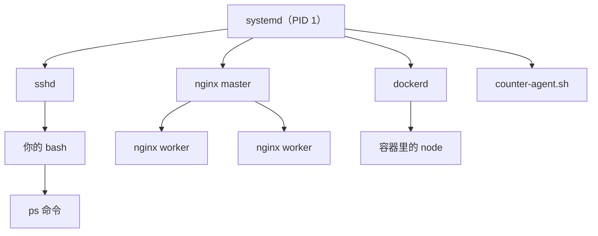
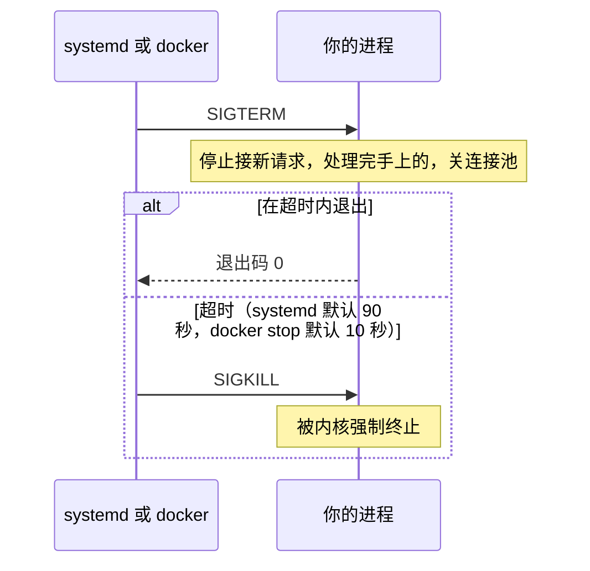

# 进程、信号与资源

服务器上的一切都在以进程的形式运行：nginx、Postgres、Docker、你的 Node 服务，还有你此刻登录用的 Shell。这一章讲进程是怎么来的、怎么查看、怎么用信号控制它们，以及 CPU、内存这两样最常见的资源怎么看懂。读完你应该能回答三个问题：这台机器上跑着什么？为什么 `kill` 了还不死？内存真的不够了吗？

## 进程是什么

**进程是一个正在运行的程序实例**。同一个程序 `/usr/bin/node` 可以同时跑好几个进程，每个进程有自己的：

- **PID**：进程号，唯一标识
- **PPID**：父进程号
- 内存空间、打开的文件、当前目录、环境变量
- 运行身份：UID / GID（第 2 章讲的权限检查就看它）

### 进程树

Linux 上所有进程都由父进程创建，最顶端是 PID 1。在 Ubuntu / Debian 上，PID 1 就是 systemd（第 4 章的主角）。

```bash
pstree -p | head -30     # 以树形查看
ps -ef --forest          # 同上，ps 版本
```



### fork 与 exec

创建进程分两步，这是 Unix 最经典的设计：

1. **fork**：复制一份当前进程，得到一个几乎一样的子进程
2. **exec**：子进程把自己替换成另一个程序

第 1 章说 Shell 执行外部命令时「fork 子进程并 exec 程序」，就是这个过程。子进程继承父进程的环境变量、打开的文件和当前目录，这解释了很多现象：在 Shell 里 `export` 的变量能被之后启动的程序看到，但子进程改不了父进程的变量。

### 进程状态

`ps` 和 `top` 里有一列 STAT / S 表示进程状态：

| 状态 | 含义 | 说明 |
|---|---|---|
| `R` | 运行中或等待 CPU | |
| `S` | 可中断睡眠 | 绝大多数进程都在这个状态：等网络、等输入 |
| `D` | 不可中断睡眠 | 通常在等磁盘 I/O，`kill -9` 也杀不掉，只能等 |
| `T` | 被暂停 | 按了 `Ctrl+Z` |
| `Z` | 僵尸 | 已经退出，等父进程来「收尸」 |

大量 `D` 状态的进程通常意味着磁盘或网络存储出了问题。僵尸进程本身不占资源，只占一个 PID 槽位，问题出在它的父进程没有调用 `wait` 回收它。

## 查看进程

### ps：拍一张快照

```bash
ps aux                         # 所有进程，BSD 风格
ps aux | grep [n]ginx          # 写成 [n]ginx 可以避免匹配到 grep 自己
ps -ef                         # 所有进程，带 PPID
ps -o pid,ppid,user,%cpu,%mem,etime,cmd -p 1234   # 指定列
pgrep -a node                  # 按名字找 PID
```

`ps aux` 每列的含义：

| 列 | 含义 |
|---|---|
| USER | 以谁的身份运行 |
| PID | 进程号 |
| %CPU / %MEM | CPU、内存占用百分比 |
| VSZ | 虚拟内存大小，基本可以忽略 |
| RSS | 实际占用的物理内存（KB），看内存看这个 |
| STAT | 状态 |
| START / TIME | 启动时间 / 累计 CPU 时间 |

### top 与 htop：实时观察

```bash
top        # 系统自带
htop       # 更好用，需要 sudo apt install htop
```

`top` 里常用的按键：`P` 按 CPU 排序，`M` 按内存排序，`1` 展开每个 CPU 核，`k` 杀进程，`q` 退出。

## 信号：给进程发消息

**信号是内核通知进程「发生了某件事」的机制**。进程可以为大多数信号注册处理函数，决定收到后做什么。

| 信号 | 编号 | 默认行为 | 什么时候出现 |
|---|---|---|---|
| SIGHUP | 1 | 终止 | 终端断开；很多守护进程约定为「重新加载配置」 |
| SIGINT | 2 | 终止 | 按 `Ctrl+C` |
| SIGQUIT | 3 | 终止并转储 | 按 `Ctrl+\` |
| SIGKILL | 9 | 强制终止 | `kill -9`，**不能被捕获或忽略** |
| SIGTERM | 15 | 终止 | `kill` 的默认信号，「请你体面地退出」 |
| SIGSTOP | 19 | 暂停 | 不能被捕获 |
| SIGCONT | 18 | 继续 | |
| SIGTSTP | 20 | 暂停 | 按 `Ctrl+Z` |

```bash
kill 1234            # 发 SIGTERM
kill -HUP 1234       # 发 SIGHUP
kill -9 1234         # 发 SIGKILL，最后手段
pkill -f 'node dist/main.js'   # 按命令行匹配
killall nginx        # 按程序名
```

### 为什么要先 TERM 后 KILL

SIGTERM 给进程一个收尾的机会：Node 服务可以停止接收新请求、等正在处理的请求结束、关闭数据库连接池；Postgres 可以把数据刷到磁盘。SIGKILL 则由内核直接把进程抹掉，什么都来不及做，可能留下写了一半的文件。

正确的停止流程是：**先发 SIGTERM，等一段时间，还不退出再发 SIGKILL**。systemd 停服务、`docker stop` 都是这么做的：



所以你的服务应该处理 SIGTERM。NestJS 里调用 `app.enableShutdownHooks()` 就会在收到 SIGTERM 时触发生命周期钩子；裸 Node 可以这样写：

```ts
process.on('SIGTERM', async () => {
  server.close();          // 不再接受新连接，等已有请求结束
  await pool.end();        // 关闭数据库连接池
  process.exit(0);
});
```

### 容器里的 PID 1 问题

在容器里，你的进程往往就是 PID 1。内核对 PID 1 有特殊处理：**没有注册处理函数的信号会被忽略**。如果 Node 进程没写 SIGTERM 处理，`docker stop` 发过去它毫无反应，等满 10 秒被 SIGKILL。

另一个常见原因是用 `npm start` 或 `sh -c` 包了一层：信号发给了 npm 或 sh，它们不一定转发给真正的 Node 进程。解决办法是在 Dockerfile 里直接 `CMD ["node", "dist/main.js"]`，或者用 `docker run --init`、compose 的 `init: true` 加一个会转发信号的小 init 进程。详见[《容器技术》](../docker-containers/)。

### SIGHUP 与 nohup

SIGHUP 的本意是「终端挂断了」：ssh 断开时，Shell 会给它的子进程发 SIGHUP，默认行为是终止。所以 ssh 里直接跑的长任务会随着断线一起死掉。几种应对：

- `nohup cmd &`：忽略 SIGHUP，输出写进 `nohup.out`
- tmux / screen：进程挂在 tmux 服务端下，跟 ssh 会话无关（第 1 章）
- 真正要常驻的服务：交给 systemd（第 4 章），这才是正解

## 前台、后台与作业控制

```bash
long-task &          # 放到后台运行
jobs                 # 列出当前 Shell 的后台作业
fg %1                # 把 1 号作业拉回前台
# 前台运行时按 Ctrl+Z 暂停，再输入 bg 让它在后台继续
```

这套作业控制只在当前 Shell 里有效，适合临时用。

## 退出码

每个进程结束时都会返回一个 0–255 的**退出码**：0 表示成功，非 0 表示失败。

```bash
ls /nonexistent
echo $?              # 上一条命令的退出码，这里是 2
```

几个约定俗成的值：

| 退出码 | 含义 |
|---|---|
| 0 | 成功 |
| 1 | 一般错误 |
| 126 | 找到了命令但不能执行（通常是没有 x 权限） |
| 127 | 找不到命令 |
| 128 + N | 被信号 N 杀死：130 = Ctrl+C（2），137 = SIGKILL（9），143 = SIGTERM（15） |

**137 是最值得记住的一个**。容器或服务莫名退出、退出码 137，十有八九是被 OOM Killer 杀掉了，或者被 `docker stop` 超时强杀了。

## CPU 与负载

### load average

```bash
uptime
# 10:21:07 up 34 days,  2:11,  1 user,  load average: 0.52, 0.61, 0.58
```

三个数是过去 1、5、15 分钟的**平均负载**：平均有多少个进程处于「正在运行、等待 CPU，或者在不可中断睡眠」的状态。

怎么判断高不高？要和 CPU 核数比：

```bash
nproc                # CPU 核数
```

- 负载约等于核数：CPU 刚好跑满
- 负载远高于核数：有进程在排队
- 负载高但 `top` 里 CPU 使用率很低：多半是大量进程卡在 `D` 状态等磁盘 I/O

Linux 的负载把 `D` 状态也算进去了，所以它反映的不只是 CPU 压力。三个数的趋势也有用：1 分钟远高于 15 分钟，说明问题刚开始。

### top 第三行

```text
%Cpu(s):  12.3 us,  2.1 sy,  0.0 ni, 84.9 id,  0.5 wa,  0.0 hi,  0.2 si,  0.0 st
```

| 字段 | 含义 | 高了说明 |
|---|---|---|
| us | 用户态 | 程序自己在算，比如 Node 在跑业务逻辑 |
| sy | 内核态 | 系统调用多，比如大量小 I/O、网络包 |
| id | 空闲 | |
| wa | 等待 I/O | 磁盘慢或者读写量太大 |
| st | 被宿主机偷走 | 云服务器的物理机超卖，买的机器 CPU 不够 |

便宜的突发性能型云服务器上 `st` 偏高很常见。

## 内存：别被 free 吓到

```bash
free -h
```

```text
               total        used        free      shared  buff/cache   available
Mem:           3.8Gi       1.4Gi       0.3Gi        12Mi       2.1Gi       2.2Gi
Swap:          2.0Gi          0B       2.0Gi
```

新手看到 `free` 只剩 0.3Gi 会慌，其实**看 available 就够了**。


- **used**：进程真正占用的内存
- **buff/cache**：内核拿空闲内存缓存最近读写过的文件，下次读同一个文件就不用碰磁盘。程序需要内存时，干净的缓存可以立即让出来
- **free**：完全没用的内存。Linux 的哲学是「空着的内存就是浪费」，所以 free 小是正常的
- **available**：内核估算的「新程序还能拿到多少」，约等于 free 加上可回收的缓存

真正需要担心的是 **available 持续很低，并且 swap 在被大量使用**。

### swap

swap 是磁盘上的一块空间，内存不够时把不常用的内存页换出去。小内存的云服务器（1–2G）建议加一点 swap，在偶发的内存尖峰时拿速度换不崩溃：

```bash
sudo fallocate -l 2G /swapfile
sudo chmod 600 /swapfile
sudo mkswap /swapfile
sudo swapon /swapfile
echo '/swapfile none swap sw 0 0' | sudo tee -a /etc/fstab   # 开机自动启用
swapon --show
```

`/etc/fstab` 是什么、写错了有什么后果，第 7 章讲。

### OOM Killer

当内存和 swap 都耗尽时，内核会启动 **OOM Killer**，按一套评分挑一个进程杀掉（通常是占内存最多的那个）来保住系统。它发的是 SIGKILL，进程毫无准备。

```bash
sudo dmesg -T | grep -i -E 'killed process|out of memory'
journalctl -k | grep -i oom
```

看到 `Out of memory: Killed process 2345 (node)`，就找到了服务莫名其妙重启的原因。应对思路：

- 查清是泄漏还是真的不够用（看内存是否随时间单调上涨）
- 给 Node 设置堆上限，比如 `node --max-old-space-size=1024`，让它自己先报错
- 给容器或 systemd 服务设内存上限（第 4 章的 `MemoryMax=`），让失控的那一个先被限制，而不是随机殃及 Postgres

## 资源限制：ulimit

每个进程还受一组资源上限约束，最常碰到的是**最多能打开多少个文件描述符**。每个网络连接、每个打开的文件都占一个描述符，高并发服务会撞到上限，报 `EMFILE: too many open files`。

```bash
ulimit -n                          # 当前 Shell 的上限
cat /proc/$(pgrep -o nginx)/limits # 看某个运行中进程的实际上限
```

注意，`ulimit` 和 `/etc/security/limits.conf` 只对登录会话生效，**对 systemd 启动的服务无效**。服务的上限要写在 unit 文件里的 `LimitNOFILE=`，第 4 章讲。

## 本章要点

- 进程由父进程 fork + exec 创建，PID 1 是 systemd；`D` 状态等 I/O，`Z` 是没被回收的僵尸
- `kill` 默认发 SIGTERM 让进程体面退出，SIGKILL 不可捕获；服务要处理 SIGTERM
- 容器里进程是 PID 1，不注册处理就收不到 SIGTERM；不要用 `npm start` 包一层
- 退出码 137 = 被 SIGKILL，常见于 OOM 或停止超时；`dmesg` 里能找到 OOM 记录
- 负载要和 `nproc` 比，负载高 CPU 低看 `wa` 和 `D` 状态
- 内存看 `available` 不看 `free`，缓存是可回收的；小内存机器加 swap

## 动手练习

1. **从退出码认出信号**：在 bash 里执行 `sleep 300 & kill $!; wait $!; echo $?`，再执行 `sleep 300 & kill -9 $!; wait $!; echo $?`。

   验证：第一次输出 `143`，第二次输出 `137`。

   参考答案：被信号 N 杀死的进程退出码是 128 + N，SIGTERM 是 15，SIGKILL 是 9。以后看到容器退出码 137，先想到 SIGKILL。

2. **容器里的 PID 1 不理 SIGTERM**：执行 `docker run -d --name p1 node:22-alpine node -e 'setInterval(()=>{},1000)'`，再 `time docker stop p1`；删掉容器后加上 `--init` 重做一遍（容器名换成 `p2`）。

   验证：第一次 `docker stop` 大约耗时 10 秒，`docker inspect -f '{{.State.ExitCode}}' p1` 是 `137`；加 `--init` 后几乎立刻返回，退出码是 `143`。做完 `docker rm p1 p2`。

   参考答案：Node 没注册 SIGTERM 处理，作为 PID 1 时内核把信号忽略，只能等超时被 SIGKILL。`--init` 让 tini 当 PID 1 并转发信号，Node 不是 PID 1，SIGTERM 按默认行为终止它。

3. **复现一次 OOM**：执行 `docker run --name oom -m 128m node:22-alpine node -e 'const a=[];setInterval(()=>a.push(Buffer.alloc(1e7,1)),50)'`，等它自己退出。

   验证：`docker inspect -f '{{.State.OOMKilled}} {{.State.ExitCode}}' oom` 输出 `true 137`。做完 `docker rm oom`。

   参考答案：进程不断申请并写入内存，超过容器的 cgroup 上限后被内核 OOM Killer 用 SIGKILL 杀掉。在 Linux 宿主上还可以用 `sudo dmesg -T | grep -i oom` 看到对应记录。
