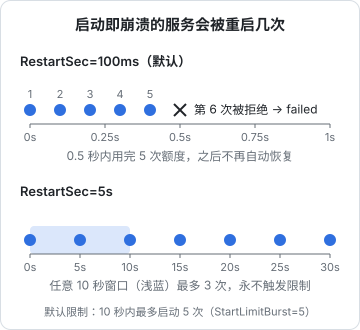
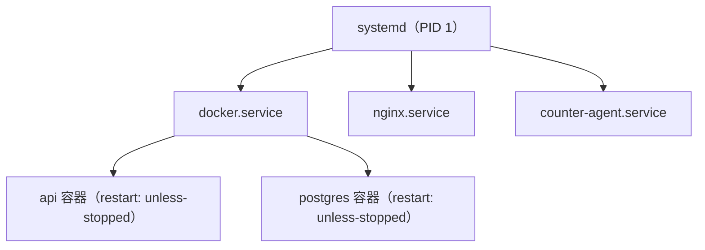

# systemd 与服务管理

上一章说过，ssh 里直接跑的进程会随断线一起死掉，`nohup` 和 tmux 也只是权宜之计。一个真正的线上服务需要：开机自动启动、挂了自动拉起、日志有地方存、能按顺序等依赖就绪、能限制它吃多少资源。在现代 Linux 上，这些都由 **systemd** 负责。这一章讲 systemd 的核心概念、日常命令，以 hatch-counter 的真实 unit 为例拆解配置，再写一个带安全加固的 Node 服务和一个替代 cron 的定时任务。

## systemd 是什么

systemd 是 Ubuntu、Debian、RHEL 系等主流发行版的 **PID 1**，内核启动后运行的第一个用户态进程。它的职责远不止「启动」：

- **服务管理**：启动、停止、重启服务，挂了按策略拉起
- **依赖与顺序**：网络就绪后再起 nginx，Docker 起来后再起依赖它的服务
- **日志**：服务的 stdout / stderr 自动进 journald（第 5 章）
- **资源控制**：每个服务一个 cgroup，可以限制 CPU、内存
- **定时任务、挂载、套接字激活**等

在 systemd 之前，服务靠 `/etc/init.d/` 下的一堆 Shell 脚本启动，每个脚本自己处理 PID 文件、后台化、重启逻辑，各写各的。systemd 把这些统一成声明式的配置文件，你只描述「要什么」，怎么做交给它。

## unit：一切皆单元

systemd 管理的每样东西叫一个 **unit**，用后缀区分类型：

| 类型 | 后缀 | 管什么 | 例子 |
|---|---|---|---|
| service | `.service` | 一个进程或一组进程 | `nginx.service`、`docker.service` |
| timer | `.timer` | 定时触发另一个 unit | `apt-daily.timer` |
| target | `.target` | 一组 unit 的同步点，类似「运行级别」 | `multi-user.target`、`network-online.target` |
| socket | `.socket` | 监听套接字，有连接时再启动服务 | `docker.socket` |
| mount | `.mount` | 挂载点 | 由 `/etc/fstab` 自动生成 |
| path | `.path` | 监视文件变化 | |

### unit 文件放在哪

| 目录 | 谁写的 | 优先级 |
|---|---|---|
| `/usr/lib/systemd/system/` | 软件包自带，`apt` 升级会覆盖 | 低 |
| `/etc/systemd/system/` | 管理员（你）写的 | 高 |
| `/run/systemd/system/` | 运行时生成，重启消失 | 中 |

规则很简单：**自己写的 unit 放 `/etc/systemd/system/`，永远不要改 `/usr/lib` 下的文件**，想改软件包自带的配置用下面讲的 drop-in。

## 日常命令

```bash
systemctl status nginx          # 状态、PID、最近几行日志
sudo systemctl start nginx      # 启动
sudo systemctl stop nginx       # 停止
sudo systemctl restart nginx    # 重启（先停再起，有短暂中断）
sudo systemctl reload nginx     # 重新加载配置，不中断服务（需服务支持）
sudo systemctl enable nginx     # 开机自启
sudo systemctl enable --now x   # 开机自启并立即启动
sudo systemctl disable x        # 取消开机自启
systemctl is-active x           # 只输出 active / inactive，适合脚本判断
systemctl list-units --type=service --state=running
systemctl --failed              # 列出失败的 unit，排障第一步
systemctl cat nginx             # 看 unit 文件的完整内容（含 drop-in）
sudo systemctl daemon-reload    # 改了 unit 文件之后必须执行
```

两组最容易混淆的概念：

- **start 和 enable 是两回事**：start 是「现在启动」，enable 是「开机时启动」。只 start 不 enable，重启机器后服务就没了；只 enable 不 start，要等下次重启才会跑。新服务一般用 `enable --now` 一步到位
- **restart 和 reload**：restart 会杀掉进程再起，正在处理的连接会断；reload 让进程自己重读配置（nginx 收到 SIGHUP 后平滑换 worker）。改 nginx 配置应该 `nginx -t && systemctl reload nginx`

### 读懂 status

```text
● counter-agent.service - counter 上线代理
     Loaded: loaded (/etc/systemd/system/counter-agent.service; enabled; preset: enabled)
     Active: active (running) since Mon 2026-11-02 09:12:03 CST; 3h ago
   Main PID: 1234 (agent.sh)
      Tasks: 2 (limit: 4557)
     Memory: 3.1M
        CPU: 1.204s
     CGroup: /system.slice/counter-agent.service
             ├─1234 /bin/bash /srv/counter/agent.sh
             └─5678 sleep 15
```

- **Loaded** 一行：unit 文件在哪、是否 `enabled`
- **Active** 一行：当前状态和持续时间。`failed` 就是挂了，`activating (auto-restart)` 是正在等待重启
- **CGroup**：这个服务下的所有进程，包括它 fork 出来的子进程

status 下面还会附几行最近的日志，看完整日志用 `journalctl -u counter-agent`（第 5 章）。

## 拆解一个真实的 unit

hatch-counter 线上机器有一个常驻的「上线代理」：一个 Bash 脚本，每 15 秒检查一次是否有前端新版本，有就下载、校验、切软链。它就是由 systemd 管的，unit 文件不到 15 行（这里改了名字和路径）：

```ini
[Unit]
Description=counter 上线代理（读下载桶里的指针，切静态站的版本）
After=docker.service network-online.target
Wants=network-online.target

[Service]
ExecStart=/srv/counter/agent.sh
Restart=always
RestartSec=5

[Install]
WantedBy=multi-user.target
```

逐段来看。

### [Unit]：描述与依赖

- `Description`：出现在 `status` 和日志里的名字
- `After=`：**只管顺序**，如果这些 unit 也要启动，等它们启动完再启动我。它不会主动拉起 docker
- `Wants=`：**只管拉起**，启动我的时候顺便把 `network-online.target` 也启动，但它失败了我照样启动

`After` 和 `Wants` 经常要成对出现：`Wants=network-online.target` 负责把「等网络真正可用」这个目标拉起来，`After=network-online.target` 负责排在它后面。只写 `After` 而没人拉起这个 target，就等于什么都没等。

还有一个更强的 `Requires=`：依赖的 unit 失败或停止时，我也跟着停。大部分场景用 `Wants` 就够了，`Requires` 容易产生连锁停机。

| 指令 | 拉起依赖 | 决定顺序 | 依赖挂了我也停 |
|---|---|---|---|
| `Wants=` | 是 | 否 | 否 |
| `Requires=` | 是 | 否 | 是 |
| `After=` | 否 | 是 | 否 |

### [Service]：怎么运行

- `ExecStart=`：启动命令，**必须是绝对路径**。systemd 不经过 Shell，所以 `|`、`>`、`&&` 都不能直接用；需要 Shell 语法就写进脚本里，或者 `ExecStart=/bin/bash -c '...'`
- `Restart=always`：不管怎么退出（包括退出码 0）都重启。对一个「应该永远在跑」的常驻循环脚本，这是对的
- `RestartSec=5`：重启前等 5 秒。默认只等 100 毫秒，下面会看到这会带来什么问题

原文件里还有一句注释说明为什么这个服务以 root 运行：它要写 `/srv/counter` 下的网页目录，能做什么由脚本里的几道白名单约束。这是一种取舍，更常见的做法是指定 `User=` 降权，后面的例子会写。

### [Install]：enable 时挂到哪

`WantedBy=multi-user.target` 的意思是：执行 `systemctl enable` 时，在 `multi-user.target` 的依赖里加上我。`multi-user.target` 是服务器正常启动后到达的状态，所以效果就是「开机自启」。

enable 本质上只是建了一个软链：

```bash
ls -l /etc/systemd/system/multi-user.target.wants/
```

### 装上它

```bash
sudo cp counter-agent.service /etc/systemd/system/
sudo systemctl daemon-reload
sudo systemctl enable --now counter-agent
systemctl status counter-agent
```

## 重启策略与启动频率限制

`Restart=` 有几个取值：

| 取值 | 什么时候重启 | 适合 |
|---|---|---|
| `no` | 从不（默认） | 一次性任务 |
| `on-failure` | 非 0 退出、被信号杀死、超时 | 大多数 Web 服务 |
| `always` | 任何退出 | 常驻循环脚本 |

光有 `Restart=` 还不够。systemd 还有一个保护机制：**启动频率限制**。默认在 10 秒内（`StartLimitIntervalSec=10s`）启动超过 5 次（`StartLimitBurst=5`），systemd 就判定这个服务「坏了」，不再拉起，状态变成 `failed`，日志里出现 `Start request repeated too quickly`。

它和 `RestartSec` 一起决定了一个一启动就崩溃的服务会怎样：



- 默认的 100 毫秒间隔下，半秒之内就把 5 次额度用完，服务停在 `failed`，再也不会自己恢复
- `RestartSec=5` 时，任意 10 秒内最多启动 3 次，永远触发不了限制，服务会一直重试

哪种更好要看场景。依赖的数据库暂时连不上、网络还没好，这类「等一会儿就好」的故障，较长的 `RestartSec` 能让服务自己恢复；配置写错这类「怎么重启都没用」的故障，无限重试只会刷屏日志。一个常见的折中是在 `[Unit]` 里放宽限制：

```ini
[Unit]
StartLimitIntervalSec=300
StartLimitBurst=10

[Service]
Restart=on-failure
RestartSec=5
```

服务进入 `failed` 后，修好问题要先清掉计数再启动：

```bash
sudo systemctl reset-failed myapp
sudo systemctl start myapp
```

## 写一个 Node 服务的 unit

hatch-counter 的 API 跑在 Docker 里，但很多小项目直接用 systemd 跑 Node 更简单。下面是一个带合理默认值和安全加固的完整例子：

```ini
# /etc/systemd/system/myapp.service
[Unit]
Description=myapp API
After=network-online.target postgresql.service
Wants=network-online.target

[Service]
Type=exec
User=myapp
Group=myapp
WorkingDirectory=/srv/myapp/current
EnvironmentFile=/srv/myapp/app.env
Environment=NODE_ENV=production
ExecStart=/usr/bin/node dist/main.js
Restart=on-failure
RestartSec=5

# 给优雅退出留时间：先 SIGTERM，30 秒后还没退再 SIGKILL
TimeoutStopSec=30

# 资源限制
LimitNOFILE=65536
MemoryMax=1G

# 安全加固
NoNewPrivileges=yes
PrivateTmp=yes
ProtectSystem=strict
ProtectHome=yes
ReadWritePaths=/srv/myapp/data

[Install]
WantedBy=multi-user.target
```

几个要点：

- **`User=` 降权**：用第 2 章建的系统用户 `myapp` 跑，即使服务被攻破，攻击者也只有这个用户的权限
- **`Type=exec`**：进程 exec 成功就算启动成功。如果程序会调用 `sd_notify` 告诉 systemd「我准备好了」，用 `Type=notify` 更准确；老式的会自己 fork 到后台的程序用 `Type=forking`；跑完就退出的脚本用 `Type=oneshot`
- **`EnvironmentFile=`**：从文件读环境变量，格式是每行 `KEY=value`。把密钥放在单独的文件里，权限设成 600，unit 文件本身就可以放心地提交进仓库
- **`LimitNOFILE=`**：第 3 章说过，`ulimit` 对 systemd 服务无效，要在这里设
- **`MemoryMax=`**：基于 cgroup 的内存上限，超过后只在这个服务内部触发 OOM，不会波及其他进程
- **`ProtectSystem=strict`**：整个文件系统对这个服务只读，只有 `ReadWritePaths=` 列出的目录可写。服务被攻破也改不了系统文件

`ExecStart` 里的 `/usr/bin/node` 要换成你实际的路径（`command -v node`）。如果 Node 是用 nvm 装在家目录里的，`ProtectHome=yes` 会让服务找不到它，服务器上建议用系统级的安装方式。

systemd 自带一个评估工具，能给每个服务的加固程度打分并列出可以加的选项：

```bash
systemd-analyze security myapp
```

## drop-in：不改原文件也能覆盖配置

想给 apt 装的 nginx 加个 `LimitNOFILE`，不要去改 `/usr/lib/systemd/system/nginx.service`，下次升级就被覆盖了。用 `systemctl edit`：

```bash
sudo systemctl edit nginx
```

它会打开编辑器，内容保存到 `/etc/systemd/system/nginx.service.d/override.conf`，并自动 `daemon-reload`：

```ini
[Service]
LimitNOFILE=65536
```

drop-in 里的配置会合并到原 unit 上。有一个例外要注意：`ExecStart=` 这类可以出现多次的指令是**追加**，要替换必须先写一个空值清掉：

```ini
[Service]
ExecStart=
ExecStart=/usr/sbin/nginx -g 'daemon on; master_process on;' -c /etc/nginx/custom.conf
```

`systemctl cat nginx` 会把原文件和所有 drop-in 一起显示出来，排查「配置到底生效没有」时很有用。

## timer：替代 cron

定时任务传统上用 cron，systemd 提供了 timer 作为替代。相比 cron，timer 的好处是：

- 输出自动进 journald，不用自己重定向日志
- 机器关机时错过的任务，开机后可以补跑（`Persistent=true`）
- 可以设随机延迟，避免多个任务同一时刻挤在一起
- 能用 `systemctl` 统一查看、手动触发

以每天凌晨备份数据库为例。timer 需要两个文件：一个 `.service` 描述做什么，一个同名的 `.timer` 描述什么时候做。

```ini
# /etc/systemd/system/pg-backup.service
[Unit]
Description=备份 Postgres
After=docker.service
Requires=docker.service

[Service]
Type=oneshot
ExecStart=/srv/counter/backup.sh
```

```ini
# /etc/systemd/system/pg-backup.timer
[Unit]
Description=每天凌晨备份 Postgres

[Timer]
OnCalendar=*-*-* 03:30:00
RandomizedDelaySec=10min
Persistent=true

[Install]
WantedBy=timers.target
```

注意 enable 的是 **timer** 而不是 service：

```bash
sudo systemctl daemon-reload
sudo systemctl enable --now pg-backup.timer
systemctl list-timers                     # 所有 timer，下次和上次触发时间
sudo systemctl start pg-backup.service    # 立即手动跑一次，验证脚本
journalctl -u pg-backup.service           # 看备份的输出
```

`OnCalendar` 的写法拿不准时，用 `systemd-analyze` 验证：

```bash
systemd-analyze calendar 'Mon..Fri 09:00'
systemd-analyze calendar '*-*-* 03:30:00' --iterations=3
```

`backup.sh` 的写法见第 8 章。

## systemd 与 Docker

hatch-counter 的 API 和 Postgres 跑在 Docker Compose 里，它们和 systemd 是什么关系？



- systemd 管 `docker.service`，Docker 守护进程开机自启
- 容器的重启由 Docker 自己负责，靠 compose 文件里的 `restart: unless-stopped`
- **不要再用 systemd 包一层去重启容器**：两个监管者各管各的，容易打架。`docker compose up -d` 起来的容器，交给 Docker 的重启策略就好

nginx 装在宿主机上、由 systemd 管，而不是放进 compose，hatch-counter 的考虑是：证书续期工具 certbot 装在宿主机上，续期后执行一句 `systemctl reload nginx` 就完成了，放进容器反而要自己拼接这套流程。

## 本章要点

- systemd 是 PID 1，负责服务的启动、依赖、重启、日志和资源控制，配置是声明式的 unit 文件
- 自己的 unit 放 `/etc/systemd/system/`，改完 `daemon-reload`；改软件包的配置用 `systemctl edit` 写 drop-in
- start 是现在启动，enable 是开机启动；新服务用 `enable --now`
- `Wants` 管拉起、`After` 管顺序，常成对使用
- 默认 10 秒内启动超过 5 次会被判定失败；`RestartSec` 太短会让服务很快停在 `failed`
- 生产服务用 `User=` 降权，`EnvironmentFile=` 放密钥，`LimitNOFILE=` 和 `MemoryMax=` 限资源，`ProtectSystem=strict` 加固
- timer 比 cron 多了日志、补跑和统一管理；容器的重启交给 Docker，不要重复监管
