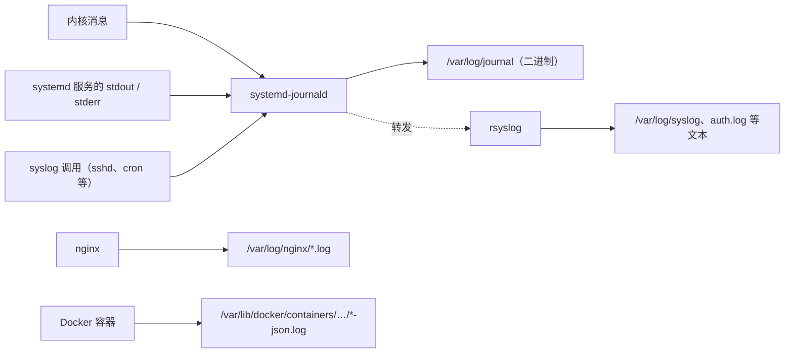

# journald 与日志

服务出了问题，第一件事永远是看日志。但 Linux 上的日志散落在好几个地方：journald、`/var/log` 下的文本文件、Docker 容器的日志、应用自己写的文件。这一章先理清日志从哪来、到哪去，然后把 `journalctl` 的常用查询练熟，再讲日志怎么持久化、怎么防止把磁盘写满，最后给应用日志的写法建议。

## 日志从哪来、到哪去

在一台 Ubuntu / Debian 服务器上，日志大致这样流动：



- **journald** 是 systemd 的日志组件，收集内核消息、所有 systemd 服务的输出、以及走 syslog 接口的程序日志，存成带索引的二进制格式
- **rsyslog** 是传统的文本日志服务。Ubuntu 默认仍然安装它，所以你能看到 `/var/log/syslog`；Debian 12 起默认不再安装，只用 journald
- 有些程序自己写日志文件，最常见的是 **nginx**，写在 `/var/log/nginx/`
- **Docker 容器**的 stdout / stderr 默认由 Docker 收集，存成 JSON 文件

记住一条：**systemd 管的服务，日志就去 journald 找**；nginx 看自己的文件；容器用 `docker logs`。

## journalctl：查询 journald

journald 的优势在于结构化：每条日志都带着来源服务、PID、优先级、时间等字段，可以精确过滤，而不是对着大文本文件 `grep`。

### 最常用的几条

```bash
journalctl -u nginx                 # 某个服务的全部日志
journalctl -u nginx -n 100          # 最近 100 条
journalctl -u counter-agent -f      # 持续跟踪，等于 tail -f
journalctl -u nginx -u docker       # 多个服务合在一起，按时间交错
journalctl -e                       # 直接跳到末尾
```

`journalctl` 默认用 `less` 分页，按 `G` 到末尾、`/` 搜索、`q` 退出。想直接输出到终端或交给管道，加 `--no-pager`。

### 按时间过滤

```bash
journalctl -u myapp --since '10 min ago'
journalctl -u myapp --since today
journalctl -u myapp --since '2026-11-02 09:00' --until '2026-11-02 10:00'
journalctl -b                       # 本次开机以来
journalctl -b -1                    # 上一次开机（需要持久化，见下文）
journalctl --list-boots             # 列出所有记录在案的开机
```

`-b -1` 在排查「机器半夜自己重启了」时非常有用：看上一次开机最后几分钟发生了什么。

### 按优先级过滤

每条日志有一个 syslog 优先级，从 0（emerg）到 7（debug）：

| 级别 | 名字 | 含义 |
|---|---|---|
| 0 | emerg | 系统不可用 |
| 1 | alert | 必须马上处理 |
| 2 | crit | 严重 |
| 3 | err | 错误 |
| 4 | warning | 警告 |
| 5 | notice | 值得注意的正常事件 |
| 6 | info | 信息 |
| 7 | debug | 调试 |

```bash
journalctl -p err -b                # 本次开机以来所有 err 及更严重的
journalctl -p warning -u myapp      # 某服务的 warning 及以上
```

服务写到 stderr 的内容默认记为 err 级别（3），stdout 记为 info（6）。

### 内核日志

```bash
journalctl -k                       # 内核消息，等价于 dmesg 但带完整时间
journalctl -k -b | grep -i -E 'oom|error|fail'
```

第 3 章的 OOM Killer 记录、第 7 章的磁盘 I/O 错误，都在内核日志里。

### 按字段与内容过滤

```bash
journalctl _PID=1234                # 某个进程
journalctl _UID=1000                # 某个用户的进程
journalctl -t sshd                  # 按 syslog 标识
journalctl -u myapp -g 'timeout|ECONNREFUSED'   # 按正则过滤消息内容
```

### 输出格式

```bash
journalctl -u myapp -o cat          # 只要消息本身，不要时间和主机名前缀
journalctl -u myapp -o json-pretty -n 1   # 看一条日志的全部字段
journalctl -u myapp -o short-iso    # ISO 格式时间
```

如果你的应用输出 JSON 格式的日志，`-o cat` 配合 `jq` 就能做结构化分析：

```bash
journalctl -u myapp -o cat --since '1 hour ago' | jq -r 'select(.level >= 50) | .msg'
```

### 不用 sudo 看日志

普通用户默认只能看自己进程的日志。把日常用户加进 `systemd-journal` 组（Ubuntu 上 `adm` 组也可以），就能看到所有日志：

```bash
sudo usermod -aG systemd-journal deploy
# 重新登录后生效
```

## 一个真实的排障场景

hatch-counter 的前端发版流水线有一步「上线并验首页」，红了的时候，部署文档给的排查方法就是两条命令：

```bash
systemctl status counter-agent
journalctl -u counter-agent -n 50
```

第一条看代理是不是在跑；第二条看它最近读到了什么、切换版本时说了什么。代理脚本把每一步都打印了出来，日志读起来像这样：

```text
[09:41:02] web：指针换成 1.3.0（run 12345-1）
[09:41:02] 拉包：…/web/1.3.0/web-1.3.0.tar.gz
[09:41:03] ✓ sha256 对上了
[09:41:03] 切过去：1.2.0 → 1.3.0
[09:41:03] ✗ 本机首页里没有 assets/index-a1b2c3.js，切回 1.2.0
```

一眼就能看出：包拉下来了、校验通过了，但切换后首页内容对不上，于是自动回滚了。问题范围立刻缩小到 nginx 或缓存那一层。

这个例子说明了**写给 systemd 管的脚本，最好的日志方式就是往 stdout 打印人能读懂的步骤**。journald 会自动记录时间、服务名和 PID，不需要你自己管日志文件。这个脚本自己在行首加了时间，是因为它也会被手动在终端里执行（`./agent.sh rollback web 1.2.0`），那时候没有 journald 帮它记时间。

## 持久化与容量

### journald 存在哪

journald 的存储方式由配置项 `Storage=` 决定。默认值 `auto` 的含义是：**如果 `/var/log/journal` 目录存在就写磁盘，否则只写内存（`/run/log/journal`），重启即丢**。

```bash
ls -d /var/log/journal              # 存在就说明是持久化的
journalctl --disk-usage             # 日志占了多少空间
```

较新的 Ubuntu 和 Debian 默认已经创建了这个目录。如果你的机器上没有，或者想明确指定，用一个 drop-in 配置：

```ini
# /etc/systemd/journald.conf.d/persistent.conf
[Journal]
Storage=persistent
SystemMaxUse=1G
```

```bash
sudo systemctl restart systemd-journald
```

### 不会把磁盘写满吗

journald 自带容量控制。`SystemMaxUse=` 不设时，默认上限是所在文件系统的 10%，并且不超过 4G。小硬盘的云服务器上，明确设一个上限更放心。

手动清理：

```bash
sudo journalctl --vacuum-size=500M  # 只保留最近 500M
sudo journalctl --vacuum-time=2weeks
```

**不要直接 `rm` `/var/log/journal` 下的文件**，用 `--vacuum-*` 让 journald 自己处理。

## /var/log 下的文本日志

即使有了 journald，`/var/log` 下这几个文件仍然值得知道：

| 文件 | 内容 |
|---|---|
| `/var/log/syslog` | 系统通用日志（Ubuntu，rsyslog 写入） |
| `/var/log/auth.log` | 登录、sudo、ssh 认证记录，查谁登录过、有没有人在暴力破解 |
| `/var/log/kern.log` | 内核消息 |
| `/var/log/nginx/access.log`、`error.log` | nginx 访问和错误日志 |
| `/var/log/apt/history.log` | apt 装过、升级过、删过什么，第 6 章会用到 |
| `/var/log/dpkg.log` | 更底层的包操作记录 |
| `/var/log/unattended-upgrades/` | 自动安全更新的日志 |

```bash
sudo grep 'Failed password' /var/log/auth.log | tail       # 暴力破解尝试
sudo tail -f /var/log/nginx/error.log
```

没装 rsyslog 的 Debian 上没有 `auth.log`，同样的信息用 `journalctl -u ssh` 查。

## logrotate：文本日志的轮转

journald 自己管容量，但 nginx 这类自己写文件的程序，日志会无限增长。**logrotate** 负责定期把日志文件改名归档、压缩、删除旧的。在较新的 Ubuntu / Debian 上它由 `logrotate.timer` 每天触发一次。

软件包会在 `/etc/logrotate.d/` 下放自己的配置。nginx 的大致是这样：

```text
/var/log/nginx/*.log {
    daily
    missingok
    rotate 14
    compress
    delaycompress
    notifempty
    create 0640 www-data adm
    sharedscripts
    postrotate
        invoke-rc.d nginx rotate >/dev/null 2>&1
    endscript
}
```

| 指令 | 含义 |
|---|---|
| `daily` / `weekly` | 轮转频率 |
| `rotate 14` | 保留 14 份旧日志 |
| `compress` / `delaycompress` | 旧日志 gzip 压缩，最近一份先不压，方便查看 |
| `missingok` / `notifempty` | 文件不存在不报错，空文件不轮转 |
| `create 0640 www-data adm` | 轮转后新建文件的权限和属主 |
| `postrotate` | 轮转后执行的命令，通常是通知程序重新打开日志文件 |

### 为什么需要 postrotate

第 2 章讲过，文件名只是目录项。logrotate 把 `access.log` 改名成 `access.log.1` 后，nginx 手里拿着的文件描述符**仍然指向同一个 inode**，会继续往已经改名的 `access.log.1` 里写。所以轮转后必须通知 nginx 重新打开日志文件（nginx 约定用 USR1 信号），新日志才会写进新建的 `access.log`。

如果程序不支持重新打开日志，可以用 `copytruncate`：先复制一份，再把原文件清空。代价是复制和清空之间写入的几行可能丢失。

自己的应用如果写日志文件，照着加一份配置，然后用 `-d` 试运行检查：

```bash
sudo logrotate -d /etc/logrotate.d/myapp   # 只打印会做什么，不真执行
sudo logrotate -f /etc/logrotate.d/myapp   # 强制立即轮转一次
```

## Docker 容器的日志

容器日志默认用 `json-file` 驱动，存在 `/var/lib/docker/containers/<容器 ID>/` 下，**默认不限大小**。一个日志量大的服务能慢慢把磁盘写满，而磁盘满了之后 Postgres 的表现是最难排查的那一类问题。

hatch-counter 的 compose 文件给每个服务都配了上限：

```yaml
services:
  api:
    logging:
      driver: json-file
      options: { max-size: "50m", max-file: "3" }
```

每个容器最多保留 3 个 50M 的文件，总量封顶 150M。也可以在 `/etc/docker/daemon.json` 里给所有容器设默认值：

```json
{
  "log-driver": "json-file",
  "log-opts": { "max-size": "50m", "max-file": "3" }
}
```

改 `daemon.json` 要重启 Docker，而且只对之后新建的容器生效。

查看容器日志：

```bash
docker compose logs -f --tail=100 api
docker logs --since 10m <容器名>
```

## 应用日志怎么写

结合前面的内容，给你自己的 Node 服务几条建议：

1. **写 stdout / stderr，不要自己写文件**。systemd 下进 journald，Docker 下进容器日志，轮转和容量都有人管。这也是十二要素应用的原则之一
2. **生产环境输出 JSON**。NestJS 可以接 pino 之类的日志库，一行一个 JSON 对象，`jq` 能直接分析，以后接日志平台也省事
3. **带上关联信息**：请求 ID、用户或门店 ID、耗时。出问题时才能把一次请求的所有日志串起来
4. **不要记录密钥和个人敏感信息**：密码、令牌、完整手机号不应出现在日志里。日志的访问控制通常比数据库松得多
5. **错误要带上下文**：「保存失败」没有用，「保存进货单失败：store=42，原因 ECONNREFUSED 127.0.0.1:5432」才有用

日志集中收集、指标和告警属于可观测性的范畴，详见《可观测性与性能》。

## 本章要点

- systemd 服务的日志在 journald，用 `journalctl -u <服务>` 查；nginx 看 `/var/log/nginx`；容器用 `docker logs`
- `-f` 跟踪、`-n` 最近几条、`--since` 按时间、`-p err` 按级别、`-b -1` 看上次开机、`-k` 看内核
- `Storage=auto` 下有 `/var/log/journal` 才持久化；用 `SystemMaxUse=` 和 `--vacuum-size` 控制容量
- logrotate 轮转文本日志，轮转后要通知程序重新打开文件，否则它会继续写旧 inode
- Docker 的 json-file 日志默认不限大小，务必配 `max-size` / `max-file`
- 应用日志写 stdout、用 JSON、带请求 ID、不记密钥
