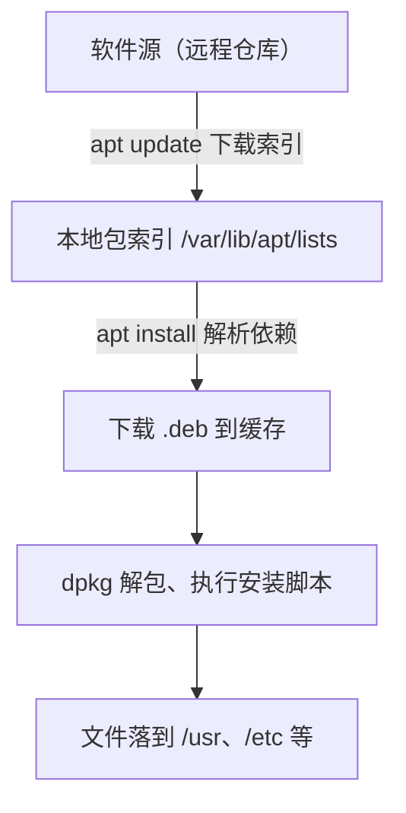

# 包管理

在 macOS 上你用 Homebrew 装工具，在项目里用 pnpm 装依赖。Linux 服务器上对应的是系统级的包管理器，Ubuntu / Debian 上是 **apt**。它不只是「装软件」，还负责依赖解析、签名校验、安全更新。这一章讲 apt 的工作原理和日常命令、怎么安全地添加第三方软件源、怎么让服务器自动打安全补丁，以及 Node 这类运行时在服务器上该怎么装。

## 包管理器解决什么问题

直接下载一个二进制扔到服务器上也能跑，为什么要用包管理器？因为它解决了几件手工很难做好的事：

- **依赖**：nginx 依赖 OpenSSL、PCRE 等一串库，包管理器自动把它们装齐，并保证版本兼容
- **可追溯**：每个文件属于哪个包、什么时候装的，都有记录，卸载时能删干净
- **签名校验**：下载的包会核对软件源的签名，防止被中间人替换
- **安全更新**：OpenSSL 出了漏洞，一条命令就能把所有用到它的程序一起修好

## apt 的结构



- **.deb**：Debian 系的软件包格式，本质是一个压缩包，里面有文件和安装前后要执行的脚本
- **dpkg**：底层工具，只负责装一个 `.deb` 文件，不管依赖、不联网
- **apt**：上层工具，负责找包、解析依赖、下载，然后调用 dpkg 安装
- **软件源**：一个按约定组织的 HTTP 目录，里面有包索引和 `.deb` 文件

`apt` 和 `apt-get` 的区别：`apt` 是面向人的交互命令，输出更友好、带进度条；`apt-get` 输出格式稳定，**写脚本时用 `apt-get`**。

## 日常命令

```bash
sudo apt update                 # 刷新包索引（不升级任何东西）
sudo apt upgrade                # 升级已安装的包，不会删除任何包
sudo apt full-upgrade           # 升级，必要时为解决依赖删除或新装包
sudo apt install nginx rsync    # 安装
sudo apt remove nginx           # 卸载，保留配置文件
sudo apt purge nginx            # 卸载并删除配置文件
sudo apt autoremove             # 删除当初作为依赖装进来、现在没人用的包
apt search postgresql           # 搜索
apt show nginx                  # 详细信息：版本、依赖、描述
apt list --installed            # 列出已安装的包
apt list --upgradable           # 列出可升级的包
```

**`update` 和 `upgrade` 是两回事**：`update` 只是把软件源上的「目录」下载到本地，`upgrade` 才真正升级。所以安装前总是先 `update`，否则可能装到旧版本，甚至因为索引过期找不到包。

在脚本或自动化里安装，要避免交互提问：

```bash
sudo DEBIAN_FRONTEND=noninteractive apt-get install -y nginx
```

Ubuntu 上装包时有时会弹出一个 needrestart 的对话框，问哪些服务要重启以加载更新过的库。按默认选项确认通常就行；在自动化脚本里可以加环境变量 `NEEDRESTART_MODE=a` 让它自动处理。

### 查询：这个文件是哪个包的

```bash
dpkg -L nginx                   # nginx 包装了哪些文件
dpkg -S /usr/sbin/nginx         # 这个文件属于哪个包
apt-cache policy nginx          # 已装版本、候选版本、来自哪个源
apt-cache rdepends --installed libssl3   # 哪些已装的包依赖它
```

`apt-cache policy` 在加了第三方源之后特别有用：它告诉你同一个包在不同源里各有什么版本、apt 会选哪一个。

### 查历史：昨天谁升级了什么

```bash
less /var/log/apt/history.log
zgrep -h 'Upgrade:' /var/log/apt/history.log* | tail
```

服务在某天之后行为变了，翻一下这里，看是不是那天自动升级了某个库。

### 锁定版本

有时你不希望某个包被自动升级，比如数据库的大版本：

```bash
sudo apt-mark hold postgresql-16
apt-mark showhold
sudo apt-mark unhold postgresql-16
```

## 软件源

### 源配置在哪

软件源的配置放在 `/etc/apt/sources.list` 和 `/etc/apt/sources.list.d/` 下。新版本逐渐改用一种叫 deb822 的格式，文件后缀是 `.sources`。Ubuntu 24.04 的官方源就在 `/etc/apt/sources.list.d/ubuntu.sources`：

```text
Types: deb
URIs: http://archive.ubuntu.com/ubuntu/
Suites: noble noble-updates noble-backports
Components: main restricted universe multiverse
Signed-By: /usr/share/keyrings/ubuntu-archive-keyring.gpg
```

| 字段 | 含义 |
|---|---|
| `URIs` | 仓库地址 |
| `Suites` | 发行版代号及其更新通道，如 `noble`（24.04）、`noble-updates`、`noble-security` |
| `Components` | 分区。Ubuntu 的 `main` 是官方支持的，`universe` 是社区维护的 |
| `Signed-By` | 用哪把公钥验证这个源的签名 |

同一个文件里通常还有第二段，`Suites` 是 `noble-security`，指向安全更新的仓库。

国内的云服务器通常已经把 `URIs` 换成了云厂商自己的镜像，下载速度快很多，不需要你再改。

### 添加第三方源

官方源里的软件版本往往偏旧，Docker、PostgreSQL、Node 等都提供自己的 apt 源。添加第三方源的现代做法是：**把公钥放进单独的 keyring 文件，用 `Signed-By` 把这把钥匙只绑定到这一个源**。

```bash
# 1. 下载软件官方提供的 GPG 公钥，存到 keyrings 目录
sudo install -m 0755 -d /etc/apt/keyrings
curl -fsSL https://example.com/apt/gpg.key | sudo gpg --dearmor -o /etc/apt/keyrings/example.gpg

# 2. 添加源，用 signed-by 指定只信任这把钥匙
echo "deb [signed-by=/etc/apt/keyrings/example.gpg] https://example.com/apt $(. /etc/os-release && echo "$VERSION_CODENAME") stable" \
  | sudo tee /etc/apt/sources.list.d/example.list

# 3. 刷新并安装
sudo apt update
sudo apt install example-package
```

这里的 `example.com` 是占位符，实际地址和公钥以各软件的官方安装文档为准。Docker Engine 的官方安装步骤就是这个形式。

为什么要绑定？旧教程里常见的 `apt-key add` 会把公钥加进全局信任列表，等于允许这个第三方签名**任何**包，包括冒充 `openssl` 的包。`apt-key` 已经被废弃，不要再用。

几条原则：

- **只添加官方文档里写的源**，不要从论坛帖子里复制来路不明的源
- 通过 `curl | bash` 安装的脚本，先下载下来读一遍再执行
- Ubuntu 的 PPA（`add-apt-repository ppa:xxx`）是个人或小团队维护的源，同样要先确认维护者可信

### 发行版代号

```bash
cat /etc/os-release
lsb_release -a
```

| 发行版 | 版本 | 代号 |
|---|---|---|
| Ubuntu | 22.04 LTS | jammy |
| Ubuntu | 24.04 LTS | noble |
| Debian | 12 | bookworm |
| Debian | 13 | trixie |

第三方源要按代号选对应的仓库。服务器建议用 **LTS 版本**，Ubuntu LTS 提供 5 年的标准支持，期间只推送安全和缺陷修复，不会突然换大版本。

## 自动安全更新

一台对公网开放的服务器，最大的风险之一是**已知漏洞没打补丁**。Ubuntu 服务器默认装了 `unattended-upgrades`，每天自动安装来自安全通道的更新：

```bash
systemctl status unattended-upgrades
cat /etc/apt/apt.conf.d/20auto-upgrades
```

```text
APT::Periodic::Update-Package-Lists "1";
APT::Periodic::Unattended-Upgrade "1";
```

两个都是 `"1"` 就表示开启。Debian 上需要手动安装并开启：

```bash
sudo apt install unattended-upgrades
sudo dpkg-reconfigure -plow unattended-upgrades
```

具体升级哪些源、要不要自动重启，在 `/etc/apt/apt.conf.d/50unattended-upgrades` 里配置。默认只升级安全更新，**不会自动重启**。

### 需要重启吗

内核或 glibc 这类底层组件的更新，必须重启才能生效。Ubuntu 会在需要时创建一个标记文件：

```bash
cat /var/run/reboot-required 2>/dev/null
cat /var/run/reboot-required.pkgs 2>/dev/null   # 哪些包要求重启
```

登录时看到 `*** System restart required ***` 就是这个意思。单机部署的服务重启意味着停机，所以挑业务低峰手动重启，比让它自动重启更可控。重启前确认所有服务都 `enable` 了（第 4 章），容器都配了 `restart: unless-stopped`。

### 大版本升级

从一个 LTS 升到下一个 LTS（比如 22.04 到 24.04）用 `do-release-upgrade`。这是有风险的操作：

- 先做好完整备份，或者给云服务器打快照
- 第三方源会被暂时禁用，升级后要逐个检查
- 对单机部署的小项目来说，**新开一台机器部署新版本再切流量**，往往比原地升级更稳妥

## 运行时怎么装：以 Node 为例

服务器上需要 Node 时，有几种选择：

| 方式 | 优点 | 缺点 |
|---|---|---|
| 发行版自带的 `nodejs` 包 | 一条命令，跟着系统更新 | 版本通常落后好几个大版本 |
| Node 官方或 NodeSource 的 apt 源 | 版本新，走 apt 管理 | 多一个第三方源 |
| 官方预编译二进制解压到 `/usr/local` | 版本完全可控，无额外源 | 升级要自己做 |
| nvm / fnm | 本地开发方便 | 装在家目录，systemd 服务用起来别扭 |
| **Docker 镜像** | 运行时跟着镜像走，宿主机什么都不用装 | 要学 Docker |

hatch-counter 选的是最后一种：宿主机上只装 nginx、certbot、rsync 和 Docker，Node 和项目依赖都在镜像里。宿主机越干净，升级系统时越不容易出问题，迁移机器时也只需要装这几样。

如果不用 Docker，推荐 apt 源或官方二进制，装好后用 corepack 启用 pnpm。Node 22、24 这两个 LTS 自带 corepack；更新的版本计划不再内置，届时需要先 `npm install -g corepack`，以 Node 官方说明为准：

```bash
node --version
sudo corepack enable
pnpm --version
```

## 其他包格式

| 工具 | 是什么 | 服务器上建议 |
|---|---|---|
| snap | Ubuntu 推的沙盒包格式，自动更新 | Ubuntu 上有些软件只提供 snap；服务端软件优先用 apt 或 Docker |
| flatpak | 主要面向桌面应用 | 服务器上基本用不到 |
| pip、npm 全局安装 | 语言级包管理器 | 不要用 `sudo pip install` 往系统 Python 里装东西，会和 apt 冲突 |

## RHEL 系的对应命令

如果遇到 Rocky、AlmaLinux、CentOS Stream 或阿里云的 Alibaba Cloud Linux，包管理器是 dnf：

| 操作 | Debian / Ubuntu | RHEL 系 |
|---|---|---|
| 刷新索引 | `apt update` | `dnf makecache`（install 时也会自动刷新） |
| 升级全部 | `apt upgrade` | `dnf upgrade` |
| 安装 | `apt install x` | `dnf install x` |
| 卸载 | `apt remove x` | `dnf remove x` |
| 文件属于哪个包 | `dpkg -S /path` | `rpm -qf /path` |
| 包里有哪些文件 | `dpkg -L x` | `rpm -ql x` |
| 底层包格式 | `.deb` | `.rpm` |
| 源配置目录 | `/etc/apt/sources.list.d/` | `/etc/yum.repos.d/` |

systemd、journald 以及本书其余大部分内容在两大家族上是通用的。

## 本章要点

- apt 负责找包、解依赖、下载，dpkg 负责安装单个 `.deb`；脚本里用 `apt-get` 加 `-y`
- `apt update` 只刷新索引，`apt upgrade` 才升级；装包前先 update
- `dpkg -S` 查文件属于哪个包，`apt-cache policy` 查版本来自哪个源，`/var/log/apt/history.log` 查升级历史
- 第三方源用独立 keyring 加 `signed-by` 绑定，不要用已废弃的 `apt-key`
- 开启 unattended-upgrades 自动打安全补丁；看到 `reboot-required` 挑低峰手动重启
- 宿主机尽量保持干净，运行时放进 Docker 镜像是单机部署的好选择

## 动手练习

装包会改系统，下面的题都在一次性容器 `docker run --rm -it ubuntu:24.04 bash` 里做，退出即丢弃。

1. **没有 update 就装不上**：容器一启动就执行 `apt-get install -y curl`；再执行 `apt-get update && apt-get install -y curl`。

   验证：第一次报 `Unable to locate package curl`；第二次装好，`tail /var/log/apt/history.log` 里有一段 `Install: curl` 的记录。

   参考答案：官方镜像为了减小体积删掉了 `/var/lib/apt/lists`，本地没有索引，apt 根本不知道有 curl 这个包。`update` 下载索引后才找得到。

2. **文件属于哪个包**：执行 `dpkg -S /usr/bin/ls` 和 `dpkg -S "$(readlink -f /bin/sh)"`，再用 `dpkg -L dash | head` 看这个包装了什么。

   验证：第一条输出以 `coreutils:` 开头，第二条以 `dash:` 开头。

   参考答案：`dpkg -S` 按文件路径反查包名。第二条顺便印证了第 1 章说的 `/bin/sh` 在 Ubuntu 上是 dash。

3. **版本从哪来、怎么锁住**：装好 curl 后执行 `apt-cache policy curl`，再 `apt-mark hold curl` 和 `apt-mark showhold`。

   验证：`policy` 输出里有 `Installed:` 和 `Candidate:` 两行，下面列出版本来自哪个源地址；`showhold` 输出 `curl`。

   参考答案：`apt-cache policy` 告诉你 apt 会从哪个源选哪个版本，加了第三方源后用它排查装错版本的问题；`hold` 让 `apt upgrade` 跳过这个包，`apt-mark unhold curl` 解除。
