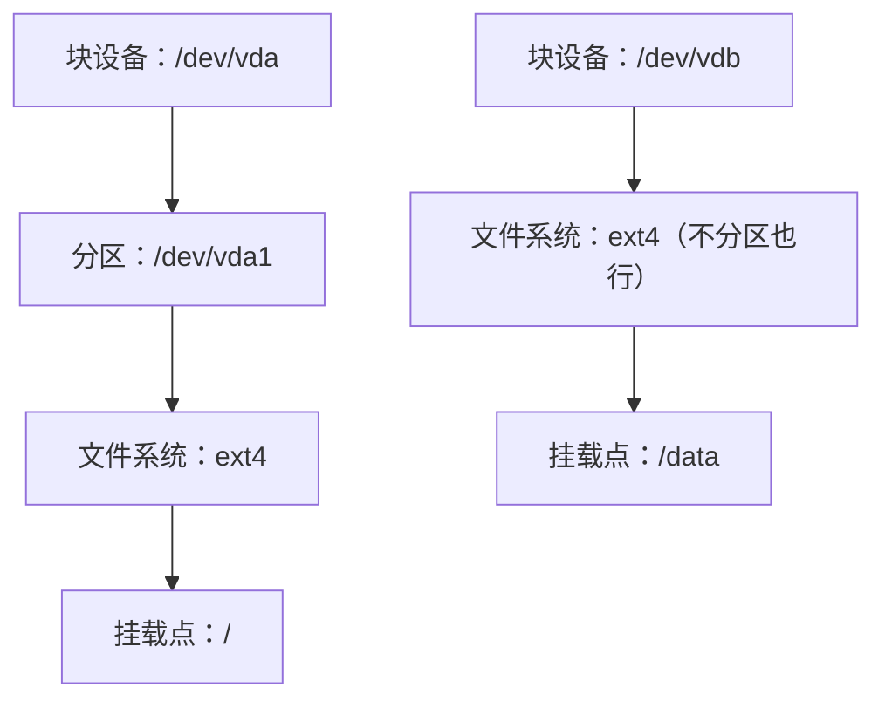
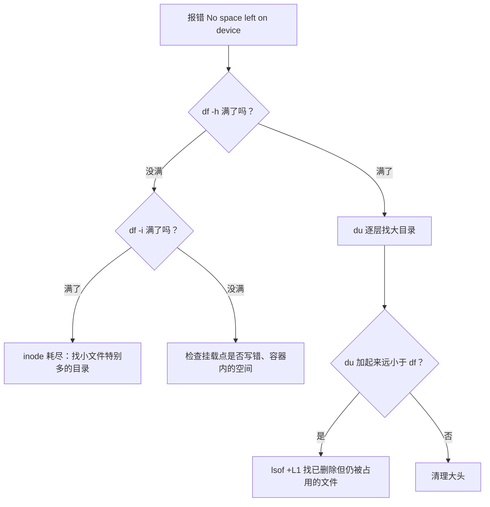

# 磁盘与挂载

「No space left on device」是服务器上最常见、后果也最乱的故障之一：日志写不进去、数据库拒绝写入、Docker 拉不下镜像，各种报错看起来毫不相关。这一章从磁盘、分区、文件系统、挂载这几层概念讲起，然后给出查空间、挂数据盘、扩容的完整步骤，最后整理磁盘写满时的排查顺序。

## 从磁盘到目录：四层概念

在 Windows 上，一块硬盘就是一个盘符。Linux 上要经过四层：



| 层 | 是什么 | 怎么看 |
|---|---|---|
| 块设备 | 内核看到的一块盘，按「块」读写 | `/dev/sda`、`/dev/vda`、`/dev/nvme0n1` |
| 分区 | 把一块盘切成几段 | `/dev/vda1`、`/dev/nvme0n1p1` |
| 文件系统 | 在一段空间上组织文件和目录的数据结构 | ext4、xfs、btrfs |
| 挂载点 | 把文件系统接到目录树上的某个目录 | `/`、`/data`、`/boot/efi` |

设备名取决于虚拟化方式：KVM 虚拟机多是 `vda`，物理 SATA 盘是 `sda`，NVMe 盘是 `nvme0n1`。

**挂载**是理解 Linux 存储的关键：第 2 章说所有东西都在 `/` 这一棵树上，其他磁盘不是独立的「盘符」，而是挂到树上的某个目录。挂上之后，访问 `/data/x` 实际上就是在读写第二块盘。

## 查看磁盘和空间

### lsblk：有哪些盘

```bash
lsblk
lsblk -f        # 带文件系统类型、UUID 和挂载点
```

```text
NAME    MAJ:MIN RM  SIZE RO TYPE MOUNTPOINTS
vda     252:0    0   40G  0 disk
├─vda1  252:1    0 39.9G  0 part /
└─vda15 252:15   0  106M  0 part /boot/efi
vdb     252:16   0  100G  0 disk
```

这里 `vdb` 是一块刚买的数据盘，还没有文件系统也没有挂载。

### df：每个文件系统用了多少

```bash
df -h           # 按挂载点显示容量
df -hT          # 加上文件系统类型
df -i           # 看 inode 用量
```

```text
Filesystem      Size  Used Avail Use% Mounted on
/dev/vda1        39G   31G  6.1G  84% /
tmpfs           1.9G     0  1.9G   0% /dev/shm
```

`tmpfs` 是内存里的文件系统，不占磁盘。只看真实磁盘可以用 `df -h -x tmpfs -x devtmpfs`。

注意 `Size` 不等于 `Used` 加 `Avail`：ext4 默认给 root 预留 5% 的空间，普通用户写满之后，root 的进程还能继续写一点，系统不至于完全瘫痪。

### du：是谁占的

`df` 告诉你盘满了，`du` 告诉你是哪个目录：

```bash
sudo du -h --max-depth=1 / 2>/dev/null | sort -h | tail
sudo du -sh /var/log /var/lib/docker
sudo du -xh --max-depth=1 / | sort -h   # -x：不跨文件系统，只统计根分区
```

逐层往下钻，很快就能找到大头。交互式的 `ncdu` 更方便：

```bash
sudo apt install ncdu
sudo ncdu -x /
```

## 挂载一块数据盘

云服务器的系统盘通常比较小，数据库、上传的文件放在单独的数据盘上有几个好处：系统盘坏了或重装时数据不受影响，数据盘可以单独扩容和打快照。

### 1. 建文件系统

确认设备名，**千万别格式化错盘**：

```bash
lsblk -f
sudo mkfs.ext4 /dev/vdb
```

`mkfs` 会清空这块盘上的所有数据。对于只当一个整体用的数据盘，直接在整块盘上建文件系统就行，不分区也可以，后面扩容更简单。

ext4 是 Ubuntu / Debian 的默认选择，成熟稳定；xfs 在大文件和高并发写入上表现好，RHEL 系默认用它。小项目用 ext4 即可。

### 2. 临时挂载试一下

```bash
sudo mkdir -p /data
sudo mount /dev/vdb /data
df -h /data
```

`mount` 命令的效果只持续到重启。

### 3. 写进 fstab，开机自动挂载

`/etc/fstab` 定义开机时挂载哪些文件系统。先查这块盘的 UUID：

```bash
sudo blkid /dev/vdb
# /dev/vdb: UUID="3f1c…" TYPE="ext4"
```

然后在 `/etc/fstab` 里加一行：

```text
UUID=3f1c...  /data  ext4  defaults,nofail  0  2
```

| 字段 | 含义 |
|---|---|
| `UUID=…` | 用 UUID 而不是 `/dev/vdb`：设备名可能在重启或加盘后变化，UUID 跟着文件系统走 |
| `/data` | 挂载点 |
| `ext4` | 文件系统类型 |
| `defaults,nofail` | 挂载选项；`nofail` 表示这块盘挂不上也继续开机 |
| `0` | dump 备份标记，现在基本不用 |
| `2` | 开机时 fsck 检查的顺序：根分区写 1，其他写 2，0 表示不检查 |

**fstab 写错会导致机器开不了机**，卡在紧急模式，云服务器上只能通过控制台的 VNC 救援。所以：

- 数据盘一定加 `nofail`
- 写完立刻验证，不要等到重启才发现：

```bash
sudo umount /data
sudo mount -a          # 按 fstab 挂载所有条目，有错误会立刻报出来
sudo findmnt --verify  # 检查 fstab 的语法和设备是否存在
df -h /data
```

`mount -a` 不报错、`df` 能看到 `/data`，才算完成。

### 4. 把数据放上去

Docker 的数据默认在系统盘的 `/var/lib/docker`，包括镜像、容器日志和命名卷。hatch-counter 的 Postgres 数据就在命名卷 `pgdata` 里，实际位置是 `/var/lib/docker/volumes/<项目名>_pgdata/`。想把 Docker 整体搬到数据盘，可以改 `/etc/docker/daemon.json`：

```json
{
  "data-root": "/data/docker"
}
```

这个改动最好在部署初期做。已有数据的机器上，要先停掉 Docker、把原目录完整复制过去（`rsync -aHAX`）、改配置、再启动，并确认容器和数据都正常后再删旧目录。

## 扩容

云服务器的磁盘可以在控制台在线扩容，但控制台改完只是块设备变大了，**分区和文件系统不会自动跟着变大**：

```bash
lsblk                                  # 确认块设备已经变大
sudo growpart /dev/vda 1               # 把 1 号分区扩到占满整块盘
sudo resize2fs /dev/vda1               # 扩展 ext4 文件系统
df -h /
```

- `growpart` 在 `cloud-guest-utils` 包里，Ubuntu 云镜像一般已经装好
- xfs 用 `sudo xfs_growfs /`，参数是挂载点而不是设备
- 直接在整块盘上建的文件系统（上面的 `/dev/vdb`）没有分区，跳过 `growpart`，直接 `resize2fs /dev/vdb`
- ext4 和 xfs 都支持**在线扩容**，不用卸载；但都不支持在线缩小，xfs 根本不能缩

扩容前给磁盘打一个快照，是便宜又有效的保险。

## 磁盘写满了怎么办

### 排查顺序



### 常见的大头

| 位置 | 是什么 | 怎么清理 |
|---|---|---|
| `/var/lib/docker` | 镜像、停止的容器、构建缓存、容器日志 | `docker system df` 先看，再 `docker image prune -a`、`docker builder prune` |
| `/var/lib/docker/containers/*/*-json.log` | 没设上限的容器日志 | 配 `max-size`（第 5 章），紧急时 `truncate -s 0` 该文件 |
| `/var/log/journal` | journald | `journalctl --vacuum-size=500M` |
| `/var/log/*.gz`、`*.1` | 轮转后的旧日志 | 确认无用后删除，调小 logrotate 的 `rotate` |
| `/var/cache/apt` | 下载过的 `.deb` | `sudo apt clean` |
| 应用的上传、备份目录 | 业务数据 | 迁到数据盘或对象存储，旧备份按策略删除 |

清理 Docker 时要小心卷：卷的清理命令删除的是**当前没有被容器使用的卷**，如果数据库容器恰好被 `docker compose down` 停掉了，它的数据卷就会被当成「没用的」。较新的 Docker（23.0 起）默认只清理匿名卷，`docker volume prune -a` 才会连命名卷一起删；旧版本则会删掉所有未使用的卷。不管哪个版本，带 `--volumes`、`-a` 的清理命令执行前都要先看清楚列表。hatch-counter 的部署脚本特意不删旧镜像（回滚要用），只在攒多了之后手动按时间清理：

```bash
docker image prune -a --filter until=720h   # 删除 30 天前的、没有容器在用的镜像
```

### 删了文件，空间却没回来

一个经典的坑：发现某个日志文件 20G，`rm` 掉了，`df` 却纹丝不动。

原因还是第 2 章讲的 inode：`rm` 删掉的只是目录项。**只要还有进程打开着这个文件，inode 和数据块就不会释放**。那个还在往日志里写的进程手里的文件描述符依然有效。

```bash
sudo lsof +L1                    # 列出已删除但仍被打开的文件
# COMMAND  PID USER FD TYPE DEVICE    SIZE/OFF NLINK NODE NAME
# node    2345 app  1w REG  252,1  21474836480     0 1234 /var/log/app.log (deleted)
```

解决办法是重启那个进程，或者通过 `/proc` 直接清空它：

```bash
sudo truncate -s 0 /proc/2345/fd/1
```

所以要清理一个正在写入的日志文件，正确做法从一开始就是 `truncate -s 0 file`（清空内容，inode 不变），而不是 `rm`。

### inode 耗尽

`df -h` 还有空间，`df -i` 却显示 100%：文件系统的 inode 用完了，通常是某个目录里堆了几百万个小文件，比如没清理的 session 文件、缓存碎片。

```bash
sudo find / -xdev -type f | cut -d/ -f2-3 | sort | uniq -c | sort -rn | head
```

这条命令按前两级目录统计文件数，找到后删掉无用的小文件即可。ext4 的 inode 数量在 `mkfs` 时就定下了，之后不能增加。

## 磁盘性能

磁盘慢的表现是第 3 章讲的：负载高、CPU 的 `wa` 高、进程处于 `D` 状态。定位用 `iostat`：

```bash
sudo apt install sysstat
iostat -xz 1
```

重点看几列：

| 列 | 含义 | 关注点 |
|---|---|---|
| `r/s`、`w/s` | 每秒读写次数（IOPS） | 和云盘规格标称的 IOPS 上限比 |
| `rkB/s`、`wkB/s` | 每秒读写量 | 和吞吐上限比 |
| `r_await`、`w_await` | 每次读写的平均耗时（毫秒） | SSD 云盘通常应在个位数毫秒 |
| `%util` | 设备忙碌时间占比 | 长期接近 100% 说明磁盘是瓶颈 |

找出是哪个进程在读写：

```bash
sudo apt install iotop
sudo iotop -o          # 只显示正在读写的进程
```

云盘的 IOPS 和吞吐通常跟容量挂钩，或者按规格档位限制。小容量的入门级云盘，被一个大查询或者一次 `docker pull` 打满并不稀奇。具体数值以云厂商的产品文档为准。

## 本章要点

- 存储分四层：块设备、分区、文件系统、挂载点；其他盘挂到目录树上，而不是独立盘符
- `lsblk` 看盘，`df -h` 看空间，`df -i` 看 inode，`du` / `ncdu` 找大目录
- 挂数据盘：`mkfs.ext4` → 写 fstab（用 UUID、加 `nofail`）→ `mount -a` 和 `findmnt --verify` 立刻验证
- 控制台扩容后还要 `growpart` 加 `resize2fs`
- 磁盘满先查 Docker、容器日志、journal；`du` 和 `df` 对不上就用 `lsof +L1` 找已删除仍被占用的文件
- 清空正在写的日志用 `truncate -s 0`，不要 `rm`；清理 Docker 卷之前看清列表，别误删停着的数据库卷

## 动手练习

**不要在真实服务器上写满磁盘**。下面的题都在一次性的特权容器里，用内存文件系统 tmpfs 模拟一块小盘：`docker run --rm -it --privileged ubuntu:24.04 bash`，进去后执行 `mkdir -p /mnt/d && mount -t tmpfs -o size=20m tmpfs /mnt/d`。退出容器一切消失。

1. **写满再排查**：执行 `dd if=/dev/zero of=/mnt/d/fill bs=1M`，等它自己停下；然后按本章的排查顺序找出元凶。

   验证：`dd` 以 `No space left on device` 结束；`df -h /mnt/d` 的 `Use%` 是 `100%`；`du -sh /mnt/d/*` 指向 `fill`。

   参考答案：先 `df` 确认哪个挂载点满了，再在那个挂载点下用 `du` 逐层找大头。

2. **删了空间却没回来**：重新写满后，执行 `sleep 1000 < /mnt/d/fill &`，然后 `rm /mnt/d/fill`，再看 `df -h /mnt/d`。

   验证：`df` 仍然是 `100%`；`ls -l /proc/$!/fd/0` 显示指向 `/mnt/d/fill (deleted)`；`kill %1` 之后 `df` 降回接近 0。

   参考答案：`rm` 只删目录项，`sleep` 还打开着这个 inode，数据块就不会释放。真实服务器上用 `lsof +L1` 找这类文件，对正在写的日志应该用 `truncate -s 0` 清空。

3. **inode 先用完**：另挂一块只有 200 个 inode 的盘：`mkdir -p /mnt/i && mount -t tmpfs -o size=20m,nr_inodes=200 tmpfs /mnt/i`，然后 `for n in $(seq 1 300); do touch /mnt/i/f$n; done`。

   验证：后面一批 `touch` 报 `No space left on device`；`df -h /mnt/i` 几乎没用，`df -i /mnt/i` 的 `IUse%` 是 `100%`。

   参考答案：每个文件占一个 inode，小文件多时 inode 比空间先耗尽，报错信息一模一样，所以 `df -h` 没满时要接着看 `df -i`。
