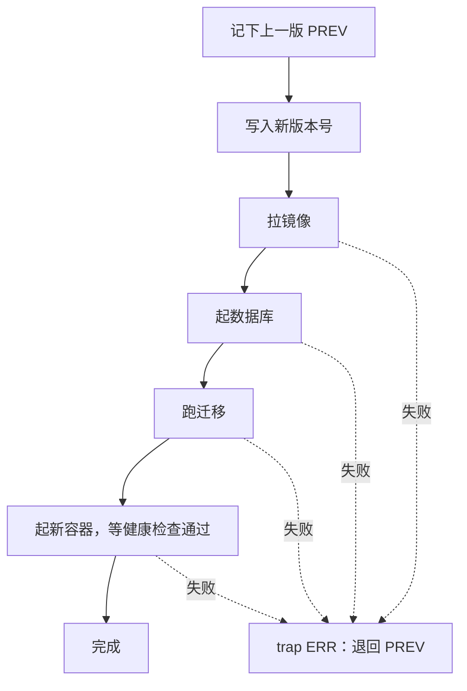

# Shell 脚本

部署、备份、巡检这类活，第一次手敲，第二次复制粘贴，第三次就该写成脚本了。Shell 脚本是服务器上最趁手的自动化工具：不用装任何运行时，能直接调用前面几章的所有命令。但 Bash 的语法充满陷阱，写得随意的脚本会在最糟糕的时刻静默出错。这一章讲写出**可靠**脚本所需的知识：严格模式、引号、条件与循环、函数、清理与回滚、加锁，并以 hatch-counter 的两个真实部署脚本为例。

## 脚本的骨架

```bash
#!/usr/bin/env bash
#
# 一句话说明这个脚本做什么、怎么用：./backup.sh [目录]

set -euo pipefail

main() {
  echo "开始干活"
}

main "$@"
```

```bash
chmod +x backup.sh
./backup.sh
```

### 第一行：shebang

`#!` 开头的这一行告诉内核用哪个解释器执行这个文件。

- `#!/usr/bin/env bash`：在 `PATH` 里找 bash，可移植性好
- `#!/bin/bash`：写死路径，Linux 上也没问题
- `#!/bin/sh`：在 Ubuntu / Debian 上是 **dash**，不支持 `[[ ]]`、数组这些 bash 扩展

第 1 章提过这个坑：脚本里用了 bash 语法却写了 `#!/bin/sh`，在 macOS 上测试正常（macOS 的 sh 是 bash 兼容模式），到了 Ubuntu 上就报错。**写 bash 语法就明确写 bash**。

## 严格模式

`set -euo pipefail` 几乎是每个 bash 脚本都该有的第一句：

| 选项 | 作用 | 没有它会怎样 |
|---|---|---|
| `-e` | 任何命令失败（非 0 退出）就立即退出脚本 | 出错后继续往下跑，比如 `cd` 失败后在错误的目录里 `rm` |
| `-u` | 使用未定义的变量时报错退出 | 拼错的变量名被当成空字符串 |
| `-o pipefail` | 管道中任何一个命令失败，整个管道就算失败 | `pg_dump | gzip` 里 pg_dump 失败了，gzip 照样成功，你得到一个空备份 |

`pipefail` 那一行值得多想一下：没有它，`pg_dump ... | gzip > backup.gz` 的退出码只取决于最后的 `gzip`。数据库连不上时 pg_dump 报错退出，gzip 压缩了一段空输入，正常退出，脚本以为备份成功了。等到真要恢复的那天，才发现一个月的备份全是空文件。

### set -e 的局限

`-e` 并不是万能的，它在这些场景**不会**触发：

```bash
if grep -q foo file; then ...   # 条件判断里的失败
cmd || echo "失败了"             # 被 || 或 && 接住的失败
local out=$(cmd)                # local 自己的退出码是 0，掩盖了 cmd 的失败
```

最后一个最隐蔽。要拿到命令替换的退出码，声明和赋值分开写：

```bash
local out
out=$(cmd)      # 这样 cmd 失败时 -e 会生效
```

### 什么时候不用 -e

hatch-counter 的上线代理 `agent.sh` 用的是 `set -uo pipefail`，**故意去掉了 `-e`**。它是一个常驻的循环：每 15 秒检查一次新版本，某次下载失败不应该让整个代理退出。所以它对每一步都显式检查结果：

```bash
curl -fsS --retry 3 -o "$tmp/$name" "$url" || { say "✗ 包拉不下来"; return 1; }
```

一次性的脚本用 `-e` 让错误尽早暴露；常驻的循环自己处理每个错误，失败了记日志、等下一轮。

## 变量与引号

```bash
name="counter"
dir="/srv/$name"
echo "$dir"            # /srv/counter
echo "${name}_backup"  # 花括号界定变量名
```

**所有变量引用都加双引号**，这是 Shell 脚本最重要的一条规则：

```bash
file="my report.txt"
rm $file       # 错：被拆成 rm my report.txt，删两个文件
rm "$file"     # 对
```

### 参数展开

bash 在 `${}` 里提供了一套很实用的字符串操作：

| 写法 | 作用 | 例子（`f=/srv/app/web-1.2.0.tar.gz`） |
|---|---|---|
| `${var:-默认}` | 变量为空时用默认值 | `${POLL:-15}` |
| `${var:?提示}` | 变量为空时报错退出 | `rm -rf "${dir:?}/"` |
| `${var#前缀}` | 删掉最短匹配的前缀 | `${f#*/}` → `srv/app/web-1.2.0.tar.gz` |
| `${var##前缀}` | 删掉最长匹配的前缀 | `${f##*/}` → `web-1.2.0.tar.gz` |
| `${var%后缀}` | 删掉最短匹配的后缀 | `${f%.tar.gz}` → `/srv/app/web-1.2.0` |
| `${var%%后缀}` | 删掉最长匹配的后缀 | |
| `${#var}` | 长度 | |

`agent.sh` 解析 `key=value` 格式的配置行就用了这个：

```bash
key=${line%%=*}     # 第一个 = 之前
value=${line#*=}    # 第一个 = 之后
```

它的配置项全部用 `${VAR:-默认值}` 声明，既有默认值，又能在测试时用环境变量覆盖：

```bash
STATE_DIR=${STATE_DIR:-/srv/counter/agent}
POLL=${POLL:-15}
```

## 条件判断

```bash
if [[ -f "$file" ]]; then
  echo "文件存在"
elif [[ -d "$file" ]]; then
  echo "是个目录"
else
  echo "不存在"
fi
```

`[[ ]]` 是 bash 的条件表达式，比老式的 `[ ]` 更安全（里面的变量不加引号也不会被拆分，但养成加引号的习惯没坏处）。常用的测试：

| 表达式 | 为真的条件 |
|---|---|
| `-f path` / `-d path` / `-e path` | 是文件 / 是目录 / 存在 |
| `-x path` | 可执行 |
| `-z "$s"` / `-n "$s"` | 字符串为空 / 非空 |
| `"$a" = "$b"` / `"$a" != "$b"` | 字符串相等 / 不等 |
| `$a -eq $b`、`-lt`、`-gt` | 数字比较 |
| `"$s" =~ 正则` | 正则匹配（只在 `[[ ]]` 里可用） |

正则匹配非常适合校验输入。`agent.sh` 拒绝任何不像版本号的参数，因为这个参数后面会拼进文件路径：

```bash
VER_RE='^[0-9]+\.[0-9]+\.[0-9]+$'
[[ "$ver" =~ $VER_RE ]] || { echo "版本号不像版本号：$ver" >&2; exit 1; }
```

注意正则放在变量里、`=~` 右边**不加引号**，加了引号会被当成普通字符串匹配。

**`if` 判断的其实是命令的退出码**，`[[ ]]` 只是一个特殊的命令。所以可以直接判断任何命令：

```bash
if systemctl is-active --quiet nginx; then echo "nginx 在跑"; fi
if ! command -v docker >/dev/null; then echo "没装 docker" >&2; exit 1; fi
```

## 循环与参数解析

```bash
for app in admin site web; do
  echo "处理 $app"
done

while IFS= read -r line; do    # 逐行读文件的标准写法
  echo "行：$line"
done < input.txt
```

`IFS= read -r` 是逐行读取的固定搭配：`IFS=` 保留行首行尾的空白，`-r` 不把反斜杠当转义符。

`case` 适合匹配多个模式，常用来解析命令行参数。hatch-counter 的 `deploy.sh` 接受一个版本号和一个可选的 `--maintenance`：

```bash
VERSION=""
MAINTENANCE=0
for arg in "$@"; do
  case "$arg" in
    --maintenance) MAINTENANCE=1 ;;
    -*) echo "不认识这个参数：$arg" >&2; exit 1 ;;
    *)
      if [ -n "$VERSION" ]; then
        echo "版本号只能给一个" >&2; exit 1
      fi
      VERSION="$arg"
      ;;
  esac
done
[ -n "$VERSION" ] || { echo "用法：./deploy.sh <版本号> [--maintenance]" >&2; exit 1; }
```

`"$@"` 表示所有参数，每个参数保持独立（带空格的参数不会被拆开）。不认识的参数直接报错退出，而不是默默忽略，这样敲错了参数会立刻知道。

## 函数

```bash
say() { echo "[$(date '+%H:%M:%S')] $*"; }

current_version() {
  local target
  target=$(readlink "$1/current") || return 0
  basename "$target"
}

say "线上版本：$(current_version /srv/counter/sites/web)"
```

- 参数用 `$1`、`$2` 访问，`$#` 是参数个数
- 函数里的变量**默认是全局的**，用 `local` 声明局部变量
- `return` 只能返回 0–255 的退出码；要返回字符串就 `echo`，调用方用 `$( )` 接住
- 报错信息写到 stderr（`>&2`），stdout 留给真正的输出，这样调用方用 `$( )` 接住的才是干净的结果

## 清理与回滚：trap

脚本可能在任何一步失败。`trap` 让你注册「出事时执行」的代码：

```bash
tmp=$(mktemp -d)
trap 'rm -rf "$tmp"' EXIT     # 无论成功、失败还是被 Ctrl+C，退出时都清理
```

| 信号或事件 | 什么时候触发 |
|---|---|
| `EXIT` | 脚本退出时，不管什么原因 |
| `ERR` | 某条命令失败时（配合 `set -e`） |
| `INT` / `TERM` | 收到 Ctrl+C 或 SIGTERM |

### 一个真实的回滚流程

hatch-counter 的 `deploy.sh` 用 `trap ERR` 实现失败自动回滚。精简后的逻辑：

```bash
set -euo pipefail

PREV=$(sed -n 's/^API_TAG=//p' .env)    # 记住上一版

restore() {
  trap - ERR                  # 先摘掉 trap，避免回滚自己失败时递归进来
  echo "退回 $PREV" >&2
  set_tag "$PREV"
  docker compose up -d --wait --wait-timeout 90
}
trap 'restore || true' ERR

set_tag "$VERSION"
docker compose pull api
docker compose up -d --wait --wait-timeout 60 postgres
docker compose run --rm api ./node_modules/.bin/tsx src/db/migrate-cli.ts
docker compose up -d --wait --wait-timeout 90

trap - ERR
echo "起来了：$VERSION"
```



几个值得学习的细节：

- **`restore` 一开始就 `trap - ERR`**：回滚过程中的命令也可能失败，不摘掉的话会再次触发 trap，屏幕上刷满「回滚失败」，真正的第一个错误早就滚出去了
- **`restore || true`**：回滚本身失败时不让脚本因 `-e` 立刻退出，后面还有要打印的提示
- **顺序是脚本的全部意义**：迁移必须跑完才起新容器。反过来的话，新代码会对着旧表结构跑上几秒，那几秒进来的是真实请求
- 它只能回滚镜像，**回滚不了数据库迁移**。所以这个项目要求每个迁移都兼容上一版代码：先加列，删列留到之后的版本

### 安全地修改配置文件

`deploy.sh` 要改 `.env` 里的一行 `API_TAG=...`，没有用 `sed -i` 原地编辑，而是写临时文件再改名：

```bash
set_tag() {
  touch .env
  grep -v '^API_TAG=' .env > .env.tmp || true
  echo "API_TAG=$1" >> .env.tmp
  mv .env.tmp .env
}
```

- 只改自己那一行，文件里其他内容原样保留
- `grep -v` 在没有任何行输出时退出码是 1，`|| true` 防止 `-e` 把脚本停掉
- 最后的 `mv` 是原子的（第 2 章），任何时刻读这个文件的人看到的要么是旧版、要么是新版，不会是写了一半的

## 加锁：同一时刻只跑一个

定时任务和手动执行可能撞在一起，两个进程同时切换版本就乱套了。`flock` 提供文件锁：

```bash
exec 9> /var/lock/myjob.lock
flock -n 9 || { echo "已经有一个在跑了" >&2; exit 1; }
# 后面的代码同一时刻只有一个进程在执行
```

`agent.sh` 里常驻的循环和手动执行的 `rollback` 就靠一把锁互斥：

```bash
locked() {
  (
    flock 9
    "$@"
  ) 9> "$STATE_DIR/lock"
}

locked rollback_static "$app" "$ver"
```

这里不带 `-n`，后来的进程会等前一个释放锁再执行，而不是直接放弃。

## 实战：数据库备份脚本

结合前面的内容，写一个给第 4 章的 timer 调用的备份脚本：

```bash
#!/usr/bin/env bash
#
# 备份 compose 里的 Postgres，保留最近 14 天。由 pg-backup.timer 每天调用

set -euo pipefail
umask 077                       # 备份里有全部业务数据，只有 root 能读

BACKUP_DIR=${BACKUP_DIR:-/data/backups}
KEEP_DAYS=${KEEP_DAYS:-14}

cd /srv/counter
mkdir -p "$BACKUP_DIR"

file="$BACKUP_DIR/app-$(date +%F-%H%M).sql.gz"
tmp="$file.partial"
trap 'rm -f "$tmp"' EXIT        # 中途失败不留半截文件

# -T：不分配终端，否则输出里会混进控制字符；pipefail 保证 pg_dump 失败时整条命令失败
docker compose exec -T postgres pg_dump -U app app | gzip > "$tmp"
mv "$tmp" "$file"

find "$BACKUP_DIR" -name 'app-*.sql.gz' -mtime +"$KEEP_DAYS" -delete

echo "备份完成：$file（$(du -h "$file" | cut -f1)）"
```

- 先写 `.partial` 再改名：目录里出现的 `.sql.gz` 一定是完整的
- `umask 077`：备份文件权限自动是 600
- 输出一行结果，进 journald，`journalctl -u pg-backup` 就能看到每天的备份大小。大小突然变成几十字节，说明出问题了

只在同一台机器上的备份防不住机器本身出事。把它加密送到异地、让失败可见、定期演练恢复，见[《一人运维手册》3-2-1 原则](../production-ops/02-backup-dr.md#3-2-1-原则)。

## 用 ShellCheck 检查

ShellCheck 是 Shell 脚本的静态检查工具，能发现大部分引号遗漏、`set -e` 陷阱和可移植性问题：

```bash
sudo apt install shellcheck     # macOS：brew install shellcheck
shellcheck deploy.sh
```

hatch-counter 的脚本里能看到 `# shellcheck disable=SC2012` 这样的注释，表示「这里我知道 ShellCheck 会警告，但我是有意为之」。禁用某条规则时最好在旁边写上理由。

让编码 agent 写 Shell 脚本时，把「跑一遍 shellcheck 并修掉所有警告」写进要求里，是成本最低的质量保障。

## 什么时候不该用 Shell

Shell 擅长把命令串起来，不擅长处理数据。出现下面这些信号，就该换成 TypeScript（用 `tsx` 直接运行）或 Python：

- 需要解析 JSON、YAML（偶尔用 `jq` 可以，大量处理就别硬撑了）
- 脚本超过两三百行，或者有复杂的数据结构
- 需要调用 HTTP API 并处理响应、重试、分页
- 需要写单元测试

hatch-counter 的分工就是这样：机器上执行的部署脚本用 Bash（服务器上不用装任何东西），发版、上传、通知这些复杂流程用 TypeScript 写成 `tools/` 下的命令行工具。

## 本章要点

- 写 bash 语法就用 `#!/usr/bin/env bash`，Ubuntu 上 `/bin/sh` 是 dash
- `set -euo pipefail` 是标配；`-e` 在条件判断、`||` 和 `local x=$(…)` 中不生效；常驻循环可以不用 `-e`，改为显式处理错误
- 变量一律加双引号；`${VAR:-默认}`、`${VAR:?}`、`${f##*/}` 这些展开很实用
- `[[ "$s" =~ $RE ]]` 校验输入，不认识的参数直接报错
- `trap EXIT` 做清理，`trap ERR` 做回滚，回滚函数先摘掉 trap；改文件用「写临时文件再 mv」
- `flock` 保证同一时刻只跑一个；用 ShellCheck 检查；逻辑复杂了就换 TypeScript

## 动手练习

1. **空备份是怎么来的**：执行 `bash -c 'false | gzip > /tmp/x.gz; echo $?'`，再执行 `bash -c 'set -o pipefail; false | gzip > /tmp/x.gz; echo $?'`。

   验证：第一条输出 `0`，第二条输出 `1`；`ls -l /tmp/x.gz` 能看到一个只有几十字节的 gzip 文件。

   参考答案：没有 `pipefail` 时管道的退出码只看最后一个命令。把 `false` 换成连不上数据库的 `pg_dump`，就是「每天备份成功、文件全是空的」。

2. **`local` 吞掉了失败**：把下面的脚本存成 `t.sh` 运行，再把 `local out=$(false)` 改成两行 `local out` 和 `out=$(false)` 重跑。

   ```bash
   #!/usr/bin/env bash
   set -euo pipefail
   f() { local out=$(false); echo "还在跑"; }
   f
   echo "结束"
   ```

   验证：第一次打印 `还在跑` 和 `结束`，`echo $?` 是 `0`；改后什么都不打印，退出码是 `1`。`shellcheck t.sh` 会对原写法给出 SC2155 警告。

   参考答案：`local` 自己的退出码是 0，掩盖了命令替换的失败，`-e` 看不到；声明和赋值分开后，赋值语句的退出码就是 `false` 的。

3. **用 flock 互斥**：在 Linux 或容器（macOS 默认没有 `flock`）里执行 `flock -n /tmp/demo.lock sleep 30 &`，紧接着执行 `flock -n /tmp/demo.lock echo 拿到锁 || echo 已经有一个在跑了`；再把第二条的 `-n` 去掉重试。

   验证：带 `-n` 时立刻输出 `已经有一个在跑了`；去掉 `-n` 后命令会卡住，等后台的 `sleep` 结束才输出 `拿到锁`。

   参考答案：`-n` 是拿不到锁就放弃，适合定时任务；不带 `-n` 是排队等待，适合手动执行的回滚这类必须做完的操作。
