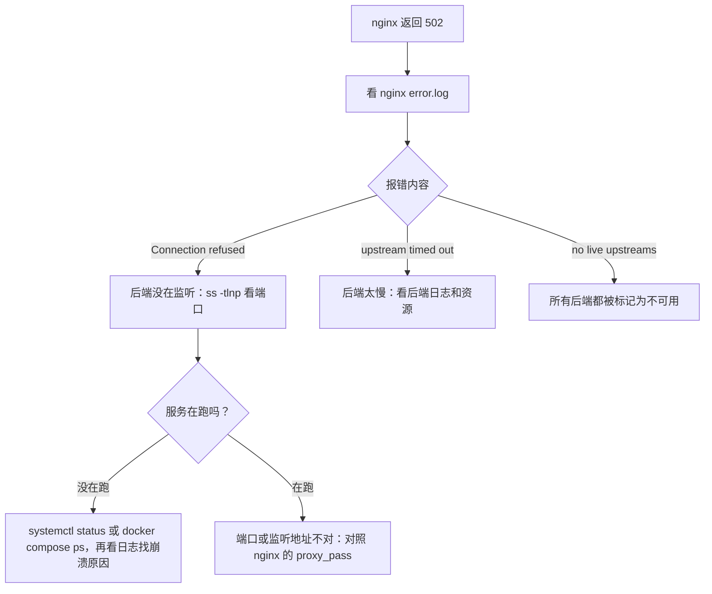

# 排障工具箱

前八章分别讲了命令、权限、进程、systemd、日志、包、磁盘和脚本。真正出事的时候，问题不会告诉你它属于哪一章：用户只会说「打不开了」「好慢」。这一章把前面的工具串成一套排障方法：先讲思路，再给一份登上机器后的「头一分钟」检查清单，然后按 CPU、内存、磁盘、网络、进程分类整理工具，最后用几个典型场景演练完整的排查过程。

## 排障的思路

### 先问三个问题

1. **什么变了？** 绝大多数故障是由变更引起的：刚发了版、改了配置、系统自动升级了、证书过期了、流量突然变大了。`/var/log/apt/history.log`、部署记录、`git log` 都是线索
2. **影响范围多大？** 所有用户还是部分用户？所有接口还是某一个？这台机器还是所有机器？范围决定了问题在哪一层
3. **能稳定复现吗？** 能复现的问题好查，偶发的问题要靠日志和监控还原现场

### 先止血，再查因

单机部署的小项目，出事时优先恢复服务：回滚到上一版、重启服务、扩容磁盘。**但在重启之前，先花一分钟保留现场**：

```bash
journalctl -u myapp --since '30 min ago' > /tmp/incident-myapp.log
ps aux --sort=-%mem > /tmp/incident-ps.txt
free -h; df -h; uptime
```

重启会抹掉进程状态、内存里的信息，之后就再也查不到原因了。

### USE 方法

对每一种资源，检查三个指标，这个方法叫 USE（Utilization、Saturation、Errors），由性能工程师 Brendan Gregg 提出：

- **使用率**：资源有多忙
- **饱和度**：有多少工作在排队等这个资源
- **错误**：有没有出错


按这张表把每一格过一遍，就不会漏掉某一类资源。很多时候问题出在你没想到去看的那一格。

## 头一分钟：登上机器先跑这些

```bash
uptime                              # 负载和开机时长：是不是刚重启过？
dmesg -T | tail -20                 # 内核最近说了什么：OOM、磁盘错误、网卡问题
systemctl --failed                  # 有没有挂掉的服务
df -h -x tmpfs -x devtmpfs          # 磁盘满了没
free -h                             # available 还剩多少
top -b -n 1 | head -20              # 谁在吃 CPU 和内存
journalctl -p err -b --no-pager | tail -30   # 本次开机以来的错误
```

这七条不到一分钟就能跑完，能覆盖大部分常见问题：磁盘满、内存耗尽被 OOM、服务启动失败、机器意外重启。

`uptime` 显示 `up 3 min` 而你没有重启过，说明机器自己重启了，用 `journalctl -b -1 -n 100` 看上次开机最后的日志。

## 按资源分类的工具

### CPU

```bash
top                         # 按 P 排序，按 1 看每个核
mpstat -P ALL 1             # 每个核的使用率（sysstat 包）
pidstat 1                   # 每个进程每秒的 CPU 使用
```

单个 Node 进程 CPU 长期 100%，说明主线程被占满（Node 的 JavaScript 是单线程的），常见原因是同步的大计算、巨大的 JSON 序列化、正则回溯。用 `node --cpu-prof` 抓一份 CPU profile 分析，详见《TS 与 Node 进阶》。

### 内存

```bash
free -h                     # 看 available
vmstat 1                    # si / so 两列持续非 0 说明在频繁换页
ps aux --sort=-rss | head   # 按实际内存排序
journalctl -k | grep -i oom # 有没有进程被 OOM 杀掉
```

### 磁盘

```bash
df -h; df -i                # 空间和 inode
iostat -xz 1                # 使用率、等待时间
iotop -o                    # 谁在读写
lsof +L1                    # 已删除但仍被占用的文件
```

详见第 7 章。

### 网络

网络排查按层往下走：服务在不在监听、本机能不能访问、外部能不能连通、域名解析是否正确。

```bash
ss -tlnp                    # 哪些端口在监听、被哪个进程占着
ss -tnp state established   # 当前的 TCP 连接
ss -s                       # 连接数统计
curl -v http://127.0.0.1:3000/health   # 本机直接访问服务
curl -sI https://example.com           # 只看响应头
dig +short example.com      # DNS 解析结果
ping -c 4 1.1.1.1           # 基本连通性
mtr example.com             # 逐跳的延迟和丢包
nc -zv host 5432            # 某个端口能不能连上
```

`ss -tlnp` 的输出要注意监听地址：

```text
State   Recv-Q  Send-Q   Local Address:Port   Peer Address:Port  Process
LISTEN  0       511            0.0.0.0:443         0.0.0.0:*      users:(("nginx",pid=812,fd=6))
LISTEN  0       4096         127.0.0.1:3000        0.0.0.0:*      users:(("docker-proxy",pid=1520,fd=7))
```

- `0.0.0.0:443`：所有网卡都在监听，外部可以访问
- `127.0.0.1:3000`：只有本机能访问。hatch-counter 的 API 容器就是这样绑定的，只给宿主机上的 nginx 用，没有 TLS 的接口不直接暴露到公网

服务明明在跑、外部却连不上，十有八九是监听地址不对（只监听了 127.0.0.1），或者被防火墙挡住了。

最底层的工具是抓包，网络问题最终都能靠它定位：

```bash
sudo tcpdump -i any -nn port 3000 -c 20
```

DNS、TLS、HTTP 各层的原理和更深入的排查方法，见《计算机网络》。

### 进程在干什么

进程没有报错，但就是卡住不动？看它在做什么：

```bash
sudo strace -p 1234 -f -tt          # 实时看它的系统调用
sudo strace -f -e trace=openat,connect ./start.sh   # 只看打开文件和网络连接
sudo lsof -p 1234                   # 它打开了哪些文件和连接
cat /proc/1234/status               # 状态、内存、线程数
ls -l /proc/1234/cwd                # 它的当前目录
sudo cat /proc/1234/environ | tr '\0' '\n'   # 它启动时的环境变量
```

`strace` 能回答很多「为什么」：卡在 `read` 上说明在等输入或网络；反复 `connect` 失败说明连不上依赖；大量 `openat` 返回 `ENOENT` 说明在找一个不存在的文件。最后这条看环境变量的命令很适合排查「为什么服务读不到我配的变量」。

## 防火墙

### 两层防火墙

云服务器上通常有两层：

- **云厂商的安全组**：在机器外面，控制台上配置。新开的机器一般只放行了 22 端口
- **机器上的防火墙**：Ubuntu 上常用 ufw，它是 iptables / nftables 的一层简化封装

外部访问不通时，两层都要检查。安全组没放行 80、443 端口，机器上怎么配都没用。

```bash
sudo ufw status verbose
sudo ufw allow OpenSSH          # 先放行 ssh，再启用！
sudo ufw allow 80,443/tcp
sudo ufw enable
```

**启用 ufw 之前一定先放行 ssh**，否则当前连接一断，你就把自己锁在外面了，只能去控制台救援。

### Docker 绕过 ufw

一个很多人踩过的坑：compose 里写 `ports: - "5432:5432"`，ufw 明明没放行 5432，外网却能连上数据库。原因是 Docker 发布端口时**直接往 iptables 里插规则**，这些规则在 ufw 的规则之前生效。

最可靠的做法是只把端口绑定到本机：

```yaml
ports:
  - "127.0.0.1:3000:3000"
```

或者干脆不发布端口，容器之间走 compose 的内部网络。hatch-counter 的 Postgres 就完全没有映射端口，需要连库时用 `docker compose exec postgres psql`。

## 典型场景演练

### 场景一：网页返回 502 Bad Gateway

502 是 nginx 说「我把请求转给后端了，但后端没有给出正常响应」。问题不在 nginx 本身，而在它后面。



```bash
sudo tail -20 /var/log/nginx/error.log
ss -tlnp | grep 3000
curl -v http://127.0.0.1:3000/v1/health
docker compose ps
docker compose logs --tail=100 api
```

本机 `curl` 后端是关键的一步：它绕过 nginx，直接告诉你后端是否正常。后端正常而 nginx 报 502，就去查 `proxy_pass` 的地址；后端也不正常，问题就和 nginx 无关了。

### 场景二：服务起不来

```bash
systemctl status myapp
journalctl -u myapp -n 50 --no-pager
```

按日志里的线索对号入座：

| 日志里看到 | 原因 | 回到哪一章 |
|---|---|---|
| `Permission denied` | 运行用户没有文件或目录的权限 | 第 2 章 |
| `EADDRINUSE` / `Address already in use` | 端口被别的进程占了，`ss -tlnp` 找出是谁 | 本章 |
| `status=203/EXEC` | `ExecStart` 路径不对或文件没有执行权限 | 第 4 章 |
| `Start request repeated too quickly` | 触发了启动频率限制，修好后 `reset-failed` | 第 4 章 |
| `status=137` 或 `Killed` | 被 SIGKILL，多半是 OOM | 第 3 章 |
| `No space left on device` | 磁盘满 | 第 7 章 |
| `Cannot find module` | 工作目录不对或依赖没装 | 第 4 章 `WorkingDirectory=` |

在终端里能跑、交给 systemd 就不行，常见的原因是**环境不同**：systemd 启动的服务不读 `~/.bashrc`，`PATH` 更短，没有你在 Shell 里 `export` 的变量，运行用户也可能不同。用 `systemctl show myapp -p Environment` 和 `/proc/<PID>/environ` 对比两边的环境。

### 场景三：机器很慢

```bash
uptime          # 负载多高？和 nproc 比
top             # us 高、wa 高还是 st 高？
```

按 `top` 第三行定位方向（第 3 章）：

- **us 高**：某个程序在大量计算，`top` 按 P 排序找到它
- **sy 高**：系统调用频繁，用 `strace -c -p <PID>` 统计是哪类调用
- **wa 高**：在等磁盘，`iostat -xz 1` 和 `iotop` 找读写大户
- **st 高**：宿主机资源被别的虚拟机抢了，换规格或换机型
- **都不高但负载高**：大量进程处于 `D` 状态，`ps -eo state,pid,cmd | grep '^D'` 看它们在等什么
- **available 很低、swap 在频繁换入换出**：内存不够了

### 场景四：时间不对

证书校验失败、日志时间对不上、签名过期，有时根源是系统时间漂移了：

```bash
timedatectl                 # 当前时间、时区、是否已同步
sudo timedatectl set-timezone Asia/Shanghai
```

`System clock synchronized: yes` 才说明在正常同步。Ubuntu 默认用 systemd-timesyncd 同步时间，云服务器通常配置好了厂商自己的时间服务器。

## 写下来

每次排障结束，花五分钟记下：现象、原因、怎么修的、怎么防止再发生。hatch-counter 的部署文档末尾有一张「现象 → 原因 → 怎么办」的排障表，每一行都是踩过的坑。下次同样的问题出现，查表比从头排查快得多；把这张表放进项目文档，编码 agent 也能读到。

更进一步的，是在问题发生之前就知道：磁盘使用率超过 80% 告警、服务健康检查失败告警、证书到期前提醒。这是可观测性的范畴，见《可观测性与性能》。

## 本章要点

- 先问什么变了、影响范围多大、能否复现；先止血再查因，重启前保留现场
- USE 方法：对 CPU、内存、磁盘、网络逐一检查使用率、饱和度、错误
- 头一分钟七条命令：`uptime`、`dmesg`、`systemctl --failed`、`df`、`free`、`top`、`journalctl -p err`
- 网络从内向外查：`ss -tlnp` 看监听地址，本机 `curl` 后端，再看防火墙和 DNS
- 云上有安全组和本机防火墙两层；Docker 发布的端口会绕过 ufw，敏感端口只绑 127.0.0.1
- 502 先本机 curl 后端；服务起不来先看 `journalctl -u`；终端能跑 systemd 不行多半是环境不同

## 接下来读什么

读完这本，你应该能自如地登上服务器，看懂上面在跑什么，出了问题知道从哪里查起。接下来：

- **按导读顺序，下一本是《容器技术》**：本书多次提到容器的 PID 1、日志、端口发布和数据卷，那本书会从 namespace 和 cgroup 讲起，把 Docker 和 Compose 讲透
- **想搞懂网络那一层**：读《计算机网络》，DNS、TCP、TLS、HTTP 的原理和 `dig`、`curl`、`tcpdump` 的深入用法都在那里
- **要把服务正式上线**：接着读《Nginx 与反向代理》和《部署与 CI/CD》，前者讲反向代理和 HTTPS，后者讲从服务器初始化到零停机发布的完整流程
