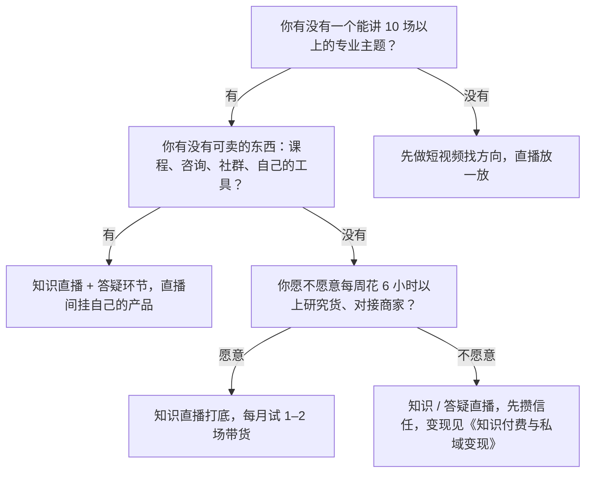

# 直播的几种类型与适合谁

短视频是「做好了放出去等人看」，直播是「人来了你得接住」。对下班才有时间的开发者来说，直播最大的好处是**产出确定**：一场 60 分钟的直播，开了就有 60 分钟的内容、一份数据、几条可切的片段；最大的难处是**它占用的是整块时间，而且不能返工**。所以在买灯、写脚本之前，先想清楚你要做哪一种直播。

本书用一个贯穿全书的例子：老周，后端开发，下班后做账号「老周写代码」，短视频讲 AI 编程工具和效率技巧，积累了几千粉丝。他想每周开两场知识直播（周二、周四 21:00–22:00），再试一场桌搭好物的带货直播（周六 20:00）。后面每章的模板都会套在他身上，你换成自己的赛道即可。

## 五种直播，各自靠什么赚钱

| 类型 | 一场在做什么 | 主要收入 | 对主播的要求 | 一个人做的难度 |
|---|---|---|---|---|
| 知识直播 | 围绕一个主题讲 40–60 分钟，有提纲、有演示 | 引流到课程 / 社群 / 咨询；少量打赏 | 有真本事，能讲清楚 | 低：一个人讲 + 屏幕共享即可 |
| 答疑直播 | 观众提问，你现场回答、现场演示 | 同上；建立信任最快 | 反应快，不怕被问倒 | 低到中：要一边看公屏一边答 |
| 陪伴直播 | 边写代码 / 边学习 / 边做事，偶尔聊天 | 打赏、粉丝团；变现弱 | 能长时间稳定在线 | 低，但很耗时间，且容易被判「挂机」 |
| 连麦直播 | 和同行、嘉宾或观众连线对谈 | 互相导粉；打赏 | 会控场、会提问 | 中：要约人、要处理连线事故 |
| 带货直播 | 讲解商品、挂链接、促成下单 | 佣金或自营利润 | 懂货、懂话术、守规矩 | 高：讲解、改价、回复、上下架同时发生 |

几点说明：

- **打赏不是开发者副业的主线**。打赏收入集中在娱乐、才艺、团播这类内容上，且平台对「诱导打赏」管得越来越严（见第 10 章）。知识类账号的打赏通常只够付电费，把它当零头即可
- **知识和答疑是同一种能力的两种形态**。知识直播你掌握节奏，答疑直播观众掌握节奏。新手先做知识直播，有了固定观众再加答疑环节
- **带货是唯一一种「一场就能算清赚了多少」的直播**，但它的工作量和合规风险也最高。选什么货归[《带货与选品》](../ecommerce-selling/)，本书只讲「货选好之后，直播间里怎么卖」
- **陪伴直播**（直播写代码、直播学习）适合积累熟脸，但要注意：长时间不说话、画面几乎不变，很容易被平台判为挂机或无意义直播，第 10 章会讲边界

## 用三个问题选类型



为什么不建议没有主题的人先开播：直播的流量很大程度上来自你的短视频和老粉。短视频没有跑出方向时开播，常见情况是在线人数长期个位数，主播对着空房间讲一小时，几场之后就放弃了。账号方向怎么定见[《账号定位与对标拆解》](../account-positioning/)。

## 每种类型适合谁

### 知识直播：最适合开发者起步

适合你，如果：

- 你在某个领域有「别人愿意花钱问你」的经验：某门语言、某类框架、面试、架构、AI 工具、独立开发
- 你能把一件事拆成 5–8 个步骤讲清楚
- 你已经有短视频或文章，观众知道你是干什么的

一场知识直播的典型结构是：开场预告今天讲什么 → 分 3–4 段讲解，每段配演示 → 中间穿插提问 → 最后 10 分钟答疑 + 介绍你的产品。完整的 60 分钟脚本见第 5 章。

开发者的天然优势：**能现场演示**。打开编辑器、跑一段代码、现场让 AI 工具改一个 bug，这些画面比任何 PPT 都有说服力，也是后面切片最好的素材（第 9 章）。

### 答疑直播：最快建立信任

适合你，如果：

- 你反应快、知识面宽，被问到不会的也能坦然说「这个我不确定，下播查了在群里回」
- 你有足够的老粉会来提问；没人提问的答疑直播很尴尬

技巧：开播前在粉丝群或评论区征集问题，准备好前 5 个问题当「垫底」，公屏没人提问时就讲这些。第 4 章有对应话术。

### 陪伴直播：适合想长期积累熟脸、时间又多的人

适合你，如果：

- 你本来就要花时间做某件事（写开源项目、刷题、学英语），顺便开着
- 你能接受收入很低，主要目的是让一群人习惯在固定时间见到你

对下班副业来说，陪伴直播的时间投入产出比最低。要做就设定明确的时长（例如每次 90 分钟）和互动节奏（每 10 分钟抬头看一次公屏、说两句话），不要挂着不管。

### 连麦直播：适合已经有同行网络的人

适合你，如果：

- 你认识几位同领域、粉丝量级相近的创作者，可以互相请嘉宾
- 你擅长提问、能让嘉宾多说

连麦的价值在于**两边粉丝互相看到对方**。连麦前要提前对好流程和话题边界，避免现场冷场或说出不合适的话。连麦里对方的违规言论，你的直播间同样可能被处罚。

### 带货直播：适合懂货、愿意钻研的人

适合你，如果：

- 你的观众有明确的购买需求，而且你的推荐有说服力。比如老周的观众是程序员，桌搭、键盘、显示器支架、降噪耳机是他们真会买、而老周真用过的东西
- 你愿意花时间对接商家、拿样品、核对资质、算佣金
- 你能接受第一个月可能卖不出几单

不适合你，如果：你没用过这些货，只是看别人卖得好。没用过的东西讲不出细节，只能靠喊「便宜」「最后几单」，这恰恰是最容易违规的话术。

## 一个人做直播，时间账先算清

直播的时间远不止开播的那 60 分钟。以老周的一场知识直播为例：

| 环节 | 时间 | 能不能省 |
|---|---|---|
| 定主题、写提纲、准备演示代码 | 60–90 分钟 | 第一次长，之后复用提纲能缩到 30 分钟 |
| 发预热短视频、直播预告 | 30 分钟 | 可以从上一场切片里剪，见第 9 章 |
| 开播前调试设备、走检查清单 | 15 分钟 | 不能省 |
| 直播 | 60 分钟 | — |
| 下播后复盘、填表 | 20 分钟 | 不能省，见第 8 章 |
| 剪切片、发布 | 30–60 分钟 | 可外包或用工具半自动 |
| **合计** | **约 3.5–4.5 小时** | |

带货直播还要加上选品、对接商家、核对资质、试用样品的时间，一场的总投入往往在 6 小时以上。

如果你每周能给副业的时间是 10 小时，建议节奏是：**每周 2 场知识直播，或 1 场知识 + 1 场带货**，其余时间留给短视频。第一个月不要超过这个量，先看自己能不能坚持。

## 开播前要想清楚的五件事

把下面这张卡片填好再往下读。后面每一章都会用到它。

```text
直播定位卡
账号：老周写代码
直播类型：知识直播为主，每月 1–2 场带货
固定时段：周二、周四 21:00–22:00（知识）；隔周六 20:00–21:00（带货）
一句话说清这个直播间：每周两晚，现场演示 AI 编程工具怎么真正提效
目标观众：1–5 年经验的开发者，想用 AI 工具但总觉得「不好用」
观众来了能得到什么：一个当场能抄走的用法 + 现场答疑
我靠什么变现：付费社群（知识直播）、桌搭好物佣金（带货）
我不做什么：不聊政治时事、不评价具体公司八卦、不卖没用过的东西
第一个月的目标：开满 8 场，每场按时开、按时下、每场都复盘
```

## 第一个月的周计划

老周的第一个月是这样排的。你可以照着改时间，但不要一开始就加场次。

| 周 | 直播 | 短视频 | 其他 | 这周要验证什么 |
|---|---|---|---|---|
| 第 1 周 | 知识 × 2 | 预告 2 条 | 搭好设备，做 1 场 10 分钟测试直播 | 设备和流程能不能跑通 |
| 第 2 周 | 知识 × 2 | 预告 1 条 + 切片 2 条 | 建粉丝群，开始收集问题 | 能不能准时开播、按提纲讲完 |
| 第 3 周 | 知识 × 2（第二场加 15 分钟答疑） | 预告 1 条 + 切片 2 条 | 第 8 章的复盘表连续填满 | 答疑环节有没有人提问 |
| 第 4 周 | 知识 × 1 + 带货试播 × 1 | 切片 2 条 | 带货前一周联系商家、拿样品 | 观众对带货的反应 |

第 4 周的带货试播是可选项。如果前三周的观众主要在问技术问题、没人问「你用的什么键盘」，说明你的观众还没有购买需求，先别带货。

最后一行很重要。第一个月的目标**不要写在线人数或成交额**。新直播间的数据波动很大，用数字给自己定目标，几场之后就会失去信心。先把「按时开播、按时复盘」做成习惯，数据的判断方法见第 8 章。

## 常见坑

| 坑 | 表现 | 怎么避免 |
|---|---|---|
| 什么都想播 | 周一讲 Rust，周三卖耳机，周五陪伴写代码 | 一个直播间一个主类型，最多加一个副类型 |
| 时间不固定 | 想起来就开，观众找不到你 | 固定时段，写进账号简介和直播预告 |
| 一上来就带货 | 粉丝还不认识你，你在卖东西 | 先用知识直播建立信任，再试带货 |
| 把打赏当收入 | 为了礼物去做 PK、喊打赏 | 知识类账号不靠打赏；诱导打赏是平台重点处罚对象 |
| 低估时间 | 以为一场就 1 小时，结果每次熬到凌晨 | 按上面的时间账排计划，留出睡眠 |

## 本章要点

- 直播分知识、答疑、陪伴、连麦、带货五类，收入来源和工作量差别很大
- 开发者最适合从知识直播起步：能现场演示，信任建立快，切片素材好
- 带货是唯一能单场算清收益的类型，但工作量和合规风险最高，最好在有固定观众后再试
- 一场 60 分钟的直播，前后总投入约 3.5–4.5 小时；带货在 6 小时以上
- 开播前填好「直播定位卡」，第一个月的目标是按时开播和复盘，而不是数据
