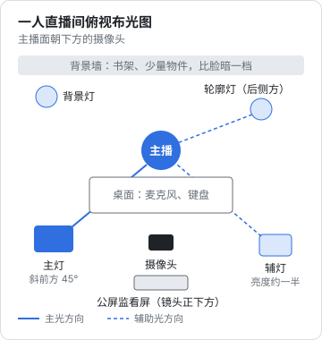

# 直播间搭建：设备、布光、推流与画面布局

一个人直播，设备的目标只有三个：**观众听得清、看得清、画面不出事故**。听得清排第一：画面糊一点观众能忍，声音有回声、有底噪、忽大忽小，观众几秒钟就划走。所以预算有限时，钱先花在麦克风上，其次是灯，最后才是摄像头。

本章按三档预算给清单。价格只是 2026 年下半年电商平台常见价位的大致区间，会随促销和型号变化，买之前自己比一下价；本章不推荐具体品牌，参数和用途讲清楚，你按参数挑。拍摄和收音的通用原理（构图、三点布光、降噪）见[《拍摄与剪辑实务》](../shooting-editing/)，这里只讲直播间特有的部分。

## 三档预算清单

### 第一档：手机开播（约 500–1000 元）

适合：先试几场，确认自己能坚持。

| 设备 | 要求 | 大致价位 | 说明 |
|---|---|---|---|
| 手机 | 近三年的中高端机，前置或后置摄像头都能用 | 已有 | 后置画质更好，但看不到公屏，需要第二台设备看评论 |
| 落地或桌面手机支架 | 能竖拍、能调高度，稳 | 50–150 元 | 镜头高度和眼睛平齐或略高 |
| 补光灯 | 带柔光罩的 LED 灯，色温可调（3200–5600K），亮度可调 | 100–300 元 | 不要只用环形灯正对脸，眼镜反光明显 |
| 领夹麦（无线） | 能接手机，带降噪 | 150–400 元 | 比手机自带麦克风提升最明显的一项 |
| 第二台设备看公屏 | 旧手机或平板 | 已有 | 用同一账号以观众身份进入，或用平台的主播助手 |
| 手机散热背夹 | 半导体制冷 | 50–100 元 | 手机直播 1 小时容易过热降频 |

手机开播的限制：屏幕共享、切换场景都不方便；**知识直播要演示代码时，手机档基本不够用**。

### 第二档：电脑推流（约 2000–4000 元）

适合：知识直播要共享屏幕，或者确定要长期做。老周用的就是这一档。

| 设备 | 要求 | 大致价位 | 说明 |
|---|---|---|---|
| 电脑 | 你写代码的电脑基本都够；推流 1080p 需要硬件编码（近年 Mac 的 Apple Silicon、带 NVENC 的 N 卡都可以） | 已有 | 推流时关掉无关程序，尤其是 IDE 的索引和容器 |
| 摄像头 | 1080p 30fps 的网络摄像头，或手机通过有线方式当摄像头 | 200–600 元 | 手机当摄像头画质通常比同价网络摄像头好 |
| USB 麦克风 | 心形指向（只收正面声音），带监听口 | 300–800 元 | 离嘴 10–20 厘米，加防喷罩 |
| 主灯 | 带柔光箱的 LED 常亮灯，显色指数（CRI）≥ 95 | 300–600 元 | 放在脸的斜前方 45° |
| 辅助灯或背景灯 | 小号 LED 或灯带 | 100–200 元 | 照亮背景，让人和背景分开 |
| 显示器 | 至少双屏：一块给推流软件和公屏，一块给演示内容 | 已有或 800 元起 | 单屏会让你频繁切窗口，画面也跟着乱 |
| 有线网络 | 网线直连路由器 | 50 元 | 不要用 Wi‑Fi 推流 |

### 第三档：完整直播间（约 6000–15000 元）

适合：带货直播、或知识直播已经稳定、愿意再投入。

| 设备 | 要求 | 大致价位 | 说明 |
|---|---|---|---|
| 相机 + 采集卡 | 能干净输出 HDMI、长时间不过热的相机；USB 采集卡 1080p60 | 3000–8000 元 | 背景虚化、肤色都明显好于网络摄像头 |
| XLR 动圈麦 + 声卡 | 动圈麦对房间回声不敏感 | 800–2000 元 | 声卡带硬件增益和监听 |
| 两盏主灯 + 一盏轮廓灯 + 背景灯 | 同上，CRI ≥ 95 | 800–2000 元 | 三点布光，见下文 |
| 商品台 / 第二机位 | 俯拍支架 + 第二个摄像头 | 300–1000 元 | 带货特写：键盘手感、材质细节 |
| 提词或公屏监看屏 | 放在镜头正下方的小屏 | 300–800 元 | 让你看公屏时视线不离镜头太远 |
| 吸音材料 | 吸音棉、地毯、窗帘 | 200–500 元 | 空房间回声大，挂窗帘和铺地毯就有明显改善 |
| UPS 或移动电源 | 给路由器和光猫供电 | 200–400 元 | 停电时网不断，至少能正常下播 |

## 布光：一个人一张桌子的标准摆法



要点：

- **主灯在斜前方 45°、略高于眼睛**，柔光箱尽量靠近人（越近越柔）
- **辅灯在另一侧，亮度约为主灯的一半**，用来减轻阴影；预算不够时用白墙或白色泡沫板反光代替
- **轮廓灯从后侧方打在头发和肩膀上**，把人和背景分开。第一档可以不要
- **背景要比脸暗一档**，但不能全黑。书架、几样有特点的物件（键盘、手办、书）就够了，不要堆满
- **所有灯的色温统一**。房间顶灯色温和补光灯不同时，脸上会出现两种颜色，最简单的办法是关掉顶灯
- **戴眼镜的人**：把主灯抬高、往侧面挪，直到镜片里看不到灯的反光为止

## 推流软件

| 平台 | 官方电脑端工具 | 能否用 OBS 等第三方软件 | 说明 |
|---|---|---|---|
| 抖音 | 抖音直播伴侣 | 规则有过变化，以直播伴侣和创作者后台当前提示为准 | 电脑开播需要单独申请权限，条件见第 3 章 |
| 快手 | 快手直播伴侣 | 同上 | |
| 视频号 | 视频号助手网页端可开播，也提供推流地址 | 以视频号助手当前提供的方式为准 | |
| 小红书 | 以小红书 App 和创作服务平台当前提供的方式为准 | 同上 | |
| B 站 | 直播姬 | 提供推流码 | |

一个稳妥的组合：**用 OBS 做画面合成，输出虚拟摄像头，再在平台官方伴侣里把虚拟摄像头当采集源推流**。这样画面布局在 OBS 里调，推流走官方工具，换平台时画面配置不用重做。这只是一种常见做法，平台对第三方工具的态度会变，开播前在官方伴侣里看一下是否有相关提示。

推流参数参考（1080p 竖屏）：

```text
分辨率：1080×1920（竖屏）或 1920×1080（横屏）
帧率：30fps（知识直播足够；带货演示动作多可用 60fps）
码率：4000–6000 kbps，按平台推荐值调整
编码：硬件编码优先（Apple VT / NVENC），CPU 占用低
关键帧间隔：2 秒
上行带宽：实测上行不低于推流码率的 2 倍；用测速网站测上传速度，不是下载速度
```

## 画面布局：竖屏还是横屏

主流短视频平台的直播流量大多来自竖屏信息流，**带货和聊天类直播优先竖屏**。知识直播要演示代码，竖屏放不下一行代码，就要做取舍。

| 布局 | 适合 | 画面构成 | 注意 |
|---|---|---|---|
| 竖屏全身 / 半身 | 带货、聊天、连麦 | 人占画面 60% 以上，下方留出平台挂件区域 | 底部约 1/4 会被评论和购物车挡住，重要内容不要放在那里 |
| 竖屏上屏下人 | 知识直播（竖屏平台） | 上半部分放放大的代码或幻灯片，下半部分放人 | 代码字号放大到 24–28 号以上，一屏不超过 15 行 |
| 横屏画中画 | 知识直播（B 站、视频号横屏） | 屏幕共享占满，人像缩在角落 | 人像别挡住代码；角落留给平台水印 |
| 双机位切换 | 带货 | 主机位人像 + 第二机位商品特写，按快捷键切换 | 切到特写时你仍要持续说话 |

老周的知识直播用「竖屏上屏下人」：OBS 里上半部分是放大的编辑器窗口（字号 26，深色主题，关掉小地图和侧边栏），下半部分是他本人；标题栏写着今天的主题，例如「AI 补全写测试：现场改 3 个 bug」。

演示代码的几条规矩：

- 演示用的是**专门准备的演示项目**，不是公司代码。公司代码、内网地址、同事名字一旦出现在直播里，就算立刻切走，也可能被录屏
- 终端和编辑器里**不要出现密钥、token、个人邮箱、路径里的真名**。演示前用 `env` 和 `history` 看一眼，必要时新建一个干净的系统用户
- 关掉系统通知、微信和邮件弹窗。macOS 打开「勿扰模式」，Windows 打开「专注」
- 浏览器用单独的配置文件，没有书签栏和自动填充

## 声音：三分钟自检

```text
声音自检（每次开播前）
1. 用推流软件录 30 秒，正常说话音量，回放听：
   [ ] 没有明显回声（有回声：挂窗帘、铺地毯、换动圈麦）
   [ ] 没有持续底噪（电流声、风扇声：关空调和风扇，检查接地）
   [ ] 音量表峰值在 -12 到 -6 dB 之间，大声说话不爆音
2. 播放演示视频或音乐时，确认声音进了直播流但不刺耳
3. 背景音乐：只用平台曲库或已获授权的音乐，音量低于人声约 20 dB
4. 戴耳机监听，防止外放声音被麦克风二次收进去
```

背景音乐的版权问题不要小看。直播中使用未授权的音乐，可能被平台提示、静音或中断直播。平台直播伴侣里一般有可用曲库，优先用它。

## 开播前要做的一次性准备

| 项目 | 做什么 | 做完打勾 |
|---|---|---|
| 网络 | 网线直连，测上行带宽，记下数值 | |
| 电脑 | 新建一个「直播」用户或配置文件，桌面干净，无敏感文件 | |
| 推流软件 | 建好 3 个场景：开场等待、主画面、商品特写或演示全屏 | |
| 快捷键 | 场景切换、静音、紧急切黑屏，各绑一个键（第 7 章会用到） | |
| 灯位 | 拍一张灯位照片，下次照着摆 | |
| 备用方案 | 手机装好平台 App、登录同一账号，电脑出问题时手机接着播 | |
| 测试直播 | 用小号或把直播设为仅自己可见（如平台支持），完整跑 10 分钟 | |

## 常见坑

| 坑 | 后果 | 怎么避免 |
|---|---|---|
| 先买相机，用电脑自带麦克风 | 画面好、声音差，观众划走 | 第一笔钱买麦克风 |
| 用 Wi‑Fi 推流 | 卡顿、掉线，平台判断直播质量差 | 网线直连 |
| 环形灯正对脸 | 脸平、眼镜反光、眼睛里一个圈 | 柔光箱放斜前方 45° |
| 演示时弹出微信消息 | 隐私泄露，内容可能被截图传播 | 勿扰模式 + 单独的系统用户 |
| 画面底部放关键信息 | 被评论区和购物车挡住 | 关键内容放画面中上部 |
| 开播才发现设备问题 | 前 10 分钟在调设备，观众全走光 | 开播前 15 分钟走检查清单，见第 3 章 |

## 本章要点

- 预算有限时按「麦克风 → 灯 → 摄像头」的顺序花钱
- 手机档适合试水；知识直播要演示代码，至少需要电脑推流档
- 主灯斜前方 45°，辅灯减阴影，背景比脸暗一档，所有灯色温统一
- 用 OBS 合成画面、官方伴侣推流是常见组合，第三方工具的使用以平台当前提示为准
- 竖屏底部会被挂件遮挡；知识直播用「上屏下人」，代码字号放大、一屏不超过 15 行
- 演示环境要干净：不出现公司代码、密钥、真名路径和消息弹窗
