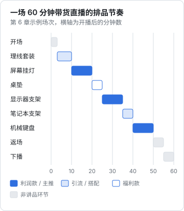

# 排品与节奏：一场带货直播怎么排

货选好之后，还要决定**先卖哪个、每个讲多久、什么时候放福利、什么时候返场**，这就是排品。排品决定了一场直播的在线人数曲线和成交结构：开场全是高价品，人留不住；全场都是低价品，忙一晚上佣金很少。

选什么货、怎么谈佣金、怎么判断商家靠不靠谱，归[《带货与选品》](../ecommerce-selling/)。本章假设你已经有了一份「能卖」的商品清单，只讲怎么把它们排进一场 60 分钟里。知识直播的「排品」很简单（一般只有一个付费产品），本章最后单独说。

## 商品在直播间里的五种角色

同一件商品放在不同位置，扮演的角色不同。角色是排品时给它定的任务，不是商品本身的属性。

| 角色 | 任务 | 典型特征 | 一场放几个 | 注意 |
|---|---|---|---|---|
| 引流款 | 开场拉起第一波成交和互动，让观众「先买一个小东西」 | 价格低、需求广、决策简单 | 1–2 个 | 不能是亏本冲量的假低价；质量要过关，否则差评拖累后面所有品 |
| 主推款 | 本场最想卖、讲得最透的那个 | 你最熟、最有说服力，佣金中等以上 | 1 个 | 放在第一波人气最高的时候 |
| 利润款 | 贡献主要佣金 | 客单价或佣金率较高 | 2–3 个 | 讲解时间要足，适合谁 / 不适合谁说透 |
| 福利款 | 感谢在场观众、稳住中段人气 | 商家给的直播间专属价，数量有限 | 1 个 | 数量、价格如实说，不虚构「最后几单」 |
| 搭配款 | 和前一个品组合使用，提高客单 | 和利润款强相关 | 0–2 个 | 讲「组合」，不强行捆绑 |

一个人播，**一场 5–8 个品**比较合适。品太多，每个只能讲两三分钟，讲不出细节，只能靠喊价格。

## 老周这场的排品表

以下价格和佣金率是为了演示计算而设的示例数字，你的实际数字以商家合同和购物车为准。

| 顺序 | 时间 | 商品（角色） | 讲解要点 |
|---|---|---|---|
| 1 | 03–10 | 桌面理线套装（引流款） | 前后对比照，粘贴款 vs 螺丝款 |
| 2 | 10–20 | 屏幕挂灯（主推款） | 关灯实测反光，曲面屏不适合 |
| 3 | 20–25 | 大号桌垫（福利款） | 商家给的数量如实说，防泼水演示 |
| 4 | 25–35 | 显示器支架（利润款） | 现场安装，VESA 孔位和桌板厚度 |
| 5 | 35–40 | 笔记本支架（搭配款） | 和 4 搭配，单屏用户不需要 |
| 6 | 40–50 | 机械键盘（利润款） | 配列、声音、系统兼容 |
| — | 50–55 | 返场 2、4 | 集中回答尺寸和兼容问题 |

价格和佣金：

| 商品 | 直播间价（元） | 佣金率 | 单件佣金（元） |
|---|---|---|---|
| 桌面理线套装 | 29 | 20% | 5.80 |
| 屏幕挂灯 | 159 | 25% | 39.75 |
| 大号桌垫 | 39 | 10% | 3.90 |
| 显示器支架 | 299 | 20% | 59.80 |
| 笔记本支架 | 69 | 20% | 13.80 |
| 机械键盘 | 459 | 15% | 68.85 |



这样排的逻辑：

- **引流款放最前**：开场 3 分钟后，先讲一个 29 元、人人都用得上的东西。它的任务是让直播间出现第一批成交和提问，而不是赚钱
- **主推款紧跟其后**：开播后 10–20 分钟通常是老粉到齐、人气较高的时段，把最有把握的品放这里
- **福利款放在 20 分钟左右**：讲完主推，在线人数往往开始回落，此时放福利稳住中段
- **利润款在中后段**：留下来的观众意向更强，适合讲需要决策时间的高价品
- **最贵的放最后讲**：讲完它直接进返场，观众有时间提问和考虑
- **返场只返有人问的品**：返场不是把所有品再念一遍，而是回答集中出现的问题

## 怎么算一场的预估佣金

> [!WARNING]
> 预估佣金只是按佣金率算出的毛佣金：实际到手还要扣平台技术服务费 / 结算扣点（比例按类目和平台不同，以抖音电商、快手电商等平台规则中心和商家后台的结算规则为准），本节的示例没有扣这一项。

$$
\text{预估佣金} = \sum_i \text{成交件数}_i \times \text{价格}_i \times \text{佣金率}_i \times (1 - \text{退货率}_i)
$$

这个公式算的是扣平台技术服务费之前的毛佣金，实际到手还要再扣一道，见本节开头的提示。

用上面的示例数字，假设这场卖出理线套装 20 件、挂灯 12 件、桌垫 30 件、显示器支架 4 件、笔记本支架 5 件、键盘 2 件，退货率统一按 10% 估：

| 商品 | 件数 | 单件佣金 | 小计（元） |
|---|---|---|---|
| 理线套装 | 20 | 5.80 | 116.0 |
| 屏幕挂灯 | 12 | 39.75 | 477.0 |
| 桌垫 | 30 | 3.90 | 117.0 |
| 显示器支架 | 4 | 59.80 | 239.2 |
| 笔记本支架 | 5 | 13.80 | 69.0 |
| 机械键盘 | 2 | 68.85 | 137.7 |
| **合计（退货前）** | | | **1155.9** |
| **扣 10% 退货后** | | | **约 1040** |

这组件数是假设，不是预期。它说明的是结构：**桌垫卖得最多，贡献的佣金却最少；挂灯和支架才是这场的收入主体**。如果你发现自己大部分讲解时间花在低佣金的品上，就要调整排品。

佣金结算周期、平台服务费、个税怎么扣，见《带货与选品》和[《自媒体与短剧合规财税》](../media-compliance/)。

## 两种节奏：过款和循环

| 节奏 | 怎么排 | 适合 | 一个人做的难点 |
|---|---|---|---|
| 过款（顺序讲） | 每个品讲一次，按顺序过完，最后返场 | 场次少、品不多、观众以老粉为主 | 后进来的人错过前面的品，靠返场补 |
| 循环（单品循环 / 小循环） | 几个品为一组，每 15–20 分钟循环一次 | 流量持续进入、时长 2 小时以上 | 要不停重复，体力消耗大；重复话术容易变成机械喊卖 |

一个人下班播 60 分钟，**用过款 + 返场就够了**。循环节奏是专业直播间为承接持续流量设计的，不适合副业初期。

## 排品前的核对清单

```text
排品核对清单（开播前 24 小时，和每个商家逐一确认）
商品 ×（逐个填写）
[ ] 链接是否正确，规格（颜色、尺寸）是否齐全
[ ] 直播间价：××元；是否有优惠券，券的领取和使用条件
[ ] 若要说「比日常价便宜」：被比较的价格是多少、依据是什么（商品页标注 / 近期成交价）
[ ] 库存：××件；福利款的数量：××件
[ ] 发货时间：××小时内；发货地
[ ] 售后：是否 7 天无理由、运费谁出、质保多久
[ ] 资质：检测报告、品牌授权、3C 认证（需要的品类）已拿到，放在手边
[ ] 我自己用过吗？用了多久？缺点是什么？
[ ] 适合谁 / 不适合谁，各写一句
```

最后两项最容易被跳过，但它们决定你在直播间里讲得出讲不出细节。**说不出缺点的商品，说明你还不够了解它**。

## 每个品一张讲解卡

开播时不可能记住六个品的所有参数。每个品做一张卡片，放在手边或第二块屏上：

```text
讲解卡：屏幕挂灯（2 号链接，主推）
直播间价：××元（日常价 ××元，依据：商品页标注）
库存：××件
核心场景：晚上关顶灯写代码
演示动作：关顶灯 → 开挂灯 → 镜头对准屏幕看反光
参数（照商品页）：色温 2700–6500K；显色指数商家标 95；USB 供电
资质：检测报告已拿到（文件名：××）
适合：平面屏，上边框厚度 ××–××毫米
不适合：曲面屏；上边框带摄像头的屏幕
缺点：调光要按实体按钮，没有遥控
售后：7 天无理由，质保 1 年（以商品页为准）
不能说：护眼、防近视、全网最低
```

## 开播中的临场调整

排品表是计划，开播后要根据公屏和在线人数微调。能调的和不能调的要分清：

| 情况 | 可以怎么调 | 不能怎么调 |
|---|---|---|
| 某个品没人问、讲了 3 分钟在线人数一直掉 | 压缩讲解，提前进入下一个品 | 临时改价、临时加赠品（没有和商家确认过的） |
| 公屏集中问一个还没讲的品 | 告诉观众「× 分钟后讲」，或把它提前 | 跳过当前品的售后和适合谁 |
| 福利款提前抢完 | 如实说「已经没有了」 | 让商家临时补库存再喊「最后几单」 |
| 主推款讲完反响很好 | 返场时再讲一次，回答新问题 | 夸大销量（「已经卖了几千单」，没有依据时） |
| 发现链接价格和讲解卡不一致 | 立即暂停讲这个品，说明「价格以页面为准，我核对一下」 | 按口播价格承诺给观众补差价（除非商家书面同意） |

一个经验：**临场调整只调顺序和时长，不调价格和规则**。价格和规则的任何变化都要先和商家确认，不然售后纠纷全落在你身上。

## 一个月的排品怎么轮换

每周只带一场货的话，观众大多是同一批人。连续几场都卖同样的东西，观众会疲劳。可以按月规划：

| 场次 | 主题 | 主推款 | 引流款 | 说明 |
|---|---|---|---|---|
| 第 1 场 | 桌搭专场 | 屏幕挂灯 | 理线套装 | 本章示例 |
| 第 2 场 | 降噪与专注 | 降噪耳机 | 耳塞 | 换品类，观众重新被吸引 |
| 第 3 场 | 返场 + 新品 | 第 1、2 场卖得最好的品 | 新品试卖 | 回应「上次没抢到」「上次没听全」的观众 |
| 第 4 场 | 观众点单 | 粉丝群投票选出的品类 | 同左 | 用观众的需求反推选品 |

## 知识直播怎么「排品」

知识直播一般只有一个付费产品（社群、课程或咨询），排品问题变成了**什么时候介绍、讲多久**：

| 放在哪 | 好处 | 坏处 | 建议 |
|---|---|---|---|
| 开场就讲 | 后来的人也能看到链接 | 观众还没感受到价值，像广告 | 不建议 |
| 讲完主内容、答疑之前 | 观众刚得到价值，信任最高 | 部分人讲完就走了 | 推荐，3 分钟以内 |
| 答疑之后、下播之前 | 留到最后的人意向最强 | 人数最少 | 和上一条二选一 |

每场只介绍一次，不在讲解中间反复插入广告。社群或课程本身怎么设计，见[《知识付费与私域变现》](../knowledge-products/)。

## 常见坑

| 坑 | 后果 | 怎么改 |
|---|---|---|
| 开场就上最贵的品 | 观众还没进入状态，没人买，人气也起不来 | 开场用引流款 |
| 引流款是假低价 | 先标高价再「砍价」，或质量很差，引来投诉和差评 | 引流款要真实价格、真实质量 |
| 福利款说「最后几单」但不断补货 | 虚构紧迫感，属于引人误解的宣传 | 数量如实说，说完就不补 |
| 品太多，每个讲 2 分钟 | 讲不出细节，只能喊价格 | 一场 5–8 个品 |
| 只看成交件数 | 忙一晚上，佣金全在低价品上 | 用公式算每个品的佣金贡献 |
| 排品表和购物车顺序不一致 | 讲 3 号弹出 4 号，观众困惑 | T-15min 对照排品表检查购物车 |

## 本章要点

- 商品在直播间里扮演引流、主推、利润、福利、搭配五种角色，角色是排品时给它的任务
- 一个人播 60 分钟，排 5–8 个品，用过款 + 返场的节奏
- 引流款开场，主推款放人气最高的 10–20 分钟，福利款稳中段，利润款和高客单放中后段
- 用「件数 × 价格 × 佣金率 × (1 − 退货率)」算每个品的贡献，避免时间都花在低佣金的品上
- 每个品一张讲解卡：价格依据、演示动作、参数、资质、适合谁、缺点、不能说的词
- 知识直播的付费产品只在讲完主内容后介绍一次
