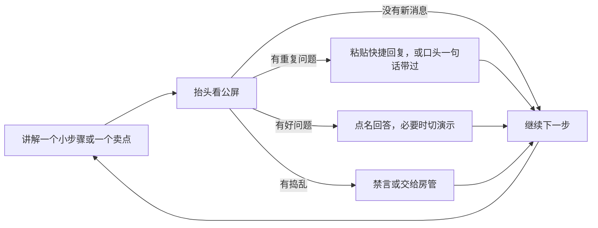
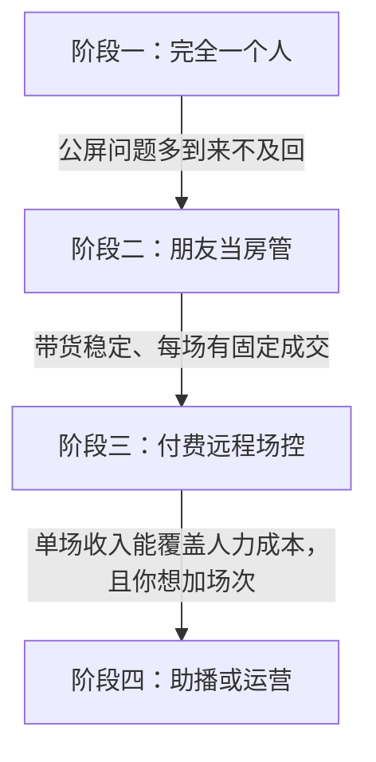

# 一个人怎么同时当主播和场控

专业直播间里，主播背后通常还有几个人：场控盯公屏和气氛，中控在后台上下架、改价、弹链接，运营看数据、调投放。你一个人下班开播，这些活全落在自己身上。本章讲怎么用工具、快捷回复和流程把它们压缩到「一个人做得过来」，以及什么时候该找帮手。

## 先把活拆清楚

| 角色 | 做什么 | 一个人做时怎么处理 |
|---|---|---|
| 主播 | 讲解、演示、互动 | 你的主业，占 80% 注意力 |
| 场控（房管） | 看公屏、回复问题、禁言捣乱的人、提醒主播漏掉的问题 | 快捷回复 + 定时抬头看公屏 + 信任的朋友当房管 |
| 中控 | 弹商品链接、上下架、改库存、发优惠券、处理链接错误 | 开播前全部配置好，开播中只做「弹出链接」一个动作 |
| 运营 | 盯实时数据、调整节奏、管投放 | 开播中只看在线人数一个数，其他留给复盘 |
| 助播 | 补充讲解、试用演示、念公屏问题 | 前期不需要；有稳定成交后再考虑 |

原则：**开播中只做必须实时做的事，其他全部挪到开播前或下播后。**

| 事情 | 挪到什么时候 |
|---|---|
| 商品上架、改价格、设库存、建优惠券 | 开播前 24 小时，T-15min 再检查一次 |
| 置顶评论、直播间公告、快捷回复 | 开播前 |
| 场景、快捷键、提词 | 开播前一次性配好 |
| 看转化率、停留时长、流量来源 | 下播后复盘 |
| 回复私信、处理售后 | 下播后 |

## 工具：把动作做成一个键

### 推流软件快捷键

在推流软件里给下面这些动作各绑一个快捷键，并写在一张便签上贴在显示器边：

```text
快捷键便签（示例，键位按自己习惯改）
F1  主画面（上屏下人 / 主机位）
F2  演示全屏（知识）/ 商品特写机位（带货）
F3  等待画面（「马上回来」）
F4  麦克风静音 / 取消静音
F8  紧急切换：纯色背景 + 「画面调整中」字样（误开了不该出现的窗口时用）
```

预算允许的话，买一个可编程宏键盘（几个到十几个键，能绑定场景切换、静音、播放提示音）。没有也没关系，键盘上的功能键就够。

### 公屏监看

- 公屏放在**摄像头正下方**的小屏或第二块显示器上，让你看公屏时视线离镜头不太远（第 2 章布光图）
- 公屏字号调大，坐在正常位置能看清
- 知识直播演示时你会盯着代码，**给自己定一个节奏：每讲完一个小步骤，抬头看一次公屏**；或者在提纲里每隔 5 分钟写一个「看公屏」

### 平台的中控和管理功能

主流平台都提供主播端的中控台或直播管理后台（抖音电商的达人工作台、各平台直播伴侣里的商品管理等），能在电脑上弹出商品、查看实时成交。功能入口和名称常有变化，以你所用平台的当前版本为准。用好下面几项就够：

| 功能 | 用途 | 开播前怎么设 |
|---|---|---|
| 购物车排序 | 讲到几号弹几号 | 按排品表顺序排好 |
| 讲解中 / 弹出商品 | 让观众看到当前讲的品 | 开播中一键操作 |
| 置顶评论 / 直播间公告 | 放直播主题、时间、规则 | 开播前写好 |
| 房管（管理员） | 让信任的人帮你禁言、踢人 | 提前设置 1–2 个房管 |
| 屏蔽词 | 自动拦截广告、辱骂和你不想出现的词 | 开播前加好 |

### 不要用的「工具」

市面上有不少「自动回复机器人」「AI 场控插件」「无人直播软件」。**凡是不是平台官方提供、需要你交出账号或在推流中注入内容的第三方插件，都不要用。** 抖音 2025 年 9 月发布的《抖音直播关于治理录播挂机的公告》明确把「使用作弊插件或道具进行无真人出镜的直播」列为治理对象（据中华网 2025-09-25 报道）。这类插件还可能盗取账号。详见第 10 章。

## 快捷回复：把重复问题提前答好

一场直播里，70% 的问题是重复的：几点播、在哪买、发不发货、怎么进群。把答案提前写好，放在置顶评论、直播间公告，或复制到一个文本文件里随时粘贴。

```text
快捷回复库（知识直播）
[直播时间] 每周二、四晚 21:00–22:00，主页可以预约。
[今天的提示词] 下播后 10 分钟发在粉丝群，主页有入群方式。
[社群介绍] 付费社群 ××元/年：每周实战笔记、演示代码、每周一次文字答疑。7 天内可退（以实际规则为准）。
[录屏回放] 精彩片段会剪成短视频发在主页。
[问题太长] 你的问题比较复杂，下播后在群里详细回你。
```

```text
快捷回复库（带货直播）
[价格] 价格以购物车里显示的为准。
[发货] 发货时间以商品页写的为准，由商家发货。
[售后] 售后找商家客服；处理不了来粉丝群找我，我帮你对接。
[尺寸 / 兼容] 购买前请看商品页的规格参数，不确定的把型号打在公屏上，我帮你看。
[佣金] 今天的商品商家付了佣金，我只推荐自己用过的。
```

快捷回复要**定期更新**：每次复盘时，把这场公屏里重复出现、你却没有现成答案的问题加进去。

## 一个人的开播操作节奏



带货时讲到一个品，操作顺序固定为：

```text
带货单品操作顺序
1. 口播：「接下来讲 × 号，×××」
2. 切到商品特写机位（F2）
3. 讲解：场景 → 问题 → 参数 → 实测 → 适合谁
4. 中控台点「讲解中 / 弹出」× 号商品
5. 口播：价格以购物车为准、售后规则
6. 看公屏 1 分钟，回答这个品的问题
7. 切回主机位（F1），说下一个品
```

动作越固定，你越不会在直播里手忙脚乱。前三场可以把这张单子贴在桌上，照着做。

## 什么时候找帮手



### 阶段二：朋友或铁粉当房管

- 找一个信任的朋友或长期在直播间的老粉，设为房管
- 给他一份快捷回复库和一张「你可以做 / 不能做」的清单
- **只给房管权限，不给账号密码**

```text
房管说明（发给帮你的人）
你可以：
- 用快捷回复库回答重复问题
- 禁言发广告、辱骂、引流到其他平台的人
- 把好问题私信或在公屏 @ 我
你不能：
- 以我的名义承诺价格、赠品、售后
- 在公屏和观众争吵
- 透露任何观众的个人信息
有拿不准的，先不处理，下播后告诉我。
```

### 阶段三：付费远程场控

有的人以按场或按小时计费的方式接远程场控、中控的活。市场价格差别很大，没有可靠的公开行情，按你所在城市和平台自己询价。合作前要讲清：

| 事项 | 写清楚什么 |
|---|---|
| 工作范围 | 只回复公屏、禁言？还是也负责弹链接、改库存？ |
| 权限 | 用平台提供的子账号或协作权限，不交出主账号密码和支付权限 |
| 话术边界 | 不能说的词、不能做的承诺，和你的替换表一致 |
| 费用 | 按场还是按小时，是否和成交挂钩 |
| 保密 | 不泄露商家价格、佣金和观众信息 |
| 违规责任 | 因对方操作导致违规怎么处理 |

《直播电商监督管理办法》第六十三条规定，直播营销人员的职务行为违法，由所在单位承担相应行政责任。对个人主播来说，**你直播间里任何人说的话、做的操作，平台和监管都会算在你的直播间头上**。所以宁可少用人，也不要用你不了解的人。

### 阶段四：助播

助播能在你讲解时补充演示、念问题，让节奏更顺。但对副业来说，人力成本会迅速吃掉利润。一个简单的判断：

$$
\text{单场佣金或产品收入} - \text{投放费用} - \text{助播费用} > \text{你自己一场的时间价值}
$$

左边持续大于右边几周之后，再考虑请助播。

## 下播后的 20 分钟

场控和中控的收尾工作也要排进流程：

```text
下播后清单
[ ] 看一遍公屏记录，把没回答的问题整理出来，发到粉丝群统一回答
[ ] 把重复出现、没有现成答案的问题加进快捷回复库
[ ] 带货：下架本场的直播间专属价链接（或确认商家已恢复日常价）
[ ] 带货：记下售后问题，次日跟商家确认
[ ] 填复盘表（第 8 章）
[ ] 标记录屏中值得切片的时间点（第 9 章）
```

## 常见坑

| 坑 | 后果 | 怎么避免 |
|---|---|---|
| 开播中才上架商品、改价格 | 手忙脚乱，价格出错 | 开播前全部配好 |
| 把账号密码给外包场控 | 账号被盗、被用来违规 | 只给房管或子账号权限 |
| 用第三方自动回复或无人直播插件 | 被判作弊，直播权限被回收，账号可能被盗 | 只用平台官方功能 |
| 演示时一直不看公屏 | 观众提问没人理，流失 | 每个小步骤后抬头看一次 |
| 房管在公屏和人吵架 | 直播间氛围变差，还可能违规 | 给房管写明边界 |
| 一边播一边看各种数据 | 分心，讲解断断续续 | 开播中只看在线人数 |

## 本章要点

- 把主播、场控、中控、运营、助播的活拆开，开播中只做必须实时做的事
- 场景切换、静音、紧急切画面各绑一个快捷键；公屏放在镜头下方，每个小步骤后看一次
- 用置顶评论、直播间公告和快捷回复库解决 70% 的重复问题，每次复盘更新
- 只用平台官方工具，不用第三方自动回复和无人直播插件
- 找帮手按「朋友房管 → 付费远程场控 → 助播」的顺序，只给权限不给密码
- 你直播间里任何人的言行都算在你头上
