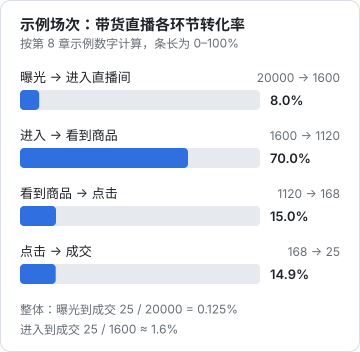
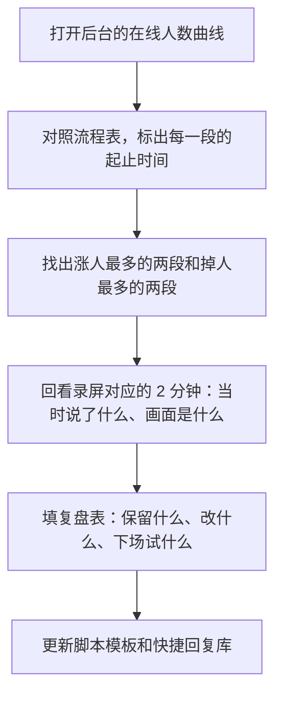

# 数据与复盘：指标怎么看，复盘表怎么填

直播和短视频最大的区别之一，是**每一场都有完整的分钟级数据**。在线人数什么时候涨、什么时候掉，对着你的流程表一看就知道是哪一段出了问题。但新主播常犯两个错误：一是开播中盯着数据，讲解断断续续；二是下播后只看一个「场观」，涨了高兴、跌了沮丧，没有任何改进。本章讲下播后怎么看数据、怎么复盘。

各平台后台的指标名称和口径不完全一样（抖音的直播数据在直播伴侣和创作者中心 / 电商后台，视频号在视频号助手，其他平台在各自创作者中心），**以你所用平台的指标说明为准**。下面用通用名称讲含义和判读方法。

## 指标分三层

### 第一层：来了多少人、留了多久

| 指标 | 含义 | 怎么看 |
|---|---|---|
| 场观（累计观看人数） | 这场一共进来过多少人（去重） | 规模指标，受流量来源影响大，不能单独看 |
| 最高在线 | 同一时刻在线人数的峰值 | 看峰值出现在哪个环节 |
| 平均在线 | 整场在线人数的平均 | 比场观更能反映直播间的承接能力 |
| 人均停留时长 | 每个观众平均待了多久 | **最重要的内容质量指标** |
| 直播间曝光进入率 | 在推荐流里看到你的直播间，有多少人点了进来 | 反映画面和标题的第一眼吸引力 |

三个数之间有一个近似关系：

$$
\text{平均在线} \approx \frac{\text{场观} \times \text{人均停留时长}}{\text{直播时长}}
$$

例如场观 1600、人均停留 1.5 分钟、直播 60 分钟，平均在线约为 $1600 \times 1.5 / 60 = 40$ 人。想提高平均在线，要么让更多人进来，要么让进来的人待得更久。**新直播间先抓停留时长**：进来的人都留不住，更多流量也只是更快地流走。

### 第二层：观众有没有反应

| 指标 | 含义 | 计算 |
|---|---|---|
| 评论率（互动率） | 有多少比例的观众发过评论 | 评论人数 ÷ 场观 |
| 转粉率 | 有多少比例的观众关注了你 | 新增关注 ÷ 场观 |
| 粉丝团 / 加群人数 | 愿意进一步靠近的人 | 平台后台直接看 |
| 老粉占比 | 场观中已关注你的人的比例 | 平台后台直接看 |

老粉占比高、新观众少，说明你还在靠老粉撑场，平台推荐流量没起来；新观众多、转粉率低，说明来的人不对或者内容没打动他们。

### 第三层：有没有成交（带货 / 知识产品）

| 指标 | 含义 | 计算 |
|---|---|---|
| 商品曝光率 | 进来的人里，有多少看到了商品 | 商品曝光人数 ÷ 场观 |
| 商品点击率 | 看到商品的人里，有多少点了 | 商品点击人数 ÷ 商品曝光人数 |
| 点击成交率 | 点了的人里，有多少下单 | 成交人数 ÷ 商品点击人数 |
| 成交金额（GMV） | 这场的成交总额 | 后台直接看，注意是否已扣退款 |
| 千次观看成交金额（GPM） | 每 1000 次观看带来多少成交额 | 成交金额 ÷ 场观 × 1000 |
| 退货 / 退款率 | 成交后退了多少 | 下播后几天到几周才稳定 |



图里是老周第一场带货的示例数字。拆成环节看，问题在哪一环一目了然：

| 环节偏低 | 通常意味着 | 先试什么 |
|---|---|---|
| 曝光 → 进入 | 推荐流里的直播画面、标题不吸引人 | 画面更亮、人更大；标题写清「在干什么」 |
| 进入 → 看到商品 | 讲解没提到商品，或商品弹出得太晚 | 讲到哪个品就弹哪个品 |
| 看到商品 → 点击 | 观众对这个品没兴趣，或价格、主图劝退 | 检查选品是否符合观众；讲解先讲场景再讲价格 |
| 点击 → 成交 | 详情页、规格、售后有疑虑 | 讲清适合谁、规格和售后；回答公屏里的疑问 |

## 判断标准：跟自己比，不跟别人比

网上流传的「停留时长要过 1 分钟」「转化率要到 x%」这类行业标准，大多没有可靠出处，且不同赛道、不同平台、不同流量来源差别极大。**本书不给通用标准**，给的是一个更可靠的方法：

1. 连续记录每一场的核心指标（下文的复盘表）
2. 以**最近 7 场的中位数**作为你自己的基线
3. 每场和基线比：明显高于基线的，找出原因并保留；明显低于基线的，找出原因并修改
4. 每次只改一个变量（开场方式、排品顺序、开播时间……），否则不知道是哪个改动起了作用

```text
判断一个变化是不是真的
- 只有一场好：可能是偶然（那天流量好、某个老粉转发了），再看两场
- 连续 3 场都高于基线：大概率是真的改进，把它写进脚本模板
- 连续 3 场都低于基线：回看这几场改了什么，先撤回最近的改动
```

## 复盘的顺序：曲线对流程表

下播后 20 分钟内完成复盘，越晚记忆越模糊。



在线人数曲线的几种典型形状：

| 曲线形状 | 常见原因 | 下一场试什么 |
|---|---|---|
| 开场后持续下滑，没有回升 | 开场没说清价值；或前 10 分钟内容太慢 | 开场 15 秒说清「今天能带走什么」，第一段演示提前 |
| 某一段突然掉一截 | 那一段太长、太难、跑题，或在讲广告 | 缩短那一段，或换到后面 |
| 某一段明显上涨 | 演示翻车、观众提问、讲到了大家关心的点 | 把这类内容提前，或单独做一场 |
| 整体平稳但很低 | 老粉撑场，平台推荐流量没来 | 检查直播间画面和标题；看预热是否到位 |
| 福利款时涨、过后掉回 | 观众是冲福利来的，对其他品不感兴趣 | 检查选品和观众是否匹配 |

## 复盘表

每场一行，用表格或共享文档都行。前 8 列是数据，后 4 列是你的判断，**后 4 列比前 8 列重要**。

| 场次 | 日期 | 类型 | 主题 | 场观 | 平均在线 | 人均停留 | 新增关注 | 成交 / 转化 |
|---|---|---|---|---|---|---|---|---|
| 07 | 2026-11-05 | 知识 | AI 补单测 | （填） | （填） | （填） | （填） | 社群 × 人 |
| 08 | 2026-11-08 | 带货 | 桌搭专场 | （填） | （填） | （填） | （填） | 成交金额 ×× |

| 场次 | 涨人最多的段落和原因 | 掉人最多的段落和原因 | 下一场只改一件事 |
|---|---|---|---|
| 07 | 第一段「改坏代码」演示，翻车反而讲得最清楚 | 34 分钟处理时间依赖的重构，太长 | 重构部分提前准备好，只演示关键两步 |
| 08 | 挂灯关灯实测 | 机械键盘讲了 12 分钟，超时 | 键盘讲解压到 8 分钟，先讲「不适合谁」 |

```text
单场复盘卡（下播后 20 分钟内填）
场次：            日期：            类型：知识 / 带货
主题：
数据：场观 __  平均在线 __  最高在线 __（出现在第 __ 分钟）
      人均停留 __  新增关注 __  评论人数 __
      （带货）商品点击 __  成交单数 __  成交金额 __
      （知识）产品咨询 __  成交 __
和最近 7 场中位数比：高 / 持平 / 低（逐项）
涨人最多的两段：1.                 2.
掉人最多的两段：1.                 2.
公屏里出现最多的问题：
这场做对了、下场要保留的一件事：
下一场只改的一件事：
要加进快捷回复库的问题：
可以切片的时间点（第 9 章）：
```

## 周复盘和月复盘

| 频率 | 看什么 | 决定什么 |
|---|---|---|
| 每场 | 单场复盘卡 | 下一场改哪一段 |
| 每周 | 本周几场的对比；预热视频的效果 | 下周的主题和开播时间 |
| 每月 | 7 场中位数的变化趋势；总投入时间；总收入 | 继续、调整还是暂停 |

月复盘时算一次时间账：

$$
\text{每小时收入} = \frac{\text{本月直播相关收入（佣金 + 产品收入 + 打赏）} - \text{本月投入的现金成本}}{\text{本月投入的总小时数}}
$$

总小时数要包括准备、剪辑、复盘的时间（第 1 章的时间账），不只是开播时长。

## 什么时候该调整方向

| 情况 | 判断 | 建议 |
|---|---|---|
| 播满 8–12 场，停留时长和平均在线的中位数在缓慢上升 | 方向对，继续 | 保持频率，每场改一件事 |
| 播满 8–12 场，各项中位数完全不动 | 内容或定位可能有问题 | 回到[《账号定位与对标拆解》](../account-positioning/)，重新看对标的直播间 |
| 停留时长不错，但没人买 | 观众认可内容，但产品不匹配 | 换产品或换转化方式，而不是换内容 |
| 有成交但退货率明显偏高 | 讲解和实物不符，或观众冲动下单 | 讲解多讲「不适合谁」；检查商品质量 |
| 每小时收入长期为负，且你已经很累 | 副业不可持续 | 降频（每周一场）或暂停，把精力放回短视频 |

## 常见坑

| 坑 | 后果 | 怎么避免 |
|---|---|---|
| 开播中盯数据 | 讲解断断续续，数据反而更差 | 开播中只看在线人数 |
| 只看场观 | 场观受流量来源影响，波动大，看不出问题 | 先看人均停留和平均在线 |
| 和别人的数据比 | 赛道、流量来源不同，比较没有意义 | 跟自己最近 7 场的中位数比 |
| 一次改好几样 | 不知道哪个改动起了作用 | 每场只改一件事 |
| 复盘只写数据不写原因 | 下次还是不知道怎么改 | 复盘卡后半部分必填 |
| 成交当天就算收入 | 退货、结算周期没算进去 | 按实际结算到账的金额记账 |

## 本章要点

- 指标分三层：来了多少人和留多久、观众有没有反应、有没有成交；新直播间先抓人均停留
- 平均在线 ≈ 场观 × 人均停留 ÷ 直播时长；带货按「曝光 → 进入 → 看到商品 → 点击 → 成交」逐环节找问题
- 不用网上的通用标准，以自己最近 7 场的中位数为基线，连续 3 场才算真变化
- 复盘时把在线人数曲线对照流程表，找涨人和掉人最多的两段，回看录屏
- 每场填复盘卡，每次只改一件事；每月算一次每小时收入，决定继续、调整还是暂停
