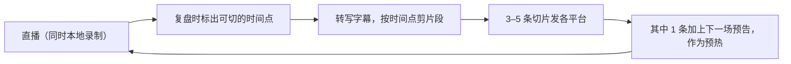

# 直播切片与二次分发

一场 60 分钟的直播，下播之后就消失了，除非你把它切开重新发。对下班时间有限的人来说，切片是直播最划算的副产品：**素材已经有了，只差剪**。一场直播通常能切出 3–5 条短视频，它们又会成为下一场的预热视频（第 3 章），形成「直播 → 切片 → 预热 → 直播」的循环。



剪辑的通用技法（字幕、节奏、封面）见[《拍摄与剪辑实务》](../shooting-editing/)，自动化流水线和批量处理见[《AI 内容生产工具链》](../ai-content-pipeline/)。本章只讲直播切片特有的部分。

## 第一步：保证有一份干净的原始录像

| 方式 | 优点 | 缺点 |
|---|---|---|
| 推流软件本地同时录制 | 画质最好，没有平台水印和挂件，能分轨录音 | 占硬盘，推流和录制同时进行会多占资源 |
| 平台的直播回放下载 | 不占本地资源 | 是否提供、保留多久、能否下载以平台为准；可能带水印、画质被压缩 |
| 手机录屏 | 什么都没准备时的兜底 | 画质差，带公屏和挂件 |

建议：**推流软件里开启本地录制**，录成 mkv（意外断电不会整个文件损坏），下播后再转 mp4。60 分钟 1080p 的录像大约几个 GB，准备一块专门放直播素材的移动硬盘，按日期建目录：

```text
live-archive/
  2026-11-05-ai-unit-test/
    raw.mkv
    raw.srt          # 转写字幕
    review.md        # 复盘卡（第 8 章）
    clips/
      01-mock-trap.mp4
      02-prompt.mp4
```

## 第二步：找到值得切的片段

切片不是随便截一段。好的切片片段同时满足：**脱离上下文也能看懂、前 3 秒有钩子、30–90 秒内有完整的起承转合**。

找片段的三个来源：

| 来源 | 怎么找 | 典型片段 |
|---|---|---|
| 在线人数曲线 | 第 8 章复盘时找出的「涨人最多的两段」 | 观众用脚投票选出来的内容 |
| 公屏 | 评论突然变多的时刻 | 引起共鸣或争议的观点 |
| 你的记忆 | 播的时候觉得「这段讲得好」，下播马上记时间 | 翻车、金句、高质量答疑 |

直播中可以准备一个「打点」动作：讲到好内容时按一个快捷键（很多推流软件支持在录制中插入标记或章节；不支持的话，在手机上记一下当前时间），下播后直接按标记找。

可切的片段类型：

| 类型 | 时长 | 示例（老周） | 适合发到 |
|---|---|---|---|
| 干货片段 | 45–90 秒 | 「改坏代码，测试必须挂」的完整演示 | 抖音、视频号、小红书、B 站 |
| 问答片段 | 30–60 秒 | 观众问「老项目从哪开始补测试」，老周的回答 | 抖音、视频号 |
| 翻车片段 | 20–45 秒 | AI 写的测试全绿、改坏后还是全绿 | 抖音、小红书 |
| 观点片段 | 30–60 秒 | 「AI 默认会 mock 掉一切」 | 抖音、视频号 |
| 合集 / 长切片 | 5–15 分钟 | 三段演示的完整版 | B 站、视频号 |
| 商品讲解片段 | 30–90 秒 | 屏幕挂灯关灯实测 | 挂商品的短视频（规则见下文） |

## 第三步：转写和剪辑

对开发者来说，转写和粗剪很适合用命令行完成。下面是一种做法：用开源的语音识别工具在本地生成字幕，再按时间点批量剪切。

```bash
# 1. mkv 转 mp4（不重新编码，几秒完成）
ffmpeg -i raw.mkv -c copy raw.mp4

# 2. 本地转写成 srt 字幕（openai-whisper 命令行，模型越大越准越慢）
whisper raw.mp4 --language zh --model medium --output_format srt

# 3. 按时间点剪一段（重新编码，切点更准）
ffmpeg -ss 00:08:12 -to 00:09:40 -i raw.mp4 -c:v libx264 -crf 20 -c:a aac clips/01-mock-trap.mp4
```

转写的字幕直接拖进剪辑软件校对，比从零打字快得多。中文专业词（mock、pytest、函数名）识别错误较多，一定要人工校对一遍。

剪辑时针对直播切片要额外做的事：

- **重写开头**。直播里的原话往往是「好，我们接下来看……」，不适合做开头。剪掉铺垫，从结论或冲突开始；必要时补录一句 3 秒的开头
- **加大字标题**。观众刷到时没有上下文，屏幕上方要有一行字说明这段讲什么
- **去掉公屏和挂件**。用本地录像就没有这个问题；用平台回放的话要裁掉或遮住
- **处理观众昵称**。公屏里观众的昵称、头像出现在切片里，最好打码或不露出；直播里口头念出的昵称问题不大，但涉及隐私内容的要剪掉
- **价格信息要小心**。直播间价只在那一场有效，切片发出去后可能被很久以后的人看到，**切片里不要保留「现在下单只要 ××元」这类有时效的价格口播**，或者加字幕说明「价格以下单页面为准」

### 切片的标题和开头模板

```text
切片标题模板（屏幕上方大字 + 发布标题）
结论型：AI 写的测试，改坏代码还是绿的，就是假的
反常识型：让 AI 写测试，最怕的不是写错，是写得太「对」
问答型：「老项目没有测试，从哪开始补？」我的答案是……
翻车型：直播现场翻车：AI 写的 5 个测试，3 个是假的
步骤型：3 步判断 AI 写的测试有没有用

切片开头 3 秒（补录或从原片挑一句）
「你让 AI 写的测试，可能一个都没在测。」
「刚才直播里有人问了一个特别好的问题。」
「这是我直播里翻车最惨的一次。」
```

标题要和内容一致，**不要为了点击写和片段无关或夸大的标题**，比如「AI 让程序员失业」配一段讲测试技巧的片段。标题党在各平台都会被限流，也会让真正想看技术内容的人失望。钩子的写法见[《选题与爆款结构》](../topic-and-hooks/)。

### 一场切片的工作量

| 步骤 | 手工 | 用转写 + 命令行 |
|---|---|---|
| 找片段 | 回看录像 30–60 分钟 | 看复盘卡的时间点 + 搜索转写稿关键词，10 分钟 |
| 粗剪 | 剪辑软件里逐段拖，30 分钟 | ffmpeg 按时间点批量切，5 分钟 |
| 字幕 | 手打或自动识别后校对，每条 10 分钟 | 用 srt 校对，每条 5 分钟 |
| 精剪、加标题、封面 | 每条 10–15 分钟 | 用固定模板，每条 5–10 分钟 |

3–5 条切片，手工要 2 小时以上，用转写和模板能压到 1 小时左右。再往后的批量化、自动打点、自动生成标题，见《AI 内容生产工具链》；做成工具卖给其他主播，见[《给创作者和短剧团队做工具》](../creator-tools/)。

## 第四步：分发

| 平台 | 切片怎么改 | 注意 |
|---|---|---|
| 抖音、快手 | 竖屏，30–90 秒，强钩子开头 | 可挂直播预约 |
| 视频号 | 竖屏或横屏，可以稍长 | 能转发到朋友圈和社群，适合给老粉看 |
| 小红书 | 竖屏，配图文笔记更好；把关键步骤做成图 | 平台对导流到站外很敏感，别留联系方式 |
| B 站 | 横屏长切片或完整回放，加章节 | 观众能接受 10 分钟以上的技术内容 |
| 公众号 / 博客 | 用转写稿整理成文章 | 一场直播的转写稿改一改就是一篇长文 |
| 粉丝群 / 社群 | 发完整回放或精华合集 | 作为付费社群的权益之一 |

各平台的推荐机制和创作者规则见[《抖音与快手》](../douyin-kuaishou/)和[《小红书、视频号与 B 站》](../xhs-channels-bilibili/)。一条切片发多个平台时，**用本地无水印的版本分别上传**，不要把一个平台下载的带水印视频传到另一个平台。

切片的发布节奏：

```text
一场直播后的切片排期（示例）
下播当晚：剪 1 条最好的干货片段，次日中午发
次日：剪 1 条问答片段 + 1 条翻车片段，分两天发
下一场开播当天下午：用 1 条片段 + 本场预告，作为预热视频
每月：把 4 场的精华剪成一条 10 分钟合集发 B 站
```

## 请别人切、或者授权别人切

账号做大以后，会有人来问「能不能切你的直播」。这里有两种情况：

| 情况 | 怎么处理 |
|---|---|
| 你请人帮你剪 | 付费外包，素材和成品归你；签一份简单的委托协议，写清交付数量、时长、修改次数、费用、素材保密和版权归属 |
| 别人想用自己的账号发你的切片（「切片授权」） | 你授权、对方发布、按约定分成。必须签书面授权：授权范围（哪些场次、能否剪辑、能否挂商品）、期限、能否转授权、禁止的内容（不得断章取义、不得加虚假标题）、违规时你如何收回 |

几条底线：

- **没有授权的切片属于侵权**。反过来，你也不要切别人的直播，即使对方是你的对标账号
- **连麦嘉宾的片段要先征得对方同意**，嘉宾的肖像和言论不是你一个人能授权的
- 别人在切片里加的夸大标题、虚假宣传，平台和观众会算到你的名字上。授权协议里写明你有权要求删除，并定期检查
- 切片账号挂商品带货，涉及商品宣传的合规责任；授权前想清楚，见[《自媒体与短剧合规财税》](../media-compliance/)

## 切片也是复盘的一部分

剪切片时你会把好的片段反复看几遍，这是最好的复盘时机：

- 这段为什么好？是演示、是观点，还是观众的提问？下一场能不能多安排这类内容
- 哪些地方你说了很多「然后」「那个」「嗯」？下一场注意
- 哪一段你自己都看不下去？那观众也一样，下一场砍掉

## 常见坑

| 坑 | 后果 | 怎么避免 |
|---|---|---|
| 没开本地录制 | 平台回放不能下载或有水印，切不了 | 推流软件开启本地录制 |
| 切片开头是「好，接下来」 | 前 3 秒没有钩子，没人看 | 从结论或冲突开始，必要时补录开头 |
| 切片保留了直播间限时价格 | 后来看到的人按那个价格找你 | 剪掉或加「以下单页面为准」 |
| 观众隐私出现在画面里 | 隐私泄露，被投诉 | 用无公屏的本地录像，昵称和头像打码 |
| 把带水印视频跨平台搬运 | 限流 | 每个平台都用本地原片上传 |
| 口头答应别人切片，没签协议 | 出了问题说不清 | 书面授权，写清范围、期限和收回条件 |

## 本章要点

- 切片是直播最划算的副产品，一场能切 3–5 条，并作为下一场的预热
- 推流软件开启本地录制，按日期归档，保证有无水印、无挂件的原片
- 从在线人数曲线、公屏高峰和自己的记忆里找片段：脱离上下文能看懂、前 3 秒有钩子、30–90 秒完整
- 本地转写 + 命令行按时间点剪切，开发者能把粗剪的时间压到很短
- 切片里不保留限时价格，观众隐私要处理，跨平台用无水印原片
- 授权别人切或请人剪，都要书面写清范围、期限和责任
