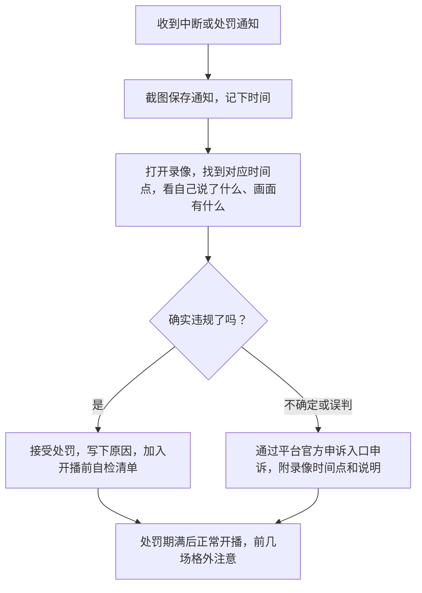

# 违规风险：限流、封禁的常见原因与无人直播的坑

直播的违规后果比短视频更直接：短视频违规通常是一条作品被限流或下架，直播违规可能是**当场被中断**，严重的回收直播权限，影响整个账号。对下班做副业的人来说，一次封禁可能让几个月的积累归零。本章讲平台怎么处罚、哪些行为最常触发处罚、为什么不要碰「无人直播」，以及被处罚后怎么办。

法律条文的完整解读、税务和主体问题，见[《自媒体与短剧合规财税》](../media-compliance/)；本章只讲直播间里的高频风险。下文的平台治理数据均来自公开报道，查询日期 2026-11-03。

## 处罚是梯度的

各平台的处罚手段大同小异，按轻重大致是：

| 程度 | 常见手段 | 对你的影响 |
|---|---|---|
| 轻 | 系统提醒、警告 | 提示你哪句话或哪个画面有问题，立即改正一般不会升级 |
| 中 | 中断直播、限制推荐（限流）、扣信用分 | 当场断播；后续几场流量明显下降 |
| 较重 | 关闭礼物收入、禁止 PK、限制违规场次收益提现、封禁直播若干天 | 收入受损，停播期间粉丝流失 |
| 重 | 无限期回收直播权限、封禁账号 | 账号的直播能力基本归零 |
| 涉嫌违法 | 平台向主管部门报送线索 | 可能面临行政处罚甚至刑事责任 |

抖音直播 2026 年 6 月 30 日发布的治理公告提到，对「违规诱导消费」可根据严重程度和主观恶意，采取限制违规场次收益提现、关闭礼物收入功能、禁止使用 PK 功能、回收直播权限等处罚；2026 年以来已处置超过 34 万个直播间、对 10.4 万个账号采取梯度处罚（据科技日报 2026-07-01 报道）。

另外，2026 年 2 月 1 日起施行的《直播电商监督管理办法》要求平台建立黑名单制度，并**防止被列入黑名单的主体通过更换或重新注册账号逃避惩戒**。被封之后换个号重来，这条路会越来越难走。

## 法规框架：直播间里要记住的几部

| 规定 | 和直播间最相关的内容 |
|---|---|
| 《广告法》 | 第九条禁止使用「国家级」「最高级」「最佳」等用语；直播带货中推销商品的言论同样受广告法约束 |
| 《电子商务法》 | 经营者应全面、真实、准确、及时地披露商品或服务信息，不得虚构交易、编造用户评价 |
| 《反不正当竞争法》 | 禁止对商品的性能、功能、质量、销售状况、用户评价等作虚假或引人误解的商业宣传 |
| 《明码标价和禁止价格欺诈规定》（2022 年 7 月 1 日起施行） | 价格要明码标示；使用「原价」等比较价格要有真实依据 |
| 《直播电商监督管理办法》（市场监管总局、国家网信办令第 117 号，2025-12-18 公布，2026-02-01 起施行） | 直播页面持续展示实际经营者信息；实时管理互动内容；口误现场纠正；明码标价并标明比较基准；使用 AI 生成的人物须标识并持续提示 |
| 《网络主播行为规范》（国家广电总局、文化和旅游部，2022 年 6 月） | 列出了网络主播不得出现的行为，包括虚假宣传、诱导打赏、低俗内容、侵犯他人权益等 |

《直播电商监督管理办法》对未履行义务规定了罚款：例如未履行信息展示义务，逾期不改正的处一万元以下罚款；涉及身份核验、纠错、AI 标识等义务，拒不改正或情节严重的处一万元以上十万元以下罚款（第五十八、五十九条，以条文为准）。虚假宣传和价格违法，分别依照《反不正当竞争法》《广告法》《价格法》等处罚。

## 最常触发处罚的十类行为

| 类别 | 典型表现 | 怎么避免 |
|---|---|---|
| 录播、挂机 | 播放提前录好的视频、长时间定格或黑屏、人不在镜头前 | 真人实时出镜；离开超过几分钟就下播 |
| 无人 / 数字人伪装真人 | 绿幕 + 录像 + 自动回复；数字人冒充真人 | 不做；使用数字人须按规定标识（见下文） |
| 诱导互动和打赏 | 「扣 1 抽奖」「点赞到 1 万上福利」「刷礼物才回答」、PK 惩罚刺激消费 | 互动只问观众的情况；不向观众要礼物 |
| 极限词和绝对化用语 | 「最好」「第一」「全网最低」「100% 有效」 | 用第 4 章替换表 |
| 虚假和夸大宣传 | 编造销量、虚构评价、普通商品说医疗功效 | 只说有依据的话，资质放手边 |
| 价格问题 | 虚构原价、口播价与页面价不一致、虚构库存和限时 | 价格以购物车为准，比较价标明依据 |
| 引导站外交易 | 口播或画面出现微信号、手机号、二维码，引导私下交易 | 不在直播间留联系方式；私域引流规则见[《国内私域与内容平台》](../private-domain-cn/) |
| 未成年人相关 | 未成年人出镜主播、诱导未成年人打赏 | 不让未成年人出镜，直播间不面向未成年人营销 |
| 侵权内容 | 播放未授权的音乐、影视、比赛画面；未授权切别人的直播 | 用平台曲库；只播自己的内容 |
| 不当言行和画面 | 抽烟喝酒、低俗、辱骂观众、危险动作、敏感时事 | 开播前画面自检；不聊与主题无关的敏感话题 |

### 开发者要特别留意的几类

技术类直播有几个其他赛道少见的风险：

| 内容 | 风险 |
|---|---|
| 演示破解软件、绕过付费、使用盗版 | 侵犯著作权，平台和法律都不允许 |
| 演示抓取他人网站或个人数据 | 可能违反《个人信息保护法》《数据安全法》和对方网站的协议，严重时涉嫌犯罪 |
| 演示或推荐违规的网络访问工具 | 违反相关管理规定 |
| 演示「绕过平台风控」「批量注册账号」「刷量工具」 | 平台重点打击的黑灰产，直接封禁 |
| 讲投资、荐股、币圈 | 金融类内容有严格的资质要求，非持牌人士不要给具体的投资建议 |
| 演示时泄露公司代码、内网、密钥 | 违反劳动合同和保密义务，后果可能比平台处罚更重 |

## 无人直播和录播：为什么不要碰

网上有很多「无人直播项目」「一台电脑挂 10 个直播间」「躺赚」的课程和软件，专门针对想做副业但没时间的人。**它们的风险远大于收益**：

**平台明确禁止，而且查得越来越严。**

- 2024 年 12 月，抖音表示禁止商家采用数字人直播等无人虚拟直播形式伪装成真实直播，点名「绿幕直播 + 录播视频 + 智能回复」「AI 生成虚拟形象误导消费者」等手法；2024 年下半年起已处置 17 万余个录播直播间、封禁 3 万余个录播账号；监测手段包括开播时长异常、账号历史、商品信息、循环文案识别等（据北京日报 2024-12-11 报道）
- 2025 年 9 月 25 日，抖音发布《抖音直播关于治理录播挂机的公告》，把盗播他人内容、播放已录制的音视频、挂机定格黑屏、使用作弊插件或道具进行无真人出镜直播列为违规；2025 年以来处罚涉及录播挂机的直播间超过 45 万个，3.3 万个录播黑灰产账号被无限期回收直播权限，已有 5 人被刑事拘留；平台提醒不要轻信「无需真人直播」的宣传（据中华网 2025-09-25 报道）

**卖课和卖软件的人才是真正赚钱的。** 上面的公告里，被打掉的团伙开发了 30 余款录播作弊软件、关联账号上万个。你买的软件可能本身就在盗你的账号。

**即使暂时没被发现，数据也是假的。** 录播直播间没有真实互动，停留和转化通常很差，平台也不会给持续的流量。

### 数字人直播的边界

数字人本身不是违规，**用数字人冒充真人**才是。《直播电商监督管理办法》第三十七条要求：使用人工智能生成的人物图像、视频从事直播电商活动的，应当按照国家有关规定进行标识，并持续向消费者提示其为人工智能生成。

| 可以考虑 | 不要做 |
|---|---|
| 按平台规则申请和使用数字人功能，按要求标识并持续提示 | 数字人冒充真人，不做标识 |
| 数字人做辅助（比如讲解时的虚拟形象），真人实时在场 | 数字人 + 录好的话术循环播放，人不在 |
| 用 AI 生成脚本、整理资料 | 用 AI 生成虚假的商品信息、假冒他人宣传 |

各平台对数字人直播的具体要求（是否需要申请、是否需要真人驱动、标识方式）变化较快，用之前查当前的平台规则。

### 陪伴直播的边界

直播写代码、直播学习这类陪伴直播，画面变化少、说话少，容易被系统误判为挂机。降低风险的做法：

- 人始终在镜头里，不长时间离开
- 每隔一段时间（比如 10 分钟）抬头说几句话、回应公屏
- 画面里要有你正在实时操作的内容，而不是一张静止的屏幕
- 需要离开超过几分钟（吃饭、接电话），就下播，别挂着

## 被处罚了怎么办



几条原则：

- **只走官方申诉渠道**。声称能「解封」「恢复权重」的付费服务，大多是骗局，还可能需要你交出账号
- **不要换号规避**。前面说过，平台要建立黑名单并防止换号逃避，换号可能导致新号一起被处理
- **留好录像**。本地录像（第 9 章）是你申诉时最重要的证据
- **从处罚里学东西**。把触发处罚的话、画面写进下面的自检清单

## 开播前合规自查清单

```text
合规自查（每场开播前，和设备检查清单一起过）
内容
[ ] 今天的主题不涉及破解、盗版、抓取他人数据、违规网络工具、投资建议
[ ] 演示环境没有公司代码、密钥、内网地址、真名
[ ] 背景音乐来自平台曲库或已获授权
带货
[ ] 每个品的讲解卡里写了「不能说」的词
[ ] 价格、库存、比较价依据和购物车一致
[ ] 资质文件在手边
[ ] 不在直播间留任何联系方式
互动
[ ] 今天的互动问题没有「扣 1 抽奖」「点赞到多少」「关注才能领」
[ ] 福袋、抽奖只用平台官方工具，参与条件按工具规则写清
人和画面
[ ] 真人全程在镜头前；需要离开就下播
[ ] 没有未成年人出镜
[ ] 没有抽烟、喝酒和不适宜的着装、画面
如使用数字人或 AI 生成形象
[ ] 已按平台规则申请，已标识并在直播中持续提示
```

## 常见坑

| 坑 | 后果 | 怎么避免 |
|---|---|---|
| 买「无人直播」课程或软件 | 账号被封、软件盗号、钱打水漂 | 不碰；平台公告已明确提醒 |
| 以为说一次极限词没关系 | 系统识别后中断直播，扣信用分 | 用替换表，口误当场纠正 |
| 演示时打开了破解软件或盗版资源 | 侵权，直播被中断 | 演示环境专门准备，只用正版和开源工具 |
| 陪伴直播离开座位半小时 | 被判挂机 | 离开超过几分钟就下播 |
| 被封后换号重来 | 新号可能被关联处理 | 走官方申诉，接受处罚后整改 |
| 找「解封中介」 | 被骗钱、交出账号 | 只走平台官方申诉入口 |

## 本章要点

- 处罚是梯度的：警告、中断、限流、关闭功能、封禁、回收直播权限，涉嫌违法会移交主管部门
- 直播间要记住《广告法》《电子商务法》《反不正当竞争法》、明码标价规定和 2026 年 2 月起施行的《直播电商监督管理办法》
- 十类高频违规：录播挂机、无人或数字人伪装、诱导互动打赏、极限词、虚假宣传、价格问题、站外交易、未成年人、侵权、不当言行
- 开发者还要留意破解盗版、数据抓取、违规工具、投资建议和泄露公司信息
- 无人直播和录播被平台持续重点打击，卖课和卖软件的人才是赚钱的一方；数字人必须标识，不能冒充真人
- 被处罚后保存证据、走官方申诉、不换号、不找解封中介，把教训写进开播前自查清单
