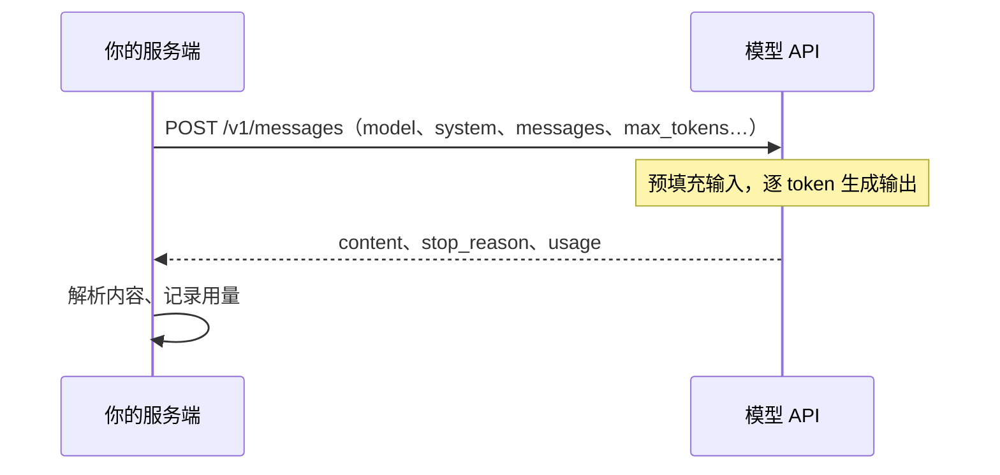

# 模型 API 与参数

[《大模型原理科普》](../llm-fundamentals/)讲的是模型内部怎么工作；这本书讲的是另一半：**怎么把模型接进你的产品，让它稳定、便宜、快地干活**。从这一章开始，我们站在调用方的位置，把模型当成一个远程服务来看：一次请求里装了什么、回来的是什么、哪些参数真正影响结果。

## 这本书讲什么、适合谁、怎么读

**讲什么**：大模型应用的工程基本功。九章分别是 API 与参数、Prompt 工程、结构化输出、工具调用、流式输出、Prompt 缓存、成本与延迟、模型选型、错误与重试。不讲原理（那是《大模型原理科普》的事），也不讲 Agent 架构、RAG、评测体系和上线运维，这些各有专门的书。

**适合谁**：已经能写 TypeScript 后端（NestJS、Cloudflare Workers 之类）、想在自己的产品里加 AI 功能的开发者。读过《大模型原理科普》最好，没读过也能看懂，遇到原理会注明出处。

**怎么读**：前五章按顺序读，它们是一次调用从「发出去」到「拿回来」的全过程；后四章偏运营，可以等功能上线前再读。

**几个约定**：

- 示例代码用 TypeScript + Node 22，模型 API 以 Anthropic 的 Messages API 为主，SDK 是 `@anthropic-ai/sdk`。概念在其他厂商那里基本通用，差异处会单独说明
- 模型 ID 写在一个常量里。写作时（2026 年 11 月）Claude 的当前型号是 `claude-opus-5-5`、`claude-sonnet-5-5`、`claude-haiku-5-5`，型号更新很快，用之前先查官方文档的模型列表
- 涉及价格的地方要么用相对倍数，要么用明确标注「假设」的整数，真实价格以官方定价页为准

## 一次调用的全貌

不管用哪家的模型，一次调用本质上都是一个 HTTPS 请求：你把「对话到目前为止的样子」发过去，模型续写下一条回复，连同用量一起返回。



最小可运行的例子：

```bash
mkdir llm-demo && cd llm-demo
pnpm init
pnpm add @anthropic-ai/sdk
pnpm add -D tsx typescript @types/node
export ANTHROPIC_API_KEY=...   # 只放在环境变量里，别写进代码
```

```typescript
// hello.ts
import Anthropic from "@anthropic-ai/sdk";

const client = new Anthropic(); // 自动读取 ANTHROPIC_API_KEY

const response = await client.messages.create({
  model: "claude-opus-5-5",
  max_tokens: 1024,
  system: "你是一个简洁的中文助手。",
  messages: [{ role: "user", content: "用一句话解释什么是幂等。" }],
});

for (const block of response.content) {
  if (block.type === "text") console.log(block.text);
}
console.log(response.stop_reason, response.usage);
```

```bash
pnpm tsx hello.ts
```

注意 `response.content` 是一个**内容块数组**，不是一个字符串。块的类型有 `text`、`thinking`（模型的思考过程）、`tool_use`（工具调用，第 4 章）等，取文本前要先按 `type` 过滤。直接写 `response.content[0].text` 在 TypeScript 里会报类型错误，在运行时也可能拿到的是思考块。

## 请求里有什么

### 角色与消息

`messages` 是一个按时间排列的数组，每条消息有 `role` 和 `content`：

| 角色 | 谁说的 | 用途 |
|---|---|---|
| `system`（顶层字段） | 开发者 | 身份、规则、背景资料，整场对话都有效 |
| `user` | 用户或你的程序 | 提问、提供数据、返回工具结果 |
| `assistant` | 模型 | 模型之前的回复 |

Anthropic 的 API 把 system 放在请求的**顶层字段**，而不是消息数组里的一条；OpenAI 风格的接口则是 `messages` 里一条 `role: "system"` 的消息。第一条消息必须是 `user`。

### API 是无状态的

模型不记得上一次请求。所谓「多轮对话」，是你每次都把完整历史重新发一遍：

```typescript
const messages: Anthropic.MessageParam[] = [
  { role: "user", content: "我叫小林。" },
  { role: "assistant", content: "你好，小林！" },
  { role: "user", content: "我叫什么？" },
];

const res = await client.messages.create({
  model: "claude-opus-5-5",
  max_tokens: 1024,
  messages,
});
```

这带来三个直接后果：

1. **对话越长，每次请求越贵越慢**，因为整段历史都要重新作为输入计费、重新预填充
2. **历史由你保管**，存数据库还是存内存是你的选择，丢了就真丢了
3. **你可以随意改写历史**：截断、摘要、插入资料。不过要注意，改写前面的内容会让缓存失效（第 6 章），部分新模型对改动过的思考块还有额外校验，最稳妥的做法是只在末尾追加

### 参数一览

| 参数 | 作用 | 建议 |
|---|---|---|
| `model` | 用哪个模型 | 放配置里，别散落在代码各处 |
| `max_tokens` | 本次最多输出多少 token | 必填；设太小会截断，非流式一般给到上万 |
| `system` | 系统提示 | 第 2 章 |
| `messages` | 对话历史 | 必填 |
| `stop_sequences` | 遇到指定字符串就停 | 少用，结构化输出更可靠 |
| `tools` / `tool_choice` | 可用工具及调用策略 | 第 4 章 |
| `output_config.format` | 约束输出符合 JSON Schema | 第 3 章 |
| `output_config.effort` | 思考与输出的投入程度：`low` 到 `max` | 第 7、8 章 |
| `thinking` | 思考模式，新模型用 `{ type: "adaptive" }` | 让模型自己决定想多少 |
| `stream` | 是否流式返回 | 第 5 章 |

### temperature 去哪了

> [!WARNING]
> 本小节按 2026 年 10 月 Anthropic 的 API 版本迁移说明（2026-10-21 版本）整理：该版本下 Messages 请求只要带 `temperature`、`top_p`、`top_k` 中任何一个就返回 400，即使传的是默认值；Claude Sonnet 4.6、Opus 4.6、Haiku 4.5 等较老的模型在旧版本 API 上仍接受非默认值。以 Anthropic 官方文档的 API versioning 页面为准。

[《大模型原理科普》第 7 章](../llm-fundamentals/07-inference-sampling.md)讲过 temperature、top-p 这些采样参数。在 Anthropic 这边，它们正在退出舞台：Claude 4.7 之后的模型只接受默认值，而 2026-10-21 版本的 API 对所有模型都不再接受这三个参数，传了直接报 400。控制输出的手段换成了 **effort**（投入多少思考）和**结构化输出**（约束格式）。

其他厂商（包括很多 OpenAI 兼容接口）仍然支持 temperature。比如 hatch-counter 调用视觉模型识别手写进货单时，就把 temperature 设成了 0.1，因为「照着抄」不需要创造力。原则不变：**抄写、提取、分类要稳，创作可以放开**，只是在不同厂商那里旋钮的名字不同。

## 响应里有什么

### stop_reason：为什么停了

每次都要检查 `stop_reason`，它告诉你这次输出是不是完整的：

| 值 | 含义 | 你该做什么 |
|---|---|---|
| `end_turn` | 模型自然说完了 | 正常处理 |
| `max_tokens` | 撞到上限被截断 | 输出不完整，提高上限或拆分任务 |
| `stop_sequence` | 遇到了你设的停止串 | 正常处理 |
| `tool_use` | 模型想调用工具 | 执行工具，把结果发回去（第 4 章） |
| `pause_turn` | 服务端工具跑到一半暂停 | 把回复原样追加，再发一次继续 |
| `refusal` | 模型基于安全策略拒绝 | 不要读内容当正常结果，给用户一个合适的提示 |

最常见的线上 bug 是忽略 `max_tokens`：JSON 只吐了一半，解析失败，日志里只看到「格式错误」。hatch-counter 的识别代码专门检查了截断标志，截断时告诉店主「单子行数太多，可以分两张拍」，而不是笼统地报错。

### usage：花了多少

```typescript
console.log(response.usage);
// {
//   input_tokens: 23,                 // 未命中缓存的输入
//   cache_creation_input_tokens: 0,   // 写入缓存的输入
//   cache_read_input_tokens: 0,       // 从缓存读取的输入
//   output_tokens: 41,                // 输出（含思考）
//   ...
// }
```

`usage` 是成本核算的唯一可靠来源，**每次调用都应该记下来**（第 7 章给出表结构）。思考过程产生的 token 按输出计费，即使你看不到思考内容。

想在发请求前知道输入有多少 token，可以用计数接口，它不产生生成费用：

```typescript
const { input_tokens } = await client.messages.countTokens({
  model: "claude-opus-5-5",
  system: "你是一个简洁的中文助手。",
  messages: [{ role: "user", content: longDocument }],
});
```

不要用别家的分词器（比如 tiktoken）估算 Claude 的 token 数，不同模型的分词器不同，误差可能很大。

## Anthropic 与 OpenAI 兼容接口的差异

国内很多厂商（智谱、通义、DeepSeek 等）都提供 OpenAI 兼容的 `/chat/completions` 接口。hatch-counter 调用智谱的视觉模型就是这条路，直接用 `fetch` 发请求。两种接口概念相同，字段不同：

| 概念 | Anthropic Messages | OpenAI 兼容 Chat Completions |
|---|---|---|
| 系统提示 | 顶层 `system` | `messages` 里的 `role: "system"` |
| 回复内容 | `content` 块数组 | `choices[0].message.content` |
| 停止原因 | `stop_reason`：`end_turn` / `max_tokens` | `finish_reason`：`stop` / `length` |
| 输出上限 | `max_tokens` 必填 | 通常可选 |
| 工具调用 | `tool_use` / `tool_result` 内容块 | `tool_calls` 字段 + `role: "tool"` 消息 |
| 认证头 | `x-api-key` | `Authorization: Bearer` |

如果一个产品要同时接多家，建议在自己的代码里定义一个窄接口（「给我图片和提示，还我文本和是否截断」），每家写一个适配器，而不是试图做一个大而全的抽象。hatch-counter 的 `chat()` 函数就是这么做的：它只返回 `{ text, truncated }`，上层不关心底下是哪家。

## 封装一层：llm.ts

散落在各处的 `client.messages.create` 很快会失控：模型名到处硬编码、用量没人记、错误处理各写各的。建议从第一天起就有一个薄封装：

```typescript
// src/llm/client.ts
import Anthropic from "@anthropic-ai/sdk";

export const client = new Anthropic({
  timeout: 120_000, // 毫秒；TypeScript SDK 的单位是毫秒
  maxRetries: 2,    // SDK 内置的自动重试，第 9 章细讲
});

export const MODELS = {
  main: process.env.LLM_MODEL_MAIN ?? "claude-opus-5-5",
  fast: process.env.LLM_MODEL_FAST ?? "claude-haiku-5-5",
} as const;

export async function ask(params: {
  feature: string; // 哪个功能在调用，用于记账
  model?: string;
  system?: string;
  messages: Anthropic.MessageParam[];
  maxTokens?: number;
}): Promise<{ text: string; message: Anthropic.Message }> {
  const started = Date.now();
  const message = await client.messages.create({
    model: params.model ?? MODELS.main,
    max_tokens: params.maxTokens ?? 8000,
    system: params.system,
    messages: params.messages,
  });

  if (message.stop_reason === "max_tokens") {
    throw new Error(`[${params.feature}] 输出被截断，请提高 maxTokens 或拆分任务`);
  }
  if (message.stop_reason === "refusal") {
    throw new Error(`[${params.feature}] 模型拒绝了这个请求`);
  }

  const text = message.content
    .filter((b): b is Anthropic.TextBlock => b.type === "text")
    .map((b) => b.text)
    .join("");

  console.info("llm_call", {
    feature: params.feature,
    model: message.model,
    ms: Date.now() - started,
    usage: message.usage,
  });
  return { text, message };
}
```

后面各章会逐步往这里加东西：结构化输出、缓存、流式、重试。关键在于**所有调用都从这一个口子出去**，以后换模型、加监控、加限流都只改一处。

## 密钥只放在服务端

API key 等于钱。几条硬规矩：

- **永远不要在前端、App、Electron 渲染进程里直接调用模型 API**。打包进客户端的 key 一定会被扒出来。hatch-counter 的设计文档里写得很明确：单据识别只在服务端调，key 也只在服务端，客户端只能问到「能不能用」
- key 放环境变量或密钥管理里，不进仓库；`.env` 加进 `.gitignore`
- 给不同环境（开发、生产）用不同的 key，在控制台设置花费上限
- 客户端调你自己的接口，你的接口做鉴权、限流，再去调模型

## 本章要点

- 一次模型调用就是一个 HTTPS 请求：发出对话历史，拿回内容块、停止原因和用量
- API **无状态**，多轮对话要每次重发完整历史，历史越长越贵越慢
- 响应的 `content` 是块数组，取文本前按 `type` 过滤
- **每次都检查 `stop_reason`**，`max_tokens` 意味着输出被截断
- **每次都记录 `usage`**，它是成本核算的唯一依据
- Anthropic 新 API 已不接受 temperature 等采样参数，用 effort 和结构化输出控制结果；其他厂商仍有这些旋钮
- 所有调用经过一个薄封装，密钥只放在服务端

## 动手练习

1. **content 不是字符串**：在本章的 `llm-demo` 目录里新建 `blocks.ts`，写一行 `const t = response.content[0].text;`（`response` 的类型标成 `Anthropic.Message`），运行 `pnpm tsc --noEmit blocks.ts`。

   验证：类型检查报 `TS2339`，提示 `text` 在联合类型的某个成员上不存在；改成先按 `type === "text"` 过滤后，类型检查通过。

   参考答案：`content` 是 `text`、`thinking`、`tool_use` 等块的联合数组，只有文本块有 `text` 字段。照本章 `ask()` 里的写法用类型守卫过滤再拼接。

2. **API 没有记忆**（需要 API key）：先只发一条 `{ role: "user", content: "我叫什么？" }`，再按本章「API 是无状态的」一节带上前两轮历史重发一次，两次都打印 `usage.input_tokens`。

   验证：第一次模型说不知道你的名字，第二次答出「小林」；第二次的 `input_tokens` 明显大于第一次。

   参考答案：模型只看到这一次请求里的内容，「记忆」完全来自你重发的历史，多出来的输入 token 就是这段历史的代价。

3. **复现截断**（需要 API key）：用 `max_tokens: 30` 让模型「列出 20 种常见蔬菜并各写一句介绍」，打印 `stop_reason`；再用本章的 `ask()` 封装调同样的请求。

   验证：第一次打印出 `max_tokens`，文本在半句处断掉；`ask()` 抛出「输出被截断」的错误，而不是把半截文本当结果返回。

   参考答案：截断不会让 HTTP 请求失败，只体现在 `stop_reason` 上，所以封装层要主动检查并转成错误。
