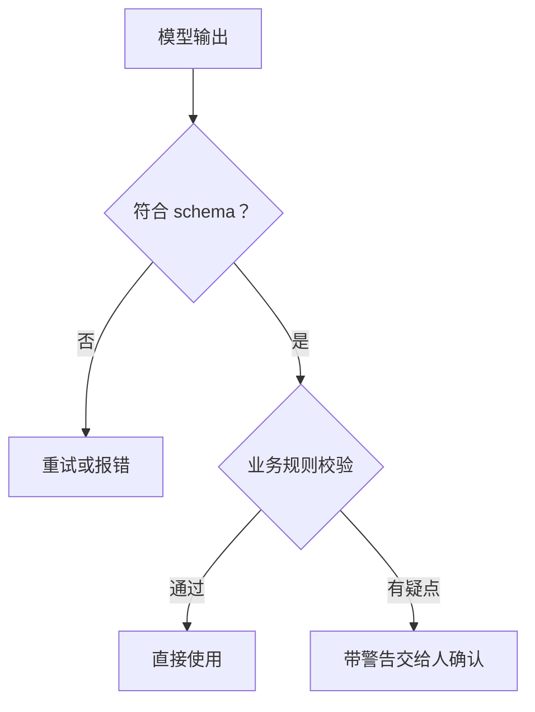

# 结构化输出

聊天界面里，模型输出一段文字给人看就够了。但在产品里，模型的输出多半要交给**程序**：存进数据库、渲染成表单、触发下一步操作。程序不认「大概是这个意思」，它要的是字段齐全、类型正确的 JSON。这一章讲怎么可靠地拿到结构化数据，以及拿到之后还要做什么。

## 从「求它」到「约束它」

让模型输出 JSON 有四种做法，可靠性逐级提高：

| 做法 | 原理 | 可靠性 | 适用 |
|---|---|---|---|
| 在 prompt 里要求「只输出 JSON」 | 靠模型自觉 | 大多数时候可以，偶尔夹带说明文字、写错标点 | 不支持约束输出的模型 |
| 上一种 + 宽容解析 | 从回复里抠出 JSON，修补常见错误 | 能救回一部分 | 同上，作为兜底 |
| 工具调用 + `strict: true` | 让模型「调用一个工具」，参数就是你要的数据 | 参数保证符合 schema | 需要同时调用工具时 |
| `output_config.format` 约束输出 | 生成时按 schema 约束，不合法的 token 不会被选中 | 保证语法正确、符合 schema | 首选 |

最后一种叫**约束解码**（constrained decoding）：模型每生成一个 token，服务端都检查它是否会让输出偏离 schema，偏离的候选直接排除。所以输出**在语法上一定合法**，不会出现缺括号、多逗号、字段名拼错。

## 用 Zod 定义 schema

TypeScript 项目里最顺手的方式是用 Zod 写 schema，SDK 帮你转成 JSON Schema 发给 API，再把结果解析成带类型的对象：

```bash
pnpm add zod
```

```typescript
import Anthropic from "@anthropic-ai/sdk";
import { zodOutputFormat } from "@anthropic-ai/sdk/helpers/zod";
import { z } from "zod";

const client = new Anthropic();

const ReceiptLine = z.object({
  name: z.string().describe("货品名本身，不含序号、数量、算式"),
  unit: z.string().nullable().describe("照抄单位格原文，如「斤」「6斤7两」"),
  quantity: z.number().nullable(),
  unitPrice: z.number().nullable(),
  amount: z.number().nullable(),
});

const Receipt = z.object({
  date: z.string().nullable().describe("YYYY-MM-DD；单据写「26年7月5日」指 2026-07-05"),
  supplier: z.string().nullable(),
  lines: z.array(ReceiptLine),
  total: z.number().nullable(),
});

type Receipt = z.infer<typeof Receipt>;

export async function readReceipt(imageBase64: string): Promise<Receipt> {
  const res = await client.messages.parse({
    model: "claude-opus-5-5",
    max_tokens: 8000,
    system: "你在帮一家餐馆录入手写的进货单。读不出来的字段写 null，不要猜。",
    messages: [
      {
        role: "user",
        content: [
          { type: "image", source: { type: "base64", media_type: "image/jpeg", data: imageBase64 } },
          { type: "text", text: "逐行读出这张进货单。" },
        ],
      },
    ],
    output_config: { format: zodOutputFormat(Receipt) },
  });

  if (res.stop_reason === "max_tokens") throw new Error("输出被截断，单据行数太多");
  if (res.stop_reason === "refusal") throw new Error("模型拒绝处理这张图片");
  if (!res.parsed_output) throw new Error("没有解析出结构化结果");
  return res.parsed_output;
}
```

注意三点：

1. `messages.parse()` 返回的 `parsed_output` 已经是 `Receipt` 类型，不用自己 `JSON.parse`
2. **截断和拒绝仍然要检查**。约束解码保证「生成出来的部分」合法，但撞到 `max_tokens` 时输出就是不完整的
3. `.describe()` 写的说明会进入 JSON Schema 发给模型，相当于每个字段旁边的小 prompt。字段级的规则写在这里，比堆在 system 里更不容易被忽略

## schema 怎么设计

schema 本身就是 prompt 的一部分，设计得好坏直接影响准确率。

### 给「不知道」留位置

**每个可能读不出来的字段都应该是 nullable**。如果 `quantity` 是必填的 `number`，模型在读不出数量时被逼着填一个数，它就会编。允许 `null`，它才有诚实的出口。

hatch-counter 的 prompt 里有一条规则特别说明了这个问题：「每个字段都要有值：读不出来就写 null，绝对不要把『数量』『金额』这类字段说明当成值写进去」。这是在没有约束解码的接口上，用 prompt 弥补 schema 的表达力。

### 用枚举代替自由文本

```typescript
const Ticket = z.object({
  category: z.enum(["network", "crash", "billing", "account", "other"]),
  severity: z.enum(["low", "medium", "high"]),
  summary: z.string().describe("一句话概括，不超过 30 字"),
});
```

枚举让下游代码可以直接 `switch`，也让模型没法发明新类别。记得留一个 `other`，否则不属于任何类别的输入会被硬塞进最接近的那个。

### 保持扁平

嵌套三四层的 schema 会让模型和你都容易出错。能用两个平铺字段表达的，就不要建一个子对象。数组里放对象是常见且合理的（比如单据的行），但对象里再套数组再套对象就要三思。

### 把「原文」和「解释」分开

需要模型既抄录又判断时，分成两个字段：

```typescript
const Line = z.object({
  rawText: z.string().describe("这一行在图上的原文，照抄"),
  name: z.string().describe("从原文中提取的货品名"),
  quantity: z.number().nullable(),
});
```

`rawText` 保留了证据，出错时能看出是「认字认错了」还是「理解错了」。

## 约束不了的：语义

约束解码保证 JSON 合法、字段齐全、类型正确，但**保证不了内容是对的**。数量读成了单价、日期年份猜错了、金额小数点漏了，这些 schema 都拦不住。

所以结构化输出后面一定要接一层**业务校验**：



hatch-counter 的做法是很好的参照。模型返回每一行之后，代码会做这些检查：

- **交叉验证**：数量 × 单价 ≠ 金额时，加一条警告「『大白菜』的数量×单价和金额对不上，核对一下」
- **推导补全**：数量格空着、但单价和金额都有时，按金额 ÷ 单价算出数量，同时提示「有 3 行的数量是算出来的，核对一下」
- **格式规范化**：日期、金额都经过专门的解析函数（如 `parseLooseCents`），把「12.5」「12.50元」统一转成以分为单位的整数
- **结构核对**：模型读出的列数和模板记录的列数不一致时，提示「这家可能换了单据格式」

这些检查的结果不是直接报错，而是作为 `warnings` 和数据一起交给店主确认。**模型做初稿，规则挑疑点，人做最终决定**，这是一个在大多数录入、提取类场景都适用的分工。

## 没有约束解码时：宽容解析

不是所有厂商、所有模型都支持约束输出。hatch-counter 用的智谱视觉模型走 OpenAI 兼容接口，只能靠 prompt 要求 JSON，代码注释里说得很直白：模型「偶尔不按格式回话，所以下面的 JSON 提取写得比较宽容」。

宽容解析的思路：

1. 从回复里找出所有可能是 JSON 的片段（去掉 Markdown 代码块标记、前后的说明文字）
2. 对每个片段先直接 `JSON.parse`，失败则修补常见错误（中文引号和逗号、末尾多余的逗号）再试
3. 优先返回结构最完整的那个（比如带 `lines` 数组的），实在没有再退而求其次

```typescript
export function parseModelJson(text: string): unknown | null {
  let fallback: unknown | null = null;
  for (const raw of extractJsonCandidates(text)) {
    for (const attempt of [raw, repairJson(raw)]) {
      let parsed: unknown;
      try {
        parsed = JSON.parse(attempt);
      } catch {
        continue;
      }
      if (!parsed || typeof parsed !== "object" || !Object.keys(parsed).length) continue;
      if (Array.isArray((parsed as { lines?: unknown }).lines)) return parsed;
      fallback ??= parsed;
    }
  }
  return fallback;
}
```

解析出对象之后，还要用 Zod 的 `safeParse` 做一遍类型校验，而不是直接相信它。解析两次仍失败时，hatch-counter 会**重试一次**，因为「大模型偶尔会跑题或者标点写歪，重试一次比让用户自己点第二遍强」；再失败就把原始输出写进日志，给用户一个可操作的提示。

有约束解码就用约束解码，宽容解析是给没有的情况准备的兜底。

## 结构化输出与工具调用的关系

工具调用（下一章）的参数本质上也是结构化输出：模型生成一个符合 `input_schema` 的 JSON。两者怎么选：

| 你想要 | 用 |
|---|---|
| 模型最终给出一份结构化结果 | `output_config.format` |
| 模型在过程中调用外部能力，参数要可靠 | 工具 + `strict: true` |
| 两者都要 | 同时用：工具负责过程，`format` 负责最终答案 |

过去常见的一个技巧是定义一个假工具，再用 `tool_choice` 强制模型调用它，借此拿到 JSON。新一代 Claude 模型（Opus 5.5、Sonnet 5.5 等）已经不支持强制指定工具，这个技巧也就该换成 `output_config.format` 了。

## 本章要点

- 产品里的模型输出大多给程序用，要的是 schema 合法的结构化数据
- 首选 `output_config.format` 的约束解码，用 Zod 定义 schema，`messages.parse()` 直接拿到带类型的对象
- 约束解码不防截断：**仍要检查 `stop_reason`**
- schema 是 prompt 的一部分：可能缺失的字段设为 nullable，分类用枚举并留 `other`，结构保持扁平，`.describe()` 写字段级规则
- 约束只管语法不管语义，后面要接业务校验：交叉验证、规范化、带警告交给人确认
- 没有约束解码的接口用「prompt 要求 + 宽容解析 + 类型校验 + 重试一次」兜底

## 动手练习

1. **nullable 是诚实的出口**：用 Zod 定义 `z.object({ quantity: z.number() })` 和 `z.object({ quantity: z.number().nullable() })`，分别 `safeParse({ quantity: null })`，打印 `.success`。

   验证：前者输出 `false`，后者输出 `true`。

   参考答案：非 nullable 的数字字段没有表达「读不出来」的合法取值，约束解码下模型只能填一个数，也就是编一个。可能缺失的字段都应设为 nullable。

2. **写一个宽容解析**：实现本章的 `repairJson`，至少处理中文逗号、中文引号和末尾多余的逗号，再配合 `parseModelJson` 解析下面这段模型回复。

   ````text
   好的，结果如下：
   ```json
   {"lines": [{"name": "白菜", "amount": 12.5,},]}
   ```
   ````

   验证：解析结果是对象，`lines.length` 为 1，`lines[0].name` 为 `白菜`；直接 `JSON.parse` 原文则抛出 `SyntaxError`。

   参考答案：先剥掉代码块标记和前后说明文字，再用正则把 `,}`、`,]` 里的逗号去掉，把全角标点换成半角后重试解析。

3. **业务校验别用浮点比较**：写一个 `checkLine(quantity, unitPrice, amount)`，在数量×单价≠金额时返回警告。用数量 3、单价 0.1、金额 0.3 测试。

   验证：`node -p "3 * 0.1 === 0.3"` 输出 `false`，直接比较会产生误报；改成以分为单位的整数比较（`Math.round(unitPrice * 100) * quantity === Math.round(amount * 100)`）后不再报警。

   参考答案：这就是本章提到 hatch-counter 用 `parseLooseCents` 把金额统一成「分」的原因，钱的计算和比较都用整数。
