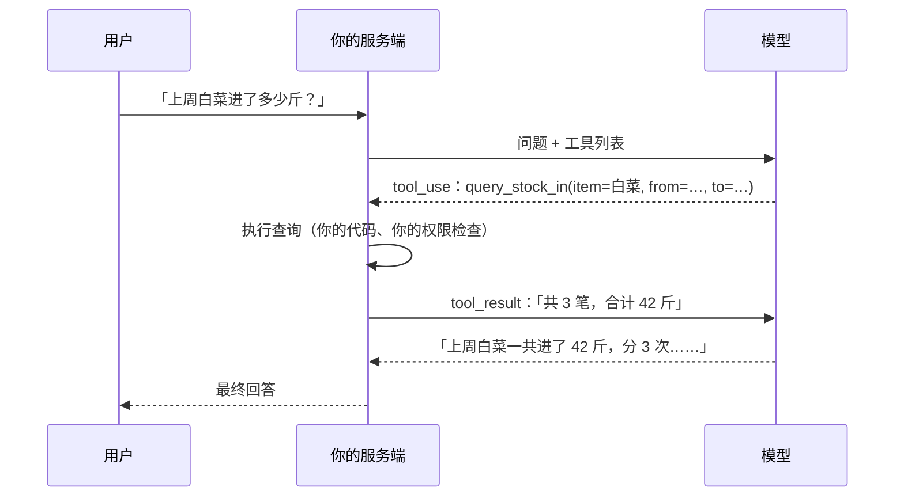

# 工具调用

模型只能生成文本。它不知道今天的库存，查不了订单，也发不了通知。**工具调用**（tool use，也叫 function calling）让模型可以说「我需要调用某个函数，参数是这些」，由你的程序去执行，再把结果交还给它。这是从「问答机器人」走向「能办事的系统」的关键一步，也是 Agent 的基础。这一章讲清楚工具调用的协议、循环的写法，以及怎么把工具设计得安全好用。

## 模型不执行任何东西

最重要的一点先说清楚：**模型从不执行工具**。它只是输出一个结构化的「调用请求」，执行与否、怎么执行，完全由你的代码决定。



这意味着：权限检查、参数校验、危险操作的确认，都在你的代码里做，**不能指望模型「自觉」**。

## 定义工具

一个工具由三部分组成：名字、描述、参数的 JSON Schema。

```typescript
import Anthropic from "@anthropic-ai/sdk";

const tools: Anthropic.Tool[] = [
  {
    name: "query_stock_in",
    description:
      "查询某个货品在一段时间内的进货记录，返回每笔的日期、数量、单价和合计。" +
      "用户问进了多少、花了多少钱、从谁家进的时使用。日期不确定时先问用户，不要猜。",
    strict: true,
    input_schema: {
      type: "object",
      properties: {
        item: { type: "string", description: "货品名，如「大白菜」" },
        from: { type: "string", description: "起始日期 YYYY-MM-DD（含）" },
        to: { type: "string", description: "结束日期 YYYY-MM-DD（含）" },
      },
      required: ["item", "from", "to"],
      additionalProperties: false,
    },
  },
];
```

- **描述是写给模型看的说明书**：做什么、什么时候用、什么时候不用、返回什么。模型选不选这个工具、参数填得对不对，几乎全靠这段话
- `strict: true` 让参数严格符合 schema（要求 `additionalProperties: false` 并列出 `required`），省掉一大类参数校验错误
- 名字用动词开头、含义明确：`query_stock_in` 比 `stock` 好

## 工具调用循环

一次工具调用至少要两次 API 请求：第一次模型提出调用，第二次你把结果送回去，模型据此回答。模型也可能连续调用多个工具，所以要写成循环：

```typescript
import Anthropic from "@anthropic-ai/sdk";

const client = new Anthropic();
const MAX_STEPS = 10;

export async function runWithTools(userInput: string): Promise<string> {
  const messages: Anthropic.MessageParam[] = [{ role: "user", content: userInput }];

  for (let step = 0; step < MAX_STEPS; step++) {
    const res = await client.messages.create({
      model: "claude-opus-5-5",
      max_tokens: 8000,
      system: "你是门店管理助手。今天是 2026-11-02。",
      tools,
      messages,
    });

    // 无论是否调用工具，模型的回复都要原样追加进历史
    messages.push({ role: "assistant", content: res.content });

    if (res.stop_reason === "pause_turn") continue;
    if (res.stop_reason !== "tool_use") {
      return res.content
        .filter((b): b is Anthropic.TextBlock => b.type === "text")
        .map((b) => b.text)
        .join("");
    }

    const toolUses = res.content.filter(
      (b): b is Anthropic.ToolUseBlock => b.type === "tool_use",
    );

    // 并行执行，所有结果放进同一条 user 消息
    const results = await Promise.all(
      toolUses.map(async (call): Promise<Anthropic.ToolResultBlockParam> => {
        try {
          const output = await executeTool(call.name, call.input);
          return { type: "tool_result", tool_use_id: call.id, content: JSON.stringify(output) };
        } catch (err) {
          return {
            type: "tool_result",
            tool_use_id: call.id,
            content: err instanceof Error ? err.message : String(err),
            is_error: true,
          };
        }
      }),
    );
    messages.push({ role: "user", content: results });
  }

  throw new Error(`工具调用超过 ${MAX_STEPS} 步仍未结束`);
}
```

几个容易写错的地方：

| 要点 | 原因 |
|---|---|
| 把 `res.content` **整个**追加进历史，而不是只取文本 | `tool_result` 要通过 `tool_use_id` 对上前面的 `tool_use`，丢了就报错 |
| 一轮里的多个工具结果放进**同一条** user 消息 | 拆成多条会让模型逐渐不再并行调用 |
| 工具失败时返回 `is_error: true` 的结果，而不是丢掉或抛出 | 模型看到错误信息后常常能自己纠正，比如换个参数重试 |
| 设置最大步数 | 防止模型陷入反复调用的死循环，烧钱又卡住请求 |
| 用 `JSON.parse` 处理过的 `call.input`，不要对原始字符串做文本匹配 | 不同模型对 JSON 字符串的转义方式可能不同 |

### 分发与校验

`executeTool` 负责把调用分发到真正的实现，**并且再校验一遍参数**。`strict` 保证了形状，但业务上的合法性（日期范围是否过大、用户有没有权限看这个门店的数据）仍要自己判断：

```typescript
import { z } from "zod";

const QueryStockIn = z.object({
  item: z.string().min(1),
  from: z.string().regex(/^\d{4}-\d{2}-\d{2}$/),
  to: z.string().regex(/^\d{4}-\d{2}-\d{2}$/),
});

async function executeTool(name: string, input: unknown): Promise<unknown> {
  switch (name) {
    case "query_stock_in": {
      const args = QueryStockIn.parse(input);
      if (daysBetween(args.from, args.to) > 366) {
        throw new Error("时间范围不能超过一年，请缩小范围");
      }
      return stockService.queryIn(currentStoreId(), args); // 门店 ID 来自登录态，不来自模型
    }
    default:
      throw new Error(`未知工具：${name}`);
  }
}
```

注意最后一行：**门店 ID 来自当前登录用户，而不是模型给的参数**。凡是涉及身份和权限的值，都不应该让模型来填，否则用户只要在对话里说一句「查一下隔壁店的数据」，就可能越权。

### 用 Tool Runner 省掉循环

SDK 提供了一个 beta 的 Tool Runner，帮你写好上面的循环，你只需要写工具函数。用 Zod 定义参数时，它会在调用你的函数前自动校验：

```typescript
import Anthropic from "@anthropic-ai/sdk";
import { betaZodTool } from "@anthropic-ai/sdk/helpers/beta/zod";
import { z } from "zod";

const client = new Anthropic();

const queryStockIn = betaZodTool({
  name: "query_stock_in",
  description: "查询某个货品在一段时间内的进货记录。",
  inputSchema: z.object({ item: z.string(), from: z.string(), to: z.string() }),
  run: async (args) => JSON.stringify(await stockService.queryIn(currentStoreId(), args)),
});

const finalMessage = await client.beta.messages.toolRunner({
  model: "claude-opus-5-5",
  max_tokens: 8000,
  tools: [queryStockIn],
  messages: [{ role: "user", content: "上周白菜进了多少斤？" }],
});
```

理解了手写循环，再用 Tool Runner 才知道它替你做了什么。需要在每一步插入自定义逻辑（审批、日志、限额）时，可以退回手写循环。

## 控制工具的使用

`tool_choice` 决定模型怎么对待工具：

| 取值 | 行为 |
|---|---|
| `{ type: "auto" }`（默认） | 模型自己决定调不调、调哪个 |
| `{ type: "none" }` | 本次不许调用工具 |
| `{ type: "any" }` / `{ type: "tool", name }` | 强制调用；**新一代 Claude 模型（Opus 5.5、Sonnet 5.5 等）不再支持**，会报 400 |

想让模型一定调用某个工具，现在的做法是在 prompt 里明确说「用 `query_stock_in` 查询」，配合 `strict: true`；收到回复后检查是否真的有 `tool_use` 块，没有就当作异常处理。

`disable_parallel_tool_use: true`（放在 `tool_choice` 里）可以限制每轮最多调用一个工具，适合工具之间有先后依赖、或者有副作用需要逐个确认的场景。

## 设计好用又安全的工具

工具设计的好坏，往往比 prompt 更决定效果。

### 返回模型读得懂的结果

工具结果是给模型看的，不是给前端看的。几条原则：

- **只返回需要的字段**。把一整行数据库记录（二十个字段，含内部 ID 和时间戳）丢给模型，既浪费 token 又分散注意力
- **用人类可读的值**。`"status": "已退货"` 比 `"status": 3` 好
- **结果太多时截断并说明**：「共 312 条，只返回最近 20 条；需要更多请缩小时间范围」
- **错误信息要可操作**：「日期格式应为 YYYY-MM-DD，收到的是 11/02」比「Invalid input」有用得多，模型看到后能自己改

### 读写分离，写操作要确认

把工具按风险分级：

| 级别 | 例子 | 处理 |
|---|---|---|
| 只读 | 查库存、查订单 | 直接执行 |
| 可撤销的写 | 加入草稿、生成待审单据 | 直接执行，界面上可撤销 |
| 不可撤销或涉及钱 | 发通知、付款、删除 | **先返回给用户确认**，确认后再执行 |

确认流程的一种实现：工具执行时不真正写入，而是返回「已生成待确认操作 #123：给 5 位员工发送排班通知」，前端展示确认按钮，用户点了之后由普通接口执行。模型只负责「提议」，人负责「拍板」。

### 幂等

网络超时、重试、模型重复调用都可能让同一个写操作执行两次。写类工具要么天然幂等（「把状态设为已完成」），要么带一个幂等键。这和普通接口的幂等设计完全一样，hatch-counter 的写接口就统一要求带幂等键。

### 工具不要太多

几个精心设计的工具，胜过几十个零碎的工具。工具定义本身会占用上下文（每次请求都要发），工具越多，模型选错的概率越高。功能相近的工具考虑合并，用一个参数区分。工具实在很多时，可以用工具搜索之类的机制按需加载，这部分在[《工具设计与 MCP》](../tools-and-mcp/)里展开。

## 服务端工具

除了你自己实现的工具，Anthropic 还提供一些**在它的服务器上执行**的工具，比如网页搜索、网页抓取、代码执行。声明之后模型会自己调用，结果直接出现在回复里，你不需要写执行逻辑。

```typescript
const res = await client.messages.create({
  model: "claude-opus-5-5",
  max_tokens: 8000,
  tools: [{ type: "web_search_20260209", name: "web_search", max_uses: 3 }],
  messages: [{ role: "user", content: "最近一周 Expo 有什么新版本发布？" }],
});
```

服务端工具按次数额外计费，工具类型名带日期版本，用之前查一下文档里的最新类型名。另外它们的错误不会抛异常，而是以一个错误内容块的形式出现在结果里，要记得检查。

## 从工具调用到 Agent

上面那个循环，如果把最大步数放宽、给模型一组足够通用的工具（读写文件、执行命令、搜索），让它自己规划步骤，就得到了一个 Agent。Claude Code 本质上就是这样一个循环加上精心设计的工具和上下文管理。

什么时候该用简单的单次调用，什么时候该上 Agent、Agent 的规划、记忆、失败模式怎么处理，是[《Agent 原理与设计》](../agent-principles/)的内容。一个朴素的原则是：**能用固定流程解决的，不要交给模型自由发挥**。固定流程更便宜、更快、更好测试。

## 本章要点

- 工具调用让模型输出结构化的调用请求，**执行由你的代码完成**，权限和校验也在你这边
- 工具 = 名字 + 描述 + 参数 schema；描述是写给模型的说明书，`strict: true` 保证参数合法
- 循环要点：完整追加 assistant 回复、同轮结果放一条消息、失败返回 `is_error`、设最大步数
- 身份、门店、权限相关的值从登录态取，**不让模型填**
- 新一代 Claude 不支持强制工具调用，改用 prompt 指示 + 检查结果
- 工具结果精简、可读、错误可操作；写操作分级，危险操作要人确认，写类工具要幂等
- 能用固定流程解决的就不要上 Agent

## 动手练习

1. **模型填不了门店 ID**：用本章的 `QueryStockIn` schema 解析一个带了额外字段的输入：`{ item: "白菜", from: "2026-11-01", to: "2026-11-07", storeId: "隔壁店" }`，打印结果。

   验证：输出里只有 `item`、`from`、`to` 三个键，没有 `storeId`。

   参考答案：Zod 的 `z.object` 默认丢弃未声明的键，`executeTool` 里的门店 ID 只能来自 `currentStoreId()`。想让多余字段直接报错，可以改用 `z.strictObject`，再观察 `parse` 抛出的错误。

2. **最大步数兜底**（需要 API key）：把 `executeTool` 改成永远返回「数据还在同步，请稍后再查一次」，`MAX_STEPS` 设为 3，问「上周白菜进了多少斤？」，在每轮循环里打印 `stop_reason`。

   验证：观察模型是否连续发起 `tool_use`。如果三轮都在调用，函数抛出「工具调用超过 3 步仍未结束」；如果模型中途放弃并直接回答，打印出的最后一个 `stop_reason` 是 `end_turn`。

   参考答案：无论模型怎么表现，上限都保证请求不会无休止地调用下去。生产代码里还要把触顶次数记进日志，它往往意味着工具设计或描述有问题。

3. **给工具分级**：下面五个工具分别属于本章「读写分离」表里的哪一级？`list_suppliers`（列出供货商）、`create_draft_order`（生成进货草稿）、`send_staff_notice`（给员工发通知）、`delete_receipt`（删除一张单据）、`get_today_sales`（查今日营业额）。

   验证：对照本章的三级表格，每个工具都能说出「直接执行」「执行后可撤销」「先给用户确认」中的一个，并说出理由。

   参考答案：`list_suppliers`、`get_today_sales` 只读；`create_draft_order` 是可撤销的写；`send_staff_notice` 发出去收不回，`delete_receipt` 不可撤销，两者都要先返回待确认操作，由人点确认后再执行。
