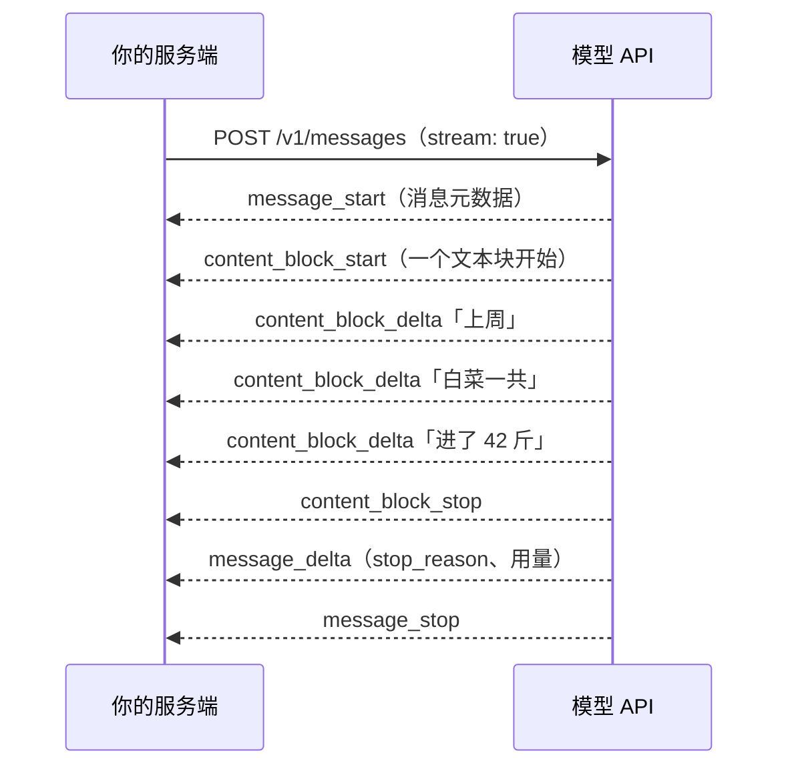
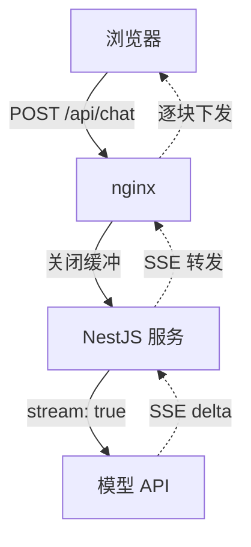

# 流式输出

模型生成一段 500 字的回答可能要十几秒。如果等全部生成完再返回，用户盯着转圈十几秒，体验很差；如果边生成边显示，第一个字在一两秒内就出现，用户会觉得「它在思考、在打字」，等待感完全不同。这就是**流式输出**。这一章讲它在 API 层怎么工作，以及怎么把它一路送到浏览器：经过你的 NestJS 服务、经过 nginx，并且在用户关掉页面时及时停下来，不再为没人看的输出付钱。

## 为什么要流式

[《大模型原理科普》第 7 章](../llm-fundamentals/07-inference-sampling.md)讲过，输出 token 只能一个一个串行生成。一次请求的耗时大致是：

$$
\text{总耗时} \approx \text{排队与网络} + \text{预填充（随输入变长）} + \text{输出 token 数} \times \text{每个 token 的生成时间}
$$

流式改变不了总耗时，但改变了用户**感受到的**等待。衡量指标有两个：

| 指标 | 含义 | 影响因素 |
|---|---|---|
| 首 token 时间（TTFT） | 从发请求到看到第一个字 | 排队、输入长度、是否命中缓存、思考时长 |
| 总耗时 | 到最后一个字 | 主要取决于输出长度 |

除了体验，流式还有一个工程上的理由：**避免超时**。生成很长的输出（几万 token）时，非流式请求可能要跑好几分钟，途经的各种代理、负载均衡很容易在中途断开空闲连接。流式连接上一直有数据在流动，就不存在这个问题。SDK 甚至会在 `max_tokens` 很大、又没有开流式时提醒你。

## SSE 事件流

Anthropic 的流式响应用的是 **SSE**（Server-Sent Events）：一个 HTTP 响应不断开，服务端持续写入一行行事件。



| 事件 | 含义 |
|---|---|
| `message_start` | 消息开始，带消息 ID、模型等元数据 |
| `content_block_start` | 一个内容块开始，类型可能是 `text`、`thinking`、`tool_use` |
| `content_block_delta` | 块的增量内容：`text_delta`、`thinking_delta`、`input_json_delta` |
| `content_block_stop` | 块结束 |
| `message_delta` | 消息级别的更新，`stop_reason` 和最终用量在这里 |
| `message_stop` | 结束 |

一条消息可能包含多个块，比如先一个思考块、再一个文本块、再一个工具调用块，处理时按块的类型分别对待。

## 用 SDK 接收流

SDK 把事件流包装好了，最常用的写法：

```typescript
import Anthropic from "@anthropic-ai/sdk";

const client = new Anthropic();

const stream = client.messages.stream({
  model: "claude-opus-5-5",
  max_tokens: 32000,
  messages: [{ role: "user", content: "介绍一下 Postgres 的行级安全。" }],
});

stream.on("text", (delta) => process.stdout.write(delta));

const final = await stream.finalMessage(); // 完整的 Message，和非流式返回的一样
console.log("\n", final.stop_reason, final.usage);
```

`on("text")` 只给你文本增量，最省事；`finalMessage()` 在流结束后给出完整消息，用来检查 `stop_reason`、记录用量、存历史。**不要自己拼接 delta 再 `new Promise` 包一层等结束**，SDK 已经处理好了完成、出错、中断等各种状态。

需要区分块类型时（比如把思考过程和正文分开显示），直接遍历事件：

```typescript
for await (const event of stream) {
  if (event.type === "content_block_start") {
    console.log(`\n[${event.content_block.type}]`);
  } else if (event.type === "content_block_delta") {
    if (event.delta.type === "text_delta") process.stdout.write(event.delta.text);
    if (event.delta.type === "thinking_delta") process.stdout.write(event.delta.thinking);
  }
}
```

新一代 Claude 模型默认**不返回思考内容**（思考块的文本为空），只告诉你它在思考。如果想给用户展示思考摘要，要在请求里设置 `thinking: { type: "adaptive", display: "summarized" }`。否则开了思考的请求会表现为：前几秒什么都没有，然后正文突然开始。这段空白要在界面上用「正在思考」之类的状态填上。

## 一路送到浏览器

真实产品里，链路是：浏览器 → nginx → 你的服务端 → 模型 API。每一段都要「流」起来，任何一段攒包，流式就白做了。



### 服务端：NestJS 转发

NestJS 自带 `@Sse()` 装饰器，但它只支持 GET，而聊天请求要用 POST 带上历史消息。更直接的做法是拿到底层的 `Response` 自己写：

```typescript
// chat.controller.ts
import { Body, Controller, Post, Req, Res } from "@nestjs/common";
import type { Request, Response } from "express";
import Anthropic from "@anthropic-ai/sdk";

const client = new Anthropic();

@Controller("chat")
export class ChatController {
  @Post()
  async chat(
    @Body() body: { messages: Anthropic.MessageParam[] },
    @Req() req: Request,
    @Res() res: Response,
  ): Promise<void> {
    res.status(200);
    res.setHeader("Content-Type", "text/event-stream; charset=utf-8");
    res.setHeader("Cache-Control", "no-cache, no-transform");
    res.setHeader("X-Accel-Buffering", "no"); // 告诉 nginx 别攒包
    res.flushHeaders();

    const send = (event: string, data: unknown) =>
      res.write(`event: ${event}\ndata: ${JSON.stringify(data)}\n\n`);

    const stream = client.messages.stream({
      model: "claude-opus-5-5",
      max_tokens: 16000,
      messages: body.messages,
    });

    // 用户关了页面：立刻中止上游请求，不再为没人看的输出付钱
    req.on("close", () => stream.abort());

    stream.on("text", (delta) => send("delta", { text: delta }));

    try {
      const final = await stream.finalMessage();
      send("done", { stopReason: final.stop_reason, usage: final.usage });
      await saveUsage("chat", final); // 记账
    } catch (err) {
      if (!res.writableEnded) send("error", { message: "生成中断，请重试" });
    } finally {
      res.end();
    }
  }
}
```

要点：

- **只转发前端需要的东西**。不要把模型的原始事件原样透传，自己定义 `delta` / `done` / `error` 三种事件，前端好处理，也不泄露内部细节
- **监听客户端断开并中止上游**。不这么做的话，用户关了页面，模型还会把几千 token 生成完，钱照付
- 流在中途出错时，HTTP 状态码早已是 200 发出去了，**只能通过一个 `error` 事件告诉前端**

hatch-counter 的实时推送接口（`/v1/events`）用的是同样的写法：设置 `text/event-stream`、`X-Accel-Buffering: no`，`flushHeaders()` 之后监听 `close` 做清理。这套模式对推送和 AI 流式输出是通用的。

### nginx：关闭缓冲

nginx 默认会把上游的响应攒满一个缓冲区再往下发，流式输出就变成了「憋一会儿，蹦出一大段」。在对应的 location 关掉缓冲，并把读超时调到比最长生成时间更长：

```nginx
location /api/chat {
    proxy_pass http://app_upstream;
    proxy_http_version 1.1;
    proxy_buffering off;
    proxy_cache off;
    proxy_read_timeout 300s;
}
```

服务端的 `X-Accel-Buffering: no` 和 nginx 的 `proxy_buffering off` 作用相同。hatch-counter 的 nginx 配置注释里说两处都写，是「怕哪天只改了一处」，这是个好习惯。用 Cloudflare 等 CDN 时也要确认它不会缓冲这类响应。

### 前端：读取流

浏览器原生的 `EventSource` 只支持 GET，所以 POST 请求用 `fetch` 加 `ReadableStream` 自己解析：

```typescript
export async function streamChat(
  messages: { role: "user" | "assistant"; content: string }[],
  onDelta: (text: string) => void,
  signal?: AbortSignal,
): Promise<void> {
  const res = await fetch("/api/chat", {
    method: "POST",
    headers: { "Content-Type": "application/json" },
    body: JSON.stringify({ messages }),
    signal,
  });
  if (!res.ok || !res.body) throw new Error(`请求失败：${res.status}`);

  const reader = res.body.pipeThrough(new TextDecoderStream()).getReader();
  let buffer = "";
  for (;;) {
    const { value, done } = await reader.read();
    if (done) break;
    buffer += value;
    // SSE 事件之间用空行分隔；最后一段可能不完整，留到下一轮
    const parts = buffer.split("\n\n");
    buffer = parts.pop() ?? "";
    for (const part of parts) {
      const event = /^event: (.+)$/m.exec(part)?.[1];
      const data = /^data: (.+)$/m.exec(part)?.[1];
      if (!event || !data) continue;
      const payload = JSON.parse(data);
      if (event === "delta") onDelta(payload.text);
      if (event === "error") throw new Error(payload.message);
    }
  }
}
```

在 React 里，用户点「停止生成」时调用 `AbortController.abort()`，`fetch` 被取消，连接断开，服务端收到 `close` 事件再中止上游，整条链都停下来。

### 渲染的细节

- **增量渲染 Markdown**：每来一个 delta 就整段重新解析 Markdown 是可以接受的（几千字以内很快），但要节流，比如每 50 毫秒最多渲染一次，避免过于频繁的 DOM 更新
- **未闭合的结构**：代码块只来了开头的三个反引号、表格只来了一半时，渲染结果会闪烁。多数 Markdown 库能容忍，必要时在渲染前临时补一个闭合标记
- **滚动跟随**：用户往上翻看时不要强行滚到底部

## 流式 + 工具调用

流式和工具调用可以同时用。工具的参数以 `input_json_delta` 的形式一段段到达，是不完整的 JSON 片段，要等 `content_block_stop` 之后才能完整解析。通常的做法是：文本 delta 实时显示，工具调用等 `finalMessage()` 拿到完整的 `tool_use` 块后再执行，然后开下一轮请求。

工具参数很大时（比如模型要写一整个文件），可以在工具定义上设置 `eager_input_streaming: true`，让参数边生成边流出来，而不是攒到最后一次性到达。开了它之后，API 不再替你校验参数，拿到的 JSON 可能不完整，**执行前一定要自己用 schema 校验**，并检查 `stop_reason` 不是 `max_tokens`。

## 中途失败怎么办

流式请求可能在任何时刻断掉：网络抖动、服务端过载、用户网络切换。几条处理原则：

| 情况 | 处理 |
|---|---|
| 还没收到任何内容就失败 | 和非流式一样，可以安全重试（第 9 章） |
| 已经输出了一部分 | 不要自动从头重试，用户会看到内容消失又重来。保留已有内容，标记「生成中断」，给一个重试按钮 |
| 用户主动停止 | 已生成的部分照常保存进历史，用户可以接着问 |

另外，已经流出去的那部分 token 是要计费的，即使最终失败了也一样。

## 什么时候不用流式

流式不是银弹。下面这些场景用非流式更简单：

- **后台任务**：批量处理、定时任务，没有人在等着看，用非流式甚至用批处理接口（第 7 章）
- **输出给程序用的结构化数据**：半截 JSON 没有用处，等完整结果更简单。但输出很长时仍然建议用流式接收、用 `finalMessage()` 拿结果，以避免超时
- **很短的输出**：分类、打标签这种只输出几个 token 的，流不流没区别

## 本章要点

- 流式不缩短总耗时，但大幅缩短**首 token 时间**，并避免长输出超时
- Anthropic 用 SSE 事件流，按内容块组织：start → 若干 delta → stop，`stop_reason` 和用量在 `message_delta` 里
- SDK 用 `on("text")` 拿增量、`finalMessage()` 拿完整结果，不要自己包 Promise
- 整条链都要流：服务端自定义精简事件、nginx 关缓冲、前端用 `fetch` + `ReadableStream`
- **用户断开时中止上游**，否则为没人看的输出付钱
- 中途出错只能通过事件告知前端；已输出部分不要静默重来
- 后台任务、结构化数据、短输出不必流式
