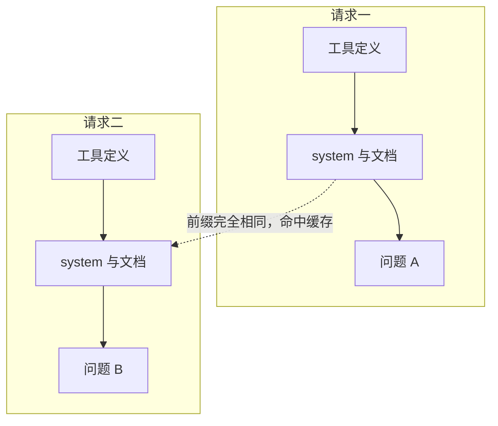
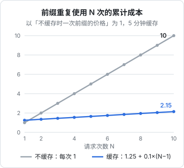
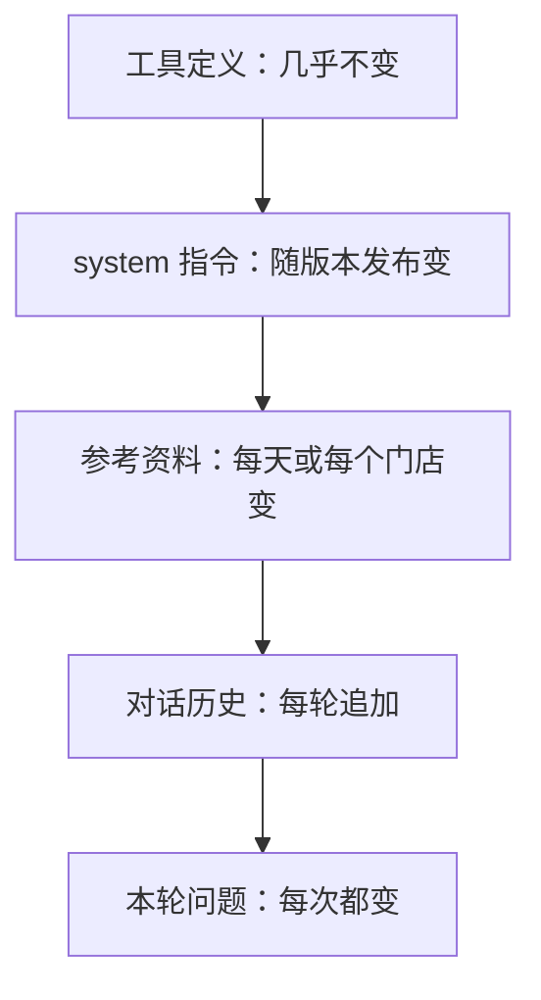

# Prompt 缓存

大多数 AI 功能的请求都长得很像：同一份几千字的 system prompt、同一组工具定义、同一份参考文档，只有最后的用户问题不同。每次都让模型从头处理这些重复内容，是在为同样的计算反复付钱。**Prompt 缓存**让服务商把重复前缀的计算结果存起来，下次直接复用：命中缓存的输入只收很小一部分价格，首 token 也来得更快。它是成本优化里**唯一不牺牲质量**的手段，应该在每个功能上线前就做好。

## 原理：复用前缀的计算

[《大模型原理科普》第 7 章](../llm-fundamentals/07-inference-sampling.md)讲过 KV Cache：模型处理输入时，会为每个 token 算出 Key 和 Value，后续生成要反复用到。Prompt 缓存就是把这些中间结果跨请求保存下来。

由于注意力是因果的，每个 token 的计算结果只取决于它**前面**的内容，所以缓存只能按**前缀**复用：



这决定了缓存的第一条铁律：**前缀里任何一个字节变了，从那里往后的缓存全部失效**。在 system prompt 开头插一个当前时间，整份缓存就永远不会命中。

## 算一笔账

缓存的计费分三部分（Anthropic 的倍数，以基础输入价格为 1）：

| 部分 | 价格倍数 | 说明 |
|---|---|---|
| 写入缓存（5 分钟有效期） | 1.25 | 第一次处理这段前缀，比普通输入贵 25% |
| 写入缓存（1 小时有效期） | 2 | 存得久，写入更贵 |
| 读取缓存 | 约 0.1 | 部分新型号更低 |
| 普通输入 | 1 | 断点之后、没有缓存的部分 |

用 5 分钟缓存时，前缀只要被用到**两次**就回本：$1.25 + 0.1 = 1.35 < 2$。用得越多，省得越多：



一个 5000 token 的 system prompt，每天被调用一万次。不缓存时每天的这部分输入是 5000 万 token；缓存命中良好时，折算下来只相当于几百万 token 的价格。对于聊天、Agent 这类每轮都重发完整历史的场景，节省更明显，因为历史本身也是可以缓存的前缀。

除了省钱，命中缓存的部分不需要重新预填充，**首 token 时间也会明显缩短**，长 prompt 时尤其明显。

## 怎么开启

### 自动缓存：最简单

> [!WARNING]
> 顶层 `cache_control`（自动缓存）的写法按 2026 年 10 月 Anthropic 官方 SDK 文档整理，一个请求最多 4 个缓存断点，最短可缓存长度随模型不同（几百到几千 token），太短的前缀会静默不缓存。以 Anthropic 官方文档的 Prompt caching 页面为准。

在请求顶层加一个 `cache_control`，API 会自动把缓存断点放在最后一个可缓存的块上，并随着对话增长往后移：

```typescript
const res = await client.messages.create({
  model: "claude-opus-5-5",
  max_tokens: 8000,
  cache_control: { type: "ephemeral" }, // 自动缓存
  system: LONG_SYSTEM_PROMPT,
  messages: history,
});
```

多轮对话用这个就够了：每一轮都会复用上一轮的整段历史。

### 显式断点：精确控制

请求的渲染顺序是 **tools → system → messages**。你可以在任意内容块上加 `cache_control`，表示「缓存到这里为止的全部内容」：

```typescript
const res = await client.messages.create({
  model: "claude-opus-5-5",
  max_tokens: 8000,
  tools, // 工具定义排在最前面，会被一起缓存
  system: [
    { type: "text", text: STATIC_INSTRUCTIONS },
    {
      type: "text",
      text: `<handbook>\n${storeHandbook}\n</handbook>`,
      cache_control: { type: "ephemeral" }, // 断点：tools + system 一起缓存
    },
  ],
  messages: [{ role: "user", content: question }],
});
```

几个限制：

- 一个请求最多 **4 个**断点（自动缓存也占一个）
- 前缀太短不会被缓存，而且**不报错**，只是 `cache_creation_input_tokens` 为 0。最小长度因模型而异（从几百到几千 token 不等），以文档为准
- 缓存按模型隔离，换了模型就是另一份缓存

### 什么时候必须用显式断点

如果 prompt 的结尾是**每次都不同**的内容（比如检索出的文档片段、用户的问题），自动缓存会把断点放在最后，结果每次都写入一份新缓存、却从来读不到，白付 25% 的写入溢价。这时要把显式断点放在**共享部分的末尾**。

一个稳妥的组合：在静态 system 的最后一块放一个显式断点，保证这部分一定能复用；同时开启顶层自动缓存，覆盖不断增长的对话历史。

## 按稳定性分层排列

设计 prompt 时，按「多久变一次」从前往后排：



每两层之间是一个天然的断点位置。越靠前的越稳定，命中率越高。反过来，**任何会变的东西都不要放在稳定内容的前面**。

## 悄悄让缓存失效的东西

缓存失效不会报错，只会让账单变贵。下面这些是最常见的「隐形杀手」：

| 写法 | 为什么失效 | 改法 |
|---|---|---|
| system 里写「当前时间：2026-11-02 14:03:27」 | 每次都不同 | 精确到天，或放到最后一条 user 消息里 |
| system 里拼了用户名、用户 ID | 每个用户一份缓存 | 用户相关信息放到 messages 里 |
| `JSON.stringify(obj)` 的键顺序不固定 | 字节不同 | 固定键顺序后再序列化 |
| 工具列表按权限动态增减 | 工具在最前面，一变全失效 | 工具列表保持固定，在执行时做权限检查 |
| 工具列表顺序不固定（比如从 Map 或数据库无序读出） | 字节不同 | 按名字排序 |
| 每轮修改或删除历史中的旧消息 | 改动点之后全部失效 | 历史只追加不修改 |
| 中途切换模型、修改 effort 等参数 | 缓存按模型、部分参数隔离 | 一个会话内保持一致 |

hatch-counter 的进货单 prompt 天然是缓存友好的：变化的只有「表格列依次是什么」这一句和图片本身，规则部分完全不变。如果把那句话挪到规则之后，规则就成了稳定前缀。

### 需要在会话中途改指令怎么办

有时需要在对话进行中给模型加一条新指令（比如用户切换到「简洁模式」）。直接修改顶层 system 会让整个缓存失效。部分新型号支持在 `messages` 末尾追加一条 `role: "system"` 的消息来下达中途指令，这样前面的缓存不受影响。具体哪些型号支持，以文档为准。

## 验证缓存是否命中

不要假设缓存生效了，要看数据。每次响应的 `usage` 里有三个字段：

```typescript
const { input_tokens, cache_creation_input_tokens, cache_read_input_tokens } = res.usage;

const totalInput = input_tokens + (cache_creation_input_tokens ?? 0) + (cache_read_input_tokens ?? 0);
const hitRate = totalInput ? (cache_read_input_tokens ?? 0) / totalInput : 0;
console.info("cache", { feature: "chat", hitRate: hitRate.toFixed(2) });
```

| 现象 | 说明 |
|---|---|
| 第一次 `cache_creation` 大，之后 `cache_read` 大 | 正常 |
| 每次 `cache_creation` 都大，`cache_read` 一直是 0 | 前缀每次都在变，或断点放在了每次都不同的内容之后 |
| 两者都是 0 | 前缀没达到最小长度，或根本没设断点 |
| 时好时坏 | 请求间隔超过了缓存有效期，或者有部分请求带了不同的参数 |

把命中率作为一个监控指标（第 7 章），按功能统计。上线一个新功能后命中率突然掉下来，多半是有人在 prompt 前面加了动态内容。

## 有效期怎么选

5 分钟的缓存在**每次被读取时都会刷新**有效期。所以只要同一前缀的请求间隔小于 5 分钟，它就会一直热着，不需要 1 小时的版本。

| 同一前缀的请求间隔 | 选择 |
|---|---|
| 持续不断，间隔几秒到几分钟 | 5 分钟（默认） |
| 间隔经常在 5 分钟到 1 小时之间（比如用户读完长回复再问下一句） | 1 小时，写入贵但能跨过停顿 |
| 间隔超过 1 小时、很少复用 | 缓存意义不大 |

注意计时从请求**开始**算起，生成本身的时间也算在内。一个要生成 4 分钟的请求，结束后留给下一个请求的时间只剩 1 分钟左右。

## 其他厂商

Prompt 缓存已是行业标配，但具体形式不同：有的厂商对达到一定长度的前缀**自动缓存**，不需要标记；有的需要显式创建缓存对象并引用它的 ID；折扣比例和有效期也各不相同。

不管哪家，原理都是前缀复用，所以本章的设计原则通用：**稳定内容在前、变化内容在后，不在前缀里放时间戳和用户信息，用 usage 字段验证**。

## 本章要点

- Prompt 缓存复用相同前缀的计算结果，降低成本和首 token 时间，**不影响输出质量**
- 缓存按前缀匹配，前缀里任何字节变化都会让后面全部失效
- Anthropic 的 5 分钟缓存写入 1.25 倍、读取约 0.1 倍，前缀用到两次就回本
- 多轮对话用顶层自动缓存；结尾每次都变的场景用显式断点放在共享部分末尾
- 按稳定性排列：工具 → system → 资料 → 历史 → 问题
- 时间戳、用户信息、动态工具列表、不固定的 JSON 键顺序、修改历史，都会悄悄让缓存失效
- 用 `cache_read_input_tokens` 验证命中，把命中率当作监控指标

## 动手练习

1. **算回本点**：用本章的价格倍数，在 Node 里分别算出同一前缀使用 $n$ 次时「不缓存」「5 分钟缓存」「1 小时缓存」的累计成本：$n$、$1.25 + 0.1(n-1)$、$2 + 0.1(n-1)$。

   验证：`n = 10` 时 5 分钟缓存约为 `2.15`，与本章配图一致；5 分钟缓存从第 2 次起就比不缓存便宜，1 小时缓存从第 3 次起才便宜（$n=2$ 时是 2.1 对 2）。

   参考答案：1 小时缓存写入更贵，只有在请求间隔经常超过 5 分钟、5 分钟缓存总是过期的场景才划算。

2. **键顺序让缓存失效**：运行 `node -p 'JSON.stringify({b:1,a:2}) === JSON.stringify({a:2,b:1})'`，再写一个按键名排序后序列化的 `stableStringify`，用同样两个对象比较。

   验证：第一条命令输出 `false`；`stableStringify` 对两个对象输出相同的字符串。

   参考答案：对象键的顺序取决于插入顺序，同样的数据拼进 prompt 后字节不同，缓存前缀就断了。拼进 prompt 的对象和工具列表都要先固定顺序。

3. **亲眼看命中和失效**（需要 API key）：准备一段超过模型最小缓存长度的 system（比如几千字的店铺手册），带显式断点连续发两次相同请求，打印三个用量字段；然后在 system 开头加上 `当前时间：${new Date().toISOString()}` 再连发两次。

   验证：前两次里第一次 `cache_creation_input_tokens` 大于 0，第二次 `cache_read_input_tokens` 大于 0；加了时间戳后两次的 `cache_read_input_tokens` 都是 0。如果一开始两项都是 0，说明前缀没达到最小长度。

   参考答案：时间戳每次都不同，断点之前的前缀永远对不上。时间精确到天，或者挪到最后一条 user 消息里。
