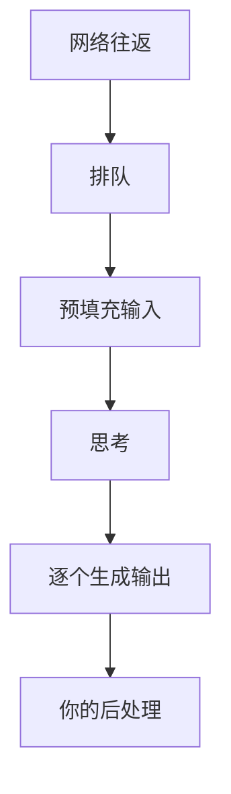

# 成本与延迟

一人公司做 AI 功能，最怕两件事：月底收到一张看不懂的账单，以及用户抱怨「太慢了」。这两件事都可以提前算、提前测、提前控制。这一章先讲成本从哪来、怎么估、怎么降，再讲延迟由哪几段组成、每段怎么优化，最后给出一套记账和监控的落地方案：一张 Postgres 表加几条查询。

## 成本从哪来

模型 API 按 token 计费，一次调用的费用是：

$$
\text{费用} = \text{输入} \times p_{\text{in}} + \text{缓存写入} \times 1.25\,p_{\text{in}} + \text{缓存读取} \times 0.1\,p_{\text{in}} + \text{输出} \times p_{\text{out}}
$$

其中 $p_{\text{in}}$、$p_{\text{out}}$ 是每 token 的输入、输出单价（缓存倍数见第 6 章，以 5 分钟缓存为例）。几个关键事实：

- **输出比输入贵得多**，通常是好几倍。原因在[《大模型原理科普》第 7 章](../llm-fundamentals/07-inference-sampling.md)：输入可以并行预填充，输出只能逐个生成
- **思考 token 按输出计费**，即使你看不到思考内容
- **多轮对话的输入会累积**：第 10 轮请求要把前 9 轮的历史全部重新发一遍
- **工具定义、图片、文档都算输入**。一张图片通常折算成上千 token

### 估算一个功能的月成本

上线前先估一下，避免拍脑袋。下面用**假设的整数价格**演示方法：输入每百万 token 3 美元，输出每百万 token 15 美元。真实价格以官方定价页为准，不同档位的模型能差出几十倍。

以「进货单识别」为例：

| 项 | 估算 |
|---|---|
| 每次输入 | system 与规则约 1500 token，图片约 1500 token，共 3000 |
| 每次输出 | 一张 20 行的单子，JSON 约 1500 token |
| 单次费用 | $3000 \times 3 / 10^6 + 1500 \times 15 / 10^6 \approx 0.009 + 0.0225 = 0.0315$ 美元 |
| 调用量 | 100 家店 × 每天 5 张 × 30 天 = 15000 次 |
| 月成本 | 约 470 美元 |

这个估算立刻告诉你几件事：输出占了七成成本，所以压缩输出格式（比如字段名缩短、不输出无用字段）比压缩 prompt 更有效；如果每家店每月只付几十块钱订阅费，模型选型和定价就要重新考虑。

**一定要用真实数据跑一批**，拿 `usage` 里的实际数字替换估算值。图片、长文档的实际 token 数往往和直觉差得很远。

## 降低成本的手段

按「是否牺牲质量」排序，先做免费的，再考虑取舍：

| 手段 | 牺牲质量吗 | 效果 |
|---|---|---|
| Prompt 缓存（第 6 章） | 否 | 重复前缀降到约一成 |
| 批处理接口 | 否，但要等 | 价格减半，结果异步返回 |
| 精简输出：只要需要的字段，不要客套话 | 基本不 | 直接砍最贵的部分 |
| 精简输入：删无用的历史、工具结果只返回必要字段 | 基本不 | 长对话里效果显著 |
| 降低 effort | 可能 | 少想一些，输出 token 减少 |
| 换小模型 | 可能 | 单价可差一个数量级 |
| 限制每个用户的用量 | 不影响质量，影响体验 | 防止个别用户烧钱 |

### 批处理接口

不需要实时结果的任务（夜间汇总报表、批量给商品打标签、离线评测），用 Message Batches 接口提交，价格是普通调用的一半，结果在一段时间内（通常远少于 24 小时）返回：

```typescript
const batch = await client.messages.batches.create({
  requests: products.map((p) => ({
    custom_id: `product-${p.id}`,
    params: {
      model: "claude-haiku-5-5",
      max_tokens: 256,
      messages: [{ role: "user", content: `给这个商品打标签：${p.name}` }],
    },
  })),
});

// 之后轮询状态，结束后读取结果
const status = await client.messages.batches.retrieve(batch.id);
if (status.processing_status === "ended") {
  for await (const item of await client.messages.batches.results(batch.id)) {
    if (item.result.type === "succeeded") {
      await saveTags(item.custom_id, item.result.message);
    }
  }
}
```

结果的顺序不保证和提交顺序一致，**必须用 `custom_id` 对应**，不能按下标。

### 按「完成一件事」算成本

一个容易被忽略的陷阱：只盯着单次请求的价格。如果便宜模型需要重试两次、或者要多轮来回才能完成任务，总成本可能比贵模型一次做对还高。**衡量单位应该是「完成一个任务的成本」**，而不是「一次请求的成本」。

## 延迟由哪几段组成



| 阶段 | 和什么成正比 | 怎么优化 |
|---|---|---|
| 网络 | 服务器距离 | 服务端部署在离 API 近的地区 |
| 排队 | 服务商负载 | 无法控制，高峰期更慢 |
| 预填充 | 输入长度 | 精简输入、**Prompt 缓存** |
| 思考 | 任务难度和 effort | 简单任务用低 effort |
| 生成 | **输出 token 数** | 精简输出、换更快的模型 |
| 后处理 | 你的代码 | 校验、入库别阻塞响应 |

大多数场景下，**输出长度是延迟的主导因素**。一个输出 2000 token 的请求，不管输入多短，都快不起来。

### 降低延迟的手段

- **流式输出**（第 5 章）：不减少总时间，但把用户感知的等待降到首 token 时间
- **少输出**：让模型直接给结论，不要复述问题、不要「好的，我来帮你」；结构化输出里不要冗余字段
- **低 effort 或更小的模型**：分类、提取这类任务，小模型又快又准
- **并行**：互不依赖的多次调用用 `Promise.all` 同时发，比如同时生成标题和摘要
- **拆分**：一个大请求拆成「快速出初稿 + 后台补全细节」
- **预计算**：能提前算的提前算。比如商品描述在上架时生成好存起来，而不是用户打开页面时现生成
- **缓存结果**：同样的输入（比如同一张单据被重复识别）直接返回上次的结果

### 给延迟定预算

和接口性能一样，给每个 AI 功能定一个延迟目标，并据此做设计决策：

| 场景 | 可接受的延迟 | 设计含义 |
|---|---|---|
| 输入时的自动补全 | 几百毫秒 | 小模型、极短输出，或者不用大模型 |
| 聊天回复 | 首 token 1–3 秒 | 流式、缓存 |
| 拍照识别单据 | 十几秒 | 显示进度，允许后台处理 |
| 生成周报 | 分钟级 | 异步任务，完成后通知 |

hatch-counter 的单据识别给整条识别链设了 150 秒的总时限，并把 nginx 对应路径的读超时配成 180 秒，就是这种「先定预算、再让各层配合」的思路，第 9 章会细讲。

## 记账：一张表

成本和延迟的优化都建立在数据之上。建议从第一个 AI 功能起就把每次调用记进数据库。用 Drizzle 定义：

```typescript
// db/schema/llm-calls.ts
import { pgTable, uuid, text, integer, timestamp, index } from "drizzle-orm/pg-core";

export const llmCalls = pgTable(
  "llm_calls",
  {
    id: uuid("id").primaryKey().defaultRandom(),
    feature: text("feature").notNull(),          // 哪个功能：receipt_scan、chat…
    userId: uuid("user_id"),                     // 谁触发的，用于配额
    model: text("model").notNull(),
    promptVersion: text("prompt_version"),
    inputTokens: integer("input_tokens").notNull(),
    cacheWriteTokens: integer("cache_write_tokens").notNull().default(0),
    cacheReadTokens: integer("cache_read_tokens").notNull().default(0),
    outputTokens: integer("output_tokens").notNull(),
    latencyMs: integer("latency_ms").notNull(),
    ttftMs: integer("ttft_ms"),                  // 流式时记录首 token 时间
    stopReason: text("stop_reason"),
    error: text("error"),                        // 失败时的错误类型
    createdAt: timestamp("created_at", { withTimezone: true }).notNull().defaultNow(),
  },
  (t) => [index("llm_calls_feature_created_idx").on(t.feature, t.createdAt)],
);
```

在第 1 章的 `ask()` 封装里，每次调用结束后写一行。**不要在表里存价格**，价格会变；存 token 数，查询时再乘以当时的单价。写入失败不应影响主流程，可以异步写或者先打日志再批量入库。

有了这张表，常用的问题都能用 SQL 回答：

```sql
-- 最近 7 天每个功能的调用量、平均延迟、缓存命中率
SELECT
  feature,
  count(*)                                         AS calls,
  round(avg(latency_ms))                           AS avg_ms,
  percentile_cont(0.95) WITHIN GROUP (ORDER BY latency_ms) AS p95_ms,
  round(sum(cache_read_tokens)::numeric
        / nullif(sum(input_tokens + cache_write_tokens + cache_read_tokens), 0), 2) AS cache_hit,
  sum(output_tokens)                               AS output_tokens
FROM llm_calls
WHERE created_at > now() - interval '7 days'
GROUP BY feature
ORDER BY output_tokens DESC;

-- 用量最大的 10 个用户（找出异常使用）
SELECT user_id, count(*) AS calls, sum(input_tokens + output_tokens) AS tokens
FROM llm_calls
WHERE created_at > now() - interval '1 day'
GROUP BY user_id
ORDER BY tokens DESC
LIMIT 10;
```

## 配额与告警

一人公司没有人盯着账单，所以要让系统自己拦：

- **每用户配额**：调用前查一下这个用户今天的用量，超了就返回「今日额度已用完」。免费用户和付费用户给不同额度
- **全局熔断**：今天的总花费超过阈值时，非核心功能自动降级（比如关掉 AI 摘要，保留核心识别）
- **服务商侧上限**：在模型厂商的控制台设置每月花费上限，作为最后一道防线
- **异常告警**：某个功能的日调用量或平均输出长度突然翻倍，发通知给自己。这往往意味着出现了循环调用的 bug，或者有人在滥用接口

最后一条特别重要。工具调用循环写错（第 4 章）、重试逻辑写错（第 9 章），都可能在一夜之间烧掉一个月的预算，而代码层面不会有任何报错。

## 本章要点

- 费用 = 输入 + 缓存写入 + 缓存读取 + 输出，**输出最贵**，思考按输出计费，多轮对话的输入会累积
- 上线前用真实数据估算月成本，判断它和你的定价是否匹配
- 先做不牺牲质量的优化：缓存、批处理（价格减半）、精简输入输出；再考虑降 effort、换小模型
- 按「完成一个任务的成本」衡量，而不是单次请求
- 延迟主要由输出长度决定；流式、少输出、小模型、并行、预计算是主要手段
- 每个功能定延迟预算，并据此决定同步、流式还是异步
- 每次调用记一行（token、延迟、模型、功能、prompt 版本），用 SQL 回答成本问题；配额、熔断、告警防止一夜烧光预算

## 动手练习

1. **复算月成本**：用本章的假设价格（输入每百万 3 美元、输出每百万 15 美元）在 Node 里复算「进货单识别」的单次和月成本，再把输出从 1500 token 压缩到 750 token 重算一次。

   验证：原方案单次约 `0.0315` 美元、月成本约 `472.5` 美元；输出减半后月成本约 `303.75` 美元，而把输入减半只能降到约 `405` 美元。

   参考答案：输出单价是输入的 5 倍，在这个功能里占七成成本，压缩输出格式的收益明显大于压缩 prompt。

2. **用 SQL 回答成本问题**：在 Docker 里起一个 Postgres（`docker run --rm -e POSTGRES_PASSWORD=pw -p 5432:5432 postgres:17`），按本章字段建一张简化的 `llm_calls` 表，用 `generate_series(1, 100)` 插入 100 行 `feature = 'chat'`、`latency_ms` 依次为 1 到 100 的数据，再跑本章第一条统计查询。

   验证：`chat` 一行的 `calls` 为 100，`avg_ms` 为 51（50.5 四舍五入），`p95_ms` 为 `95.05`。

   参考答案：`percentile_cont` 在相邻两个值之间线性插值，位置是 $0.95 \times (100-1) = 94.05$，落在第 95 和第 96 个值之间。

3. **并行省掉的时间**：写两个模拟调用 `const fake = (ms: number) => new Promise((r) => setTimeout(r, ms));`，分别耗时 1000 和 1200 毫秒。先依次 `await`，再用 `Promise.all`，用 `performance.now()` 计时。

   验证：串行约 2200 毫秒，并行约 1200 毫秒。

   参考答案：互不依赖的调用并行后，总耗时取决于最慢的那一个，这就是本章「同时生成标题和摘要」的道理。
