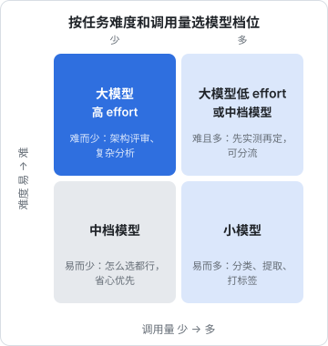
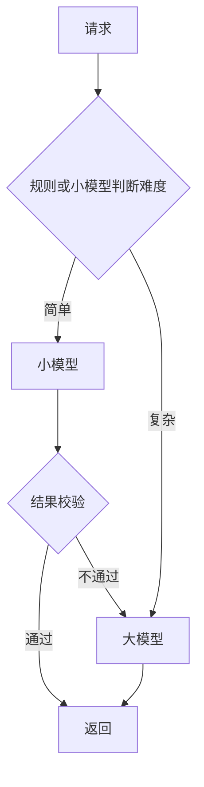

# 模型选型

模型的更新速度快到让人焦虑：每隔几个月就有新型号发布，各家都宣称在某个榜单上领先。对做产品的人来说，问题从来不是「哪个模型最强」，而是**「对我这个功能，哪个模型在质量、成本、延迟上最合适」**。这个问题没有通用答案，只能用自己的数据测出来。这一章给出选型要看的维度、一套用样例集比较模型的方法，以及怎么在代码里为「以后换模型」留好余地。

## 选型看什么

| 维度 | 要问的问题 |
|---|---|
| 质量 | 在**我的任务**上准不准？榜单分数只能参考 |
| 成本 | 按我的输入输出比例，完成一次任务多少钱？ |
| 延迟 | 首 token 多快？每秒输出多少 token？ |
| 上下文窗口 | 我的输入最长多少？会不会超？ |
| 能力 | 需要看图、读 PDF、调用工具、结构化输出吗？ |
| 稳定性 | 高峰期会不会频繁 429、529？有没有备选？ |
| 数据与合规 | 数据发给谁、存在哪里？用户在哪个国家？ |
| 生命周期 | 这个型号多久会被弃用？迁移成本多大？ |

最后两项最容易被忽略。如果你的用户主要在国内、处理的是经营数据，需要了解数据出境、生成式 AI 服务相关的管理规定，必要时选择境内厂商的模型。这类规定变化较快，**以主管部门的最新规定为准**，[《国内合规实务》](../opc-compliance-cn/)里有更系统的梳理。hatch-counter 的单据识别选了智谱的视觉模型和腾讯云 OCR，服务商都在境内，这本身就是选型的一部分。

## 模型的档位

各家厂商的产品线基本都分成几档。以 Claude 为例，同一代通常有三档：

| 档位 | Claude 对应 | 特点 | 典型用途 |
|---|---|---|---|
| 大 | Opus | 最强，最贵，较慢 | 复杂推理、编程、Agent、难的分析 |
| 中 | Sonnet | 能力和价格平衡 | 大多数日常功能、通用 Agent |
| 小 | Haiku | 最便宜、最快 | 分类、提取、路由、大批量处理 |

同代的大小档之间，单价可以相差一个数量级以上。另外还有更高的档位和特殊用途的型号，具体以官方模型列表为准。

除了换档位，**同一个模型的 effort 也是一个旋钮**。新一代模型在低 effort 下的表现，经常不输上一代模型在高 effort 下的表现。所以在决定「换小模型省钱」之前，先试试「同一个模型降低 effort」。



这张图只是起点。「难且多」那一格最值得花时间实测：任务难，小模型做不好；量又大，大模型太贵。答案可能是大模型加低 effort，也可能是中档模型，也可能是按难度分流。

## 用自己的数据比较

榜单测的是别人的任务。真正有用的比较是：**拿你的真实输入，让候选模型都跑一遍，按你的标准打分**。

### 准备样例集

- 30 到 100 条真实输入，覆盖常见情况和已知的难例
- 每条附上期望结果，或者至少有明确的判断标准
- 对提取、分类这类任务，期望结果可以是标准答案；对写作类任务，可以是一组检查项（「提到了价格」「不超过 100 字」）

### 写一个对比脚本

```typescript
// scripts/compare-models.ts
import Anthropic from "@anthropic-ai/sdk";
import { readFileSync } from "node:fs";

type Case = { id: string; input: string; expected: string };
type Effort = "low" | "medium" | "high";

const client = new Anthropic();
const cases: Case[] = JSON.parse(readFileSync("evals/ticket-classify.json", "utf8"));

const candidates: { model: string; effort: Effort }[] = [
  { model: "claude-opus-5-5", effort: "low" },
  { model: "claude-sonnet-5-5", effort: "low" },
  { model: "claude-haiku-5-5", effort: "low" },
];

const SYSTEM = "把用户的问题归类，只输出类别名：network / crash / billing / account / other";

for (const { model, effort } of candidates) {
  let correct = 0;
  let inputTokens = 0;
  let outputTokens = 0;
  const latencies: number[] = [];

  for (const c of cases) {
    const started = Date.now();
    const res = await client.messages.create({
      model,
      max_tokens: 1024,
      system: SYSTEM,
      output_config: { effort },
      messages: [{ role: "user", content: c.input }],
    });
    latencies.push(Date.now() - started);
    inputTokens += res.usage.input_tokens;
    outputTokens += res.usage.output_tokens;

    const answer = res.content
      .filter((b): b is Anthropic.TextBlock => b.type === "text")
      .map((b) => b.text)
      .join("")
      .trim();
    if (answer === c.expected) correct++;
    else console.log(`[${model}] ${c.id}: 期望 ${c.expected}，得到 ${answer}`);
  }

  latencies.sort((a, b) => a - b);
  console.table({
    model,
    effort,
    accuracy: `${((correct / cases.length) * 100).toFixed(1)}%`,
    p50Ms: latencies[Math.floor(latencies.length / 2)],
    inputTokens,
    outputTokens,
  });
}
```

```bash
pnpm tsx scripts/compare-models.ts
```

跑这个脚本本身也要花钱，样例集不大时成本很低，但不要在循环里放几千条。

### 怎么读结果

把结果整理成一张表，再结合第 7 章的成本公式换算成「每完成一千次任务的成本」：

| 候选 | 准确率 | p50 延迟 | 每千次成本 | 结论 |
|---|---|---|---|---|
| 大模型 low | （实测） | （实测） | （按 usage 换算） | |
| 中模型 low | | | | |
| 小模型 low | | | | |

几个判断原则：

- **先定质量底线**，再在达标的候选里选便宜、快的。准确率不达标的，再便宜也没用
- **看错在哪里**，而不只是看准确率。小模型错的如果都是「其实两个类别都说得通」的边界样例，可能可以接受；如果错的是明显的样例，说明能力不够
- **别忽略输出长度**。有的模型更啰嗦，单价便宜但输出 token 多，总价未必低
- 准确率差 1–2 个百分点，在几十条样例上可能只是随机波动，不要过度解读

这套方法做到系统化（自动打分、回归测试、LLM 打分），就是[《评测与质量》](../llm-evals/)的内容。

## 分流：不同请求用不同模型

当一个功能的输入难度差异很大时，可以按难度分流：



常见的分流方式：

- **按规则**：输入长度、是否带图片、用户等级
- **小模型先做，校验不过再升级**：比如结构化输出的业务校验失败、置信度低时，交给大模型重做
- **按用户选择**：给用户「快速」和「深度」两个选项

分流不是免费的：多了一层逻辑，多一个模型就多一份缓存（缓存按模型隔离），升级的请求要付两次钱。**先测「一个模型、调低 effort」够不够用**，不够再上分流。

## 为换模型留余地

模型一定会换：新型号更好更便宜、旧型号被弃用、某家服务不稳定。好的代码结构能让换模型只改配置。

### 模型名进配置

第 1 章的 `MODELS` 常量就是为此准备的。更进一步，按功能配置：

```typescript
export const FEATURE_MODELS = {
  receipt_scan: { model: "claude-opus-5-5", effort: "low" },
  chat: { model: "claude-sonnet-5-5", effort: "medium" },
  ticket_classify: { model: "claude-haiku-5-5", effort: "low" },
} as const;
```

调用日志里记下实际用的模型（第 7 章的 `model` 字段），换模型前后的效果和成本就能直接对比。

### 窄接口，薄适配

需要接多家厂商时，定义一个**只包含你需要的能力**的接口，每家写一个适配器：

```typescript
export interface Vision {
  /** 读一张图片，返回模型的文字回复和是否被截断 */
  read(image: { mime: string; base64: string }, prompt: string): Promise<{ text: string; truncated: boolean }>;
}
```

不要试图抽象出一个覆盖所有厂商所有功能的通用层，那会变成最小公倍数的复杂度、最大公约数的能力。hatch-counter 的识别模块就是这种做法：智谱和腾讯云各有一个适配器，上层只关心「认出来了没有、为什么没认出来」。

### 服务商清单与优先级

hatch-counter 更进一步，把可用的识别服务做成了数据库里的一张清单（`admin.ocr_providers`），每条有优先级、是否启用、凭据是否填全。识别时按优先级逐个尝试，前一家失败就换下一家。模型列表也写成了代码里的常量清单，而不是让管理员手填，理由写在注释里：手填只会打错一个字，然后接口报「模型不存在」，看起来却像是识别不准。

这种「清单 + 优先级 + 降级」的结构，既解决了换模型的问题，也解决了单一服务商不稳定的问题，第 9 章会展开它的降级逻辑。多供应商网关、统一限流这些更重的方案，见[《LLM 应用上线》](../llmops/)。

### 升级型号时重跑样例

新型号发布时，不要直接改配置上线。不同型号的行为可能有细微变化，参数支持也可能不同（比如本书提到的采样参数、强制工具调用、思考模式，在不同代的型号之间都有变化）。正确的流程：

1. 读官方的迁移说明，确认有没有不兼容的参数
2. 用样例集跑新旧两个型号，对比质量、成本、延迟
3. 检查 prompt 是否需要调整：为旧模型写的过度强调，在新模型上可能导致用力过猛
4. 先在一部分流量上试，观察几天再全量

## 本章要点

- 选型看质量、成本、延迟、上下文、能力、稳定性、合规、生命周期，榜单只能参考
- 各家都分大中小档，单价差一个数量级以上；同一模型的 effort 也是重要旋钮，先试降 effort 再考虑换小模型
- 用 30–100 条真实样例比较候选模型：先定质量底线，再选便宜快的，看错在哪里
- 按难度分流有收益也有成本，先验证单模型是否够用
- 模型名进配置并按功能区分，多厂商用窄接口薄适配，服务商做成带优先级的清单
- 升级型号前读迁移说明、重跑样例、调整 prompt、灰度上线

## 动手练习

1. **差几个点算不算差**：样例集 30 条，模型 A 对 27 条（90%），模型 B 对 28 条（93.3%）。用二项分布的标准误 $\sqrt{p(1-p)/n}$ 在 Node 里算一下 90% 准确率的波动范围。

   验证：`node -p 'Math.sqrt(0.9*0.1/30)'` 约为 `0.0548`，即正负 5 个多百分点，3.3 个点的差距在这个范围之内。

   参考答案：几十条样例只能发现大差距，小差距要靠扩大样例集或看「错在哪些样例上」来判断，这正是本章说的不要过度解读 1–2 个百分点。

2. **分流是否划算**：假设小模型完成一次的成本是 1，大模型是 10；小模型先做，校验不通过的比例为 $r$ 时交给大模型重做。分别算 $r$ 为 10%、30%、90% 时的平均成本，和「全部用大模型」比较。

   验证：平均成本 $1 + 10r$，依次为 2、4、10；$r = 90\%$ 时已经和全用大模型一样贵，而且升级的请求还多等了一轮。

   参考答案：分流的收益取决于升级率，上线前先用样例集估出小模型的校验通过率；升级率很高时直接用大模型或调 effort 更省事。

3. **跑一次模型对比**（需要 API key）：照本章的 `compare-models.ts`，准备 20 条工单分类样例（每类至少 3 条，含 2–3 条两类都说得通的边界样例），对三个档位各跑一遍。

   验证：每个候选打印出准确率、p50 延迟和 token 数；把答错的样例 ID 列出来，标出哪些属于边界样例。

   参考答案：先看谁达到质量底线，再在达标者中选便宜快的；如果小模型只错在边界样例上，往往可以接受，错在明显样例上则说明能力不够。
