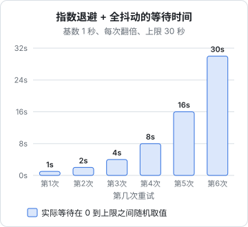
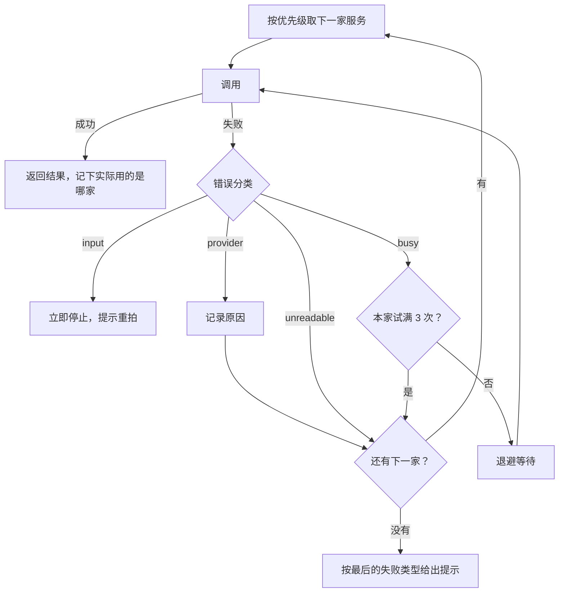

# 错误与重试

模型 API 是一个远程的、按量计费的、时常过载的服务。它会限流，会超时，会在高峰期返回「过载」；即使请求成功了，返回的内容也可能被截断、格式不对、或者干脆是拒绝。一个只在「一切正常」时能工作的 AI 功能，上线第一周就会出问题。这一章把错误分门别类，讲清楚哪些该重试、怎么重试、什么时候该换一家、什么时候该直接告诉用户，最后以 hatch-counter 的识别降级链为例，把这些串成一个完整的方案。

## 错误分两大类

| 类别 | 表现 | 例子 |
|---|---|---|
| 硬错误 | HTTP 非 2xx，或者网络异常 | 400 参数错误、401 密钥无效、429 限流、529 过载、超时 |
| 软错误 | HTTP 200，但结果不能用 | `stop_reason` 为 `max_tokens` 或 `refusal`、JSON 解析失败、业务校验不通过 |

很多代码只处理了第一类。软错误更隐蔽：请求成功了，日志里没有报错，用户却拿到了半截结果。

### 硬错误：按状态码分

| 状态码 | 类型 | 能重试吗 | 常见原因 |
|---|---|---|---|
| 400 | `invalid_request_error` | 否 | 参数不对，比如给新模型传了已不支持的参数 |
| 401 | `authentication_error` | 否 | 密钥无效 |
| 403 | `permission_error` | 否 | 这个密钥无权使用该功能 |
| 404 | `not_found_error` | 否 | 模型 ID 拼错，或你的账号无权使用该模型 |
| 413 | `request_too_large` | 否 | 请求体太大，比如图片过大 |
| 429 | `rate_limit_error` | 是，要等 | 超出每分钟请求数或 token 数限制 |
| 500 | `api_error` | 是 | 服务端内部错误 |
| 529 | `overloaded_error` | 是，要等 | 服务整体过载 |
| 无 | 网络错误、超时 | 是 | 连接中断、DNS 问题、请求超时 |

**判断原则：如果同样的请求再发一次，结果有可能不同，才值得重试**。一个填错的密钥永远不会突然变对，一个参数错误重发一百次也是 400；而 429、529、超时，等一会儿往往就好了。

### 软错误：看 stop_reason 和内容

| 情况 | 处理 |
|---|---|
| `max_tokens` | 重试同样的请求没用，要么提高上限，要么拆分任务，要么告诉用户输入太长 |
| `refusal` | 原样重试大概率还是拒绝；检查是否是误判，给用户一个合适的说明 |
| JSON 解析失败（无约束解码时） | 可以重试一次，模型偶尔会跑题 |
| 业务校验不通过 | 带上错误信息让模型修正一次，或交给人确认 |

## SDK 已经帮你做的

Anthropic 的 SDK 自带重试：默认对连接错误、408、409、429 和 5xx **自动重试 2 次**，使用指数退避，并会参考服务端返回的 `retry-after` 头。可以在客户端或单次请求上调整：

```typescript
import Anthropic from "@anthropic-ai/sdk";

const client = new Anthropic({
  maxRetries: 3,
  timeout: 60_000, // 毫秒
});

// 单次请求覆盖：交互式场景宁可快速失败
await client.messages.create(params, { maxRetries: 1, timeout: 20_000 });
```

两个注意点：

- **超时也会被重试**，所以最坏情况下的总耗时是 `timeout × (maxRetries + 1)`。60 秒超时加 3 次重试，用户可能要等 4 分钟。交互式请求要算好这个上限
- SDK 的重试只管硬错误，**软错误要自己处理**

### 按类型捕获错误

用 SDK 提供的错误类区分情况，不要去匹配错误消息的字符串：

```typescript
try {
  const res = await client.messages.create(params);
  // ……
} catch (err) {
  if (err instanceof Anthropic.AuthenticationError) {
    alertOps("模型 API 密钥无效"); // 需要人处理，通知自己
    throw new UserFacingError("AI 功能暂时不可用");
  } else if (err instanceof Anthropic.BadRequestError) {
    logger.error("请求参数错误", err.message); // 这是代码 bug
    throw new UserFacingError("AI 功能暂时不可用");
  } else if (err instanceof Anthropic.RateLimitError) {
    throw new UserFacingError("请求太多，请稍后再试");
  } else if (err instanceof Anthropic.APIConnectionError) {
    throw new UserFacingError("网络不稳定，请重试");
  } else if (err instanceof Anthropic.APIError) {
    logger.warn(`模型 API 错误 ${err.status}`, err.message);
    throw new UserFacingError("AI 服务繁忙，请稍后再试");
  }
  throw err;
}
```

顺序很重要：子类在前，父类 `APIError` 在后。另外，SDK 的响应和错误对象上都带有请求 ID，记进日志，需要联系服务商排查时用得上。

## 自己写重试：指数退避加抖动

调用其他厂商的接口、或者需要在重试之间插入自定义逻辑时，要自己实现重试。标准做法是**指数退避加随机抖动**：

- **指数退避**：每次失败后等待的时间翻倍（1 秒、2 秒、4 秒……），给服务端恢复的时间
- **上限**：等待时间不超过某个值，比如 30 秒
- **抖动**：在 0 到当前上限之间随机取一个值。如果没有抖动，同一时刻失败的大量请求会在同一时刻重试，再次把服务打垮



```typescript
type RetryOptions = {
  maxAttempts: number; // 含第一次
  baseMs: number;
  capMs: number;
  deadlineMs: number; // 总时限
  isRetryable: (err: unknown) => boolean;
  retryAfterMs?: (err: unknown) => number | undefined;
};

export async function withRetry<T>(fn: () => Promise<T>, opts: RetryOptions): Promise<T> {
  const started = Date.now();
  for (let attempt = 1; ; attempt++) {
    try {
      return await fn();
    } catch (err) {
      if (attempt >= opts.maxAttempts || !opts.isRetryable(err)) throw err;

      const ceiling = Math.min(opts.capMs, opts.baseMs * 2 ** (attempt - 1));
      const wait = opts.retryAfterMs?.(err) ?? Math.random() * ceiling;

      // 剩余时间不够等完再试一次，就别等了
      if (Date.now() - started + wait > opts.deadlineMs) throw err;
      await new Promise((r) => setTimeout(r, wait));
    }
  }
}
```

服务端返回了 `retry-after` 头时，优先听它的，它比你猜得准。

### 重试的边界

- **只重试幂等的操作**。纯粹的模型调用是幂等的（最多多花点钱）；但如果是工具调用循环中执行了写操作的那一步，重试前要确认写操作带了幂等键（第 4 章）
- **流式请求已经输出了内容就不要自动重试**（第 5 章），会造成内容重复或闪烁
- **别层层重试**。SDK 重试 2 次，你的 `withRetry` 再包 3 次，外面的任务队列再重试 3 次，一次故障就会放大成几十次请求。确定只在一层做重试，其他层把重试关掉（SDK 设 `maxRetries: 0`）
- **重试也要计入成本监控**。重试率突然升高，本身就是一个需要告警的信号

## 案例：hatch-counter 的识别降级链

hatch-counter 让店主拍照识别手写进货单，背后配置了多家识别服务（智谱的视觉大模型、腾讯云 OCR）。它的降级逻辑是本章所有原则的一个完整落地，设计文档里写得很清楚。

### 先分类，再决定怎么办

它把所有失败归成四类，每类的处理方式不同：

| 分类 | 包括 | 处理 |
|---|---|---|
| `busy` | 429、5xx、超时、连不上 | 退避重试（隔 0.8 秒、2.5 秒），同一家最多 3 次，然后换下一家 |
| `provider` | 密钥被拒、额度用完、模型不存在 | **不重试**，记下原因供运维查看，直接换下一家 |
| `unreadable` | 模型没按格式返回、返回空、读不出表头 | 不重试同一家，但**换下一家**；全部失败时提示「换张更清楚的照片」 |
| `input` | 400、413、415：图片太大、格式不支持 | **整条链立即停止**，换谁结果都一样，让店主重拍 |



代码注释里解释了为什么要分类：不分类的话只有两种做法，都不对。一律重试三次，填错的密钥永远不会突然变对，每个请求都要白等三轮；一律不重试，而 429「服务商正忙」恰恰是等一会儿就好的那种。

`unreadable` 这一类的设计尤其值得体会：同一个模型再问三遍不会突然会了，所以不重试同一家；但换一个模型可能就读出来了，所以要往下退。全部失败时，给店主的提示是「换张更清楚的照片」，而不是笼统的「服务繁忙」，因为后者会让他干等，其实重拍一张就好。

另外，在第 3 章提到的单个识别调用内部，模型没按 JSON 格式回复时会**原地重试一次**再归为 `unreadable`。这是针对软错误的一次廉价补救，和链路层面的重试是两件事。

### 总时限

每次调用的超时是 90 秒。如果没有总时限，3 次重试 × 2 家服务 × 90 秒，最坏要九分钟，店主那边只是一个转了很久的圈。所以整条链设了 150 秒的总时限：**剩下的时间不够再打一次，就不开始下一次**，直接把最后一个错误交出去。

对应地，nginx 上这个路径的 `proxy_read_timeout` 配成 180 秒，比总时限略长。如果用默认的 60 秒，nginx 会在链还没跑完时返回 504，店主看到的是一句跟真实原因毫无关系的「服务端出了点问题」。**超时要从内到外逐层变长**：单次调用 < 整条链 < 反向代理 < 客户端。

### 给用户的话和给自己的日志分开

- **给店主的提示里不出现服务商名字**。「智谱-备用号（429）」这种内部标签，店主看不懂也帮不上忙。全部失败就说「识别服务现在都很忙」，或者在 `unreadable` 时说「换张更清楚的照片」
- **每一次失败的详细原因逐条写进日志**，排障看日志
- **记下实际成功的是哪一家**。降级之后成功的不一定是排第一的那家，存档里记的是真正干活的那个，方便事后对比各家的质量

## 降级与兜底

当所有重试都失败时，最后的防线是**让功能优雅地降级**，而不是让整个页面报错：

| 功能 | 降级方案 |
|---|---|
| 单据识别 | 引导用户走表格导入或手工录入（hatch-counter 的做法） |
| AI 生成的摘要 | 显示原文的前几行 |
| 智能推荐 | 退回按时间或热度排序 |
| 聊天助手 | 提示稍后再试，保留用户输入的内容不丢失 |

**AI 功能应该是锦上添花，而不是单点故障**。设计时就要想好：模型完全不可用时，用户还能不能完成核心任务？

### 拒绝的兜底

新一代 Claude 模型有安全分类器，可能会以 `refusal` 拒绝某些请求，偶尔也会误判正常请求。Anthropic 为部分型号提供了服务端的拒绝兜底：在请求里声明备用模型，被拒绝时自动用备用模型重跑。这是 beta 功能，参数和适用型号以文档为准。即使不用它，也至少要在代码里识别 `refusal`，给用户一个说得通的提示。

### 熔断

如果某家服务持续失败，每个请求都还去试一遍、等一轮超时，是在浪费用户的时间。**熔断器**的思路是：短时间内失败次数超过阈值，就暂时把这家标为不可用，一段时间后再放少量请求试探，恢复了再重新启用。对于一人公司的规模，一个简化版本就够用：在内存里记录每家服务最近的失败次数和时间，超过阈值时在一两分钟内跳过它。

## 本章要点

- 错误分硬错误（HTTP 非 2xx、网络异常）和软错误（200 但结果不能用），两类都要处理
- **只有「再发一次结果可能不同」的错误才值得重试**：429、5xx、529、超时可以；400、401、404 不行
- SDK 默认自动重试 2 次，超时也会被重试，总耗时上限是 `timeout × (maxRetries + 1)`
- 用 SDK 的错误类按类型捕获，子类在前
- 自己重试用指数退避加抖动，优先听 `retry-after`，设总时限，只在一层做重试
- 按失败原因分类处理：重试、换一家、或立即停止；给用户的提示和给自己的日志分开
- 超时从内到外逐层变长；AI 功能要能降级，不做单点故障

## 接下来读什么

到这里，你已经掌握了把模型做成产品功能的基本功：发请求、写 prompt、拿结构化结果、调用工具、流式输出、用缓存省钱、算成本、选模型、处理错误。

按导读的顺序，下一本是[《Agent 原理与设计》](../agent-principles/)：第 4 章那个工具调用循环，放宽限制、交给模型自己规划，就成了 Agent，那本书讲它的原理、设计和常见的失败方式。如果你的目标是在产品里做更多 AI 功能，可以接着读工程线上的[《多模态应用》](../multimodal-ai/)（hatch-counter 的进货单识别会在那里展开）、[《RAG 与知识系统》](../rag-systems/)、[《评测与质量》](../llm-evals/)和[《LLM 应用上线》](../llmops/)。
