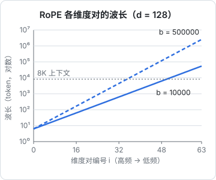
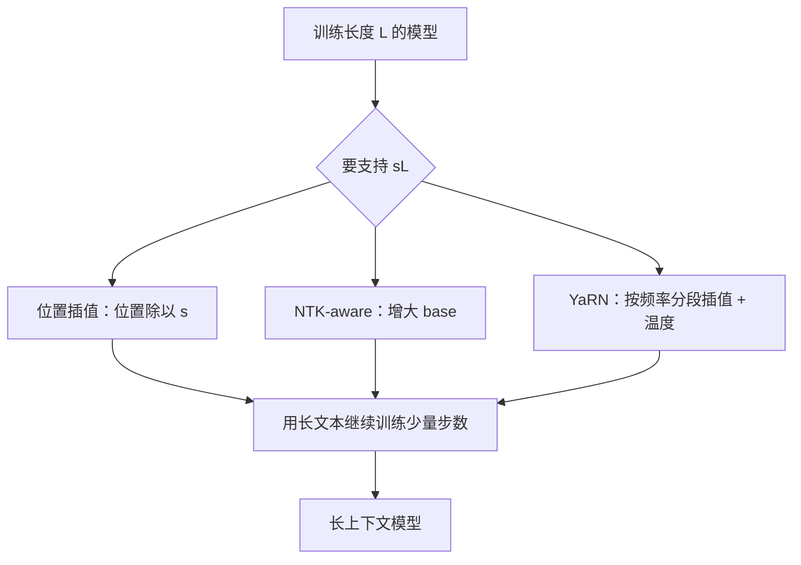

# 位置编码与 RoPE

上一章的注意力公式里没有任何关于「顺序」的信息：把输入的行打乱，每个 token 得到的输出只是跟着一起打乱（因果掩码除外，它只告诉模型「谁在前」，没说「隔多远」）。语言显然依赖顺序，所以必须把位置信息注入模型。这一章从最早的正弦编码讲到今天几乎所有开源模型都在用的 **RoPE**（旋转位置编码），重点推导它为什么能表达「相对距离」，以及「把 8K 模型扩展到 128K」时到底在改什么。

## 三代位置编码

| 方案 | 怎么做 | 代表 | 问题 |
|---|---|---|---|
| 正弦绝对位置 | 给第 $m$ 个位置一个固定的正弦向量，加到 embedding 上 | 原始 Transformer | 位置信息在深层被冲淡；外推差 |
| 可学习绝对位置 | 每个位置一个可训练向量 | GPT-2、BERT | 超过训练长度的位置根本没有向量 |
| 相对位置 | 让注意力分数直接依赖 $m - n$ | T5 的相对偏置、ALiBi、RoPE | 实现方式各不相同 |

直觉上，语言更在乎**相对位置**：「形容词紧挨在名词前面」这条规律，不管出现在第 10 个 token 还是第 1000 个 token 都一样。绝对编码要让模型从两个绝对位置里自己算出差值，相对编码直接把差值送进注意力分数。

## RoPE 想要什么

目标：找一个作用在 query 和 key 上的变换 $f(\cdot, m)$，使得变换后的点积**只依赖内容和相对位置**：

$$
\langle f(q, m),\, f(k, n) \rangle = g(q, k, m - n)
$$

这样 $QK^\top$ 这一步自动带上了相对位置，其余计算一行都不用改。

### 二维情形：旋转

先看 $d_k = 2$。把向量 $q = (q_1, q_2)$ 看成复数 $\tilde q = q_1 + i q_2$。二维实向量的点积可以写成复数形式：

$$
\langle a, b \rangle = a_1 b_1 + a_2 b_2 = \mathrm{Re}\big(\tilde a\, \overline{\tilde b}\big)
$$

定义 $f(q, m) = \tilde q\, e^{i m \theta}$，即把 $q$ 旋转角度 $m\theta$。代入：

$$
\begin{aligned}
&\langle f(q,m), f(k,n) \rangle \\
&= \mathrm{Re}\big(\tilde q\, e^{im\theta}\, \overline{\tilde k\, e^{in\theta}}\big) \\
&= \mathrm{Re}\big(\tilde q\, \overline{\tilde k}\, e^{i(m-n)\theta}\big)
\end{aligned}
$$

结果只含 $m - n$。用矩阵写更直观：设 $R(\alpha)$ 是旋转 $\alpha$ 角的矩阵，旋转矩阵满足 $R(\alpha)^\top = R(-\alpha)$、$R(\alpha)R(\beta) = R(\alpha+\beta)$，于是

$$
\begin{aligned}
&\big(R(m\theta)\, q\big)^\top \big(R(n\theta)\, k\big) \\
&= q^\top R(-m\theta) R(n\theta)\, k \\
&= q^\top R\big((n-m)\theta\big)\, k
\end{aligned}
$$

**两个向量同时转，夹角只取决于它们转的角度之差**。这就是 RoPE 的全部核心。

### 推广到高维：多个频率

$d_k$ 维向量拆成 $d_k/2$ 对，第 $j$ 对（$j = 0, 1, \dots, d_k/2 - 1$）用自己的角频率旋转：

$$
\theta_j = b^{-2j/d_k},\qquad b = 10000
$$

位置 $m$ 的变换就是一个分块对角矩阵，每块是 $R(m\theta_j)$。这里 $b$ 叫 **base**，是 RoPE 最重要的超参数。

几个要点：

- RoPE **只作用在 Q 和 K 上**，不作用在 V 上：位置只影响「看谁」，不影响「拿到什么内容」
- 它在**每一层**的注意力里都施加一次，而不是像绝对编码那样只在输入处加一次，所以位置信息不会在深层被冲淡
- 它没有可训练参数，任意位置 $m$ 都能直接算出旋转角

### 频率的意义

第 $j$ 对的波长（转一整圈需要的 token 数）是 $\lambda_j = 2\pi / \theta_j = 2\pi\, b^{2j/d_k}$。



- **高频对**（$j$ 小）：波长只有几个 token，对相邻位置非常敏感，负责「紧挨着的是谁」这类局部模式
- **低频对**（$j$ 大）：$b = 10000$、$d_k = 128$ 时，最慢的一对波长约 5.4 万个 token，在一个 8K 的窗口里只转了不到一圈的一小部分，像一个粗粒度的「大致在多远」的信号

可以把它类比为时钟的秒针、分针、时针：秒针分辨精细但很快绕回，时针转得慢但能区分大跨度。

## 实现：两种排列约定

实践中有两种把维度配对的方式：

| 约定 | 配对方式 | 见于 |
|---|---|---|
| 交错 | $(0,1), (2,3), \dots$ | RoFormer 原论文、Meta 最初发布的 Llama 代码 |
| 前后半 | $(0, \tfrac{d}{2}), (1, \tfrac{d}{2}+1), \dots$ | Hugging Face transformers 的 `rotate_half` |

两者在数学上等价，只是对 $W_Q$、$W_K$ 的列做了一次固定的置换。但**权重和代码的约定必须一致**，转换模型格式时搞错这一点，模型照样能跑，只是输出变成乱码，这是一类很隐蔽的 bug。

下面用前后半约定实现，并数值验证「点积只依赖相对位置」：

```python
import numpy as np

def rope(x, pos, base=10000.0):
    """x: (..., d)，pos: 整数位置。前后半配对约定。"""
    d = x.shape[-1]
    j = np.arange(d // 2)
    theta = base ** (-2 * j / d)          # (d/2,)
    ang = pos * theta
    cos, sin = np.cos(ang), np.sin(ang)
    x1, x2 = x[..., : d // 2], x[..., d // 2 :]
    return np.concatenate([x1 * cos - x2 * sin, x1 * sin + x2 * cos], axis=-1)

rng = np.random.default_rng(0)
q, k = rng.standard_normal(128), rng.standard_normal(128)

a = rope(q, 10) @ rope(k, 7)        # 位置差 3
b = rope(q, 1003) @ rope(k, 1000)   # 位置差仍是 3
c = rope(q, 10) @ rope(k, 2)        # 位置差 8
print(np.isclose(a, b), np.isclose(a, c))   # True False
print(np.isclose(np.linalg.norm(rope(q, 999)), np.linalg.norm(q)))  # True：旋转不改长度
```

真实实现会预先算好所有位置的 `cos`、`sin` 表缓存起来，每层复用。

## 外推：为什么超过训练长度会崩

用 4K 训练的模型，直接喂 16K 的输入，效果通常会急剧下降。原因要从频率看：

- 高频对在训练中已经转过成百上千圈，所有角度都见过，新位置不陌生
- 低频对在 4K 内只转过一小段弧，16K 时转到的角度**训练中从未出现**，模型对这些「没见过的相位」做出了不可预测的反应

所以上下文扩展的各种方法，本质都是在回答同一个问题：**怎么让长位置的旋转角落回模型见过的范围**。

### 位置插值（PI）

2023 年 Meta 的 Chen 等人提出位置插值：要把训练长度 $L$ 扩展到 $L' = sL$，就把位置压缩回去，$m \to m / s$。所有角度都落在训练范围内了，配合少量长文本继续训练即可恢复效果。

代价是高频对也被压缩了 $s$ 倍：相邻 token 的角度差变小，模型分辨局部顺序的能力受损。

### NTK-aware 缩放

社区很快提出另一种思路：不压缩位置，而是**改 base**。把 $b$ 放大为

$$
b' = b \cdot s^{\frac{d_k}{d_k - 2}}
$$

代入 $\theta_j = b'^{-2j/d_k}$ 可以验证：最低频的一对（$j = d_k/2 - 1$）角频率恰好缩小 $s$ 倍，相当于对它做了插值；最高频的一对（$j = 0$）完全不变。中间的维度按指数平滑过渡。这样**高频保留局部分辨率，低频获得外推空间**，甚至不微调也能有一定效果。

### YaRN 与按频率分段

YaRN（Peng 等人，2023）把这个思路做得更细：按每个维度对的波长与训练长度的比值分成三段，波长远小于训练长度的不动，远大于的做完整插值，中间的线性过渡；另外给注意力分数乘一个与 $s$ 相关的温度系数，补偿插值后注意力分布变平的问题。Llama 3.1 采用的也是一种按频率分段的缩放方案。

### 直接用大 base 训练

另一条路是训练时就把 base 设大。Llama 3 把 base 从 10000 提高到了 500000，上图的虚线显示，这让低频维度的波长拉长到百万级，长位置的角度变化变慢，为后续扩展上下文留出余量。



## 另一种思路：ALiBi

ALiBi（Press 等人，2021，论文标题就叫 Train Short, Test Long）完全不用位置向量，而是在注意力分数上直接减去一个与距离成正比的惩罚：

$$
S_{ij} = \frac{q_i \cdot k_j}{\sqrt{d_k}} - m_h \cdot (i - j)
$$

每个头的斜率 $m_h$ 不同，是固定的几何级数。它天然偏好近处的 token，外推表现好；但这种「越远越不重要」的强先验也限制了远距离检索的能力。当前主流开源模型大多选择了 RoPE。

## 读模型配置时看什么

打开一个开源模型的 `config.json`，和位置编码相关的字段通常是这些（字段名以 Hugging Face transformers 的 Llama 系为例）：

```json
{
  "max_position_embeddings": 131072,
  "rope_theta": 500000.0,
  "rope_scaling": {
    "rope_type": "llama3",
    "factor": 8.0,
    "low_freq_factor": 1.0,
    "high_freq_factor": 4.0,
    "original_max_position_embeddings": 8192
  }
}
```

- `rope_theta` 就是本章的 base $b$
- `rope_scaling` 说明这个模型是从较短的原始长度扩展而来，`factor` 是扩展倍数 $s$，`low_freq_factor`、`high_freq_factor` 划定了「按频率分段」的边界
- `max_position_embeddings` 是声称支持的长度。**声称支持 ≠ 在这个长度上效果好**，第 5 章会讲怎么看有效上下文

用 llama.cpp、vLLM 等推理框架加载模型时，如果手动覆盖了这些参数（比如为了跑更长上下文强行调大），效果下降是预期之内的事。

## 本章要点

- 注意力本身对顺序不敏感，必须注入位置信息；相对位置比绝对位置更符合语言的规律
- RoPE 把 Q、K 的每对维度按位置旋转，利用「两个向量同时旋转，点积只取决于转角之差」得到相对位置
- 不同维度对用不同频率 $\theta_j = b^{-2j/d_k}$：高频管局部，低频管远距离
- 超过训练长度时，低频维度遇到没见过的角度，导致效果崩溃
- 位置插值压缩位置，NTK-aware 改 base，YaRN 按频率分段并加温度；都要配合少量长文本继续训练
- 读 `config.json` 里的 `rope_theta` 和 `rope_scaling`，就能知道模型的位置编码设置和扩展方式

## 动手练习

1. **数一数「转不满一圈」的维度对**：取 $d_k=128$，分别对 $b=10000$ 和 $b=500000$ 算出 64 对的波长 $\lambda_j = 2\pi b^{2j/d_k}$，打印最短、最长波长，以及波长超过 8192 的对数。

   验证：两种 base 的最短波长都是 6.28；最长分别约 5.4 万和 256 万；波长超过 8192 的分别有 14 对和 29 对。

   参考答案：在 8K 窗口里转不满一圈的那些对，就是外推时会遇到「没见过的角度」的低频维度。base 越大，这样的维度越多、转得越慢，给后续扩展留出余量。

   ```python
   import numpy as np
   d, j = 128, np.arange(64)
   for b in [1e4, 5e5]:
       lam = 2 * np.pi * b ** (2 * j / d)
       print(b, lam[0].round(2), lam[-1].round(0), (lam > 8192).sum())
   ```

2. **验证 NTK-aware 公式**：取 $b=10000$、$d_k=128$、$s=4$，按 $b' = b\cdot s^{d_k/(d_k-2)}$ 算出新 base，再求每对新旧角频率之比 $\theta_j/\theta'_j$，看第一对和最后一对。

   验证：$b'\approx 40890$；第一对之比是 1.0，最后一对之比是 4.0。

   参考答案：$\theta'_j/\theta_j = s^{-2j/(d_k-2)}$，$j=0$ 时为 1、$j=d_k/2-1$ 时为 $1/s$。高频不动、最低频恰好插值 $s$ 倍，中间平滑过渡。

3. **复现「约定不一致」的隐蔽 bug**：在本章 `rope`（前后半约定）旁边写一个交错约定的 `rope_i`（第 $j$ 对是维度 $2j$ 和 $2j+1$）。先验证两者只差一个维度置换；再故意让 query 用 `rope`、key 用 `rope_i`，检查「位置 10 对 7」和「位置 1003 对 1000」的点积是否还相等。

   验证：置换后两者 `np.allclose` 为 `True`；混用约定时 `np.isclose(a, b)` 打印 `False`。

   参考答案：两种约定数学上等价，但 Q 和 K 必须用同一种；混用后点积不再只依赖相对位置，代码照样能跑、不会报错，只是注意力全乱了，这就是格式转换后输出乱码的一类原因。

   ```python
   def rope_i(x, pos, base=10000.0):
       d = x.shape[-1]
       ang = pos * base ** (-2 * np.arange(d // 2) / d)
       c, s = np.cos(ang), np.sin(ang)
       out = np.empty_like(x)
       out[0::2] = x[0::2] * c - x[1::2] * s
       out[1::2] = x[0::2] * s + x[1::2] * c
       return out
   a = rope(q, 10) @ rope_i(k, 7)
   b = rope(q, 1003) @ rope_i(k, 1000)
   print(np.isclose(a, b))
   ```
