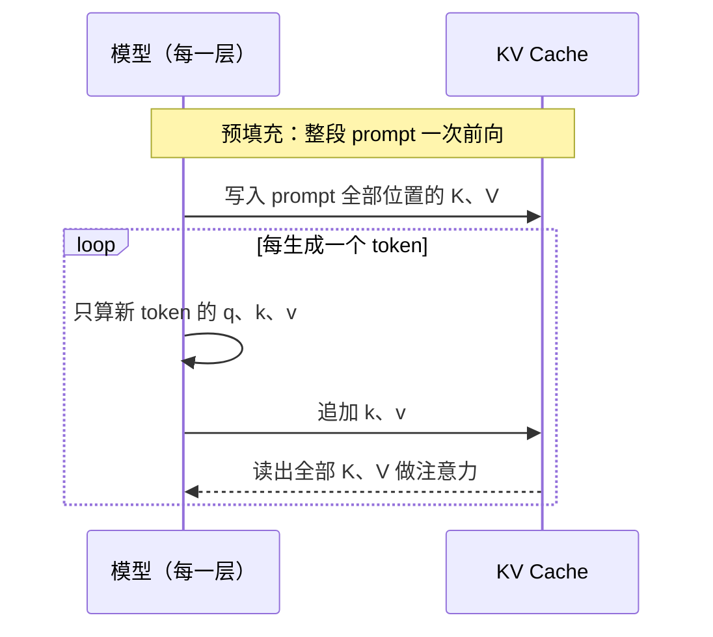
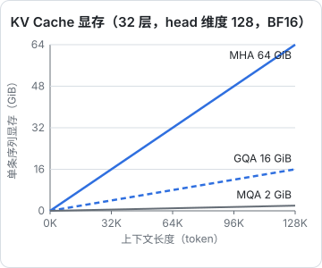
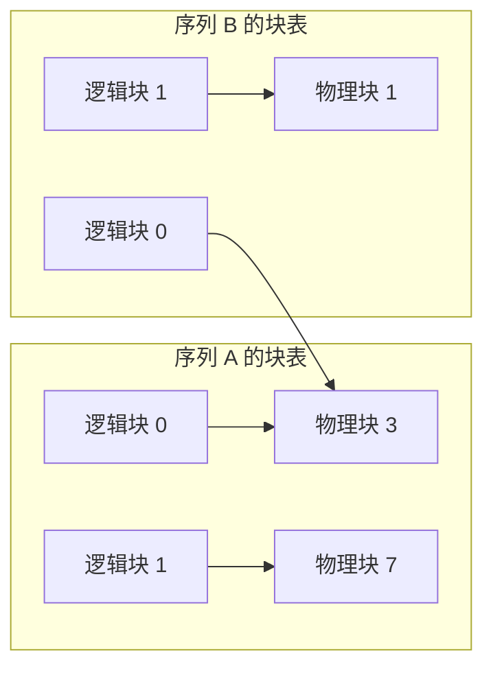

# KV Cache 与解码优化

科普篇说过：生成时把算过的 K、V 存起来，叫 KV Cache。这一章算清它到底占多少显存，解释为什么解码阶段的瓶颈是**显存带宽**而不是算力，再看业界围绕它发明的几类技术：GQA 与 MLA 压缩缓存本身，PagedAttention 管理缓存的分配，投机解码绕开逐 token 串行的限制。理解了这些，你就能看懂推理服务的价格结构，也能估算一台机器能跑多大的模型、多长的上下文。

## 为什么可以缓存

上一章末尾验证过：因果掩码下，位置 $i$ 的输出只依赖前 $i$ 个输入。生成第 $t+1$ 个 token 时，前 $t$ 个位置在每一层的 $K$、$V$ 和上一步完全相同。所以每步只需：

1. 为新 token 计算 $q_{t+1}, k_{t+1}, v_{t+1}$
2. 把 $k_{t+1}, v_{t+1}$ 追加到缓存
3. 用 $q_{t+1}$ 对缓存里全部 $t+1$ 个 key 做注意力



不缓存的话，生成第 $t$ 个 token 要把整个前缀重新过一遍模型，生成 $T$ 个 token 的总计算量是 $O(T^2)$ 次完整前向；缓存之后每步只有新 token 的一次前向，加上与缓存的注意力。

## 显存公式

每个 token 在每一层要存一个 key 和一个 value，各 $n_{kv} \times d_k$ 个数：

$$
\text{KV 字节数} = 2 \times L \times n_{kv} \times d_k \times n_{\text{ctx}} \times B \times \text{每个数的字节数}
$$

- $L$：层数；$n_{kv}$：KV 头数（下面会讲它为什么可以小于注意力头数）；$d_k$：每头维度
- $n_{\text{ctx}}$：上下文长度；$B$：同时服务的序列数（batch）

以 32 层、$d_k = 128$、BF16（2 字节）为例：

| 结构 | KV 头数 | 每 token | 8K 上下文 | 128K 上下文 |
|---|---|---|---|---|
| MHA（如 Llama 2 7B） | 32 | 512 KiB | 4 GiB | 64 GiB |
| GQA（如 Llama 3 8B） | 8 | 128 KiB | 1 GiB | 16 GiB |
| MQA | 1 | 16 KiB | 128 MiB | 2 GiB |



对照一下：Llama 3 8B 的权重本身在 BF16 下约 16 GB。单条 128K 的序列，KV Cache 就和整个模型一样大。服务 10 个并发用户，就是 10 份。**长上下文推理的显存大头往往不是模型，而是缓存**。

## 解码为什么慢：算术强度

衡量一个计算是「算力瓶颈」还是「带宽瓶颈」，看**算术强度**：每从显存读一个字节，做多少次浮点运算。

解码阶段，batch 为 $B$ 时每一步要：

- 把全部权重从显存读一遍：约 $2N$ 字节（BF16，$N$ 是参数量）
- 做约 $2N \times B$ 次浮点运算（每个序列一个 token）

算术强度约为 $B$ FLOPs/字节。而现代数据中心 GPU 的「算力 ÷ 带宽」在数百的量级：以 H100 SXM 为例，BF16 稠密算力约 990 TFLOPS，显存带宽约 3.35 TB/s，比值约 300。**batch 小于几百时，GPU 的算力大部分在空等数据**。

由此可以估算单条请求的速度上限：

$$
\text{tokens/s 上限} \approx \frac{\text{显存带宽}}{\text{每步要读的字节数}}
$$

8B 模型 BF16 约 16 GB，在 3.35 TB/s 的卡上单条序列的理论上限约 200 tokens/s，实际会更低，因为每步还要读 KV Cache，上下文越长读得越多。

这解释了几个现象：

| 现象 | 原因 |
|---|---|
| 预填充快，解码慢 | 预填充一次处理成百上千个 token，算术强度高，吃满算力；解码每步一个 token，受带宽限制 |
| 推理服务要攒 batch | batch 越大，同样读一遍权重能服务越多 token，单位成本下降 |
| 量化能提速（第 8 章） | 权重从 2 字节变成 0.5 字节，每步读的数据量少了四分之三 |
| 长上下文的输出更贵 | 每步要读的 KV Cache 随上下文增长，同一张卡能并发的序列变少 |

## 压缩缓存：MQA、GQA、MLA

公式里最好动手的是 $n_{kv}$。

### MQA 与 GQA

- **MQA**（Multi-Query Attention，Shazeer，2019）：所有 query 头共享**同一组** K、V。缓存缩小为 $1/h$，但模型质量有可见的下降，训练也不太稳定
- **GQA**（Grouped-Query Attention，Ainslie 等，2023）：把 $h$ 个 query 头分成 $g$ 组，每组共享一组 K、V。$g = h$ 就是 MHA，$g = 1$ 就是 MQA

GQA 在质量和缓存之间取了一个折中，成了当前开源模型的标配。Llama 3 8B 是 32 个 query 头、8 个 KV 头，每 4 个 query 头共享一组 K、V。

实现上，GQA 只是在算注意力前把 K、V「复制」到每个 query 头：

```python
import numpy as np

h, g, n, dk = 32, 8, 10, 128
rng = np.random.default_rng(0)
Q = rng.standard_normal((h, n, dk))
K = rng.standard_normal((g, n, dk))   # 缓存里只存 g 组
V = rng.standard_normal((g, n, dk))

rep = h // g
K_full = np.repeat(K, rep, axis=0)    # (h, n, dk)，第 0-3 头共享第 0 组
V_full = np.repeat(V, rep, axis=0)
S = Q @ K_full.transpose(0, 2, 1) / np.sqrt(dk)
print(S.shape)   # (32, 10, 10)
```

高效的内核不会真的复制内存，而是让同组的 query 头读同一块 K、V。

### MLA

DeepSeek-V2（2024）提出的 **MLA**（Multi-head Latent Attention）走得更远：不缓存每个头的 K、V，而是缓存一个低维的**潜向量** $c_t$，需要时再用矩阵把它「解压」成各头的 K、V：

$$
c_t = x_t W_{DKV},\qquad k_t^{(i)} = c_t W_{UK}^{(i)},\qquad v_t^{(i)} = c_t W_{UV}^{(i)}
$$

关键技巧是矩阵吸收：$q^{(i)} \cdot k^{(i)} = q^{(i)} W_{UK}^{(i)\top} c_t^\top$，可以把 $W_{UK}^{(i)}$ 提前并入 query 一侧，推理时直接拿 $c_t$ 算分数，不必真的解压出每个头的 key。同理 $W_{UV}$ 可以并入输出矩阵。

RoPE 和这种吸收不兼容（旋转矩阵夹在中间，随位置变化，无法提前合并），所以 MLA 额外缓存一个很小的、所有头共享的带 RoPE 的 key 分量。DeepSeek-V2 论文中潜向量维度是 512，RoPE 分量是 64，每 token 每层缓存 576 个数；而同样 128 头、每头 128 维的 MHA 需要 $2 \times 128 \times 128 = 32768$ 个数。

## 管理缓存：PagedAttention 与前缀复用

### 显存碎片

朴素的实现给每个请求按「最大可能长度」预留一整块连续显存。但请求最终生成多长事先不知道，大部分预留空间被浪费；不同长度的请求进进出出，还会产生碎片。

**PagedAttention**（Kwon 等，2023，vLLM 的核心）借用了操作系统虚拟内存的思路：

- 把 KV Cache 切成固定大小的**块**（比如每块 16 个 token）
- 每个序列维护一张**块表**，逻辑上连续的 token 可以存在物理上不连续的块里
- 按需分配，序列结束立即回收



图中两个序列的第 0 块指向同一个物理块：它们有**相同的前缀**（比如同一份 system prompt），可以共享，只在内容分叉后各自分配新块（写时复制）。

### 前缀缓存就是 Prompt 缓存

把共享前缀的思路推广到跨请求：服务端把常见前缀的 KV Cache 保留一段时间，新请求的开头如果逐 token 相同，就直接复用，跳过这部分的预填充。这正是各家 API 的 **prompt caching** 在底层做的事。

由此可以推出几条使用规则，在[《大模型应用工程》](../llm-app-engineering/)里有实操：

- 缓存按**前缀**匹配，中间改一个字，后面全部失效。所以不变的内容（system prompt、工具定义、长文档）放前面，变化的内容放最后
- 命中缓存省掉的是预填充的计算，所以输入价格可以大幅打折，首 token 延迟也明显下降
- Claude Code 这类编码 agent 每轮对话都带着相同的系统提示和越来越长的历史，前缀缓存是它们成本可控的关键

### 连续批处理

传统批处理要等一批请求全部生成完才能换下一批，短请求被长请求拖着。**连续批处理**（continuous batching，Orca 论文提出的迭代级调度）在每一步解码后检查：有序列结束就立即移出，有新请求就立即加入。配合 PagedAttention，GPU 始终保持较大的 batch，这是 vLLM、SGLang 等推理框架吞吐量远高于朴素实现的主要原因。

## 绕开串行：投机解码

解码受带宽限制，意味着「一次验证多个 token」和「生成一个 token」的耗时差不多：权重都只读一遍。**投机解码**（speculative decoding，Leviathan 等与 DeepMind 的 Chen 等在 2022–2023 年分别提出）利用了这一点：

1. 用一个小而快的**草稿模型**连续猜 $k$ 个 token
2. 大模型**一次前向**并行计算这 $k$ 个位置上自己的概率分布
3. 从左到右逐个检验：草稿 token $x$ 以概率 $\min\big(1, p(x)/q(x)\big)$ 被接受，$p$ 是大模型的概率，$q$ 是草稿模型的概率
4. 第一个被拒绝的位置，从修正分布 $\max(0, p - q)$（归一化后）里重新采样一个 token，丢弃后面的草稿

这套接受—拒绝规则保证了**最终输出的分布与大模型单独采样完全相同**，不是近似。草稿猜得越准，每次大模型前向产出的 token 越多，加速比越高。代码、结构化输出这类可预测性强的文本，加速效果尤其明显。

变体包括：用模型自身额外的预测头当草稿（不需要单独的小模型）、用 prompt 里已有的文本片段当草稿（适合「改写一段代码」这类输出大量照抄输入的场景）。

## 本章要点

- 因果掩码让前缀的 K、V 与后文无关，所以可以缓存；KV Cache 把生成的总计算量从平方降到线性
- 显存 $= 2 \times L \times n_{kv} \times d_k \times n_{\text{ctx}} \times B \times$ 字节数；长上下文时缓存往往比权重还大
- 解码的算术强度约等于 batch 大小，远低于 GPU 的算力带宽比，所以单请求速度受带宽限制，服务端要攒 batch
- GQA 让多个 query 头共享 K、V，MLA 缓存低维潜向量，都是在压缩 $n_{kv} \times d_k$
- PagedAttention 用分块和块表消除碎片、共享前缀；跨请求的前缀复用就是 API 的 prompt caching
- 投机解码用草稿模型猜、大模型并行验证，接受—拒绝规则保证输出分布不变
