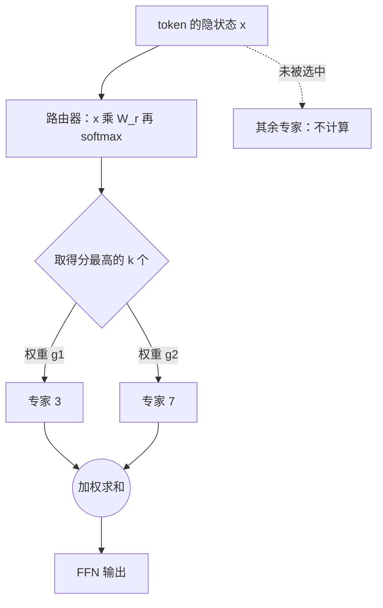

# 混合专家（MoE）

「671B 总参数，每个 token 激活 37B」「235B-A22B」——这类描述来自**混合专家模型**（Mixture of Experts，MoE）。它把 Transformer 块里的前馈网络换成很多个「专家」，每个 token 只交给其中几个处理。结果是：参数量（知识容量）可以做得很大，每个 token 的计算量却只相当于一个小得多的模型。这一章推导路由和负载均衡的公式，再算清 MoE 在训练和部署上的真实代价，最后回答一个实际问题：为什么 MoE 对 API 服务商很划算，对想在本地跑模型的个人却未必。

## 从稠密到稀疏

第 1 章算过，FFN 占每层参数的大约三分之二。稠密模型里，每个 token 都要乘过全部 FFN 参数。MoE 的想法是：

- 准备 $E$ 个结构相同、参数独立的 FFN，叫**专家**
- 加一个小小的**路由器**（router，也叫 gate），为每个 token 打分，选出得分最高的 $k$ 个专家
- 该 token 的 FFN 输出 = 这 $k$ 个专家输出的加权和

注意力层通常保持不变，所有 token 共享。



## 路由的公式

设路由器的参数为 $W_r \in \mathbb{R}^{d \times E}$。对 token 的隐状态 $x$：

$$
\begin{gathered}
s = \mathrm{softmax}(x W_r) \in \mathbb{R}^{E} \\
\mathcal{T} = \mathrm{TopK}(s, k)
\end{gathered}
$$

$$
y = \sum_{i \in \mathcal{T}} g_i \, \mathrm{FFN}_i(x),\qquad g_i = \frac{s_i}{\sum_{j \in \mathcal{T}} s_j}
$$

是否对被选中的权重重新归一化，各模型做法不一；也有先取 top-k 再只对这 $k$ 个分数做 softmax 的实现，两者等价。

这里有一个微妙之处：top-k 是离散选择，不可导。梯度只能通过权重 $g_i$ 流回路由器：被选中的专家如果让损失下降，它的分数就会被推高。**没被选中的专家拿不到这个 token 的任何梯度**。

### 一个可以跑的路由器

```python
import numpy as np

rng = np.random.default_rng(0)
n_tok, d, E, k = 8, 16, 4, 2
X = rng.standard_normal((n_tok, d))
Wr = rng.standard_normal((d, E)) * 0.5
experts = [rng.standard_normal((d, d)) / np.sqrt(d) for _ in range(E)]  # 用线性层代替 FFN

def softmax(z):
    z = z - z.max(-1, keepdims=True)
    e = np.exp(z)
    return e / e.sum(-1, keepdims=True)

s = softmax(X @ Wr)                       # (n_tok, E)
topk = np.argsort(-s, axis=-1)[:, :k]     # 每个 token 选 k 个专家
Y = np.zeros_like(X)
for e in range(E):
    rows, slot = np.nonzero(topk == e)    # 哪些 token 选了专家 e
    if len(rows) == 0:
        continue
    g = s[rows, e] / s[rows][np.arange(len(rows))[:, None], topk[rows]].sum(-1)
    Y[rows] += g[:, None] * (X[rows] @ experts[e])   # 专家只处理分给它的 token

load = np.bincount(topk.ravel(), minlength=E)
print("每个专家分到的 token 数：", load)
```

注意循环是**按专家**而不是按 token 组织的：先把同一个专家的 token 收集起来，一次矩阵乘法算完。这正是真实实现的结构，也是 MoE 难做高效的地方：每个专家的 batch 大小不固定，取决于路由结果。

## 负载均衡：MoE 最难的部分

路由器有一个天然的坏倾向：某个专家早期稍微好一点，就被选得更多、得到更多梯度、变得更好、被选得更更多……最终少数专家包揽一切，其余专家闲置，模型退化成一个小的稠密模型。这叫**路由坍缩**。

### 辅助损失

Switch Transformer（Fedus 等，2021）给出了一个经典的辅助损失。设一个 batch 里有 $T$ 个 token，对每个专家 $i$：

- $f_i$：被分配给专家 $i$ 的 token 比例（离散计数，不可导）
- $P_i = \frac{1}{T}\sum_{x} s_i(x)$：路由器给专家 $i$ 的平均概率（可导）

$$
\mathcal{L}_{\text{aux}} = \alpha \cdot E \cdot \sum_{i=1}^{E} f_i \, P_i
$$

为什么这样设计：$f$ 和 $P$ 都是和为 1 的分布，在均匀分配（$f_i = P_i = 1/E$）时 $\sum f_i P_i = 1/E$，损失等于 $\alpha$。如果某个专家过载，$f_i$ 大，梯度就会推低它的 $P_i$。乘以 $E$ 是为了让损失的量级与专家数无关。$\alpha$ 通常取很小的值，比如 0.01 量级，太大会干扰主任务。

### 容量与丢弃

为了让每个专家的计算量可预测，很多实现给每个专家设一个**容量**：

$$
\text{capacity} = \text{capacity factor} \times \frac{T \times k}{E}
$$

超出容量的 token 被「丢弃」：它在这一层不经过任何专家，只走残差连接直接传到下一层。capacity factor 取 1.0 到 1.25 左右，在浪费和丢弃之间权衡。

### 不用辅助损失的平衡

辅助损失本身会损害主任务的效果，因为它在梯度里掺入了与语言建模无关的信号。DeepSeek-V3（2024）提出了一种不依赖辅助损失的方法：给每个专家维护一个偏置 $b_i$，**只在选 top-k 时**加到分数上，不参与权重 $g_i$ 的计算。每一步训练后，过载的专家偏置调低，空闲的调高。这样负载被调平，而主任务的梯度不受干扰（论文中仍保留了一个权重很小的序列级平衡损失作为补充）。

## 专家的粒度：细粒度与共享专家

早期 MoE 用少量大专家（比如 8 个，每次选 2 个）。DeepSeekMoE（2024）提出两个改进，后来被广泛采用：

- **细粒度专家**：把每个专家切小，数量变多，每次选更多个。比如原本 8 选 2，改成 64 选 8，计算量不变，但专家组合的可能性多了几个数量级，每个专家可以更专精
- **共享专家**：设置一两个**每个 token 都必经**的专家，负责通用知识；路由专家专注于各自的特长，减少「每个专家都要重复学一遍通用知识」的冗余

## 几个代表模型

| 模型 | 发布 | 总参数 | 激活参数 | 专家配置 |
|---|---|---|---|---|
| Mixtral 8x7B | 2023 年 12 月 | 46.7B | 12.9B | 8 个专家选 2 个 |
| DeepSeek-V3 | 2024 年 12 月 | 671B | 37B | 1 个共享 + 256 个路由专家选 8 个 |
| Qwen3-235B-A22B | 2025 年 | 235B | 22B | 128 个专家选 8 个 |
| Kimi K2 | 2025 年 7 月 | 1T | 32B | 1 个共享 + 384 个路由专家选 8 个 |
| gpt-oss-120b | 2025 年 8 月 | 117B | 5.1B | 128 个专家选 4 个 |
| gpt-oss-20b | 2025 年 8 月 | 21B | 3.6B | 32 个专家选 4 个 |
| Qwen3-Next-80B-A3B | 2025 年 9 月 | 80B | 3B | 1 个共享 + 512 个路由专家选 10 个 |

> [!NOTE]
> 后四行按 2026 年 11 月各模型的 Hugging Face 模型卡和 `config.json` 整理（Kimi K2 有后续的 0905 版，架构相同）。新模型发布很快，具体参数以官方模型卡为准。

从表里能看出一个趋势：专家越来越多、越来越细，激活比例越来越低。Mixtral 每个 token 用到约 28% 的参数，Kimi K2 约 3%，Qwen3-Next 不到 4%。gpt-oss-120b 还把 MoE 层的权重直接以 MXFP4 发布（见[第 8 章](08-quantization.md#fp4mxfp4-与-nvfp4)），117B 的模型能放进一张 80GB 的卡。Qwen3-Next 另外把大部分注意力层换成了线性注意力（Gated DeltaNet），和 MoE 一起压低长上下文的成本。

两个读名字的提示：

- Mixtral 8x7B 的总参数不是 56B，因为注意力层和 embedding 是共享的，只有 FFN 有 8 份
- 「A22B」里的 A 是 Active，表示每个 token 激活的参数量

Mixtral 的论文分析过路由结果：专家的分工并不按「数学」「历史」这类主题划分，更多体现在语法结构和 token 类型层面，相邻 token 常被分给同一个专家。「每个专家是某个领域的专家」是一种常见的误解。

## 代价与取舍

MoE 把「参数量」和「计算量」解耦了，但没有免费的午餐：

| 维度 | 稠密模型 | MoE |
|---|---|---|
| 每 token 计算量 | 与总参数成正比 | 与激活参数成正比 |
| 显存占用 | 总参数 | **仍然是总参数**：所有专家都要加载 |
| 训练稳定性 | 较好 | 需要负载均衡、路由器的数值稳定等额外处理 |
| 分布式训练 | 张量并行、流水线并行 | 额外需要**专家并行**：专家分布在不同 GPU，token 要通过 all-to-all 通信发给对应的卡 |
| 小 batch 推理 | 读一遍权重 | 每个 token 激活的专家不同，batch 稍大时几乎所有专家都会被用到，权重还是得全读 |

最后一行是关键。回忆第 3 章：解码速度受权重读取量限制。

- **大规模服务**（API 服务商）：batch 很大，每个专家都能分到足够多的 token，算术强度高；每个 token 的计算量只有激活参数那么多。同样的质量，成本显著低于同等能力的稠密模型。这是近两年前沿模型普遍转向 MoE 的原因
- **个人本地部署**：显存必须装下全部参数，671B 的模型即便 4-bit 量化也要数百 GB；batch 为 1 时虽然每步只读激活的专家，但要求所有专家常驻在显存或快速内存里。一个 30B 级别的 MoE 在一台大内存的 Mac 上可以跑得比同参数的稠密模型快，但前提是装得下

所以当你看到一个「激活参数只有 20B」的 MoE 模型时，正确的理解是：**推理计算量像 20B，知识容量接近总参数的稠密模型（但通常不及），显存需求按总参数算**。

## 本章要点

- MoE 把 FFN 换成多个专家，路由器为每个 token 选 top-k 个，输出加权求和；注意力层仍然共享
- top-k 不可导，梯度只通过权重流回路由器，未被选中的专家拿不到梯度
- 路由坍缩是核心难题：Switch 的辅助损失 $\alpha E \sum f_i P_i$ 在均匀时最小；容量限制会丢弃溢出的 token；DeepSeek-V3 用只影响选择的偏置实现无辅助损失的平衡
- 细粒度专家增加组合多样性，共享专家承载通用知识
- MoE 让计算量随激活参数走，显存仍按总参数算；大 batch 服务很划算，个人本地部署要先算显存

## 动手练习

1. **手算辅助损失**：$E=4$。情形一：负载完全均匀，$f=P=[0.25,0.25,0.25,0.25]$；情形二：路由坍缩，$f=[1,0,0,0]$、$P=[0.7,0.1,0.1,0.1]$。分别算 $\mathcal{L}_{\text{aux}}/\alpha$。然后在本章「一个可以跑的路由器」末尾加两行，算出那个玩具路由器的值。

   验证：情形一为 1，情形二为 2.8；玩具路由器的值大于等于 1 附近，越不均衡越大。

   参考答案：$E\sum f_iP_i$，均匀时 $4\times4\times(0.25\times0.25)=1$，坍缩时 $4\times0.7=2.8$。代码里 `f = load / load.sum()`、`P = s.mean(0)`，再算 `E * (f * P).sum()`。

2. **模拟无辅助损失的偏置平衡**：1024 个 token、8 个专家选 2 个，路由分数天生偏向编号大的专家。每步按偏置后的分数选 top-k，统计负载，过载的专家偏置减 0.01、空闲的加 0.01，跑 200 步。

   验证：第 0 步负载很不均（如最少的几十、最多的六百左右）；第 200 步每个专家都在 256 附近。

   参考答案：偏置只参与「选谁」，不进入权重 $g_i$，所以能调平负载又不在主任务梯度里掺杂信号，这就是 DeepSeek-V3 的做法。

   ```python
   import numpy as np
   rng = np.random.default_rng(0)
   T, E, k = 1024, 8, 2
   logits = rng.standard_normal((T, E)) + np.linspace(0, 2, E)
   b = np.zeros(E)
   for step in range(201):
       topk = np.argsort(-(logits + b), axis=-1)[:, :k]
       load = np.bincount(topk.ravel(), minlength=E)
       if step in (0, 200): print(step, load)
       b -= 0.01 * np.sign(load - T * k / E)
   ```

3. **读懂一个 MoE 的账**：用 Python 的 `math.comb` 算「8 选 2」和「64 选 8」各有多少种专家组合；再估算 Mixtral 8x7B 在 4-bit 量化下至少要多少内存装权重，以及每个 token 的计算量相当于多大的稠密模型。

   验证：组合数分别是 28 和 4426165368（约 44 亿）；权重约 $46.7\times10^9\times0.5$ 字节 ≈ 23 GB；计算量相当于约 13B 的稠密模型。

   参考答案：细粒度专家在计算量不变的情况下把组合数提高了八个数量级。显存按总参数算、计算按激活参数算，所以一台 32 GB 内存的 Mac 勉强装得下 Mixtral，而它的速度接近 13B 模型。量化格式还有额外开销，实际文件会略大。
