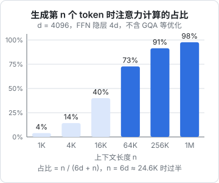
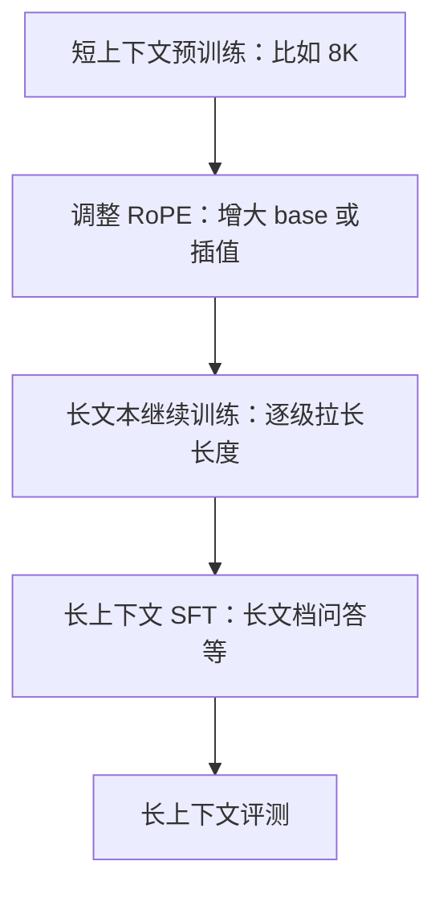

# 长上下文技术

上下文窗口从几千 token 涨到几十万、上百万，靠的不是某一个突破，而是好几层技术叠在一起：计算上让注意力不再受限于 $n^2$ 的显存（FlashAttention），结构上减少每个 token 要看的范围（滑动窗口、稀疏、线性化），分布式上把一条序列拆到多张卡（Ring Attention），训练上让模型适应长位置（第 2 章的 RoPE 扩展）。这一章依次拆开，最后讨论一个对使用者最重要的问题：**声称支持 1M，不等于在 1M 上好用**。

## 长上下文的三笔账

| 账目 | 随 $n$ 的增长 | 在哪一章 |
|---|---|---|
| 注意力计算量 | 整个序列 $O(n^2)$，每个新 token $O(n)$ | 本章 |
| 注意力矩阵的显存 | 朴素实现 $O(n^2)$ | 本章（FlashAttention） |
| KV Cache 显存 | $O(n)$，但常数很大 | 第 3 章 |
| 位置编码外推 | 超出训练长度就失效 | 第 2 章 |

第 1 章算过，每层每 token 的前向 FLOPs 约为 $24d^2 + 4nd$。注意力分数项所占的比例是

$$
\frac{4nd}{24d^2 + 4nd} = \frac{n}{6d + n}
$$



$n = 6d$ 是分水岭。对 $d = 4096$ 的模型，上下文超过约 2.5 万 token 后，大部分计算花在了注意力上，而不是那些「存着知识」的参数上。上下文越长，模型越像一台「在上下文里做检索」的机器。（实际模型用了 GQA 等优化，比例会有出入，但趋势相同。）

## FlashAttention：不改公式，改访存

### 问题在显存搬运

朴素实现先算出完整的 $S = QK^\top$（$n \times n$），写回显存，再读出来做 softmax，再写回，再读出来乘 $V$。$n = 32\text{K}$ 时，一个头的 $S$ 就有 10 亿个元素。

GPU 有两级存储：容量大但慢的 HBM（显存），和容量小（每个计算单元几百 KB）但快得多的片上 SRAM。注意力的计算量其实不大，**时间主要花在 $n \times n$ 矩阵在 HBM 里的来回搬运上**。

FlashAttention（Dao 等，2022）的思路是**分块**（tiling）：把 Q、K、V 切成能放进 SRAM 的小块，在片上算完一块的分数、softmax 和加权求和，只把最终结果写回 HBM。完整的 $n \times n$ 矩阵从来不会出现在显存里，注意力的显存占用从 $O(n^2)$ 降到 $O(n)$，速度也成倍提升。

它是**精确**的注意力，不是近似。难点在于：softmax 需要整行的最大值和总和，分块计算时每次只看到一行的一部分。

### 在线 softmax

解决办法是边读边修正。对 query 的一行，按块依次读入 key/value，维护三个量：当前见过的最大分数 $m$，指数和 $\ell$，未归一化的输出 $o$。读入新一块分数 $s_1, \dots, s_B$ 及对应的 $v_1, \dots, v_B$ 时：

$$
m' = \max\big(m,\ \max_j s_j\big)
$$

$$
\ell' = \ell \cdot e^{m - m'} + \sum_j e^{s_j - m'}
$$

$$
o' = o \cdot e^{m - m'} + \sum_j e^{s_j - m'}\, v_j
$$

全部块处理完后，输出为 $o / \ell$。

为什么对：所有之前累加的项都是以旧最大值 $m$ 为基准算的指数 $e^{s - m}$，乘上 $e^{m - m'}$ 就变成了 $e^{s - m'}$，统一换到新基准下。这正是第 1 章 softmax 平移不变性的直接应用。

```python
import numpy as np

rng = np.random.default_rng(0)
n, dk, block = 1000, 64, 128
q = rng.standard_normal(dk)
K = rng.standard_normal((n, dk))
V = rng.standard_normal((n, dk))
s_all = K @ q / np.sqrt(dk)

# 参考答案：一次性 softmax
w = np.exp(s_all - s_all.max())
ref = (w / w.sum()) @ V

# 在线 softmax：一次只看 block 个 key
m, l, o = -np.inf, 0.0, np.zeros(dk)
for start in range(0, n, block):
    s = s_all[start : start + block]
    v = V[start : start + block]
    m_new = max(m, s.max())
    scale = np.exp(m - m_new)          # 第一块时 exp(-inf) = 0
    p = np.exp(s - m_new)
    l = l * scale + p.sum()
    o = o * scale + p @ v
    m = m_new

print(np.allclose(o / l, ref))   # True
```

后续的 FlashAttention-2、FlashAttention-3 改进了并行划分和对新硬件特性的利用，思路一脉相承。今天主流训练和推理框架默认都用这类内核，在 PyTorch 里调用 `scaled_dot_product_attention` 时，底层通常就会选到它。

FlashAttention 解决了显存，但**没有改变计算量的 $O(n^2)$**。要减少计算，得改变「每个 token 看多少个 token」。

## 少看一点：滑动窗口与注意力汇聚点

### 滑动窗口

每个 token 只看最近的 $w$ 个 token（比如 $w = 4096$），计算和 KV Cache 都只与 $w$ 有关。远处的信息并非完全丢失：第 $\ell$ 层的 token 看到 $w$ 个位置，而那些位置在前一层已经各自看过 $w$ 个位置，信息逐层传递，理论感受野约为 $\ell \times w$。Mistral 7B 用过这种设计。

实践中更常见的是**混合**：大部分层用滑动窗口（局部注意力），每隔几层插一层全局注意力。这样既省了大部分层的计算和缓存，又保留了精确检索远处内容的能力。

### 注意力汇聚点

StreamingLLM（Xiao 等，2023）发现一个有趣的现象：训练好的模型会把大量注意力权重放在序列**最开头的几个 token** 上，不管它们的内容是什么。原因是 softmax 要求权重和为 1，当一个头「没什么可看的」时，需要一个地方倾倒多余的权重，开头的 token 对所有位置可见，就成了这个垃圾桶。这些 token 被称为**注意力汇聚点**（attention sink）。

推论是：如果做滑动窗口时把开头几个 token 也挤出窗口，模型会立刻崩溃；只要始终保留它们，再加上最近的窗口，模型就能稳定地处理无限长的流式输入（当然，窗口外的内容它确实记不住）。

## 换掉 softmax：线性注意力与状态空间模型

另一条路线是彻底改掉 $O(n^2)$ 的结构。如果去掉 softmax，注意力可以利用矩阵乘法结合律重排：

$$
(QK^\top)V = Q(K^\top V)
$$

$K^\top V$ 是 $d_k \times d_k$ 的矩阵，与 $n$ 无关。在因果情形下，它可以作为一个**状态**随 token 逐步累加更新，每生成一个 token 的代价是常数，像 RNN 一样。Mamba（Gu 与 Dao，2023）为代表的状态空间模型也属于这一家族，它让状态的更新依赖于输入（选择性），表达能力强了很多。

代价是：固定大小的状态是对全部历史的**有损压缩**。「从一大段文本里精确找出某个电话号码」这类任务，恰恰是 softmax 注意力的强项、固定状态的弱项。所以目前的趋势是**混合架构**：大部分层用线性注意力或 SSM，少数层保留完整注意力。AI21 的 Jamba（2024）是较早的混合模型代表，之后各家都有类似尝试。

## 分布式：Ring Attention 与上下文并行

一条百万 token 的序列，单卡连激活值都放不下。**Ring Attention**（Liu 等，2023）把序列切成块分到多张卡，每张卡持有自己那段的 Q，K/V 块则沿着环形拓扑在卡之间依次传递；每张卡收到一块就用在线 softmax 累加一次，同时把这块转发给下一张卡。计算和通信重叠，序列长度可以随卡数线性扩展。各训练框架里的「上下文并行」（context parallelism）大多是这一思路的变体。

## 训练出长上下文

把以上技术组合起来，一个长上下文模型通常这样产生：



为什么不从头就用长上下文训练？因为注意力的成本随长度平方增长，而预训练的绝大部分数据（网页、对话）本来就短。先在短序列上花掉绝大部分算力学会语言，最后用相对少的算力适应长位置，性价比最高。这一步的难点往往不在算法，而在**数据**：需要大量真正依赖长距离信息的文本（长书、代码仓库、长报告），单纯把短文拼接起来，模型学不会利用远处的内容。

## 声称支持 vs 真正好用

### 大海捞针

最常见的长上下文测试是「大海捞针」（needle in a haystack）：在一大段无关文本的某个位置插一句话（比如「最适合在旧金山做的事是……」），然后提问。按插入深度和总长度画成热力图，全绿就说明「找得到」。

现在的前沿模型在这个测试上大多接近满分，但它太简单了：针和问题的字面高度重合，本质是字符串匹配。

### 更难的测试

- **RULER**（NVIDIA，2024）在捞针之外加入了多针、多跳追踪、聚合统计等任务，它发现很多模型的「有效上下文长度」明显短于声称的长度
- **Lost in the Middle**（Liu 等，2023）发现，相关信息放在上下文的开头或结尾时模型表现最好，放在中间时明显下降，呈 U 形曲线
- 需要综合全文的推理（「这份 300 页的合同里，哪些条款互相矛盾」），比找到一个事实难得多，性能随长度下降也更快

### 对使用的启示

- 别把「窗口装得下」当成「模型会认真读」。上下文越长，每一部分分到的注意力越稀薄，无关内容会实打实地干扰输出。只放相关的内容，是[《上下文工程》](../context-engineering/)的核心原则
- 长文档放在前面，问题和指令放在最后；关键约束可以在结尾再重复一次
- 长上下文和 RAG 不是二选一：资料能精确检索时用 RAG 降低成本和噪声，需要整体理解时才把全文塞进去。[《RAG 与知识系统》](../rag-systems/)会专门讨论这个取舍
- 重复使用同一份长文档时，配合 prompt 缓存（第 3 章）能大幅降低成本

## 本章要点

- 每个新 token 的计算里注意力占比约为 $n/(6d+n)$，上下文超过约 $6d$ 后注意力成为主角
- FlashAttention 用分块和在线 softmax 把注意力的显存从 $O(n^2)$ 降到 $O(n)$，结果精确，但计算量仍是 $O(n^2)$
- 在线 softmax 靠维护运行最大值、指数和与未归一化输出，并在最大值更新时整体重缩放
- 滑动窗口与全局层混合、保留注意力汇聚点、线性注意力与 SSM 的混合架构，都是在减少每个 token 要看的范围
- Ring Attention 把序列分到多卡，K/V 块环形传递
- 长上下文模型是「短序列预训练 + RoPE 调整 + 长文本继续训练」得到的；有效上下文常短于声称值，中间位置的信息最容易被忽略

## 动手练习

1. **为什么非要 FlashAttention**：$n=32768$ 时，朴素实现里一个头的分数矩阵 $S$ 用 FP32 存要多少 GiB？如果改用滑动窗口 $w=4096$、共 32 层，理论感受野是多少 token？

   验证：一个头 4 GiB（$32768^2\times4$ 字节）；感受野 $32\times4096=131072$。

   参考答案：一层 32 个头就是 128 GiB，根本放不进显存，所以必须分块、不落地完整矩阵。滑动窗口的感受野虽然理论上很大，但信息要逐层接力，远处细节会在传递中损失，这也是要混合全局层的原因。

2. **线性注意力就是 RNN**：去掉 softmax 后，因果注意力是 $\mathrm{tril}(QK^\top)V$。写一个循环版本：维护 $d_k\times d_k$ 的状态 $S$，每步 $S \mathrel{+}= k_t^\top v_t$，输出 $q_t S$。比较两种结果。

   验证：`np.allclose` 打印 `True`，状态形状始终是 `(8, 8)`，与序列长度无关。

   参考答案：结合律把 $n\times n$ 的矩阵换成了固定大小的状态，每个 token 的代价是常数；但状态大小固定，意味着历史被有损压缩，这就是线性注意力在精确检索上吃亏的原因。

   ```python
   import numpy as np
   rng = np.random.default_rng(0)
   n, dk = 50, 8
   Q, K, V = (rng.standard_normal((n, dk)) for _ in range(3))
   masked = np.tril(Q @ K.T) @ V
   S, out = np.zeros((dk, dk)), []
   for t in range(n):
       S += np.outer(K[t], V[t])
       out.append(Q[t] @ S)
   print(np.allclose(masked, np.array(out)), S.shape)
   ```

3. **自己做一次大海捞针**（需要 API key，或本机用 Ollama 跑一个开源模型）：用脚本生成约 2 万字的填充文本（比如重复一段与主题无关的说明文字并加上段号），在 10%、50%、90% 三个深度分别插入一句「仓库钥匙放在第三个蓝色抽屉里」，每次问「仓库钥匙放在哪里？」。再把问题改成需要综合的版本：插入三句分别提到三把钥匙的位置，问「一共提到了几把钥匙，各在哪里？」。

   验证：记录每个深度、每种问法是否答对。单针题通常全对；多针综合题更可能漏掉一处，漏掉的常在中间位置。

   参考答案：单针和问题字面重合，接近字符串匹配，所以容易；多针要求把散落各处的信息都找全，更接近 RULER 的难题，也更容易暴露「中间被忽略」的现象。结果因模型而异，重点是自己观察到两类任务的差距。
