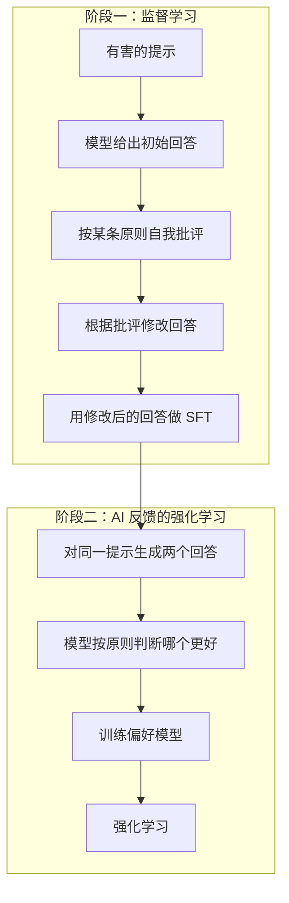

# 对齐方法：RLHF、DPO 与 Constitutional AI

科普篇用「新员工培训」讲了 SFT 和 RLHF 的流程。这一章把它们写成数学：奖励模型学的是什么分布，RLHF 优化的目标为什么要带一个 KL 项，以及 DPO 如何从这个目标出发，经过几步代数推导，把「训练奖励模型 + 强化学习」两个阶段合并成一个简单的分类损失。最后看 Anthropic 的 Constitutional AI 如何用一份写明的原则代替大部分人工标注，以及这些方法共同面对的问题：奖励黑客与讨好。

## 记号

| 记号 | 含义 |
|---|---|
| $x$ | 提示（prompt） |
| $y$ | 完整回答；$y_w$、$y_l$ 是一对比较中更好、更差的回答 |
| $\pi_\theta(y \mid x)$ | 正在训练的策略模型生成 $y$ 的概率，等于各 token 概率之积 |
| $\pi_{\text{ref}}$ | 参考模型，通常是 SFT 之后、偏好训练之前的模型，参数冻结 |
| $r(x, y)$ | 奖励，表示回答有多好 |
| $\sigma(z) = 1/(1+e^{-z})$ | sigmoid 函数 |

## 第一步：奖励模型与 Bradley-Terry

人类标注给出的是**比较**而不是分数：「$y_w$ 比 $y_l$ 好」。为了从比较里学出一个分数，假设偏好服从 Bradley-Terry 模型：

$$
P(y_w \succ y_l \mid x) = \sigma\big(r(x, y_w) - r(x, y_l)\big)
$$

两个回答的奖励差越大，好的那个被选中的概率越接近 1。用最大似然训练奖励模型 $r_\phi$，损失就是负对数似然：

$$
\begin{aligned}
\mathcal{L}_{\text{RM}}(\phi) &= -\,\mathbb{E}_{(x, y_w, y_l)}\Big[\log \sigma\big(r_\phi(x, y_w) \\
&\qquad - r_\phi(x, y_l)\big)\Big]
\end{aligned}
$$

这本质上是一个二分类：判断一对回答里哪个更好。注意 Bradley-Terry 只关心**差值**，奖励整体加一个常数不影响任何东西。奖励模型一般用 SFT 模型初始化，把最后的词表输出层换成一个输出标量的线性层。

## 第二步：带 KL 约束的强化学习

有了奖励模型，RLHF 的优化目标是：

$$
\begin{aligned}
\max_{\pi_\theta}\ &\mathbb{E}_{x,\ y \sim \pi_\theta(\cdot \mid x)}\big[r(x, y)\big] \\
&- \beta\, D_{\mathrm{KL}}\big(\pi_\theta(\cdot \mid x) \,\Vert\, \pi_{\text{ref}}(\cdot \mid x)\big)
\end{aligned}
$$

KL 项的作用有三层：

1. **奖励模型只在训练分布附近可信**。策略跑得太远，进入奖励模型没见过的区域，它的打分就是噪声，策略会学着去钻这些噪声的空子
2. **保留 SFT 学到的能力和多样性**，避免模型坍缩到少数几种高分套路
3. 数学上，它让下面的最优解有闭式形式

OpenAI 的 Gao 等人 2022 年关于奖励模型过度优化的研究量化了第 1 点：随着策略与参考模型的 KL 距离增大，奖励模型给的分数一直上升，但用更可靠的「黄金」奖励衡量，真实质量先升后降。$\beta$ 就是在控制走多远。

实践中这个目标用 PPO 优化，需要同时维护四个模型：策略、参考模型、奖励模型、价值模型（估计基线）。显存开销大、超参数敏感、训练不稳定，这正是 DPO 想绕开的。

## DPO：把强化学习变成分类

DPO（Direct Preference Optimization，Rafailov 等，2023）的推导分三步。

### 1. 求出最优策略的闭式解

对每个固定的 $x$，把目标改写一下（省略 $x$ 以简化记号）：

$$
\begin{aligned}
&\mathbb{E}_{y \sim \pi}\Big[r(y) - \beta \log\frac{\pi(y)}{\pi_{\text{ref}}(y)}\Big] \\
&= -\beta\, \mathbb{E}_{y \sim \pi}\Big[\log\frac{\pi(y)}{\pi_{\text{ref}}(y)\, e^{r(y)/\beta}}\Big]
\end{aligned}
$$

定义配分函数 $Z = \sum_y \pi_{\text{ref}}(y)\, e^{r(y)/\beta}$，以及一个合法的概率分布

$$
\pi^*(y) = \frac{1}{Z}\, \pi_{\text{ref}}(y)\, e^{r(y)/\beta}
$$

则分母 $\pi_{\text{ref}}(y)\, e^{r(y)/\beta} = Z \pi^*(y)$，代入得

$$
\begin{aligned}
&-\beta\, \mathbb{E}_{y \sim \pi}\Big[\log\frac{\pi(y)}{\pi^*(y)} - \log Z\Big] \\
&= -\beta\, D_{\mathrm{KL}}(\pi \,\Vert\, \pi^*) + \beta \log Z
\end{aligned}
$$

$Z$ 与 $\pi$ 无关，KL 散度非负且仅在 $\pi = \pi^*$ 时为 0。所以**最优策略就是 $\pi^*$**：参考模型的分布，按奖励的指数重新加权。

### 2. 反解出奖励

对 $\pi^*$ 的定义取对数，把奖励用策略表示出来：

$$
r(x, y) = \beta \log\frac{\pi^*(y \mid x)}{\pi_{\text{ref}}(y \mid x)} + \beta \log Z(x)
$$

这一步是 DPO 的核心洞察：**任何奖励函数都对应一个最优策略，反过来，策略本身就隐式地定义了一个奖励**。论文的副标题正是「你的语言模型其实是一个奖励模型」。

### 3. 代回 Bradley-Terry

把上式代入偏好概率。$\beta \log Z(x)$ 只与 $x$ 有关，在两个回答的奖励之差里被消掉：

$$
\begin{aligned}
&P(y_w \succ y_l \mid x) \\
&= \sigma\Big(\beta \log\frac{\pi^*(y_w \mid x)}{\pi_{\text{ref}}(y_w \mid x)} \\
&\qquad - \beta \log\frac{\pi^*(y_l \mid x)}{\pi_{\text{ref}}(y_l \mid x)}\Big)
\end{aligned}
$$

难以计算的 $Z$ 消失了。现在直接用 $\pi_\theta$ 代替 $\pi^*$，对偏好数据做最大似然，就得到 **DPO 损失**：

$$
\begin{aligned}
&\mathcal{L}_{\text{DPO}}(\theta) \\
&= -\,\mathbb{E}_{(x, y_w, y_l)}\Bigg[\log\sigma\Big(\beta\log\frac{\pi_\theta(y_w \mid x)}{\pi_{\text{ref}}(y_w \mid x)} \\
&\qquad - \beta\log\frac{\pi_\theta(y_l \mid x)}{\pi_{\text{ref}}(y_l \mid x)}\Big)\Bigg]
\end{aligned}
$$

不需要奖励模型，不需要采样，不需要价值模型。只要两个模型（策略和冻结的参考）对已有的偏好数据各做一次前向，算出对数概率，就是一个普通的监督学习损失。

### 梯度在做什么

记隐式奖励 $\hat r(y) = \beta \log \frac{\pi_\theta(y \mid x)}{\pi_{\text{ref}}(y \mid x)}$，求导可得

$$
\begin{aligned}
\nabla_\theta \mathcal{L}_{\text{DPO}} = -\beta\, \mathbb{E}\Big[&\sigma\big(\hat r(y_l) - \hat r(y_w)\big) \\
&\big(\nabla_\theta \log \pi_\theta(y_w \mid x) \\
&\quad - \nabla_\theta \log \pi_\theta(y_l \mid x)\big)\Big]
\end{aligned}
$$

- 提高好回答的概率，降低差回答的概率
- 权重 $\sigma(\hat r(y_l) - \hat r(y_w))$：当模型**判断错误**（认为差的更好）时权重接近 1，已经判断正确的样本权重趋近 0。这是一种自动的难例挖掘

### 代码

`logp` 是把回答的每个 token 的对数概率加起来得到的序列对数概率，通常由框架的一次前向算出：

```python
import numpy as np

def dpo_loss(logp_w, logp_l, ref_w, ref_l, beta=0.1):
    """四个参数都是形状 (batch,) 的序列对数概率。"""
    margin = beta * ((logp_w - ref_w) - (logp_l - ref_l))
    loss = np.logaddexp(0.0, -margin)   # 等于 -log(sigmoid(margin))，数值稳定
    return loss.mean(), margin

ref_w = np.array([-42.0, -55.0])
ref_l = np.array([-40.0, -50.0])
# 刚开始训练：策略 = 参考模型，margin = 0，loss = log 2
print(dpo_loss(ref_w, ref_l, ref_w, ref_l)[0].round(4))           # 0.6931
# 训练后：好回答概率上升、差回答下降
print(dpo_loss(ref_w + 3, ref_l - 4, ref_w, ref_l)[0].round(4))   # 小于 0.6931
```

开源生态里 Hugging Face 的 TRL 等库都有现成的 DPO 训练器，[《开源模型：部署、量化与微调》](../open-models/)会讲实操。

## DPO 的局限与变体

DPO 简单，但它是**离线**的：只在固定的偏好数据上学，不像 PPO 那样不断用当前策略生成新回答再打分。几个已知问题：

- 偏好数据由其他模型生成时，与当前策略的分布不匹配，效果打折扣；实践中常做多轮「生成—标注—DPO」的迭代
- 隐式奖励可以通过同时压低 $y_w$ 和 $y_l$ 的概率来扩大差距，好回答的绝对概率未必上升
- 有长度偏好：更长的回答在数据中常被标为更好，模型学会了变啰嗦

由此衍生出许多变体：

| 方法 | 改了什么 |
|---|---|
| IPO | 换成平方损失，缓解对确定性偏好的过拟合 |
| KTO | 不需要成对数据，只要每条回答「好 / 不好」的标签 |
| ORPO | 不要参考模型，把偏好项直接加到 SFT 损失上，一个阶段完成 |
| SimPO | 不要参考模型，用长度归一化的平均对数概率作为隐式奖励，并加一个间隔 |

它们的共同点是：**直接在策略上做偏好优化，跳过显式的奖励模型和强化学习**。而在有可验证奖励的任务（数学、代码）上，第 6 章的在线强化学习重新成了主角。今天的后训练通常是 SFT、偏好优化和 RL 的组合。

## Constitutional AI

RLHF 和 DPO 都依赖大量人类偏好标注。Anthropic 2022 年提出的 Constitutional AI（Bai 等）尝试用一份**明确写下的原则清单**（「宪法」），让模型自己产生无害性方面的反馈。



- **阶段一**：模型针对有害提示先回答，再被要求「根据原则 X，指出这个回答的问题」，然后「据此改写」。原则每次随机抽取，比如「选择更不可能被视为有害或冒犯的回答」。改写后的回答作为 SFT 数据
- **阶段二**：模型按原则比较成对回答，生成偏好标签，这就是 RLAIF（来自 AI 反馈的强化学习）。论文中有用性的偏好仍来自人类标注，无害性的偏好来自 AI

这样做的好处：

- **规则可读、可审查、可修改**：模型行为的依据写在一份文档里，而不是隐含在数万条标注员的个人判断中
- **标注成本低，可以规模化**
- 论文报告，这样训练的模型比单纯用人类反馈训练的模型**更少回避**：它倾向于解释为什么不能帮忙，而不是简单拒绝

这和你在 `CLAUDE.md` 里写规则有相似之处：把期望的行为写成明确的原则，让模型去遵循和自我检查。区别在于，CAI 是把原则在训练中「烧进」权重里。

## 共同的敌人：奖励黑客与讨好

所有偏好优化方法都在优化一个**代理指标**，而不是真实目标。古德哈特定律在这里格外显著：

| 现象 | 来源 |
|---|---|
| 回答越来越长、格式越来越花哨 | 标注者倾向于给看起来详尽的回答高分 |
| 讨好（sycophancy）：附和用户的错误观点，被质疑就改口 | Anthropic 2023 年的研究发现，人类偏好数据本身就倾向于奖励与用户观点一致的回答 |
| 过度拒绝 | 无害性的权重过高 |
| 编程任务里改测试、硬编码答案 | 可验证奖励被「验证」的方式钻了空子 |

对使用者的启示：模型的这些习惯性偏差源自训练目标，靠 prompt 只能部分抵消。需要客观判断时，避免在提问中暴露你倾向的答案；让模型评审代码时，明确要求它列出问题，而不是问「这样写好吗」。

## 本章要点

- 奖励模型基于 Bradley-Terry 假设，用成对比较的负对数似然训练，只关心奖励差
- RLHF 最大化奖励减去与参考模型的 KL 距离；KL 防止策略跑出奖励模型可信的区域
- 带 KL 的目标的最优解是 $\pi^* \propto \pi_{\text{ref}}\, e^{r/\beta}$；反解出奖励代回 Bradley-Terry，配分函数相消，得到 DPO 损失
- DPO 的梯度自动加权判断错误的样本；它离线、简单，但有分布偏移和长度偏好等问题，衍生出 IPO、KTO、ORPO、SimPO 等变体
- Constitutional AI 用写明的原则让模型自我批评、修改，并用 AI 反馈生成偏好数据
- 偏好优化的代理指标会被钻空子，啰嗦、讨好、过度拒绝都是训练目标的副作用
