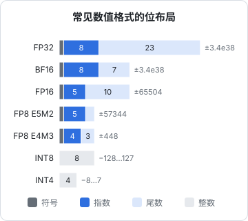

# 量化原理

一个 70B 的模型，BF16 下光权重就要 140 GB；量化到 4 位后约 40 GB，一台大内存的 Mac 就装得下，生成速度还能更快。**量化**（quantization）就是用更少的位数表示权重（有时也包括激活值和 KV Cache）。这一章讲清楚：数值格式各自的取舍、量化公式和误差从哪来、为什么大模型的量化难在「离群值」，以及 GPTQ、AWQ、SmoothQuant 这些名字背后的思路。读完你能看懂模型仓库里 `Q4_K_M`、`AWQ`、`FP8` 这些后缀，并判断该选哪个。实际部署操作留给[《开源模型：部署、量化与微调》](../open-models/)。

## 为什么量化能提速

第 3 章的结论：解码阶段受**显存带宽**限制，每生成一个 token 都要把全部权重读一遍。所以

$$
\text{单条序列解码速度} \approx \frac{\text{带宽}}{\text{权重字节数}}
$$

权重从 16 位降到 4 位，读的数据量减为四分之一，即使计算时要先把 4 位数解压回 16 位再乘（这叫**仅权重量化**），速度也能明显提升。另外两个收益：

- 省下的显存可以留给 KV Cache，支持更长上下文或更大 batch
- 如果激活值也量化（比如 W8A8：权重和激活都是 8 位），矩阵乘法可以直接用 INT8 或 FP8 的张量核心，预填充阶段的计算也会加速

| 模型 | BF16 | INT8 | 4 位（含缩放因子，约 4.5 位/参数） |
|---|---|---|---|
| 8B | 16 GB | 8 GB | 约 4.5 GB |
| 70B | 140 GB | 70 GB | 约 40 GB |

这只是权重。实际运行还要加上 KV Cache、激活值和框架开销。

## 数值格式



浮点数由符号、指数、尾数组成：**指数位决定范围，尾数位决定精度**。

| 格式 | 特点 | 典型用途 |
|---|---|---|
| FP32 | 范围大、精度高 | 优化器状态、主权重副本 |
| BF16 | 指数位和 FP32 一样多，范围相同，精度低 | 训练与推理的默认格式，几乎不会溢出 |
| FP16 | 精度比 BF16 高，但最大只到 65504 | 早期混合精度训练，需要损失缩放防溢出 |
| FP8 E4M3 | 精度稍高、范围小 | 推理的权重和激活；训练的前向 |
| FP8 E5M2 | 范围大、精度低 | 训练的梯度 |
| INT8 / INT4 | 均匀分布的整数网格，需配缩放因子 | 权重量化、KV Cache 量化 |

浮点数的可表示值在 0 附近密、远处疏，整数网格则处处均匀。神经网络的权重大致呈钟形分布，大部分值集中在 0 附近，所以低位宽时浮点格式（或者下面要讲的非均匀格式）往往更合适。

新一代 GPU 原生支持 FP8 运算，DeepSeek-V3 的技术报告就展示了大规模 FP8 混合精度训练的可行性。

## 量化的公式

### 对称量化

把实数 $w$ 映射到 $b$ 位有符号整数。取缩放因子 $s$，让绝对值最大的数恰好映射到整数范围边缘：

$$
\begin{gathered}
s = \frac{\max \lvert w \rvert}{2^{b-1} - 1} \\
q = \mathrm{clamp}\Big(\mathrm{round}\big(\tfrac{w}{s}\big),\ -2^{b-1},\ 2^{b-1}-1\Big) \\
\hat w = s \cdot q
\end{gathered}
$$

存储时只保留整数 $q$ 和缩放因子 $s$。

### 非对称量化

数据不以 0 为中心时（比如 ReLU 之后的激活全是正数），对称量化浪费了一半的网格。加一个零点 $z$：

$$
\begin{gathered}
s = \frac{\max w - \min w}{2^b - 1} \\
z = \mathrm{round}\Big(-\frac{\min w}{s}\Big) \\
q = \mathrm{clamp}\big(\mathrm{round}(\tfrac{w}{s}) + z,\ 0,\ 2^b - 1\big)
\end{gathered}
$$

反量化为 $\hat w = s(q - z)$。

### 误差从哪来

四舍五入的误差在 $[-s/2, s/2]$ 内近似均匀分布，均方误差为 $s^2/12$。**误差由 $s$ 决定，而 $s$ 由这组数里的最大绝对值决定**。只要组里有一个特别大的数，$s$ 就被撑大，其他所有正常大小的数都被挤到少数几个格点上。

### 粒度：一组数共用一个缩放因子

| 粒度 | 一个缩放因子管多少数 | 额外开销 | 精度 |
|---|---|---|---|
| 逐张量 | 整个矩阵 | 可忽略 | 差 |
| 逐通道 | 矩阵的一行或一列 | 很小 | 中 |
| 逐组 | 每连续 $G$ 个数，常见 $G = 128$ | 每参数 $16/G$ 位（FP16 缩放因子） | 好 |

逐组量化把离群值的影响限制在 128 个数以内。4 位加上每 128 个数一个 FP16 缩放因子，平均 $4 + 16/128 = 4.125$ 位；再加零点或多级缩放，实际平均位宽通常在 4.1 到 5 位之间，这就是上表「约 4.5 位」的来源。

下面的实验在一个带离群值的矩阵上对比三种粒度：

```python
import numpy as np

rng = np.random.default_rng(0)
W = rng.standard_normal((256, 1024)).astype(np.float32) * 0.02
W[3, 7] = 1.5          # 制造一个离群值

def quant_sym(w, bits, axis=None):
    qmax = 2 ** (bits - 1) - 1
    s = np.abs(w).max(axis=axis, keepdims=axis is not None) / qmax
    q = np.clip(np.round(w / s), -qmax - 1, qmax)
    return q * s

def per_group(w, bits, G=128):
    rows, cols = w.shape
    g = w.reshape(rows, cols // G, G)
    return quant_sym(g, bits, axis=-1).reshape(rows, cols)

def rel_err(a, b):
    return np.linalg.norm(a - b) / np.linalg.norm(a)

print("逐张量 INT4:", round(rel_err(W, quant_sym(W, 4)), 3))
print("逐行   INT4:", round(rel_err(W, quant_sym(W, 4, axis=1)), 3))
print("逐组   INT4:", round(rel_err(W, per_group(W, 4)), 3))
print("逐组   INT8:", round(rel_err(W, per_group(W, 8)), 4))
```

逐张量时，那一个 1.5 把 $s$ 撑到约 0.2，而绝大多数权重的绝对值不到 0.06，全部被舍入成 0，相对误差接近 100%；逐行时只有第 3 行受害；逐组时只有那 128 个数受害，误差最小。

## 大模型的难点：离群值

### 激活值里的离群特征

权重的分布相对温和，**激活值**才是难点。LLM.int8()（Dettmers 等，2022）发现，模型规模超过约 6.7B 参数后，隐状态里会出现少数几个**固定维度**，其数值比其他维度大几十倍，而且出现在几乎所有 token、大多数层里。把这些维度量化坏了，模型性能会断崖式下跌。

LLM.int8() 的办法是混合精度分解：把这几个离群维度挑出来用 FP16 算，其余 99% 以上的维度用 INT8 算。精度保住了，但实现复杂、速度收益有限。

### SmoothQuant：把难度从激活搬到权重

对于 $Y = XW$，激活 $X$ 难量化（有离群列），权重 $W$ 好量化。SmoothQuant（Xiao 等，2022）利用一个恒等变换：

$$
Y = XW = \big(X\, \mathrm{diag}(s)^{-1}\big)\big(\mathrm{diag}(s)\, W\big)
$$

把 $X$ 的第 $j$ 列除以 $s_j$，同时把 $W$ 的第 $j$ 行乘以 $s_j$，结果完全不变。选

$$
s_j = \frac{\max \lvert X_{:,j} \rvert^{\alpha}}{\max \lvert W_{j,:} \rvert^{1-\alpha}}
$$

$\alpha = 0.5$ 时两边的难度被均摊。缩放可以离线并入前一层的归一化参数，推理时零额外开销。这让 W8A8 量化在大模型上变得实用。

## 只量化权重：GPTQ 与 AWQ

对个人部署最常见的是 4 位仅权重量化。直接四舍五入（RTN）在 8 位时基本无损，到 4 位就开始掉点。两种主流的改进方法都用到一小批**校准数据**，但思路不同。

### GPTQ：让后面的权重补偿前面的误差

GPTQ（Frantar 等，2022）逐层求解：

$$
\min_{\hat W}\ \big\lVert XW - X\hat W \big\rVert_2^2
$$

目标不是让 $\hat W$ 接近 $W$，而是让**输出**接近。它沿输入维度逐个量化权重，每量化一个输入维度对应的那组权重，就利用校准数据的二阶信息（Hessian $H = 2X^\top X$ 的逆）调整**尚未量化**的权重，把刚才的舍入误差尽量补偿掉。论文显示，它能在几个 GPU 小时内把 175B 级别的模型量化到 3–4 位，精度损失很小。

### AWQ：保护重要的通道

AWQ（Lin 等，2023）观察到：权重的重要性取决于**与之相乘的激活值有多大**。激活幅度大的那约 1% 的输入通道，对应的权重一旦量化不准，误差会被放大。

它不用混合精度保留这些权重（那样对硬件不友好），而是借用 SmoothQuant 的恒等变换：把这些通道的权重放大 $s$ 倍、激活缩小 $s$ 倍，权重放大后相对舍入误差变小。缩放系数在校准数据上搜索得到。AWQ 不需要反向传播或二阶信息，速度快、对校准数据不敏感。

### 非均匀格式：NF4 与 k-quants

- **NF4**（QLoRA 论文，Dettmers 等，2023）：既然权重近似正态分布，就把 16 个量化格点放在标准正态分布的分位点上，让每个格点覆盖的权重数量大致相等。QLoRA 用它在单张消费级显卡上微调大模型
- **GGUF 的 k-quants**：llama.cpp 的模型格式。`Q4_K_M` 这类名字里，数字是主要位宽，`K` 表示采用分层的「超级块」结构（块内的缩放因子本身也被量化），`S / M / L` 表示混合程度：越往 `L` 走，越多敏感张量（如注意力的 V 投影、FFN 的输出投影）改用更高位宽

## 怎么选

| 场景 | 推荐 |
|---|---|
| 数据中心 GPU 服务，追求吞吐 | FP8（W8A8）或 INT8 SmoothQuant；新硬件优先 FP8 |
| 单卡 GPU 部署，显存紧张 | 4 位 AWQ 或 GPTQ，配合 vLLM 等框架 |
| Mac 或 CPU 本地运行 | GGUF，`Q4_K_M` 到 `Q5_K_M` 是常见的平衡点，内存够就用 `Q8_0` |
| 长上下文、KV Cache 是瓶颈 | 再加 KV Cache 的 FP8 或 INT8 量化 |

几条经验规律：

- 8 位通常接近无损；4 位在多数任务上损失较小；低于 4 位损失迅速增大
- **大模型比小模型更耐量化**：同样的显存，4 位的大模型通常胜过 8 位的小模型
- 困惑度（perplexity）掉得不多，不代表所有能力都没受影响。数学推理、代码、长上下文、非英语语言往往比通用问答更敏感，上线前用自己的任务评测一遍（见[《评测与质量》](../llm-evals/)）

以上都属于**训练后量化**（PTQ）：模型训练完再压缩。另一条路是**量化感知训练**（QAT）：训练时就模拟量化误差，让模型适应低精度。微软的 BitNet b1.58 甚至把权重限制在 $\{-1, 0, 1\}$ 三个值，从头训练，展示了极低位宽的可能性。

## 本章要点

- 解码受带宽限制，权重位数减少直接带来提速；省下的显存可以给 KV Cache
- 指数位决定范围，尾数位决定精度；BF16 范围同 FP32，是训练默认格式；FP8 有 E4M3 和 E5M2 两种
- 量化误差由缩放因子决定，缩放因子由组内最大值决定；逐组量化（如每 128 个数）把离群值的影响限制在局部
- 大模型的激活值存在固定维度的离群特征；SmoothQuant 用等价缩放把难度从激活搬到权重
- GPTQ 用二阶信息让未量化的权重补偿误差，AWQ 按激活幅度保护重要通道；NF4、k-quants 是非均匀或分层格式
- 8 位接近无损，4 位是性价比甜点，大模型比小模型更耐量化；上线前用自己的任务评测
