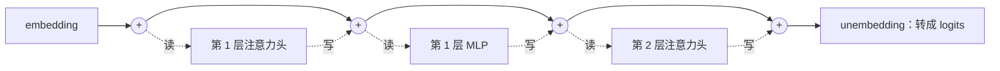
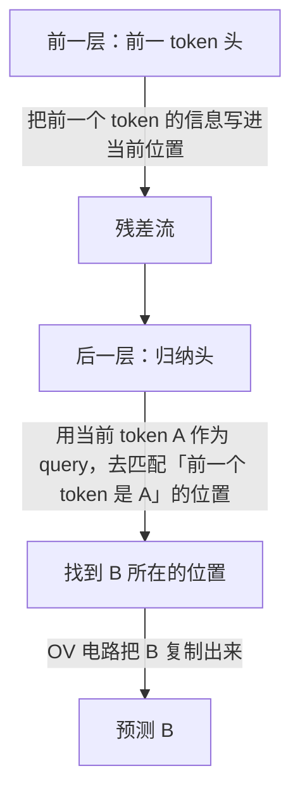

# 可解释性

前八章讲的都是「怎么造、怎么跑」：我们知道每一层的公式，却说不清训练好的模型**为什么**给出某个答案。几十亿个参数是训练出来的，不是人写的。**机制可解释性**（mechanistic interpretability）试图把这些参数反向工程成人能理解的算法：哪些方向代表哪些概念，哪些注意力头组成了哪种电路。这一章介绍这个领域的基本视角和几个最有代表性的发现：残差流、logit lens、归纳头、叠加、稀疏自编码器和归因图，并说明它们对日常使用模型有什么启发。

## 残差流：模型的公共总线

第 1 章把一个 Pre-LN 块写成 $X' = X + \mathrm{MHA}(\mathrm{Norm}(X))$、$Y = X' + \mathrm{FFN}(\mathrm{Norm}(X'))$。把 $L$ 层展开，最后一层的隐状态是

$$
x_{\text{final}} = x_{\text{embed}} + \sum_{\ell=1}^{L}\Big(\mathrm{attn}_\ell(\cdot) + \mathrm{mlp}_\ell(\cdot)\Big)
$$

Anthropic 2021 年的《A Mathematical Framework for Transformer Circuits》以此为起点提出了**残差流**（residual stream）视角：

- 残差流是一条 $d$ 维的「总线」，每个组件**从总线上读**（通过归一化和投影），再把结果**加回总线**
- 没有任何组件会覆盖总线，信息只增不删（除非后面的组件主动写入相反方向的向量）
- 组件之间通过总线上的**子空间**通信：前面某个头写入某个方向，后面某个头的 $W_Q$ 或 $W_K$ 读取同一个方向，就形成了一条通路



结合第 1 章的 QK / OV 电路改写，每个注意力头就是「按 $W_{QK}$ 决定从哪个位置读、按 $W_{OV}$ 决定往总线上写什么」的独立模块。

## Logit lens：看模型中途在想什么

既然最后一层的残差流乘上 unembedding 矩阵就得到下一个 token 的分布，那**中间层**的残差流乘上同一个矩阵会怎样？这个简单的方法叫 **logit lens**，2020 年由一位网名 nostalgebraist 的研究者在博客中提出。

典型的观察是：浅层的「预测」接近乱码或只是复述当前 token，越往深层，预测越接近最终答案，并且常常在中间某一层突然「锁定」。这说明模型在逐层细化对下一个 token 的猜测。后来的 tuned lens 为每一层训练一个小的仿射变换再解码，结果更可靠，因为中间层的表示空间不一定和最后一层完全对齐。

用 Hugging Face transformers 可以在几行内实现（以下以 GPT-2 为例，模型较小，CPU 即可运行）：

```python
import torch
from transformers import AutoModelForCausalLM, AutoTokenizer

tok = AutoTokenizer.from_pretrained("gpt2")
model = AutoModelForCausalLM.from_pretrained("gpt2").eval()

ids = tok("The Eiffel Tower is located in the city of", return_tensors="pt")
with torch.no_grad():
    out = model(**ids, output_hidden_states=True)

ln_f, W_U = model.transformer.ln_f, model.lm_head
for layer, h in enumerate(out.hidden_states):
    logits = W_U(ln_f(h[0, -1]))          # 只看最后一个位置
    print(layer, repr(tok.decode(logits.argmax())))
```

`hidden_states` 包含 embedding 输出和每一层的输出，共 13 个。注意最后一个元素已经经过了 `ln_f`，再过一次只是为了统一写法，对 argmax 的影响很小。

## 归纳头：上下文学习的一种机制

Anthropic 2022 年的研究（Olsson 等）找到了一种在几乎所有 Transformer 中都会出现的电路：**归纳头**（induction head）。它实现的算法是：

> 如果前文出现过 `[A][B]`，现在又遇到了 `[A]`，那就预测下一个是 `[B]`。

它需要两个头在不同层上协作：



1. **前一 token 头**：每个位置都去看它前面一个 token，并把那个 token 的身份写进自己的残差流。于是 `[B]` 的位置上就带有「我前面是 A」的信息
2. **归纳头**：当前位置是 `[A]`，它的 query 在找「前一个 token 是 A」的位置，恰好匹配到之前的 `[B]`；然后 OV 电路把 `B` 复制到输出

研究还发现，归纳头在训练中**突然形成**，时间点恰好对应模型上下文学习能力的一次跃升，损失曲线上会出现一个明显的「台阶」。

对使用者的启发：few-shot 示例为什么有效、为什么模型会照抄 prompt 里的格式甚至错误、为什么长对话里早先的一个拼写错误会被反复沿用，背后都有这类「看前文、找模式、复制」的机制在起作用。

## 叠加：神经元为什么难懂

一个自然的想法是逐个神经元地研究：这个神经元代表什么概念？但实际观察发现，大多数神经元是**多义的**（polysemantic）：同一个神经元可能同时对「学术引用」「韩语文本」「HTTP 请求」做出反应。

《Toy Models of Superposition》（Elhage 等，Anthropic，2022）给出了一个解释：**叠加**（superposition）。

- 模型想表示的特征（概念）数量远多于维度 $d$
- 高维空间里可以放下远多于 $d$ 个**近似正交**的方向：随机取两个高维单位向量，它们的点积通常非常接近 0
- 大多数特征是**稀疏**的：任何一段文本只涉及极少数概念。所以即使特征方向之间有少量干扰，同时激活的特征不多，干扰也可以容忍

代价是：特征不再对齐到单个神经元，而是分布在许多神经元组成的方向上。要找到特征，必须找到这些方向。

```python
import numpy as np

# 在 d 维空间放 m 个随机单位向量，看两两之间最大的 |cos|
rng = np.random.default_rng(0)
for d in [16, 128, 1024]:
    m = 4 * d                               # 特征数是维度的 4 倍
    V = rng.standard_normal((m, d))
    V /= np.linalg.norm(V, axis=1, keepdims=True)
    C = np.abs(V @ V.T)
    np.fill_diagonal(C, 0)
    print(d, "平均 |cos|:", C.mean().round(3), "最大 |cos|:", C.max().round(3))
```

维度越高，即使特征数是维度的 4 倍，向量之间的平均干扰也越小。真实模型的 $d$ 是数千，能容纳的特征远多于此。

## 稀疏自编码器：把特征找出来

如果残差流是许多稀疏特征方向的叠加，就可以训练一个**稀疏自编码器**（sparse autoencoder，SAE）把它们分解出来。对残差流向量 $x \in \mathbb{R}^d$：

$$
f = \mathrm{ReLU}\big(W_e (x - b_d) + b_e\big) \in \mathbb{R}^{m},\qquad \hat x = W_d f + b_d
$$

$$
\mathcal{L} = \lVert x - \hat x \rVert_2^2 + \lambda \lVert f \rVert_1
$$

- $m \gg d$：特征字典比残差流宽得多，可以是几万到几千万
- 重建损失要求 $f$ 保留 $x$ 的信息，L1 惩罚要求每次只有极少数特征激活
- 训练好后，$W_d$ 的每一列是一个特征方向，$f_i$ 是该特征在当前 token 上的激活强度

Anthropic 2023 年的《Towards Monosemanticity》在一个单层小模型上验证了这个方法，找到了大量含义单一、可解释的特征。2024 年的《Scaling Monosemanticity》把它扩展到 Claude 3 Sonnet，提取出数千万个特征，其中包括：

- 具体实体，比如「金门大桥」，并且是**多语言、多模态**的：同一个特征对英文、中文的描述和大桥的图片都会激活
- 抽象概念，比如代码中的安全漏洞、谄媚的赞美、内心冲突

### 从观察到干预

找到特征方向之后，可以人为放大或抑制它，看模型行为如何变化。Anthropic 演示过把「金门大桥」特征强行调高的版本，模型会在任何话题里都绕回金门大桥，甚至声称自己就是金门大桥。这说明找到的特征确实在**因果上**影响模型的行为，而不只是相关。

类似的**激活引导**（activation steering）不一定需要 SAE：用一组对比提示（比如「积极」和「消极」的句子）在某层残差流上的平均差，得到一个方向，推理时加到残差流上，就能引导输出的风格或倾向。

## 归因图：追踪一次完整的推理

单个特征回答「模型在想什么」，**电路**回答「模型怎么从输入算到输出」。Anthropic 2025 年的研究（《On the Biology of a Large Language Model》，研究对象是 Claude 3.5 Haiku）用一种替代模型把各层的特征连成**归因图**，追踪具体的计算路径。其中几个发现：

- **多步推理**：问「达拉斯所在州的首府是哪里」，可以看到模型内部先激活「得克萨斯」的特征，再由此得到「奥斯汀」，而不是直接记住了问答对
- **提前规划**：写押韵的诗时，模型在开始写一行之前，就已经在内部选好了行尾要押的那个词，再组织整行去够到它
- **事后合理化**：在一些难算的数学题上，模型写出的推理步骤与内部实际的计算路径并不一致，这呼应了第 6 章关于思维链不一定忠实的讨论

## 局限与意义

可解释性仍然是一个年轻的领域：

- SAE 的重建并不完美，残差误差里可能藏着重要的计算
- 找到的特征取决于字典大小和训练设置，「真正的特征」是什么本身就有争议
- 目前能完整解释的，大多是单个提示上的局部计算，离「理解整个模型」还很远

但它的意义已经显现：

| 方向 | 意义 |
|---|---|
| 安全 | 不依赖模型的自述，直接检查内部是否存在欺骗、谄媚、危险知识相关的特征 |
| 调试 | 定位模型在哪一步出错，而不只是看到错误的输出 |
| 理解 | 把「模型会推理吗」「模型有规划吗」这类争论变成可以检验的问题 |

对日常使用者来说，最实用的收获是一种**心智模型**：模型内部是大量稀疏概念的叠加，上下文激活了哪些概念，就决定了它会调用哪些知识和行为模式。你写的每一句 prompt，都是在选择激活哪些特征。这正是《上下文工程》要系统讨论的事。

## 本章要点

- 残差流是模型的公共总线，各组件从中读、向其加，通过子空间通信
- logit lens 把中间层的残差流直接解码，可以看到预测逐层成形
- 归纳头由前一 token 头和归纳头两层协作，实现「见过 AB，再遇 A 就预测 B」，是上下文学习的一种机制
- 叠加让模型用近似正交的方向表示远多于维度的稀疏特征，导致单个神经元多义
- 稀疏自编码器用重建损失加 L1 惩罚把残差流分解成可解释的特征；放大特征能因果地改变模型行为
- 归因图揭示了多步推理、提前规划和事后合理化等内部机制；这个领域仍很年轻，但已经改变了我们讨论模型能力的方式

## 接下来读什么

这本书把大模型从注意力公式一路讲到了内部机制。按导读的「想真正搞懂大模型」路线，下一步建议：

- 想把这些原理用在日常和 agent 打交道上：读《上下文工程》，把长上下文的注意力稀释、前缀缓存、推理模型的使用方式落到具体的工作方法里
- 想亲手部署、量化、微调开源模型：读《开源模型：部署、量化与微调》，把第 3、4、7、8 章的原理变成实际操作
- 想知道改动到底有没有让模型变好：读《评测与质量》
