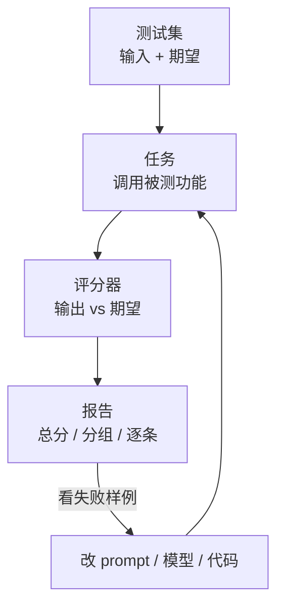
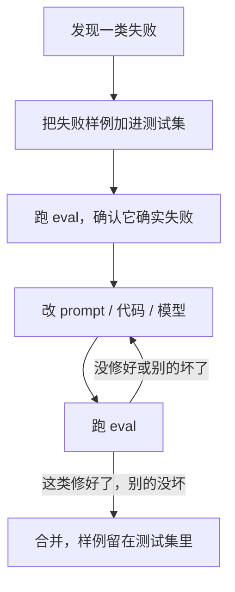

# 为什么要做 eval

改了一句 prompt，拿三张进货单试了试，结果看着不错，于是上线。一周后店主反馈：「豆腐 12 板」被记成了 12 克。回头查，是那次改动让模型开始把「板」这种不认识的单位写成空串。这种事几乎每个做大模型功能的人都经历过。这一章讲清楚 eval 是什么、为什么传统测试管不住大模型功能、一套能落地的 eval 由哪几块组成，并介绍本书贯穿始终的案例：给 hatch-counter 的进货单识别搭一个小型 eval 框架。

## 这本书讲什么、适合谁、怎么读

这本书讲**怎么系统地衡量一个大模型功能的质量**：构建测试集、写评分器、用模型当裁判、把评测做成回归测试，再把线上的真实反馈接回来。全书用 TypeScript 从零写一个几百行的 eval 框架（下文叫 `evalkit`），不依赖任何 eval 平台，读完你可以直接搬进自己的 monorepo。

适合已经在产品里接了模型 API、开始被「改了这里坏了那里」困扰的人。默认你读过[《大模型应用工程》](../llm-app-engineering/)，知道怎么调 API、做结构化输出；RAG 专有的检索指标（Recall@k、MRR）在[《RAG 与知识系统》第 7 章](../rag-systems/07-evaluation.md)讲过，这里不重复。

建议顺序读。第 2、3 章是基础，读完就能跑起第一版 eval；第 4 章的 LLM-as-judge 只在输出是自由文本时才需要；第 6 章讲 agent 的评测，不做 agent 可以跳过；第 7 章讲上线之后。

## 传统测试为什么不够

普通代码的单元测试建立在一个前提上：**同样的输入，同样的输出**。`add(1, 2)` 永远是 3，断言要么过、要么不过。大模型功能把这个前提打破了三次：

| 差异 | 普通函数 | 大模型功能 |
|---|---|---|
| 确定性 | 输入相同，输出相同 | 同一张单据识别两次，结果可能不同 |
| 正确性 | 对就是对，错就是错 | 「6斤7两」写成「6.7 斤」算对还是错？要定义 |
| 覆盖 | 分支有限，可以逐个测 | 输入空间无限：字迹、光线、供货商格式、拍摄角度 |
| 回归 | 改 A 不会悄悄改变 B 的行为 | 改一句 prompt，所有输入的行为都可能变 |

所以大模型功能的质量不能用「几个断言全绿」来描述，只能用**在一批有代表性的输入上的统计表现**来描述：「这 80 张单据里，行级 F1 是 0.94，有 3 张整张读错」。eval 就是产出这句话的那套东西。

### 看感觉为什么不行

不做 eval 时，改 prompt 的流程通常是：想到一个改法 → 找两三个例子试 → 看着好了就上线。这个流程有三个问题：

1. **样本太少**。三个例子里对了三个，真实准确率可能是 60% 也可能是 99%，第 2 章会算给你看
2. **只看到了你想看的**。你挑的例子往往就是这次想修的那类，被改坏的另一类根本没跑
3. **没有记录**。上个月为什么加了那句「不要拿别的格子的数去补」？删掉会怎样？没人知道

这本书里「看感觉」（vibe check）不是贬义词，人工逐条看输出永远是 eval 里最有价值的一步。问题在于**只**看感觉。

## eval 由哪几块组成

不管是厂商的内部评测、开源框架还是你自己写的脚本，拆开都是同样的四块：



| 组成 | 作用 | 本书章节 |
|---|---|---|
| 测试集（dataset） | 一批有代表性的输入，每条带上期望结果或判断标准 | 第 2 章 |
| 任务（task） | 把一条输入交给被测功能，拿到输出。就是调你线上那个函数 | 本章 |
| 评分器（scorer） | 比较输出和期望，给出 0 到 1 的分数。能用代码判断就用代码，不能才用模型 | 第 3、4 章 |
| 报告（report） | 汇总分数，按标签分组，和上一次比较，列出变好和变坏的样例 | 第 3、5 章 |

**测试集是其中最值钱的部分**。评分器和报告一个周末就能写完，换框架时也能重写；一份覆盖了真实难例、标注准确的测试集，要几个月的积累，是你这个功能的护城河。

### 评测的几种形态

| 形态 | 什么时候跑 | 用什么数据 | 回答什么问题 |
|---|---|---|---|
| 开发期 eval | 改 prompt、换模型时，在本机跑 | 开发集 | 这个改动有没有用 |
| 回归测试 | 合并或发版前 | 开发集 + 必过样例 | 有没有把原来对的弄坏 |
| 发版前验收 | 大改动上线前 | 留出的测试集 | 真实效果大概是多少 |
| 线上监控 | 一直在跑 | 真实流量 + 用户反馈 | 现在线上好不好、有没有在变差 |

前三种叫离线评测（offline eval），最后一种叫在线评测（online eval）。离线评测可控、可复现，但测试集总会和真实流量有偏差；在线评测最真实，但慢、噪声大、出了问题时用户已经受影响了。两者缺一不可，第 7 章讲怎么把它们接成一个闭环。

## 贯穿案例：进货单识别

hatch-counter 是一个给中小餐饮门店用的管理工具，店主拍一张手写或打印的进货单，服务端调视觉大模型把单据读成结构化数据，店主在「核单」那一屏校对后补进库存。识别部分在服务端 `apps/api/src/ocr/` 下，核心是一个函数：给一张图片，返回日期、供货商、合计和若干行明细，每行有货品名、单位、数量、单价、金额。

它几乎是 eval 的理想对象：

- **有明确的正确答案**：单据上写的是什么就是什么，大部分字段能用代码直接比对
- **错误有真实代价**：数量读错一位，库存和进价分析全跟着错
- **变量多**：prompt 有两套（通用版式和按供货商模板逐格读），服务商有好几家还会降级，模型隔几个月就出新版本
- **线上自带标注**：店主在核单屏上改过的每一格，都是一条免费的「正确答案」，第 7 章会用上

现有代码里已经有几个对 eval 非常友好的习惯：每次识别都存了模型原话 `rawText` 和用的是哪个模型，`amountMismatch()` 会检查「数量 × 单价 ≠ 金额」并给出提示。这些后面都会用到。

### 本书要搭的框架

`evalkit` 放在 monorepo 的一个包里，测试集和评测脚本按功能放：

```text
packages/evalkit/src/
  types.ts        # Case / Score / Suite 等类型
  dataset.ts      # 读 JSONL 测试集（第 2 章）
  runner.ts       # 并发跑任务、调评分器（第 3 章）
  report.ts       # 汇总、分组、写报告（第 3 章）
  stats.ts        # 置信区间、配对检验（第 2、5 章）
  judge.ts        # LLM-as-judge（第 4 章）
  cache.ts        # 响应缓存（第 5 章）
evals/receipt/
  cases.jsonl     # 测试集
  images/         # 单据照片（不入库，第 2 章）
  task.ts         # 调识别函数
  scorers.ts      # 进货单专用评分器
  run.ts          # 入口：pnpm eval receipt
```

先把最核心的类型定下来，后面每章都往上加东西：

```typescript
// packages/evalkit/src/types.ts

/** 测试集里的一条 */
export interface Case<I, E> {
  id: string;
  input: I;
  expected: E;
  /** 分组用：手写 / 打印 / 有算式 / 拍斜了 …… */
  tags: string[];
}

/** 一个指标的得分，统一成 0–1、越高越好，汇总时才能直接求平均 */
export interface Score {
  name: string;
  value: number;
  /** 给人看的：错在哪。报告里逐条列出 */
  detail?: string;
}

export interface ScorerArgs<I, O, E> {
  input: I;
  output: O;
  expected: E;
}

/** 一个评分器可以一次给出多个指标，比如行级的精确率和召回率 */
export type Scorer<I, O, E> = (args: ScorerArgs<I, O, E>) => Score[] | Promise<Score[]>;

export interface Suite<I, O, E> {
  name: string;
  cases: Case<I, E>[];
  task: (input: I) => Promise<O>;
  scorers: Scorer<I, O, E>[];
  /** 记进报告：模型名、prompt 版本、git 提交，回答「这次跑的到底是什么」 */
  meta: Record<string, string>;
}

export interface CaseResult<O> {
  id: string;
  tags: string[];
  output?: O;
  error?: string;
  scores: Score[];
  ms: number;
}
```

为什么不直接用现成的 eval 平台？可以用，市面上有不少开源框架和托管服务，功能比本书的 `evalkit` 丰富。但对一个人维护的项目，自己写有几个好处：数据留在自己手里（进货单上有供货商电话）、评分逻辑能直接复用业务代码（比如 `@counter/core` 里的金额解析）、没有额外的服务要部署和付费。更重要的是，写过一遍之后你会知道每个数字是怎么算出来的，换到任何平台都能看懂它在干什么。

## 先写 eval，再改 prompt

软件工程里有「测试驱动开发」，大模型功能对应的做法常被叫作 eval 驱动开发：



关键是第二步：**先把失败变成一条测试，再去修**。这样修完之后它会一直留在测试集里，下次有人改 prompt 时自动帮你把关。hatch-counter 代码注释里那些「豆腐 12 板会被静默记成 12 克」的教训，每一条都应该变成测试集里的一个样例。

### 什么时候不必做

eval 不是免费的：标注要花时间，每跑一次要花 API 费用。几种情况可以先不做或做得很轻：

- 功能还在验证有没有人要，一周后可能整个删掉。此时手工看十几个样例就够了
- 输出错了几乎没有代价，比如给内部用的标题建议
- 模型只是众多环节里很小的一步，端到端的业务指标已经能反映它的好坏

但只要一个功能会被反复修改、错误有真实代价、或者你打算换模型省钱，就值得从 20 条样例开始做起。最小可用的 eval 是一个 JSONL 文件加一个五十行的脚本，下一章就从这里开始。

## 本章要点

- 大模型功能不确定、对错要定义、输入空间无限、改一处影响全局，所以质量只能用**一批输入上的统计表现**描述
- 「看感觉」的问题不是看，而是**只看三个例子、只看想看的、不留记录**
- eval 由**测试集、任务、评分器、报告**四块组成，测试集最值钱
- 离线评测可控可复现，在线评测最真实，两者要接成闭环
- 贯穿案例是 hatch-counter 的进货单识别：答案明确、错误有代价、变量多、线上自带标注
- eval 驱动开发：**先把失败变成测试，再去修**
