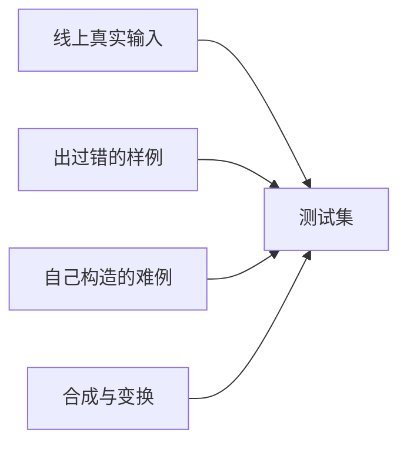
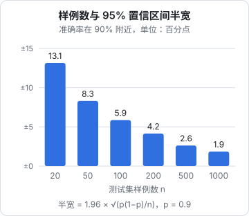

# 构建测试集

评分器写得再精巧，测试集不像真实流量，分数就没有意义。这一章讲测试集从哪来、要多少条、怎么标注、怎么存，以及怎么避免「对着测试集调 prompt」把分数调虚。最后给 `evalkit` 写上读测试集的那一段代码。

## 好测试集的三个标准

| 标准 | 意思 | 反例 |
|---|---|---|
| 有代表性 | 分布接近真实流量：手写和打印的比例、常见供货商、常见拍摄条件 | 全是自己在桌上平平整整拍的打印单 |
| 覆盖难例 | 已知会出错的情况都有，而且每类不止一条 | 只有「正常」单据，分数永远 98% |
| 标注可靠 | 期望结果是对的，而且标准一致 | 有的样例「6斤7两」标成 6.7，有的标成 6.4375 |

代表性和覆盖难例有点矛盾：真实流量里难例占比小，按真实比例抽样，难例只有一两条；专门多放难例，总分又不代表真实水平。解决办法是**打标签、分组看**：总分不作为唯一依据，每个标签组单独算分。第 3 章的报告会按标签汇总。

## 样例从哪来



### 线上真实输入

最好的来源。hatch-counter 每次识别都会把照片存进单据存档，店主在核单屏上改过之后才提交。对 eval 来说，这意味着每张单据天然有一份「人工校对后的结果」。

但要注意它和「单据上写的字」不完全是一回事。核单屏允许店主把行补到某样已有的食材、把「斤」换算成按克记的单位、跳过不想入库的行。**提交的结果是「店主想记进库存的东西」，不是「纸上写的东西」**。识别的任务是后者，所以标注应该取核单屏上「单上写的」那几格（货品名原文、单位原文、数量、单价、金额），而不是最终入库的食材和克数。

另一个坑是店主只改**挡着提交**的东西。「数量 × 单价 ≠ 金额」只是黄色提示、不挡提交，店主赶时间时可能不管。所以这类数据只能当「银标」（silver label）：拿来起步很好，进测试集之前要人工复核一遍。

### 出过错的样例

每一次线上出错都应该留下一条样例：店主反馈的、核单时改动很大的、识别服务报「读不出来」的。它们是测试集里**信息量最大**的部分，因为它们代表的正是你的功能真实的薄弱点。

### 自己构造的难例

翻一遍识别代码的注释和 prompt，几乎每一条规则背后都有一类难例：

| prompt 里的规则 | 对应的难例标签 |
|---|---|
| 有的单子把算式写在名称格里 | `formula-in-name` |
| 空行、划掉的行不要输出 | `strikethrough` |
| 数量格空着就填 null，别拿别的格子的数去补 | `empty-qty` |
| 单位照抄原文，比如「6斤7两」 | `compound-unit` |
| 单据上写「26年7月5日」 | `short-year` |
| 模板列数和单据列数对不上 | `layout-changed` |

这张表本身就是很好的文档：它说明了每条 prompt 规则为什么存在，以及删掉它会让哪组样例变差。

### 合成与变换

真实照片不够时，可以对已有样例做变换，制造拍摄条件上的难例。用 sharp 批量生成旋转、模糊、低质量压缩的版本：

```typescript
// evals/receipt/scripts/augment.ts
import sharp from "sharp";
import { mkdir } from "node:fs/promises";

const variants = {
  rot90: (s: sharp.Sharp) => s.rotate(90),
  blur: (s: sharp.Sharp) => s.blur(2),
  lowq: (s: sharp.Sharp) => s.resize({ width: 800 }).jpeg({ quality: 35 }),
} as const;

export async function augment(src: string, outDir: string, id: string) {
  await mkdir(outDir, { recursive: true });
  for (const [name, apply] of Object.entries(variants)) {
    const out = `${outDir}/${id}-${name}.jpg`;
    await apply(sharp(src)).jpeg().toFile(out);
    console.log(out);
  }
}
```

变换后的样例**期望结果不变**，所以标注成本为零。但它只能测「拍摄条件」这一维，测不了字迹和版式。完全由模型生成的单据图片和真实手写差别很大，不建议作为主要来源。

## 要多少条

先给结论：**起步 30 到 50 条，稳定后 100 到 300 条，重要的标签组每组至少 10 条**。理由是统计上的。

假设测试集有 $n$ 条，模型对了其中比例为 $p$ 的样例。这个 $p$ 只是对真实准确率的一个估计，它的 95% 置信区间半宽大约是：

$$
1.96 \times \sqrt{\frac{p(1-p)}{n}}
$$



也就是说，20 条样例上测出 90%，真实水平可能在 77% 到 100% 之间，几乎说明不了什么；100 条时缩小到大约正负 6 个百分点。区间宽度和 $\sqrt{n}$ 成反比，**样例数翻四倍，误差才减半**，所以几百条之后继续加量收益很小，不如去补难例。

正态近似在 $n$ 小或 $p$ 接近 0、1 时不准，代码里用 Wilson 区间更稳妥：

```typescript
// packages/evalkit/src/stats.ts

/** 二项比例的 Wilson 置信区间。z = 1.96 对应 95% */
export function wilson(successes: number, n: number, z = 1.96): [number, number] {
  if (n === 0) return [0, 1];
  const p = successes / n;
  const z2 = z * z;
  const denom = 1 + z2 / n;
  const center = (p + z2 / (2 * n)) / denom;
  const half = (z * Math.sqrt((p * (1 - p)) / n + z2 / (4 * n * n))) / denom;
  return [Math.max(0, center - half), Math.min(1, center + half)];
}
```

例如 50 条里对了 45 条，`wilson(45, 50)` 约为 `[0.79, 0.96]`。报告里把这个区间和分数一起打出来，就不会对 2 个百分点的差距大惊小怪了。

## 标注

### 先写标注规范

标注前把规则写下来，否则自己隔两周标的都不一致。进货单的标注规范大致是：

```text
进货单标注规范 v2

- 只标纸上写的字，不做换算：「6斤7两」照抄进 unit，quantity 写 null
- 金额、单价用「分」为单位的整数，¥12.5 标成 1250
- 货品名去掉序号和算式，保留规格：「冻鸡腿（10kg）」照抄
- 划掉的行不标；涂改过的格子以改后的字为准，在 note 里写一句
- 字确实认不出时，那一格标 null，并加标签 illegible
- 日期统一 YYYY-MM-DD；单据上没有年份时按拍摄日期补，在 note 里写明
```

规范要带版本号，规则变了就升版本，旧样例按新规则复核一遍。期望结果和业务代码用同一套单位（分、YYYY-MM-DD），评分器就不需要做转换。

### 让模型预标，人来改

从零手打一张十几行的单据很慢。更快的做法是：用当前最强的模型跑一遍，生成草稿，人逐格对照原图修改。这和店主在核单屏上做的事一模一样。

预标有一个风险：人会倾向于接受模型的结果，尤其是看不太清的格子。对策是**预标用的模型和被测的模型分开**，并且对 `illegible` 之类拿不准的样例单独复核。

### 标注质量抽查

标完一批后，隔几天随机抽 10% 重新标一遍，和第一次比较。不一致的地方通常说明规范没写清楚，修规范比修样例更重要。

## 存储格式

测试集用 JSONL：一行一条样例，追加方便、diff 清楚、出错时能定位到行。

```json
{"id":"r-0042","image":"r-0042.jpg","sha256":"9f2c…","layout":null,"tags":["handwritten","formula-in-name"],"source":"prod-2026-09","note":"第 3 行金额被涂改，以改后为准","expected":{"date":"2026-09-14","supplier":"张记冻品","totalCents":143360,"lines":[{"name":"冻鸡腿","unit":"件","quantity":2,"unitPriceCents":26000,"amountCents":52000}]}}
```

几个字段的用意：

- `sha256`：照片的哈希。照片不入库，靠它确认本地这张和标注时是同一张
- `source`：从哪来的（线上哪个月、自己构造、变换生成），分析时可以按来源分组
- `note`：标注时的判断依据，半年后复核时用得上

### 照片不进 git

照片动辄几 MB，进 git 会让仓库迅速膨胀；而且单据上有供货商电话和店名。建议放进一个私有的对象存储桶（比如 Cloudflare R2），本地用 rclone 之类的工具同步到 `evals/receipt/images/`，这个目录写进 `.gitignore`。

来自线上的样例要先脱敏：供货商电话、门店名这些和识别质量无关的信息，可以在照片上打码后再入测试集。多店铺的产品还要注意，**用客户的数据做评测是否在用户协议允许的范围内**，这类问题以你的协议和最新的法规要求为准。

### 读测试集的代码

```typescript
// packages/evalkit/src/dataset.ts
import { readFile } from "node:fs/promises";
import { z } from "zod";
import type { Case } from "./types";

/**
 * 读 JSONL 测试集。expected 的结构由各个评测自己给 schema，
 * 读的时候就校验，免得标注写错了一个字段名、到评分时才发现全是 0 分。
 */
export async function loadCases<I extends z.ZodTypeAny, E extends z.ZodTypeAny>(
  path: string,
  inputSchema: I,
  expectedSchema: E,
): Promise<Case<z.infer<I>, z.infer<E>>[]> {
  const text = await readFile(path, "utf8");
  const row = z.object({
    id: z.string(),
    tags: z.array(z.string()).default([]),
    expected: expectedSchema,
  });

  return text
    .split("\n")
    .map((line, i) => [line.trim(), i + 1] as const)
    .filter(([line]) => line && !line.startsWith("//"))
    .map(([line, lineNo]) => {
      let json: unknown;
      try {
        json = JSON.parse(line);
      } catch {
        throw new Error(`${path}:${lineNo} 不是合法的 JSON`);
      }
      const base = row.safeParse(json);
      const input = inputSchema.safeParse(json);
      if (!base.success || !input.success) {
        const issues = [...(base.error?.issues ?? []), ...(input.error?.issues ?? [])];
        throw new Error(`${path}:${lineNo} 格式不对：${JSON.stringify(issues)}`);
      }
      return { id: base.data.id, tags: base.data.tags, input: input.data, expected: base.data.expected };
    });
}
```

进货单的 schema，和业务代码用同一套单位：

```typescript
// evals/receipt/schema.ts
import { z } from "zod";

export const ReceiptLine = z.object({
  name: z.string(),
  unit: z.string().nullable(),
  quantity: z.number().nullable(),
  unitPriceCents: z.number().int().nullable(),
  amountCents: z.number().int().nullable(),
});

export const Receipt = z.object({
  date: z.string().nullable(),
  supplier: z.string().nullable(),
  totalCents: z.number().int().nullable(),
  lines: z.array(ReceiptLine),
});

export const ReceiptInput = z.object({
  image: z.string(),
  sha256: z.string(),
  layout: z.string().nullable().default(null),
});

export type Receipt = z.infer<typeof Receipt>;
export type ReceiptLine = z.infer<typeof ReceiptLine>;
export type ReceiptInput = z.infer<typeof ReceiptInput>;
```

## 开发集与测试集

改 prompt 的过程就是不断看失败样例、针对性修改。改上几十轮之后，prompt 会越来越贴合这批样例，在它们上面的分数越来越高，但不一定能推广到新单据。这和机器学习里的过拟合是同一回事。

对策是把样例分成两份：

| 集合 | 占比 | 用法 |
|---|---|---|
| 开发集（dev） | 约 70% | 日常跑、逐条看失败、据此改 prompt |
| 测试集（test） | 约 30% | 平时不看具体样例，只在大改动上线前跑一次看总分 |

按标签分层抽样，保证两边各组的比例接近。分组时按 `id` 的哈希决定去哪一边，新样例加进来时不会打乱已有的划分：

```typescript
import { createHash } from "node:crypto";

export function splitOf(id: string, testRatio = 0.3): "dev" | "test" {
  const h = createHash("sha256").update(id).digest().readUInt32BE(0);
  return h / 0xffffffff < testRatio ? "test" : "dev";
}
```

样例少于 100 条时，严格划分会让每边都太小。这个阶段可以先只用一份，但要有意识：分数涨了，有一部分是「背题」涨的。

## 测试集要一直长

测试集不是一次性建完的。几条持续的输入：

- 每周从线上抽 20 张单据，人工看一遍，错的、新供货商的格式加进来
- 每修一个 bug，先加样例
- 每过几个月，看一眼各标签组的样例数和真实流量的比例，太偏就补

随着时间推移，你会发现测试集的分布越来越接近真实情况，而 eval 的分数也越来越能预测上线效果。

## 本章要点

- 好测试集要**有代表性、覆盖难例、标注可靠**；用标签分组同时满足前两条
- 线上校对数据是最好的来源，但「提交的结果」不等于「纸上写的字」，而且只能当**银标**，要复核
- 每一次线上出错都留成样例；prompt 里每条规则都对应一类难例
- 起步 30–50 条；20 条上测出的 90% 误差约正负 13 个百分点，**样例翻四倍误差才减半**
- 先写带版本号的标注规范；模型预标、人来改，预标模型和被测模型分开
- JSONL 存样例，照片不进 git，线上样例先脱敏并确认协议允许
- 分开发集和测试集，防止对着样例把 prompt 调成「背题」
