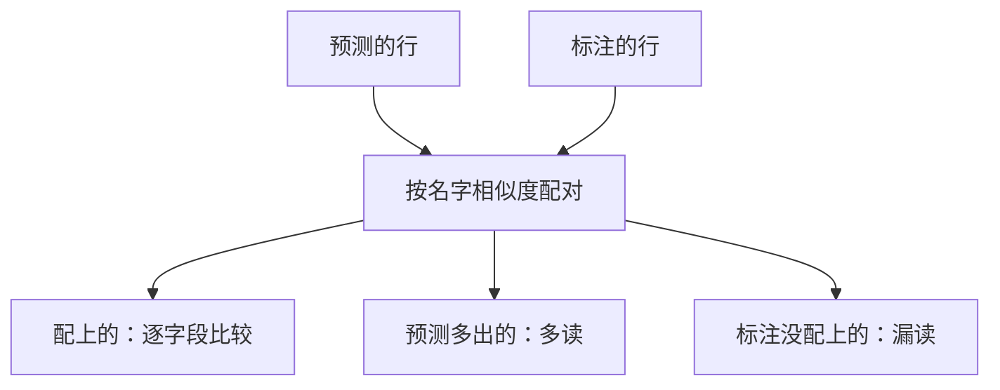
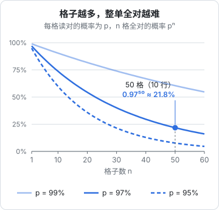

# 规则评分

有了测试集，下一步是给每条输出打分。这一章的原则只有一条：**能用代码判断的，就用代码判断**。代码评分快、免费、确定，同一份输出永远得同一个分，这正是 eval 最需要的性质。我们会为进货单写一组评分器：行对齐、字段准确率、整单全对率、不需要标注的一致性检查，再写出运行器和报告，让 `pnpm eval receipt` 第一次跑起来。

## 评分器的几个层次

从简单到复杂，规则评分大致有这几类：

| 类型 | 例子 | 适用 |
|---|---|---|
| 格式检查 | 是不是合法 JSON、字段齐不齐、日期是不是 YYYY-MM-DD | 所有结构化输出，最先做 |
| 精确匹配 | 分类结果等于标准答案 | 分类、抽取单个值 |
| 归一化后匹配 | 去空格、全角转半角、统一大小写后再比 | 抽取文本字段 |
| 容差匹配 | 数值差在 0.01 以内算对 | 数字、金额 |
| 集合 / 序列匹配 | 先对齐两组行，再逐对比较 | 表格、列表抽取 |
| 不变量检查 | 数量 × 单价 = 金额，各行之和 = 合计 | **不需要标注**，线上也能跑 |
| 包含 / 正则 | 回答里提到了价格、没有出现「作为 AI」 | 自由文本的硬性要求 |

进货单用得上其中大部分。下面一个个写。

## 行对齐：先配对，再比较

进货单的输出是一组行，最朴素的比法是按位置逐行比：第 1 行比第 1 行，第 2 行比第 2 行。但只要模型漏读了第 2 行，后面所有行都会错位，一个小错误被放大成整张单全错。分数就失去了区分度。

正确的做法是**先按货品名把预测行和标注行配对，再逐对比较字段**：



名字相似度用编辑距离。中文货品名很短，归一化（去空格、去括号里的规格）后再算：

```typescript
// evals/receipt/match.ts
import type { ReceiptLine } from "./schema";

export function normName(s: string): string {
  return s
    .replace(/[（(][^）)]*[）)]/g, "") // 规格不参与配对：冻鸡腿（10kg） ≈ 冻鸡腿
    .replace(/\s+/g, "")
    .toLowerCase();
}

export function levenshtein(a: string, b: string): number {
  const x = [...a];
  const y = [...b];
  let prev = Array.from({ length: y.length + 1 }, (_, j) => j);
  for (let i = 1; i <= x.length; i++) {
    const cur = [i];
    for (let j = 1; j <= y.length; j++) {
      cur[j] = Math.min(prev[j] + 1, cur[j - 1] + 1, prev[j - 1] + (x[i - 1] === y[j - 1] ? 0 : 1));
    }
    prev = cur;
  }
  return prev[y.length];
}

/** 0–1，1 表示完全相同 */
export function nameSim(a: string, b: string): number {
  const x = normName(a);
  const y = normName(b);
  if (!x && !y) return 1;
  return 1 - levenshtein(x, y) / Math.max([...x].length, [...y].length);
}

/**
 * 贪心配对：相似度从高到低取，已经配上的不再参与。
 * 相似度一样时优先位置接近的，同一张单上出现两次「青椒」时不会交叉配。
 */
export function matchLines(pred: ReceiptLine[], gold: ReceiptLine[], threshold = 0.5): [number, number][] {
  const candidates: { i: number; j: number; s: number }[] = [];
  pred.forEach((p, i) =>
    gold.forEach((g, j) => {
      const s = nameSim(p.name, g.name);
      if (s >= threshold) candidates.push({ i, j, s });
    }),
  );
  candidates.sort((a, b) => b.s - a.s || Math.abs(a.i - a.j) - Math.abs(b.i - b.j));

  const usedP = new Set<number>();
  const usedG = new Set<number>();
  const pairs: [number, number][] = [];
  for (const { i, j } of candidates) {
    if (usedP.has(i) || usedG.has(j)) continue;
    usedP.add(i);
    usedG.add(j);
    pairs.push([i, j]);
  }
  return pairs;
}
```

用 `[...a]` 而不是 `a.length`，是为了按字符而不是 UTF-16 码元计数，生僻字和 emoji 不会算成两个字。阈值 0.5 意味着两个字的名字错一个字仍能配上（「土豆」和「士豆」），这正是我们想要的：配上之后，名字字段本身会被判为错，但其他字段还能正常比较。

贪心不保证全局最优配对（那是匈牙利算法的事），但一张单十几行，名字之间差异通常很大，贪心的结果几乎总是对的。评分器追求的是**简单到一眼能看懂**，复杂的算法本身也会出 bug。

## 进货单评分器

配对之后，从三个角度打分：

| 指标 | 算法 | 回答的问题 |
|---|---|---|
| `line_precision` | 配上的行数 / 预测行数 | 多读了吗（把合计行、划掉的行读进来） |
| `line_recall` | 配上的行数 / 标注行数 | 漏读了吗 |
| `field_acc` | 配上的行里，字段对的格数 / 总格数 | 读出来的行，字认得准不准 |
| `header_acc` | 日期、供货商、合计三项里对了几项 | 抬头读得对不对 |
| `receipt_exact` | 整张单所有行、所有字段、抬头全对为 1，否则为 0 | 店主能不能一格都不改直接提交 |

```typescript
// evals/receipt/scorers.ts
import type { Scorer, Score } from "@hatch/evalkit";
import type { Receipt, ReceiptInput, ReceiptLine } from "./schema";
import { matchLines, normName } from "./match";

type ReceiptScorer = Scorer<ReceiptInput, Receipt, Receipt>;

const FIELDS = ["name", "unit", "quantity", "unitPriceCents", "amountCents"] as const;

function fieldEqual(field: (typeof FIELDS)[number], p: ReceiptLine, g: ReceiptLine): boolean {
  switch (field) {
    case "name":
      return normName(p.name) === normName(g.name);
    case "unit":
      return (p.unit ?? "").replace(/\s+/g, "") === (g.unit ?? "").replace(/\s+/g, "");
    case "quantity":
      // 数量可能是 6.7 这样的小数，浮点比较留一点余量
      return p.quantity === g.quantity || (p.quantity != null && g.quantity != null && Math.abs(p.quantity - g.quantity) < 1e-6);
    default:
      return p[field] === g[field];
  }
}

const ratio = (a: number, b: number) => (b === 0 ? (a === 0 ? 1 : 0) : a / b);

export const lineScorer: ReceiptScorer = ({ output, expected }) => {
  const pairs = matchLines(output.lines, expected.lines);
  const precision = ratio(pairs.length, output.lines.length);
  const recall = ratio(pairs.length, expected.lines.length);
  const f1 = precision + recall === 0 ? 0 : (2 * precision * recall) / (precision + recall);

  let right = 0;
  const wrong: string[] = [];
  for (const [i, j] of pairs) {
    const p = output.lines[i];
    const g = expected.lines[j];
    for (const f of FIELDS) {
      if (fieldEqual(f, p, g)) right++;
      else wrong.push(`「${g.name}」${f}：期望 ${g[f]}，得到 ${p[f]}`);
    }
  }
  const missed = expected.lines.filter((_, j) => !pairs.some(([, jj]) => jj === j)).map((g) => g.name);
  const extra = output.lines.filter((_, i) => !pairs.some(([ii]) => ii === i)).map((p) => p.name);

  const detail = [
    missed.length ? `漏读：${missed.join("、")}` : "",
    extra.length ? `多读：${extra.join("、")}` : "",
    ...wrong,
  ]
    .filter(Boolean)
    .join("\n");

  return [
    { name: "line_precision", value: precision },
    { name: "line_recall", value: recall },
    { name: "line_f1", value: f1, detail: detail || undefined },
    { name: "field_acc", value: ratio(right, pairs.length * FIELDS.length) },
  ];
};

export const headerScorer: ReceiptScorer = ({ output, expected }) => {
  const checks = [
    output.date === expected.date,
    normName(output.supplier ?? "") === normName(expected.supplier ?? ""),
    output.totalCents === expected.totalCents,
  ];
  return [{ name: "header_acc", value: checks.filter(Boolean).length / checks.length }];
};

/** 最严格的一档：店主一格都不用改 */
export const exactScorer: ReceiptScorer = async (args) => {
  const scores: Score[] = [...(await lineScorer(args)), ...(await headerScorer(args))];
  const all = scores.every((s) => s.value === 1);
  return [{ name: "receipt_exact", value: all ? 1 : 0 }];
};
```

几个设计上的考虑：

- **`detail` 写人话**。报告里最有用的不是 0.93 这个数，而是「『毛豆』quantity：期望 8，得到 3」这一行。评分器要顺手把错在哪说清楚
- **`field_acc` 只在配上的行里算**。漏读的行已经在 recall 里扣过分了，再扣一次会让两个指标纠缠在一起，看到 field_acc 下降时分不清是漏读多了还是认字差了
- **0/0 的约定要想清楚**。一张没有行的单（只拍到了抬头），预测也没有行，precision 和 recall 都应该是 1

### 字段准确率很高，整单全对率却很低

这是第一次跑出结果时最常见的困惑。假设每个格子独立地有 97% 的概率读对，一张 10 行的单有 50 个格子，全对的概率是：

$$
0.97^{50} \approx 0.22
$$

一般地，$n$ 个格子全对的概率是 $p^n$。下图把每格准确率 99%、97%、95% 三种情况画出来，格子一多，全对率就掉得很快：



字段准确率 97% 听起来很好，但店主的体验是**五张单里只有一张不用改**。两个指标都要看：`field_acc` 用来定位问题和比较改动，`receipt_exact` 更接近用户感受到的质量。向别人汇报效果时，后者更诚实。

## 不需要标注的评分器

有一类检查不需要知道正确答案，只看输出内部是否自洽。hatch-counter 的核单屏已经在做：数量 × 单价对不上金额时提示「核对一下」。把同样的逻辑做成评分器：

```typescript
// evals/receipt/scorers.ts（续）

/** 数量 × 单价 和 金额相差超过 1 分钱就算对不上 */
function consistent(l: ReceiptLine): boolean | null {
  if (l.quantity == null || l.unitPriceCents == null || l.amountCents == null) return null;
  return Math.abs(l.quantity * l.unitPriceCents - l.amountCents) <= 1;
}

export const consistencyScorer: ReceiptScorer = ({ output }) => {
  const checked = output.lines.map(consistent).filter((v): v is boolean => v !== null);
  const sum = output.lines.reduce((s, l) => s + (l.amountCents ?? 0), 0);
  const scores: Score[] = [{ name: "line_consistency", value: ratio(checked.filter(Boolean).length, checked.length) }];
  if (output.totalCents != null) {
    scores.push({
      name: "total_consistency",
      value: Math.abs(sum - output.totalCents) <= 1 ? 1 : 0,
      detail: `各行合计 ${sum}，单上合计 ${output.totalCents}`,
    });
  }
  return scores;
};
```

一致性高不代表读对了（数量和金额可能一起读错），但一致性低几乎一定有问题。它最大的价值在于**线上每一张单都能算**，不需要等人标注，第 7 章会把它做成线上监控指标。

注意单据本身也可能是错的：写单的人算错了金额。这种样例的标注要照抄纸上的字，一致性评分器在它上面得 0 分是正确的，不用去「修」。

## 格式失败也要计分

模型偶尔不按 JSON 回话，hatch-counter 的识别函数会重试一次，仍失败就抛错。eval 里，**任务抛错不能被悄悄跳过**，否则一个让 10% 单据直接报错的改动，反而会因为剩下的都是简单单据而让平均分上升。

运行器的做法是：任务出错时，记下错误、不调评分器，同时运行器自己给每条结果加一个 `ok` 指标：

```typescript
// packages/evalkit/src/runner.ts
import type { CaseResult, Score, Suite } from "./types";

export interface RunOptions {
  concurrency?: number;
  only?: (c: { id: string; tags: string[] }) => boolean;
}

export async function runSuite<I, O, E>(suite: Suite<I, O, E>, opts: RunOptions = {}): Promise<CaseResult<O>[]> {
  const cases = suite.cases.filter((c) => opts.only?.(c) ?? true);
  const results: CaseResult<O>[] = new Array(cases.length);
  let next = 0;

  // 固定数量的 worker 从队列里取，避免一次性把几百个请求全打出去撞 429
  async function worker() {
    while (next < cases.length) {
      const idx = next++;
      const c = cases[idx];
      const started = Date.now();
      try {
        const output = await suite.task(c.input);
        const scores: Score[] = [{ name: "ok", value: 1 }];
        for (const scorer of suite.scorers) {
          scores.push(...(await scorer({ input: c.input, output, expected: c.expected })));
        }
        results[idx] = { id: c.id, tags: c.tags, output, scores, ms: Date.now() - started };
      } catch (err) {
        results[idx] = {
          id: c.id,
          tags: c.tags,
          error: err instanceof Error ? err.message : String(err),
          scores: [{ name: "ok", value: 0 }],
          ms: Date.now() - started,
        };
      }
      process.stderr.write(".");
    }
  }

  await Promise.all(Array.from({ length: opts.concurrency ?? 4 }, worker));
  process.stderr.write("\n");
  return results;
}
```

JavaScript 是单线程的，`next++` 在 `await` 之前执行，多个 worker 之间不会取到同一条，不需要加锁。

汇总时，**出错的样例在其他指标上按 0 分计**。这样一个指标的平均值就是「在全部样例上」的平均，而不是「在没出错的样例上」的平均：

```typescript
// packages/evalkit/src/report.ts
import type { CaseResult } from "./types";
import { wilson } from "./stats";

export interface Summary {
  n: number;
  errors: number;
  metrics: Record<string, number>;
  byTag: Record<string, { n: number; metrics: Record<string, number> }>;
}

function means(rs: CaseResult<unknown>[], names: string[]): Record<string, number> {
  return Object.fromEntries(
    names.map((name) => {
      const sum = rs.reduce((s, r) => s + (r.scores.find((x) => x.name === name)?.value ?? 0), 0);
      return [name, rs.length ? sum / rs.length : 0];
    }),
  );
}

export function summarize(results: CaseResult<unknown>[]): Summary {
  const names = [...new Set(results.flatMap((r) => r.scores.map((s) => s.name)))];
  const tags = [...new Set(results.flatMap((r) => r.tags))].sort();
  return {
    n: results.length,
    errors: results.filter((r) => r.error).length,
    metrics: means(results, names),
    byTag: Object.fromEntries(
      tags.map((t) => {
        const rs = results.filter((r) => r.tags.includes(t));
        return [t, { n: rs.length, metrics: means(rs, names) }];
      }),
    ),
  };
}

export function printSummary(s: Summary, primary: string) {
  const exact = Math.round(s.metrics[primary] * s.n);
  const [lo, hi] = wilson(exact, s.n);
  console.log(`共 ${s.n} 条，出错 ${s.errors} 条`);
  console.log(`${primary} = ${(s.metrics[primary] * 100).toFixed(1)}%（95% 区间 ${(lo * 100).toFixed(0)}–${(hi * 100).toFixed(0)}%）`);
  console.table(Object.fromEntries(Object.entries(s.metrics).map(([k, v]) => [k, v.toFixed(3)])));
  console.table(
    Object.fromEntries(
      Object.entries(s.byTag).map(([tag, g]) => [tag, { n: g.n, ...Object.fromEntries(Object.entries(g.metrics).map(([k, v]) => [k, v.toFixed(3)])) }]),
    ),
  );
}
```

有一个约定要遵守：**只在某些样例上才有意义的指标**（比如 `total_consistency` 只在单上有合计时才算），按 0 计会冤枉没有合计的单。这类指标汇总前要么改成在所有样例上都给分（没有合计时给 1），要么在报告里单独算它的分母。`consistencyScorer` 选的是后一种的简化版：读报告时记得它的分母不是全部样例。

Wilson 区间只对 0/1 的指标有意义，所以 `printSummary` 的 `primary` 应该传 `receipt_exact` 这类二值指标。

## 接上任务，跑起来

任务就是调线上那个识别函数，再把它的返回值转成评测用的结构：

```typescript
// evals/receipt/task.ts
import { readFile } from "node:fs/promises";
import { scanWithVlm } from "../../apps/api/src/ocr/vlm";
import type { Receipt, ReceiptInput } from "./schema";

const IMAGES = new URL("./images/", import.meta.url);

// 被测的模型名从环境变量来，跑新旧模型对比时只改这一处
export const MODEL = process.env.EVAL_MODEL ?? "";
if (!MODEL) throw new Error("先设置 EVAL_MODEL：要评测的视觉模型型号");

export async function readReceipt(input: ReceiptInput): Promise<Receipt> {
  const buf = await readFile(new URL(input.image, IMAGES));
  const scan = await scanWithVlm(
    { baseUrl: process.env.VLM_BASE_URL!, apiKey: process.env.VLM_API_KEY!, model: MODEL },
    { base64: buf.toString("base64"), mime: "image/jpeg" },
    input.layout,
  );
  return {
    date: scan.receiptDate,
    supplier: scan.supplier,
    totalCents: scan.totalAmountCents,
    lines: scan.lines.map((l) => ({
      name: l.rawName,
      unit: l.unit,
      quantity: l.quantity,
      unitPriceCents: l.unitPriceCents,
      amountCents: l.amountCents,
    })),
  };
}
```

模型型号填你在服务商那里实际在用的那个；`RawScan` 的字段名也以 `@counter/core` 里的类型定义为准。关键是**直接调用线上同一个函数**，而不是在 eval 里另写一份 prompt。否则你评的是一份副本，线上那份改了你不知道。宽容的 JSON 解析、行的清洗、单位推断这些后处理也在被测范围内，它们一样会出错。

入口脚本：

```typescript
// evals/receipt/run.ts
import { loadCases, runSuite, summarize, printSummary } from "@hatch/evalkit";
import { writeFile, mkdir } from "node:fs/promises";
import { Receipt, ReceiptInput } from "./schema";
import { readReceipt, MODEL } from "./task";
import { lineScorer, headerScorer, exactScorer, consistencyScorer } from "./scorers";

const cases = await loadCases(new URL("./cases.jsonl", import.meta.url).pathname, ReceiptInput, Receipt);

const results = await runSuite(
  {
    name: "receipt",
    cases,
    task: readReceipt,
    scorers: [lineScorer, headerScorer, exactScorer, consistencyScorer],
    meta: { model: MODEL },
  },
  { concurrency: 3 },
);

const summary = summarize(results);
printSummary(summary, "receipt_exact");

await mkdir("evals/receipt/results", { recursive: true });
const file = `evals/receipt/results/${new Date().toISOString().replace(/[:.]/g, "-")}.json`;
await writeFile(file, JSON.stringify({ meta: { model: MODEL }, summary, results }, null, 2));
console.log(`逐条结果：${file}`);
```

```bash
pnpm tsx --env-file=.env evals/receipt/run.ts
```

`results/` 目录写进 `.gitignore`，那里有模型的完整输出。哪一份要作为基线保留，第 5 章再说。

## 跑完之后：先看失败，再看分数

第一次跑完，别急着盯总分。按 `receipt_exact = 0` 筛出失败的样例，打开原图，逐条读 `detail`，把失败归类：

| 失败模式 | 样例数 | 可能的修法 |
|---|---|---|
| 「6斤7两」被拆成数量 6.7 | 4 | prompt 里补一个复合单位的例子 |
| 合计行被当成一行货 | 3 | 后处理里过滤名为「合计」的行 |
| 同一行的单价、金额对调 | 2 | 换按模板逐格读的那条路 |
| 字确实看不清 | 2 | 不用修，标签 `illegible` |

这张表决定了下一步改什么，比任何一个汇总数字都有用。分数是用来**确认**改动有效的，失败样例才是用来**指导**改动的。

### 别忘了测评分器

评分器本身是代码，也会有 bug：配对阈值写反了、0/0 返回了 NaN。给它写几个普通的单元测试，用手工构造的输出和期望，断言分数：

```typescript
// evals/receipt/scorers.test.ts
import { describe, expect, it } from "vitest";
import { lineScorer } from "./scorers";

const line = (name: string, quantity: number) => ({ name, unit: "斤", quantity, unitPriceCents: 100, amountCents: quantity * 100 });
const receipt = (lines: ReturnType<typeof line>[]) => ({ date: null, supplier: null, totalCents: null, lines });
const input = { image: "x.jpg", sha256: "", layout: null };

describe("lineScorer", () => {
  it("漏读一行不会让后面的行错位", async () => {
    const expected = receipt([line("白菜", 6), line("毛豆", 8), line("土豆", 30)]);
    const output = receipt([line("白菜", 6), line("土豆", 30)]);
    const scores = await lineScorer({ input, output, expected });
    expect(scores.find((s) => s.name === "line_recall")?.value).toBeCloseTo(2 / 3);
    expect(scores.find((s) => s.name === "field_acc")?.value).toBe(1);
  });
});
```

这类测试不调模型，可以放进普通的 `pnpm test` 里，每次都跑。

## 本章要点

- **能用代码判断的就用代码**：快、免费、确定
- 表格类输出先**按名字配对再比较字段**，避免一处漏读引起整体错位
- 同时看 `field_acc`（定位问题）和 `receipt_exact`（用户感受）；每格 97% 准，10 行的单整单全对只有约 22%
- **不变量检查不需要标注**，线上每一条都能算
- 任务出错要计 0 分，不能悄悄跳过；运行器统一加 `ok` 指标
- 任务直接调用线上那个函数，后处理也在被测范围内
- 跑完先归类失败样例，分数用来确认，失败用来指导；评分器自己也要有单元测试
