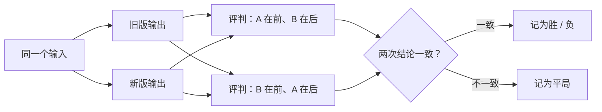
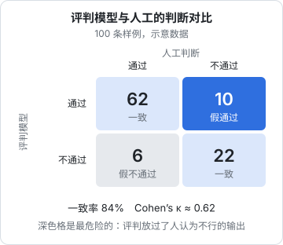

# LLM-as-judge

进货单的输出几乎全是能用代码比对的字段，但很多大模型功能的输出是自由文本：给店主写的经营小结、客服回复、一段总结。这类输出没有唯一的正确答案，「写得好不好」也很难用规则描述。这时可以让另一个模型来打分，这就是 LLM-as-judge。它很好用，也很容易用错：评判模型有自己的偏好和盲点，不校准就拿来当真理，等于用一个没验证过的尺子量东西。这一章讲什么时候用它、评判 prompt 怎么写、有哪些已知偏差、怎么用人工标注校准它。

## 先问：真的需要模型来评吗

LLM-as-judge 贵、慢、不确定，三个缺点正好和代码评分的三个优点相反。所以动手前先把能用代码判断的部分剥离出来。

拿一个假设的功能举例：给掌柜眼加一个「本周经营小结」，每周一根据上周数据，让模型给店主写三五句话。对这段文字的要求可以拆成：

| 要求 | 能用代码判断吗 | 怎么判断 |
|---|---|---|
| 不超过 150 字 | 能 | 数字符 |
| 不出现英文术语、markdown 符号 | 能 | 正则 |
| 文中的每个数字都来自输入数据 | 基本能 | 抽出文中的数字，在输入里找 |
| 指出了最值得注意的一件事 | 不能 | 需要理解 |
| 建议具体、店主看了知道该做什么 | 不能 | 需要理解 |
| 语气像跟老板说话，不像报表 | 不能 | 需要理解 |

前三条写成代码评分器，后三条才交给模型。数字核对这条特别值得用代码做：它是最严重的错误（编数字），而模型评判恰恰不擅长逐个核对数字。

```typescript
// evals/weekly/scorers.ts
/** 文中出现的每个数字，都要能在输入数据里找到 */
export const numbersGrounded = ({ input, output }: { input: string; output: string }) => {
  const nums = output.match(/\d+(?:\.\d+)?/g) ?? [];
  const missing = nums.filter((n) => !input.includes(n));
  return [{ name: "numbers_grounded", value: missing.length ? 0 : 1, detail: missing.length ? `数据里没有：${missing.join("、")}` : undefined }];
};
```

这个实现很粗糙（「增长 12%」可能是模型自己算的，输入里没有 12），但它会把可疑的样例筛出来让人看，宁可误报。

进货单也有一处可能用到模型评判：货品名的写法有歧义时（「西红柿」和「番茄」），编辑距离判为不同，但店主眼里是同一样东西。不过更好的做法是在标注里把纸上的原字写准，让评分器保持严格。**能通过改进标注解决的，不要引入评判模型**。

## 写评判 prompt

### 用二元判断，不用打分

最常见的错误是让评判模型打 1 到 10 分。问题在于：7 分和 8 分的区别是什么？评判模型自己也说不清，同一份输出两次评分可能差两分；不同的人看到「7.3 分」也不知道该不该担心。

更好的做法是**把质量拆成若干条具体的标准，每条只判断通过或不通过**：

```text
不好的问法：
给这段经营小结的质量打分，1 到 10 分。

好的问法：
逐条判断这段经营小结是否满足下列标准，每条只回答 pass 或 fail：
1. 指出了上周最值得店主注意的一件事（比如某样食材进价涨了很多、某道菜销量掉得厉害）
2. 至少有一条建议是店主这周就能去做的具体动作，而不是「注意成本」这类空话
3. 读起来像对老板说话，没有「综上所述」「同比环比」这类报表腔
```

二元判断更稳定，和人工标注比对也更容易；每条标准独立，失败时立刻知道是哪方面不行。如果确实需要等级，用三档（好 / 可接受 / 不可接受）并给每一档写清楚定义，而不是十档。

### 先说理由，再给结论

让评判模型**先写判断依据，再给结论**。模型是逐个 token 生成的，先写出「小结里提到了猪肉进价上涨 18%，这是数据中涨幅最大的一项」，再给 pass，结论就建立在具体的观察上；反过来先给结论，后面的理由往往只是在为结论找补。

用结构化输出强制这个顺序，字段的先后就是生成的先后：

```typescript
// packages/evalkit/src/judge.ts
import Anthropic from "@anthropic-ai/sdk";
import { zodOutputFormat } from "@anthropic-ai/sdk/helpers/zod";
import { z } from "zod";
import type { Score } from "./types";

const client = new Anthropic();

export interface Criterion {
  name: string;
  /** 一句话说清通过的条件，最好附上通过和不通过的例子 */
  rule: string;
}

const Verdict = z.object({
  verdicts: z.array(
    z.object({
      criterion: z.string(),
      reasoning: z.string().describe("先引用输出里的原文，再说明为什么满足或不满足"),
      pass: z.boolean(),
    }),
  ),
});

/** 评判模型的型号固定写死，换型号要重新校准，见本章后半 */
export const JUDGE_MODEL = "claude-opus-5-5";

export async function judge(params: {
  task: string; // 被评的功能是做什么的
  input: string;
  output: string;
  criteria: Criterion[];
}): Promise<Score[]> {
  const res = await client.messages.parse({
    model: JUDGE_MODEL,
    max_tokens: 4000,
    system:
      "你是一个严格的评审。你的判断会被用来决定一个改动能不能上线，所以拿不准时判 fail，并在理由里说明拿不准的地方。只依据给出的标准判断，不要引入标准之外的偏好。",
    messages: [
      {
        role: "user",
        content: `<task>${params.task}</task>

<input>
${params.input}
</input>

<output>
${params.output}
</output>

<criteria>
${params.criteria.map((c, i) => `${i + 1}. [${c.name}] ${c.rule}`).join("\n")}
</criteria>

逐条判断 output 是否满足 criteria 里的每一条标准。`,
      },
    ],
    output_config: { format: zodOutputFormat(Verdict) },
  });

  const parsed = res.parsed_output;
  if (!parsed) throw new Error(`评判没有返回结构化结果：${res.stop_reason}`);

  return params.criteria.map((c) => {
    const v = parsed.verdicts.find((x) => x.criterion === c.name || x.criterion.includes(c.name));
    // 评判漏掉了某条标准，按不通过算，并留下记录
    if (!v) return { name: `judge_${c.name}`, value: 0, detail: "评判模型没有给出这一条的结论" };
    return { name: `judge_${c.name}`, value: v.pass ? 1 : 0, detail: v.reasoning };
  });
}
```

接进 `evalkit` 只需要包一层，让它符合 `Scorer` 的签名：

```typescript
// evals/weekly/run.ts（片段）
import { judge, type Criterion } from "@hatch/evalkit";

const CRITERIA: Criterion[] = [
  { name: "key_point", rule: "指出了上周数据里最值得店主注意的一件事。只罗列数字、没有点出重点的判 fail" },
  { name: "actionable", rule: "至少一条建议是这周就能做的具体动作，例如『周三前问问另一家的猪肉报价』。『注意控制成本』这类判 fail" },
  { name: "tone", rule: "像对老板说话。出现『综上所述』『环比』『赋能』这类报表腔或术语判 fail" },
];

const judgeScorer = ({ input, output }: { input: string; output: string }) =>
  judge({ task: "根据门店上周数据，给店主写三五句经营小结", input, output, criteria: CRITERIA });
```

几个细节：

- **标准里写例子**。「具体的建议」在你脑子里有清晰的样子，在评判模型那里没有。给一个 pass 的例子、一个 fail 的例子，比多写三句解释有效
- **一次评多条标准，还是一条一个请求？** 一次评多条便宜，但标准之间会互相影响（第一条判了 fail，后面倾向于也判 fail）。标准少于五条、彼此独立时一次评没问题；发现有串扰时再拆开
- **评判的输入里不要放参考答案以外的提示**。比如别告诉它「这是新版 prompt 的输出」，它可能会因此更宽容

## 两两比较

有时你不需要绝对的分数，只想知道新版 prompt 比旧版好还是差。这时让评判模型**同时看两份输出，选更好的那个**，往往比分别打分再比较更敏感：人和模型都更擅长比较，而不是给出绝对评价。



图里每个输入评了两次、交换顺序，原因是下面要讲的位置偏差。汇总时报告「新版胜 / 平 / 负各多少条」，再看几条负的样例具体输在哪。

## 评判模型的已知偏差

用模型当裁判，要知道它会在哪些地方系统性地偏：

| 偏差 | 表现 | 对策 |
|---|---|---|
| 位置偏差 | 两两比较时偏向排在前面（或后面）的那个 | 交换顺序各评一次，不一致记为平局 |
| 长度偏差 | 偏爱更长、更详细的回答，哪怕啰嗦 | 标准里明确写长度要求；长度用代码单独卡 |
| 自我偏好 | 偏爱和自己风格相近的输出，同一家族的模型更明显 | 评判模型尽量和被测模型不同；用人工标注校准 |
| 宽容倾向 | 拿不准时倾向于判通过 | system 里写明「拿不准判 fail」；看假通过率 |
| 表面特征 | 被格式、自信的语气、术语打动，忽略事实错误 | 事实核对交给代码或带资料的专门评判 |

这些偏差的程度因模型和任务而异，没有放之四海皆准的数字。唯一可靠的办法是**在你自己的任务上测出来**，也就是下一节的校准。

## 校准：评判模型和人一致吗

评判模型给出的分数，只有在它和你的判断一致时才有意义。校准的做法：

1. 从真实输出里抽 50 到 100 条，覆盖好的、差的、拿不准的
2. **你自己先标**，每条每个标准判 pass / fail，标的时候不看评判模型的结论
3. 让评判模型评同一批
4. 比较两者，算一致率，**逐条看不一致的样例**

把结果画成一张 2×2 的表：



这张图的数字是一个示意。从它可以读出几件事：

- **一致率** = (62 + 22) / 100 = 84%
- **假通过** 10 条：人认为不行、评判放过了。这是最危险的一格，它意味着评判会让坏改动上线
- **假不通过** 6 条：评判比人严格。代价是你要多看几条，危害小得多

一致率会被「本来就大部分都通过」的情况抬高：假如 90% 的样例都是好的，评判无脑全判通过也有 90% 一致率。所以通常还要算 Cohen's kappa，它扣除了随机碰巧一致的部分：

$$
\kappa = \frac{p_o - p_e}{1 - p_e}
$$

其中 $p_o$ 是实际一致率，$p_e$ 是两者各自按自己的通过比例随机判断时的期望一致率。图中评判的通过率是 72%，人的通过率是 68%：

$$
p_e = 0.72 \times 0.68 + 0.28 \times 0.32 = 0.5792
$$

$$
\kappa = \frac{0.84 - 0.5792}{1 - 0.5792} \approx 0.62
$$

```typescript
// packages/evalkit/src/stats.ts（续）

/** 两个二元判断的 Cohen's kappa。a、b 一一对应 */
export function cohenKappa(a: boolean[], b: boolean[]): number {
  const n = a.length;
  const po = a.filter((x, i) => x === b[i]).length / n;
  const pa = a.filter(Boolean).length / n;
  const pb = b.filter(Boolean).length / n;
  const pe = pa * pb + (1 - pa) * (1 - pb);
  return pe === 1 ? 1 : (po - pe) / (1 - pe);
}
```

kappa 为 1 表示完全一致，0 表示和随机没区别。至于多少算「够用」，常见的经验划分把 0.6 以上视为较好的一致，但这只是惯例，不是标准。更实际的判断方法是：**看你自己和自己的一致程度**。隔一周把同一批重标一次，你和自己的 kappa 是多少，评判模型能达到接近这个水平就够了；有些标准（比如「语气」）人自己都判不稳，不能指望评判模型比人更稳。

### 用不一致的样例改评判 prompt

校准最大的收获不是那个数字，而是不一致的那十几条。逐条看评判的理由，通常会发现：

- 标准写得含糊，评判模型的理解和你不同：把你的理解写进标准，补一个例子
- 评判模型看漏了输出里的某个细节：在标准里点名要它检查那一处
- 你自己标错了：改你的标注

改完再跑一遍。几轮之后假通过降到可以接受的水平，再拿它去评测功能本身。**评判 prompt 和被测 prompt 一样，是需要版本管理和回归测试的代码**，校准用的那批人工标注就是它的测试集。

### 什么时候要重新校准

- 换了评判模型的型号，包括同一家的新版本
- 改了评判 prompt 或标准
- 被测功能的输出风格大变（比如换了一个家族的生成模型）

评判模型的型号要写死，不要用「最新版」之类的别名，否则某天服务商升级了别名背后的模型，你的分数会在什么都没改的情况下突然变化。

## 成本

评判模型通常要用能力强的型号，每条样例每次评测都要调用一次（两两比较还要两次）。粗略估算：100 条样例 × 每条评判约几千 token 输入和几百 token 输出，单次评测的评判成本可以按[《大模型应用工程》第 7 章](../llm-app-engineering/07-cost-latency.md)的公式换算。几个省钱的办法：

- 代码评分器先跑，**代码判不通过的样例就不必再请评判**，反正已经不通过了
- 评判结果按「评判 prompt 版本 + 输入 + 输出」缓存，输出没变就不重评（第 5 章）
- 日常开发只跑代码评分器，评判模型在合并前、发版前跑

## 本章要点

- 先把能用代码判断的剥离出来，**编数字这种最严重的错误用代码查**
- 用**多条具体标准 + 二元判断**，不用 1–10 分；标准里附上通过和不通过的例子
- 用结构化输出强制**先写理由、再给结论**
- 比较新旧版本时用两两比较，**交换顺序评两次**抵消位置偏差
- 已知偏差：位置、长度、自我偏好、宽容、表面特征；程度要在自己的任务上测
- 用 50–100 条人工标注校准：看一致率、kappa，**最关键的是假通过那一格和每条不一致的理由**
- 评判 prompt 也是代码；评判模型型号写死，换型号就重新校准
