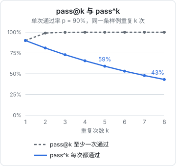
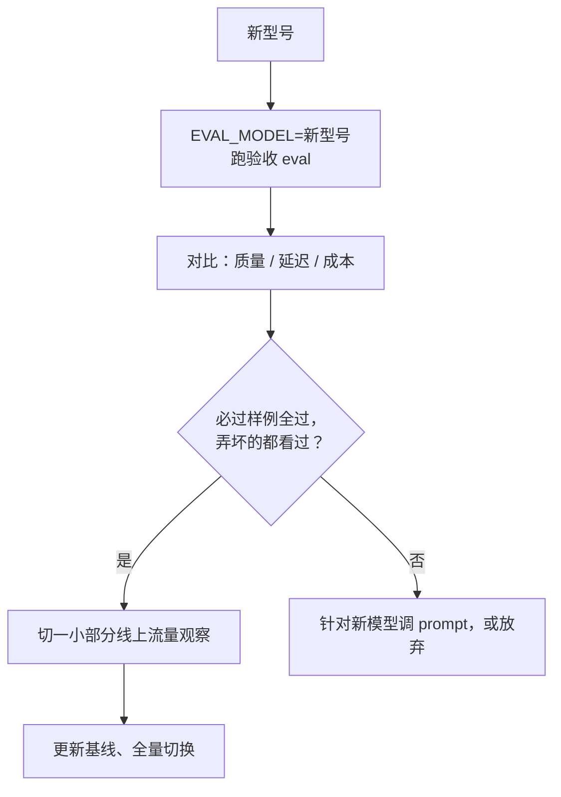

# 回归测试

前几章的 eval 能回答「现在有多好」。这一章让它回答另一个更日常的问题：「这次改动有没有把原来对的弄坏」。这就是回归测试。大模型功能的回归测试比普通代码难在两点：输出不确定，同一个版本跑两次结果也会有出入；每跑一次都要花钱。我们会给 `evalkit` 加上基线对比、逐条变化、重复运行、响应缓存和配对检验，最后把它接进日常的改动流程。

## 基线：和谁比

回归的前提是有一个参照。每次准备合并一个改动之前，跑一次 eval，和**当前线上版本**的结果比较。这个参照叫基线（baseline）。

基线文件只存评分，不存模型的完整输出，体积小，可以进 git：

```typescript
// packages/evalkit/src/baseline.ts
import { readFile, writeFile } from "node:fs/promises";
import type { CaseResult } from "./types";
import { summarize, type Summary } from "./report";

export interface Baseline {
  meta: Record<string, string>;
  summary: Summary;
  /** id -> 指标名 -> 分数 */
  cases: Record<string, Record<string, number>>;
}

export function toBaseline(meta: Record<string, string>, results: CaseResult<unknown>[]): Baseline {
  return {
    meta,
    summary: summarize(results),
    cases: Object.fromEntries(results.map((r) => [r.id, Object.fromEntries(r.scores.map((s) => [s.name, s.value]))])),
  };
}

export async function saveBaseline(path: string, b: Baseline) {
  await writeFile(path, JSON.stringify(b, null, 2) + "\n");
}

export async function loadBaseline(path: string): Promise<Baseline | null> {
  try {
    return JSON.parse(await readFile(path, "utf8")) as Baseline;
  } catch {
    return null;
  }
}
```

基线进 git 有一个额外的好处：每次更新基线都是一个提交，`git log evals/receipt/baseline.json` 就是这个功能的质量变化史，每一次分数变化都对应着一个具体的改动。

## 逐条比较，而不只比平均分

平均分持平，不代表没有回归。完全可能是修好了 5 条、弄坏了 5 条。被弄坏的那 5 条可能恰好是某个大客户的供货商格式。所以对比报告的核心是**逐条的变化**：

```typescript
// packages/evalkit/src/compare.ts
import type { Baseline } from "./baseline";

export interface CaseDiff {
  id: string;
  before: number;
  after: number;
}

export function diffCases(base: Baseline, current: Baseline, metric: string) {
  const fixed: CaseDiff[] = [];
  const broken: CaseDiff[] = [];
  for (const [id, scores] of Object.entries(current.cases)) {
    const before = base.cases[id]?.[metric];
    const after = scores[metric] ?? 0;
    if (before === undefined) continue; // 新加的样例，没有可比的
    if (after > before) fixed.push({ id, before, after });
    if (after < before) broken.push({ id, before, after });
  }
  return { fixed, broken };
}
```

对比报告长这样：

```text
receipt_exact   基线 71.3%  →  当前 76.3%   (n=80)
field_acc       基线 0.962  →  当前 0.971

修好 6 条：r-0012 r-0031 r-0042 r-0057 r-0063 r-0071
弄坏 2 条：r-0008 r-0049
  r-0008  「6斤7两」quantity：期望 null，得到 6.7
  r-0049  漏读：葱
```

**弄坏的那几条必须一条一条看**。看完通常有三种结论：确实是改动引入的问题，要修；是模型的随机波动，下一节讲怎么判断；是标注本身错了，改标注。

## 不确定性：先测出噪声有多大

用同一个版本、同样的样例连跑两次，`receipt_exact` 可能一次 72.5%、一次 70%，有两条样例在两次之间翻转。如果不知道这个噪声有多大，就分不清「弄坏 2 条」是改动造成的还是运气。

### 测一次噪声底

改动之前，**用当前版本把 eval 连跑 3 次**，统计每条样例在 3 次里的结果是否一致：

```typescript
// packages/evalkit/src/compare.ts（续）

/** runs[k][id] 是第 k 次运行时该样例的分数。返回结果不稳定的样例 */
export function flakyCases(runs: Record<string, number>[]): string[] {
  const ids = Object.keys(runs[0]);
  return ids.filter((id) => new Set(runs.map((r) => r[id])).size > 1);
}
```

不稳定的样例占比，就是你的噪声底。比如 80 条里有 4 条在 3 次运行间翻转，那么某次改动「弄坏 2 条」时，先看这 2 条是不是在不稳定名单里。

减小噪声的几个手段：

- 能固定的参数都固定：低 temperature（如果模型支持）、固定的 max_tokens、固定的模型版本号而不是别名
- 后处理更宽容：很多不稳定来自模型偶尔多一个标点、少一个空格，归一化之后就稳了
- 不稳定的样例本身就是信号：它们往往是模型「拿不准」的边界情况，值得单独看看能不能通过改 prompt 让它稳定下来

### pass@k 与 pass^k

对不确定的功能，同一条样例跑 $k$ 次，有两种完全不同的统计口径：

| 口径 | 定义 | 单次通过率 $p$ 时 | 适用 |
|---|---|---|---|
| pass@k | $k$ 次里**至少一次**通过 | $1-(1-p)^k$ | 有人从多个结果里挑，或者失败了可以自动重试 |
| pass^k | $k$ 次**全部**通过 | $p^k$ | 用户每次都要拿到对的结果 |



两条曲线讲的是同一个模型，结论却截然相反。进货单是店主每次都要读对的，应该看 pass^k：单次 90% 的通过率，意味着同一张单让它读 5 次，5 次都对的概率只有 59%。这也说明了为什么第 3 章要把「不稳定的样例」单独拎出来：**用户感受到的是一致性，不只是平均水平**。

hatch-counter 的识别函数在模型没按格式回话时会重试一次，这让「格式错误」这一类失败从 pass^k 的口径转向了 pass@2 的口径，所以重试是一种很划算的可靠性手段。但它只对能被代码检测出来的失败有效：读错了一个数字，代码不知道，也就不会重试。

`evalkit` 支持重复运行只需要在入口脚本里多跑几次，把每次的结果收集起来：

```typescript
// evals/receipt/run.ts（片段）
const repeats = Number(process.env.EVAL_REPEATS ?? 1);
const runs = [];
for (let k = 0; k < repeats; k++) runs.push(await runSuite(suite, { concurrency: 3 }));

// pass^k：每条样例 k 次都全对才算通过
const passAll = suite.cases.filter((c) =>
  runs.every((rs) => rs.find((r) => r.id === c.id)?.scores.find((s) => s.name === "receipt_exact")?.value === 1),
).length;
console.log(`pass^${repeats} = ${((passAll / suite.cases.length) * 100).toFixed(1)}%`);
```

## 配对检验：差距是真的吗

新旧两个版本在同一批样例上各跑一次，结果可以整理成四类：

| | 新版通过 | 新版不通过 |
|---|---|---|
| 旧版通过 | 都通过 | 弄坏了（记为 $b$） |
| 旧版不通过 | 修好了（记为 $c$） | 都不通过 |

两个版本都通过、都不通过的样例不提供任何「谁更好」的信息，判断只看 $b$ 和 $c$。如果两个版本其实一样好，那么每条有变化的样例朝两个方向变的机会各一半，就像抛硬币。于是可以问：抛 $b+c$ 次硬币，出现这么不平衡（或更不平衡）的结果的概率有多大？这就是符号检验（在这个场景下也叫精确 McNemar 检验）：

```typescript
// packages/evalkit/src/stats.ts（续）

function choose(n: number, k: number): number {
  let r = 1;
  for (let i = 1; i <= k; i++) r = (r * (n - k + i)) / i;
  return r;
}

/** 双侧符号检验的 p 值。b：弄坏的条数，c：修好的条数 */
export function signTest(b: number, c: number): number {
  const n = b + c;
  if (n === 0) return 1;
  const k = Math.min(b, c);
  let tail = 0;
  for (let i = 0; i <= k; i++) tail += choose(n, i);
  return Math.min(1, (2 * tail) / 2 ** n);
}
```

算一个例子：新版修好 9 条、弄坏 2 条。直觉上新版明显更好，但：

$$
p = \frac{2 \times \left[\binom{11}{0} + \binom{11}{1} + \binom{11}{2}\right]}{2^{11}} = \frac{2 \times 67}{2048} \approx 0.065
$$

按常用的 0.05 标准，这还不能算「确定更好」。这不是说新版没有进步，而是说**在这么小的样本上，数据还不足以排除运气**。实际操作中不必死守 0.05：如果弄坏的那 2 条你逐条看过、确认是随机波动或者无关紧要的，修好的 9 条又正是你想修的那类问题，就可以合并。统计检验的作用是让你对小样本上的差距保持谦虚，而不是替你做决定。

反过来，如果修好 2 条、弄坏 2 条，平均分完全没变，检验的 p 值是 1，但这依然值得看：弄坏的那两条是什么？

## 必过样例

有一类样例不讲统计：**只要错一条就不能上线**。比如「豆腐 12 板」不能被记成 12 克这条，它对应的是一个曾经让库存差了四百倍的真实事故。给这类样例打上 `critical` 标签，回归时单独检查：

```typescript
const criticalFailed = results.filter(
  (r) => r.tags.includes("critical") && r.scores.find((s) => s.name === "receipt_exact")?.value !== 1,
);
if (criticalFailed.length) {
  console.error(`必过样例失败：${criticalFailed.map((r) => r.id).join(" ")}`);
  process.exitCode = 1;
}
```

必过样例要少而精，十几条为宜。全部样例都设成必过，等于让每一次随机波动都挡住上线，很快大家就会习惯性地忽略它。

## 缓存：让重跑不花钱

调评分器、改报告格式、修评分器的 bug，这些改动不涉及模型，但每次重跑 eval 都要重新调一遍模型，既慢又花钱。解决办法是**按请求内容缓存模型的响应**：模型名、prompt、图片、参数完全相同时，直接用上次的结果。

```typescript
// packages/evalkit/src/cache.ts
import { createHash } from "node:crypto";
import { mkdir, readFile, writeFile } from "node:fs/promises";

const DIR = ".eval-cache";

export async function cached<T>(keyParts: unknown[], fn: () => Promise<T>): Promise<T> {
  if (process.env.EVAL_NO_CACHE === "1") return fn();
  const key = createHash("sha256").update(JSON.stringify(keyParts)).digest("hex");
  const file = `${DIR}/${key}.json`;
  try {
    return JSON.parse(await readFile(file, "utf8")) as T;
  } catch {
    const value = await fn();
    await mkdir(DIR, { recursive: true });
    await writeFile(file, JSON.stringify(value));
    return value;
  }
}
```

缓存键里要包含**所有影响输出的东西**。对进货单来说，是模型名、prompt 全文、图片的哈希和调用参数。最省事的做法是在识别函数发出 HTTP 请求的那一层做缓存，把整个请求体的哈希当键，这样 prompt 改了一个字，缓存自然失效。

缓存有一个副作用：它把不确定性藏起来了。命中缓存时，跑十次结果都一样，你会误以为功能很稳定。所以约定：

- 改评分器、改报告时用缓存
- **比较两个版本、测噪声底、发版前验收时关掉缓存**（`EVAL_NO_CACHE=1`）

`.eval-cache/` 写进 `.gitignore`，里面是模型的原始输出，可能含单据内容。

## 接进日常流程

hatch-counter 没有 CI，提交前的检查都在本地跑。eval 要调付费 API、跑一次要几分钟，不适合放进每次提交都跑的 `pnpm test`，比较合适的分层是：

| 层 | 什么时候跑 | 跑什么 | 花钱吗 |
|---|---|---|---|
| 评分器单元测试 | 每次 `pnpm test` | 第 3 章的 vitest 测试 | 不花 |
| 快速 eval | 改 prompt 时随手跑 | 开发集，开缓存，只用代码评分器 | 少量 |
| 回归 eval | 合并改动前 | 开发集 + 必过样例，关缓存，和基线对比 | 一次几十到几百次调用 |
| 验收 eval | 换模型、大改 prompt 上线前 | 加上留出的测试集，重复 3 次 | 最多 |

在 `package.json` 里给几种跑法起好名字：

```json
{
  "scripts": {
    "eval:receipt": "tsx --env-file=.env evals/receipt/run.ts",
    "eval:receipt:check": "EVAL_NO_CACHE=1 tsx --env-file=.env evals/receipt/run.ts --compare",
    "eval:receipt:accept": "EVAL_NO_CACHE=1 EVAL_REPEATS=3 tsx --env-file=.env evals/receipt/run.ts --compare --split=all"
  }
}
```

入口脚本用 Node 内置的 `parseArgs` 解析这几个开关：

```typescript
// evals/receipt/run.ts（片段）
import { parseArgs } from "node:util";

const { values } = parseArgs({
  options: {
    compare: { type: "boolean", default: false },
    "update-baseline": { type: "boolean", default: false },
    split: { type: "string", default: "dev" }, // dev | test | all
  },
});
```

再把规则写进项目的 `CLAUDE.md`，让编码 agent 也遵守：

```markdown
- 改了 `apps/api/src/ocr/` 下的 prompt 或后处理，合并前跑 `pnpm eval:receipt:check`，
  把对比报告里「弄坏」的样例逐条贴进提交说明；必过样例失败不得合并
- 只有确认新结果更好之后才用 `--update-baseline` 更新基线，并单独提交
```

### 换模型的流程

服务商出了新型号，或者想换一个便宜的模型省钱，流程是同一套：



不同模型对同一个 prompt 的反应可能差别很大，「换个更强的模型，分数一定更高」并不成立。eval 的价值在这里体现得最充分：没有它，换模型就是一次赌博。

## 本章要点

- 基线只存分数、进 git，它的提交历史就是功能的质量史
- **逐条比较**：平均分持平也可能修好 5 条、弄坏 5 条，弄坏的必须逐条看
- 先连跑几次测出**噪声底**，才能判断变化是不是运气
- pass@k 看「至少一次对」，pass^k 看「每次都对」；用户要每次都对的功能看 **pass^k**
- 用符号检验判断修好和弄坏的差距是否可信；**修好 9 条、弄坏 2 条，p 约 0.065**，小样本上要谦虚
- 少量 `critical` 必过样例，失败即不能上线
- 按请求内容缓存响应，改评分器时省钱；**比较版本时关掉缓存**
- 分层接入日常流程，并把规则写进 `CLAUDE.md`
