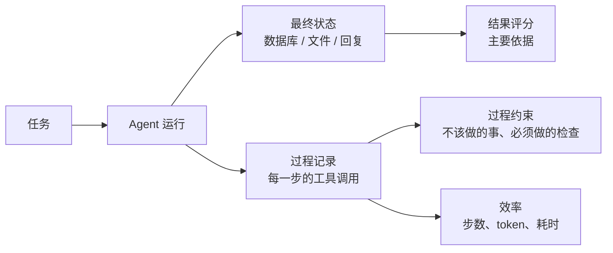

# 评测 Agent 与多步任务

前几章评的都是「一个输入、一个输出」的功能。Agent 不一样：它会连续调用工具、根据结果决定下一步，一个任务可能走十几步，同一个任务有很多种正确的走法。这一章讲 agent 的评测和单次调用有什么不同、该评结果还是评过程、怎么搭可重复的测试环境，并给出两个例子：一个自己写的工具调用 agent，一个 Claude Code 这样的编码 agent。不做 agent 的读者可以跳过本章。

## 和单次调用的评测有什么不同

| 维度 | 单次调用 | Agent |
|---|---|---|
| 输出 | 一段文本或一个 JSON | 一串动作，外加对外部世界的改变 |
| 正确答案 | 通常唯一 | 多条路径都可能对 |
| 环境 | 无状态 | 每次运行会改变环境，必须隔离和重置 |
| 失败方式 | 输出错了 | 走错路、绕远路、卡死循环、做了不该做的事 |
| 成本 | 一次调用 | 几步到几十步，差异很大 |
| 不确定性 | 有 | 每一步的不确定会累积 |

最后一条值得多说一句：假设 agent 每一步做对的概率是 95%，一个需要 10 步的任务全部做对的概率大约是 $0.95^{10} \approx 0.60$。步数越多，对每一步可靠性的要求越高。这也是为什么 agent 的评测要特别关注第 5 章讲的 pass^k。

## 评结果，还是评过程



**以结果为主**。用户关心的是库存补对了没有、代码能不能跑，而不是 agent 先调了哪个工具。如果评分器规定了「必须先搜索、再读取、再写入」这样的固定路径，一个更聪明、走了捷径的 agent 反而会被判错，评测就会奖励死板。

**过程只用来检查约束**，也就是无论走哪条路都不能违反的规则：

- 没有做不该做的事：只读的任务里调用了写工具、删除了不该删的文件
- 做了必须做的检查：写入前确认了目标存在、遇到歧义时问了人
- 没有明显的浪费：同一个工具用同样的参数调用了五次

**效率单独记录，一般不计入通过与否**。两个版本都能完成任务，一个用 6 步、一个用 15 步，这是成本和延迟的差异，放进报告里一起比较。

## 搭可重复的环境

agent 会改变环境，所以每次运行都要从同一个初始状态开始，跑完之后检查最终状态。环境的选择从轻到重：

| 环境 | 做法 | 适合 |
|---|---|---|
| 内存里的假实现 | 工具背后是一个内存对象，每次运行新建一个 | 自己写的 agent，工具逻辑简单 |
| 测试数据库 | 每次运行前从快照恢复，或者在事务里跑完回滚 | 工具直接读写数据库 |
| 文件系统副本 | 把一个固定的项目目录复制到临时目录，agent 在副本里干活 | 编码 agent |
| 容器 | 每次运行起一个新容器 | 需要装软件、跑服务的任务 |

有一条规则不论哪种环境都要遵守：**评测时 agent 绝不能碰真实环境**。真实的数据库、真实的仓库、真实的 API key 都不要出现在评测里。这既是为了可重复，也是为了安全：一个被改坏的 agent 在评测里删掉的应该是一份副本。

## 例一：自己写的工具调用 agent

假设给掌柜眼加一个「补仓助手」：店主说一句「今天老李送了 30 斤土豆，1 块 8 一斤」，agent 查食材档案、确认是哪样食材，生成一张补仓草稿给店主确认。它有两个工具：

- `search_ingredient`：按名字搜食材档案
- `create_restock_draft`：生成补仓草稿（只是草稿，店主确认后才入库）

hatch-counter 有一条明确的产品原则：数据对不上、名字认不出这类情况**交给人拍板**，列出来让用户选，不自动猜。这条原则正好可以写成评测里的过程约束。

### 假环境与运行记录

```typescript
// evals/restock-agent/env.ts
export interface Ingredient {
  id: string;
  name: string;
  unit: "g" | "ml" | "pcs";
}

export interface Draft {
  ingredientId: string;
  quantity: number;
  unit: string;
  unitPriceCents: number;
}

/** 每次运行新建一个，跑完检查 drafts */
export function makeEnv(ingredients: Ingredient[]) {
  const drafts: Draft[] = [];
  const tools = {
    search_ingredient: async ({ query }: { query: string }) =>
      ingredients.filter((i) => i.name.includes(query) || query.includes(i.name)),
    create_restock_draft: async (d: Draft) => {
      if (!ingredients.some((i) => i.id === d.ingredientId)) throw new Error(`没有这样食材：${d.ingredientId}`);
      drafts.push(d);
      return { ok: true };
    },
  };
  return { tools, drafts };
}

/** agent 跑完交回来的东西：每一步做了什么、最后说了什么、花了多少 */
export interface AgentRun {
  steps: { tool: string; input: unknown; output: unknown }[];
  finalText: string;
  inputTokens: number;
  outputTokens: number;
}
```

被测的是你自己的 agent 循环（怎么写见[《Agent 原理与设计》](../agent-principles/)），这里假设它的签名是 `runRestockAgent({ message, tools }): Promise<AgentRun>`。它内部调哪个模型、prompt 怎么写都无所谓，评测只看它交回来的东西和环境的最终状态。

### 样例与评分

```typescript
// evals/restock-agent/cases.ts
import type { Draft, Ingredient } from "./env";

export interface AgentCase {
  id: string;
  tags: string[];
  message: string;
  ingredients: Ingredient[];
  /** 期望生成的草稿；null 表示不该生成，而应该问店主 */
  expectedDrafts: Omit<Draft, "unit">[] | null;
}

export const cases: AgentCase[] = [
  {
    id: "simple",
    tags: ["happy-path"],
    message: "今天老李送了 30 斤土豆，1 块 8 一斤",
    ingredients: [{ id: "potato", name: "土豆", unit: "g" }],
    expectedDrafts: [{ ingredientId: "potato", quantity: 30, unitPriceCents: 180 }],
  },
  {
    id: "ambiguous-name",
    tags: ["ask-human", "critical"],
    message: "送了 5 斤番茄，4 块一斤",
    // 档案里有两样都可能是番茄的东西，agent 不该替店主挑
    ingredients: [
      { id: "tomato", name: "西红柿", unit: "g" },
      { id: "cherry", name: "圣女果", unit: "g" },
    ],
    expectedDrafts: null,
  },
];
```

```typescript
// evals/restock-agent/scorers.ts
import type { Score } from "@hatch/evalkit";
import type { AgentCase } from "./cases";
import type { AgentRun, Draft } from "./env";

export function scoreRun(c: AgentCase, run: AgentRun, drafts: Draft[]): Score[] {
  const scores: Score[] = [];

  // 结果：最终生成的草稿对不对
  if (c.expectedDrafts === null) {
    const asked = drafts.length === 0 && /[?？]/.test(run.finalText);
    scores.push({ name: "outcome", value: asked ? 1 : 0, detail: asked ? undefined : `不该生成草稿，却生成了 ${drafts.length} 张，或者没有向店主提问` });
  } else {
    const ok =
      drafts.length === c.expectedDrafts.length &&
      c.expectedDrafts.every((e) =>
        drafts.some((d) => d.ingredientId === e.ingredientId && d.quantity === e.quantity && d.unitPriceCents === e.unitPriceCents),
      );
    scores.push({ name: "outcome", value: ok ? 1 : 0, detail: ok ? undefined : `草稿：${JSON.stringify(drafts)}` });
  }

  // 过程约束：写之前必须搜过；同样的调用不重复
  const firstWrite = run.steps.findIndex((s) => s.tool === "create_restock_draft");
  const searchedBefore = firstWrite === -1 || run.steps.slice(0, firstWrite).some((s) => s.tool === "search_ingredient");
  scores.push({ name: "search_before_write", value: searchedBefore ? 1 : 0 });

  const keys = run.steps.map((s) => s.tool + JSON.stringify(s.input));
  scores.push({ name: "no_repeat", value: new Set(keys).size === keys.length ? 1 : 0 });

  // 效率：只记录，汇总时看平均值，不计入通过
  scores.push({ name: "steps", value: run.steps.length });
  return scores;
}
```

注意 `steps` 这个指标的值不在 0 到 1 之间，它违反了第 1 章「分数统一成 0–1」的约定。这是有意的：效率类数字放进同一份报告方便对比，但不参与「通过率」的计算。如果你更在意整洁，可以把它们放进 `CaseResult` 的另一个字段。

判断「是否向店主提问」用的是「回复里有问号」，非常粗糙。对这类判断，第 4 章的评判模型更合适：给它看对话记录和一条标准，「没有替店主在两样食材之间做选择，而是列出候选请店主确认」。

## 例二：编码 agent

另一类常见的 agent 是 Claude Code 这样的编码 agent。你写的 `CLAUDE.md`、skill、自定义命令，本质上都是在给它写 prompt，同样可以评测。hatch-shelf 就是一个现成的例子：这套书由写书 agent 按照 `books/AGENTS.md` 的规范来写，规范里有大量可以用代码检查的规则，仓库里还有一个现成的检查命令 `shelf-pack check`。

想评测的问题是：改了 `AGENTS.md` 里的某条规则之后，agent 写出来的书是更合规了，还是更差了？

### 用无头模式跑 agent

Claude Code 支持非交互的打印模式：`claude -p "<任务>"` 跑完任务后退出，`--output-format json` 让它把结果、花费、轮数等信息以 JSON 输出。具体有哪些参数、JSON 里有哪些字段，以 `claude --help` 和官方文档为准，下面的代码对字段做了宽容处理。

每次运行都在一份**临时副本**里进行：

```typescript
// evals/book-agent/run-one.ts
import { cp, mkdtemp } from "node:fs/promises";
import { tmpdir } from "node:os";
import { join } from "node:path";
import { spawnSync } from "node:child_process";

export interface BookTask {
  id: string;
  prompt: string; // 例如「在 books/demo/ 下写一章讲 HTTP 缓存的短文，遵守 books/AGENTS.md」
  bookDir: string; // 写完要检查的目录，例如 books/demo
}

export async function runBookTask(fixture: string, task: BookTask) {
  // 每次从同一个固定的仓库快照复制出一份，agent 改坏了也只是一份副本
  const work = await mkdtemp(join(tmpdir(), `book-eval-${task.id}-`));
  await cp(fixture, work, { recursive: true });

  const res = spawnSync(
    "claude",
    ["-p", task.prompt, "--output-format", "json", "--max-turns", "40", "--allowedTools", "Read,Write,Edit,Glob,Grep"],
    { cwd: work, encoding: "utf8", timeout: 15 * 60_000 },
  );

  let meta: { result?: string; total_cost_usd?: number; num_turns?: number; is_error?: boolean } = {};
  try {
    meta = JSON.parse(res.stdout);
  } catch {
    /* 超时或崩溃时 stdout 不是 JSON，下面的结果检查照样会判失败 */
  }
  return { work, meta, exitCode: res.status };
}
```

`--allowedTools` 只放行读写文件的工具，不给 Bash：被评测的 agent 不需要执行任意命令，权限越小越安全。检查由评测脚本自己来跑。

### 评结果

agent 跑完，在副本里运行仓库现成的检查命令，再加几条规范里的硬规则：

```typescript
// evals/book-agent/scorers.ts
import { readdir, readFile } from "node:fs/promises";
import { join } from "node:path";
import { spawnSync } from "node:child_process";
import type { Score } from "@hatch/evalkit";

export async function scoreBook(work: string, bookDir: string): Promise<Score[]> {
  const dir = join(work, bookDir);
  const check = spawnSync("pnpm", ["-s", "shelf-pack", "check", bookDir], { cwd: work, encoding: "utf8" });

  const mdFiles = (await readdir(dir).catch(() => [] as string[])).filter((f) => f.endsWith(".md"));
  let singleH1 = mdFiles.length > 0;
  let noBoxArt = true;
  for (const f of mdFiles) {
    const text = await readFile(join(dir, f), "utf8");
    // 去掉代码块再数 H1，代码里的 # 注释不算标题
    const prose = text.replace(/```[\s\S]*?```/g, "");
    if ((prose.match(/^# /gm) ?? []).length !== 1) singleH1 = false;
    // 规范禁止字符画：制表符（横线、竖线、拐角）连成一片基本就是在画框
    if (/[\u2500\u2502\u250c\u2510\u2514\u2518\u251c]{3,}/.test(text)) noBoxArt = false;
  }

  return [
    { name: "pack_check", value: check.status === 0 ? 1 : 0, detail: check.status === 0 ? undefined : check.stdout + check.stderr },
    { name: "single_h1", value: singleH1 ? 1 : 0 },
    { name: "no_box_art", value: noBoxArt ? 1 : 0 },
  ];
}
```

这些只能检查格式。「这一章有没有讲清楚为什么」这样的内容质量，要交给第 4 章的评判模型，标准可以直接从写作规范里摘：「开头一段说清本章要解决什么」「结尾有本章要点」。

编码 agent 的评测很贵：每个任务要跑几分钟、花的钱比单次调用多得多。所以任务数量要少而精，五到十个有代表性的任务，每个重复两三次，比五十个任务各跑一次更能说明问题。

## 设计 agent 任务的几个坑

**任务本身要能完成**。如果一个任务所有版本都是 0 分，先怀疑任务而不是 agent：描述是否有歧义？环境里缺了必要的文件？给每个任务准备一份参考解法，确认在这个环境里确实能达到期望的最终状态。

**不要过度规定路径**。上面的补仓例子只要求「写之前搜过」，没有要求「先搜、再问、再写」。路径约束只写那些违反了就一定是错的规则。

**环境要彻底隔离**。前一次运行留下的文件、数据库记录、缓存，会让后一次运行的结果失真。每次运行从快照新建，跑完丢弃。

**读运行记录**。agent 的分数掉了，光看最终状态不知道原因。报告里给每个失败的样例附上完整的运行记录（每一步的工具调用和结果），逐条读几条，通常很快就能看出它是在哪一步走偏的：工具返回的错误信息看不懂、某个工具的描述有歧义、上下文太长忘了最初的要求。

## 本章要点

- Agent 的输出是一串动作加上环境的改变；每步 95% 可靠，10 步全对只有约 60%
- **以结果为主**，过程只检查不能违反的约束，效率单独记录
- 每次运行从同一个快照新建环境，**评测绝不碰真实环境**
- 自己写的 agent：工具背后接假实现，跑完检查最终状态；「交给人拍板」这类产品原则可以写成过程约束
- 编码 agent：用无头模式在临时副本里跑，用仓库现成的检查命令和规范里的硬规则评结果，最小权限
- 任务少而精、每个重复几次；先确认任务可完成；失败时读运行记录
