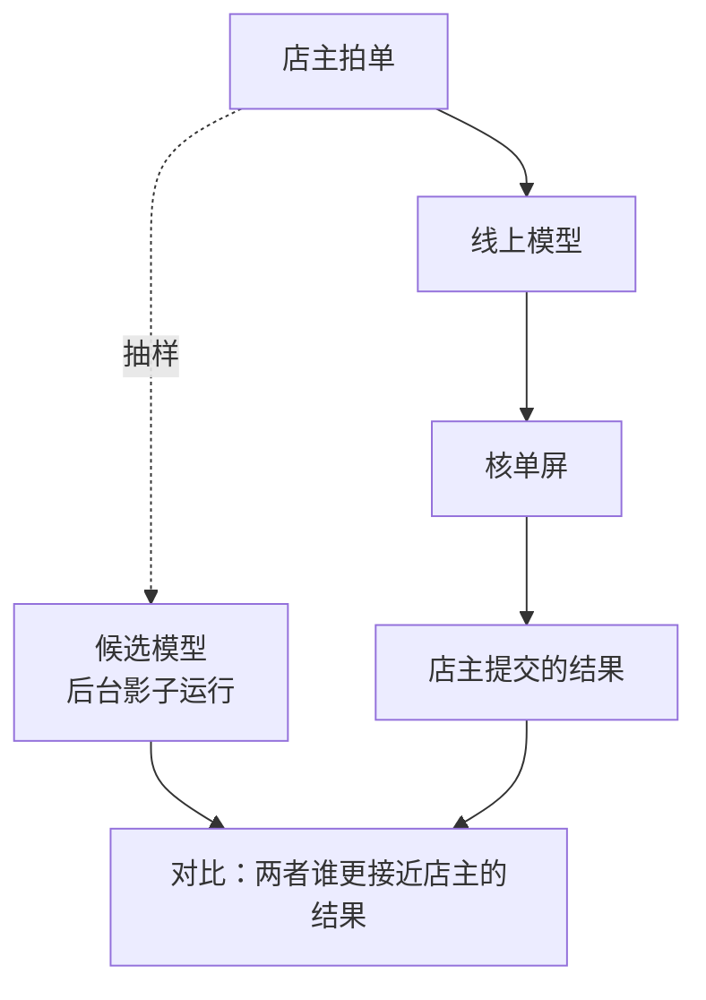
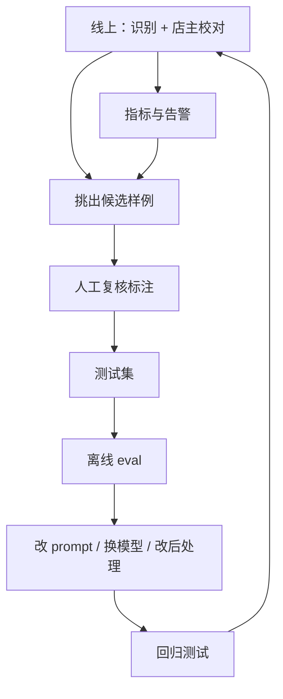

# 线上监控与反馈闭环

离线 eval 再完善，测试集也只是真实流量的一个样本。上线之后会有测试集里没有的供货商格式、没见过的拍摄条件，服务商也可能悄悄更新了模型。这一章讲上线后怎么持续知道功能好不好：记什么日志、看哪些指标、怎么从用户的行为里拿到免费的标注、怎么发现漂移、怎么安全地试新模型，最后把线上和离线接成一个闭环，让测试集跟着真实使用一起长大。

## 线上能看到什么

线上没有现成的标准答案，但有三类信号：

| 类别 | 例子 | 优点 | 缺点 |
|---|---|---|---|
| 系统信号 | 报错率、重试率、降级率、延迟、花费 | 实时、全量、零成本 | 只说明「跑没跑通」，不说明「读得对不对」 |
| 不变量信号 | 数量 × 单价 ≠ 金额的比例、各行之和 ≠ 合计的比例 | 全量、不需要人 | 只能发现自相矛盾的错误 |
| 用户信号 | 店主在核单屏上改了哪些格、补了哪些漏读的行、点了「换一张」 | 最接近真实质量 | 有延迟，受用户习惯影响 |

hatch-counter 的进货单识别在第三类信号上得天独厚：**每张单都要经过店主校对才能入库**，店主改过的每一格就是一条标注。很多产品没有这样的人工环节，用户信号只能靠点赞点踩，稀疏得多。设计 AI 功能时值得想一想：有没有办法让用户的正常操作顺带产生反馈？

## 记什么

每次识别和每次提交，都留一条结构化的记录。hatch-counter 的单据存档已经存了模型原话 `rawText` 和实际干成这件事的服务商 `provider`，在此基础上，评测还需要几样东西：识别出来的结构化结果、店主提交时「单上写的」那几格、用的是哪个版本的 prompt。

可以单独建一张表：

```typescript
// apps/api/src/db/schema/ocr-scans.ts
import { index, integer, jsonb, pgTable, text, timestamp, uuid } from "drizzle-orm/pg-core";
import type { Receipt } from "@counter/core"; // 评测用的那套结构，和 evals/receipt/schema.ts 一致

export const ocrScans = pgTable(
  "ocr_scans",
  {
    id: uuid("id").primaryKey().defaultRandom(),
    storeId: uuid("store_id").notNull(),
    receiptId: uuid("receipt_id"), // 提交之后才有
    provider: text("provider").notNull(),
    model: text("model").notNull(),
    promptVersion: text("prompt_version").notNull(),
    mode: text("mode").notNull(), // 通用版式 / 按模板逐格读
    latencyMs: integer("latency_ms").notNull(),
    attempts: integer("attempts").notNull(), // 含重试和降级
    warnings: jsonb("warnings").$type<string[]>().notNull(),
    scanned: jsonb("scanned").$type<Receipt>().notNull(),
    // 店主核单后「单上写的」那几格；没提交（换了一张、放弃了）就是 null
    committed: jsonb("committed").$type<Receipt>(),
    // 提交时用 evals 的评分器算好存下来，查询时不用再算
    scores: jsonb("scores").$type<Record<string, number>>(),
    createdAt: timestamp("created_at", { withTimezone: true }).notNull().defaultNow(),
    committedAt: timestamp("committed_at", { withTimezone: true }),
  },
  (t) => [index("ocr_scans_created_idx").on(t.createdAt)],
);
```

`promptVersion` 是最容易被忽略、又最重要的一列。没有它，某周识别质量下降时你无法判断是新 prompt 的问题，还是那周恰好来了一批难拍的单子。prompt 的版本号可以是手写的常量，每次改 prompt 时递增，也可以直接用 prompt 全文的哈希。

### 线上线下共用一套评分器

店主提交时，把识别结果当作「输出」，店主校对后的结果当作「期望」，直接调用第 3 章写好的评分器：

```typescript
// apps/api/src/ocr/online-score.ts
import { lineScorer, headerScorer, exactScorer } from "../../../../evals/receipt/scorers";
import type { Receipt } from "@counter/core";

export async function scoreCommitted(scanned: Receipt, committed: Receipt): Promise<Record<string, number>> {
  const args = { input: { image: "", sha256: "", layout: null }, output: scanned, expected: committed };
  const scores = [
    ...(await lineScorer(args)),
    ...(await headerScorer(args)),
    ...(await exactScorer(args)),
  ];
  return Object.fromEntries(scores.map((s) => [s.name, s.value]));
}
```

实际项目里，更干净的做法是把评分器挪进 `@counter/core` 这样的共享包，服务端和 `evals/` 都从那里引用，而不是跨目录相对引用。关键在于**同一个指标在线上和线下是同一个定义**：离线测出 `receipt_exact` 是 76%，线上算出来是 58%，这个差距本身就是一条重要信息，说明测试集比真实流量简单。

在线上，`receipt_exact` 有一个直白的含义：**店主一格都没改就提交的比例**。它是这个功能最值得放在首页看的数字。

### 用户信号的偏差

用店主的修改当标注，要记住第 2 章说过的两点：

- 店主只改**挡着提交**的东西，不挡提交的错误可能没被改。所以线上分数会偏乐观
- 不同的店主习惯不同：有人逐格核对，有人扫一眼就提交。按门店分组看，如果某家店的「零修改率」接近 100%，可能不是识别特别准，而是店主根本没看

所以用户信号适合看**趋势和相对变化**，绝对值要打个折扣。

## 看哪些指标

把上面的信号整理成一张每周看一次的表：

| 指标 | 来自 | 变差说明什么 |
|---|---|---|
| 零修改提交率 | `scores.receipt_exact` | 识别质量下降，最核心的指标 |
| 行召回率 | `scores.line_recall` | 漏读变多：单子更长了，或者输出被截断 |
| 字段准确率 | `scores.field_acc` | 认字变差：换了模型，或者照片质量变差 |
| 放弃率 | `committed` 为空的比例 | 识别结果差到店主宁愿换一张或手工录 |
| 不一致率 | `warnings` 里「对不上」的比例 | 不需要等提交，识别完立刻能算 |
| 读不出率 | 识别报 `unreadable` 的比例 | 照片问题，或者模型不按格式回话 |
| 降级率 | `attempts > 1` 的比例 | 首选服务商不稳定 |
| 延迟 p95、单张成本 | `latencyMs`、用量 | 体验和钱 |

按周、按模型、按 prompt 版本分组查：

```sql
select
  date_trunc('week', created_at) as week,
  model,
  prompt_version,
  count(*) as scans,
  round(avg((committed is null)::int), 3) as abandon_rate,
  round(avg((scores->>'receipt_exact')::float) filter (where committed is not null), 3) as zero_edit_rate,
  round(avg((scores->>'field_acc')::float) filter (where committed is not null), 3) as field_acc,
  percentile_cont(0.95) within group (order by latency_ms) as p95_ms
from ocr_scans
where created_at > now() - interval '12 weeks'
group by 1, 2, 3
order by 1 desc, 2, 3;
```

一个人做的产品不需要专门的监控平台。这条查询放进管理后台的一个页面，或者每周一用脚本跑一次发到自己的群里，就够用了。指标、日志和告警的通用做法见[《可观测性与性能》](../observability-performance/)。

## 漂移

功能上线时测出来的效果，会随着时间悄悄变化，原因通常有三类：

| 漂移 | 例子 | 怎么发现 |
|---|---|---|
| 输入变了 | 新签了一批门店，用的是另一种手写单；某家供货商换了单据格式 | 按门店、按供货商分组的指标突然变化；「列数对不上」的提示变多 |
| 模型变了 | 服务商更新了模型，或者别名指向了新版本 | 什么都没改，指标却在某天整体跳变 |
| 用法变了 | 店主开始拍整本送货单、一张图里有两张单 | 行数分布、放弃率变化 |

hatch-counter 按模板读表时已经有一个很好的漂移探测器：模型读出的列数和模板记的列数不一样时，会提示「要是这家换了单据格式，到单据模板把列改一下」。把这条提示出现的频率也纳入监控，它上升就说明有供货商在换格式。

### 告警要有门槛

小产品的流量不大，一周几十张单，比例的波动本来就很大。告警条件要同时满足两条，否则会天天误报：

- **样本够**：本周这个分组至少有 30 张单（门槛按你的流量定）
- **变化够大**：比过去四周的平均值低了超过一个阈值，比如零修改率下降 10 个百分点

第 2 章的 Wilson 区间在这里同样有用：本周的区间和过去四周的区间完全不重叠时，才值得认真对待。

## 安全地试新模型

离线 eval 说新模型更好，上线后未必。在全量切换之前，有两种在真实流量上验证的办法：



- **影子运行**（shadow）：抽一部分线上请求，在后台用候选模型也跑一遍，结果不给店主看，只存下来。等店主提交后，分别算线上模型和候选模型的分数。店主完全无感，代价是这部分请求要付两份钱
- **灰度**（canary）：让一小部分门店直接用候选模型，看它们的零修改率和放弃率有没有变差。比影子运行更真实，但有问题时这部分店主会受影响

影子运行特别适合 hatch-counter 这种「有人工校对」的功能：店主最终提交的结果和用哪个模型无关，是一个公平的裁判。灰度则更接近真实的用户体验，两者可以先后进行。

影子运行要注意数据的去向：如果候选模型来自另一家服务商，等于把店主的单据照片多发给了一家第三方。是否允许、需要怎样告知用户，以你的用户协议和最新的法规要求为准，相关的框架见[《国内合规实务》](../opc-compliance-cn/)。

## 闭环：让测试集跟着线上长大

把这一章和前几章串起来，就是 eval 的完整闭环：



最关键的一步是「挑出候选样例」，哪些线上数据值得进测试集？

| 优先挑 | 理由 |
|---|---|
| 修改很多的单 | `field_acc` 低于某个值，信息量最大 |
| 被放弃的单 | 识别差到店主不愿意改，但没有标注，需要自己标 |
| 新门店、新供货商的第一批单 | 覆盖测试集里还没有的格式 |
| 不一致提示多的单 | 可能读错了，也可能单子本身算错了，都值得看 |
| 随机抽的一小部分 | 保证测试集的分布不会全部偏向难例 |

挑出来的样例**不要直接进测试集**，按第 2 章的标注规范复核一遍：店主的修改是银标，复核之后才是金标。

### 每周十五分钟

把闭环落到日程上，一个人也维持得住：

```text
每周一
- 看上周的指标表：零修改率、放弃率、读不出率，和前四周比
- 按分组看有没有异常：某家门店、某个供货商、某个 prompt 版本
- 从修改最多的单里挑 5 张，对着原图看错在哪，归类
- 值得留的样例复核后加进 cases.jsonl
- 如果一类失败反复出现，开一个改动：先加样例，再改 prompt，跑回归
```

这十五分钟的产出会持续积累：测试集越来越像真实流量，离线 eval 的分数越来越能预测线上效果，改 prompt 也越来越有底气。

## 全书回顾

回头看这本书搭起来的东西：

| 章 | 产出 |
|---|---|
| 第 1 章 | eval 的四个组成，`evalkit` 的核心类型 |
| 第 2 章 | 带标签、带标注规范的 JSONL 测试集，Wilson 区间 |
| 第 3 章 | 行对齐、字段准确率、整单全对率、不变量检查，运行器和报告 |
| 第 4 章 | 评分器的单元测试、性质检查、人工对照和重新打分 |
| 第 5 章 | 二元标准的评判模型，以及用人工标注校准它的方法 |
| 第 6 章 | 基线、逐条对比、噪声底、pass^k、符号检验、缓存、必过样例 |
| 第 7 章 | agent 的结果评分、过程约束和隔离环境 |
| 第 8 章 | 线上日志、用户信号、漂移、影子运行和闭环 |

加起来不过几百行 TypeScript，但它把「改 prompt 靠感觉」变成了「改 prompt 有数据」。更重要的是那份不断生长的测试集：模型会换、框架会重写，测试集会一直留下来，是你对「这个功能做得好」最准确的定义。

## 本章要点

- 线上有三类信号：**系统信号、不变量信号、用户信号**；让用户的正常操作顺带产生反馈
- 每次调用记下模型、**prompt 版本**、识别结果和用户最终提交的结果
- **线上线下共用一套评分器**，两边分数的差距说明测试集和真实流量的差距
- 用户信号有偏差：只改挡路的错误、各人习惯不同，看趋势比看绝对值可靠
- 漂移来自输入、模型、用法三方面；告警要同时满足**样本够**和**变化够大**
- 新模型先影子运行或灰度，有人工校对的功能特别适合影子运行
- 闭环：线上挑样例 → 复核 → 进测试集 → 离线 eval → 改动 → 回归 → 上线；每周十五分钟维持它

## 动手练习

1. **告警的两个门槛**：本周零修改提交 15/40，过去四周合计 120/160。用第 2 章的 `wilson` 算两个区间；再算另一种情况：本周 9/12。

   验证：`wilson(15, 40)` 约 `[0.24, 0.53]`，`wilson(120, 160)` 约 `[0.68, 0.81]`，两者不重叠；`wilson(9, 12)` 约 `[0.47, 0.91]`，和过去四周重叠，而且样本数不到 30。

   参考答案：第一种情况样本够、变化大、区间不重叠，值得马上看；第二种 75% 和过去持平，样本又少，不该告警。

2. **在 SQL 里算放弃率和零修改率**：在 Docker 的 Postgres 里建一张只有 `model text`、`committed jsonb`、`scores jsonb` 三列的 `ocr_scans`，插入 4 行：一行 `committed` 为 null，另外三行的 `scores` 分别是 `{"receipt_exact":1}`、`{"receipt_exact":1}`、`{"receipt_exact":0}`。照本章的查询算 `abandon_rate` 和 `zero_edit_rate`。

   验证：`abandon_rate` 为 `0.250`，`zero_edit_rate` 为 `0.667`。

   参考答案：放弃的单没有店主结果，`filter (where committed is not null)` 让它不进入零修改率的分母；去掉这个 filter，null 行会让平均值的含义变得混乱。

3. **挑哪些单进测试集**：上周的识别记录里有这五张：A 店主改了 9 格，`field_acc` 0.62；B 零修改提交，来自已有十几条样例的供货商；C 被放弃，没有提交；D 一家新签门店的第一张单，改了 1 格；E 零修改提交，但 `warnings` 里有两条「对不上」。按本章的优先表，你会挑哪些，怎么处理？

   验证：每张单都能对上本章「优先挑」表里的一行或说明为什么不挑，并说出进入测试集之前要做的那一步。

   参考答案：A、C、D、E 都值得挑（修改多、被放弃、新门店、不一致提示多）；B 可以作为随机抽样的一部分，但不是优先。所有挑出来的都按第 2 章规范复核后再进 `cases.jsonl`，C 没有店主结果，需要自己从头标。

## 接下来读什么

- [《LLM 应用上线》](../llmops/)：模型网关、多供应商降级、prompt 版本管理、观测与追踪，把这一章的线上部分放进更完整的生产体系里
- [《多模态应用》](../multimodal-ai/)：进货单识别本身怎么做得更好，视觉模型、OCR 和文档理解
- 按导读的顺序，AI 纵深这一批到这里就读完了，下一批从[《产品思维》](../product-thinking/)开始，进入 OPC 的商业部分
