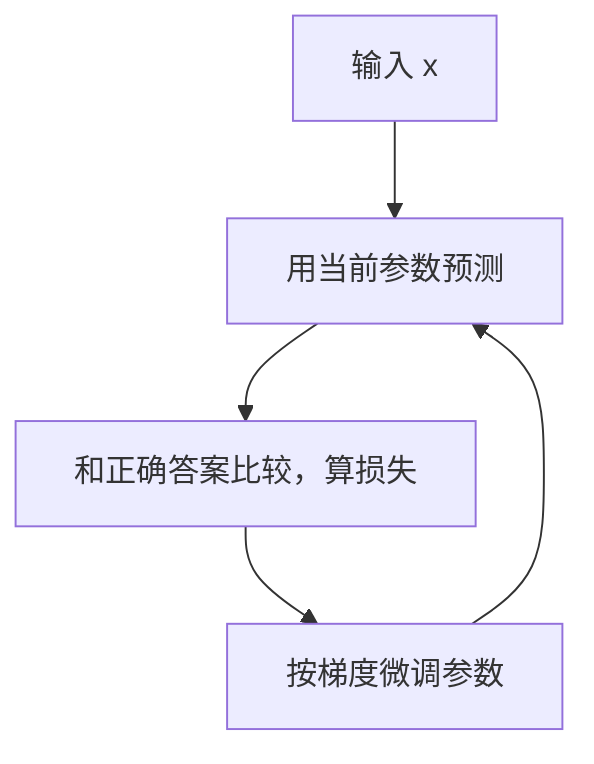
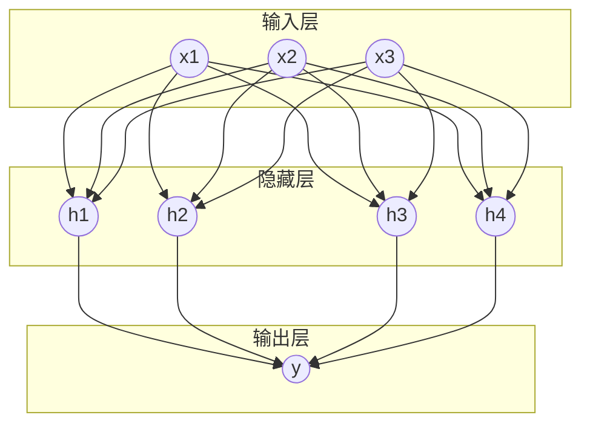

# 从函数拟合到神经网络

大模型听起来很玄，但它的本质可以用一句话说完：**一个巨大的函数，输入一段文字，输出「下一个字最可能是什么」**。这一章先把「函数」和「神经网络」这两件事讲清楚，后面所有章节都建立在这个直觉之上。

## 一切都是函数

写代码的人对函数再熟悉不过：

```ts
function f(x: number): number {
  return 2 * x + 1;
}
```

这个函数是人写出来的：我们知道规则是「乘 2 加 1」，就把规则写进去。

但很多问题我们**说不清规则**：

- 给一张图片，判断里面是猫还是狗
- 给一段中文，翻译成英文
- 给半句话，接着往下写

这些问题背后显然也存在某种「输入 → 输出」的对应关系，只是没人能把规则一条条写下来。机器学习的思路是：**既然写不出规则，那就准备大量「输入和正确输出」的例子，让机器自己把函数找出来**。

## 拟合：从例子里找函数

假设我们有一批数据点，想找一条线穿过它们：

| x | y |
|---|---|
| 1 | 3.1 |
| 2 | 4.9 |
| 3 | 7.2 |
| 4 | 8.8 |

我们猜函数长这样：$y = w \cdot x + b$。其中 $w$ 和 $b$ 是两个**参数**，一开始随便给个值，比如 $w=0, b=0$。

然后反复做三件事：

1. **预测**：用当前的 $w$、$b$ 算出每个 x 对应的预测值
2. **算误差**：预测值和真实 y 差多少，把所有误差汇总成一个数，叫**损失**（loss）
3. **调参数**：把 $w$、$b$ 往「让损失变小」的方向挪一点点

重复几百次，$w$ 会接近 2，$b$ 会接近 1，这条线就「学会」了数据里的规律。这个过程叫**训练**，第 3 步用的方法叫**梯度下降**。



### 梯度下降的直觉

想象你蒙着眼站在山坡上，目标是走到谷底。你看不见全貌，但能用脚感受脚下哪个方向更低，于是每次朝更低的方向迈一小步。

- **山的高度**就是损失
- **你的位置**就是参数的取值
- **脚下的坡度**就是梯度
- **每步迈多大**叫学习率：太大容易冲过谷底，太小走得太慢

大模型的训练，本质上就是在一个有几千亿个维度的「山」上做这件事。

## 神经网络：一种很能拟合的函数

直线只能拟合直线关系。现实世界的规律是弯弯曲曲的，所以需要一种**足够灵活**的函数形式。神经网络就是这样一种形式。

### 一个神经元

一个神经元做的事情非常简单：

1. 接收几个输入数字
2. 每个输入乘上一个权重，再加起来，再加一个偏置
3. 把结果送进一个**激活函数**，得到输出

$$
\text{输出} = \sigma(w_1 x_1 + w_2 x_2 + \dots + w_n x_n + b)
$$

激活函数 $\sigma$ 是关键。最常用的一种叫 ReLU，规则是「小于 0 的变成 0，大于 0 的保持不变」。它让网络能表达**弯曲**的关系；如果没有它，无论叠多少层，整个网络都只相当于一条直线。

### 叠成网络

把很多神经元排成一层，再把很多层叠起来，就是神经网络：



每一条连线上都有一个权重，这些权重加上偏置，就是网络的**参数**。我们常说的「某模型有 700 亿参数」，指的就是这些数字一共有 700 亿个。

数学上有一个结论：只要神经元足够多，神经网络可以逼近几乎任何函数。这就是它强大的根源：**我们不需要知道规则长什么样，只要网络足够大、数据足够多，训练会自己把规则塑造出来**。

### 训练一个网络

训练神经网络的流程和拟合直线完全一样，只是参数多了很多：

1. 输入一个例子，逐层计算得到输出（**前向传播**）
2. 和正确答案比较，算出损失
3. 从输出层往回，算出每个参数对损失的影响（**反向传播**）
4. 每个参数都往让损失变小的方向挪一点

反向传播是一种高效计算梯度的方法。它让「同时调整几千亿个参数」在计算上变得可行。

## 深度学习

**深度学习**就是用很多层的神经网络来学习。层数多了之后，网络会自发地形成分工：

- 识别图片时，前几层学会识别边缘和颜色，中间层学会识别眼睛、耳朵这样的部件，后几层学会识别「这是一只猫」
- 处理语言时，前几层处理词语的拼写和语法，后几层处理语义和推理

没有人告诉网络要这样分工，这种层次结构是训练自然塑造出来的。

## 回到大模型

现在可以把开头那句话说得更精确一点：

> 大语言模型是一个有几十亿到上万亿参数的神经网络。它被训练来完成一个任务：给定前面的文字，预测下一个词。

只是在做这件事之前，还有几个问题要解决：

- 神经网络只认数字，文字怎么变成数字？见下一章[token 与 embedding](02-tokens-embeddings.md)
- 预测下一个词时，前文里哪些部分更重要？见第 3 章[注意力机制](03-attention.md)
- 这些部件怎么组装成一个完整的模型？见第 4 章[Transformer](04-transformer.md)

## 本章要点

- 机器学习就是**从例子里找函数**：写不出规则，就让数据把规则塑造出来
- 训练 = 预测 → 算损失 → 用梯度下降调参数，反复循环
- 神经网络是一种极其灵活的函数，参数就是连线上的权重
- 激活函数让网络能表达弯曲的关系，层数加深让网络能形成层次化的理解
- 大模型就是一个超大的神经网络，任务是预测下一个词
