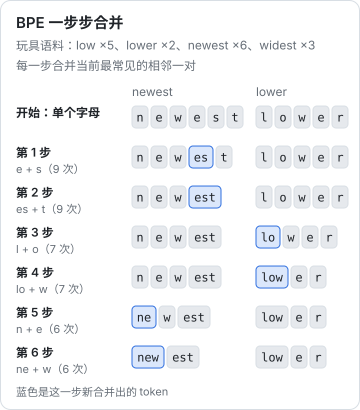
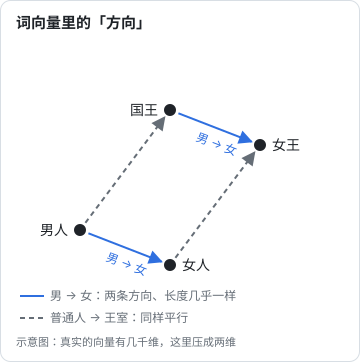
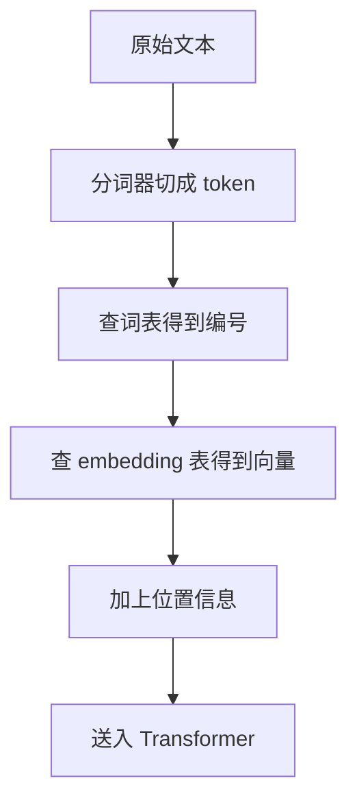

# token 与 embedding

神经网络只会做数字运算。要让它处理文字，得先解决两个问题：

1. 把一段文字切成一个个基本单位，这些单位叫 **token**
2. 把每个 token 变成一串数字，这串数字叫 **embedding**

这两步看起来只是预处理，实际上深刻影响着模型的能力、成本，甚至它会犯哪些奇怪的错。

## token：模型眼里的「字」

### 为什么不直接按字或按词切

最直观的做法有两种：

- **按字符切**：英文按字母、中文按汉字。词表很小，但序列会很长，而且单个字母几乎不携带意义
- **按单词切**：意义清晰，但词表会无限膨胀，新词、错别字、专有名词都会变成「不认识的词」

现代大模型用的是折中方案：**子词**（subword）切分。常见的词整体作为一个 token，罕见的词拆成几个片段。

### BPE：从频率里长出词表

最常用的子词算法叫 **BPE**（Byte Pair Encoding，字节对编码），思路很朴素：

1. 一开始，词表里只有所有单个字节
2. 统计训练语料中哪两个相邻单位一起出现得最多，把它们合并成一个新 token
3. 重复第 2 步，直到词表达到预定大小（通常是几万到二十几万个）

下图用一个只有四个词的玩具语料走一遍：`newest` 和 `widest` 都以 `est` 结尾，出现得多，`e`、`s`、`t` 最先被合并；`low` 和 `lower` 共享 `low`，接着被合并。六步之后，`newest` 只剩两个 token，`lower` 剩三个。



真实的分词器在几 TB 的文本上做同样的事，只是要合并几万到几十万次。

结果是：

- `the`、`ing`、`function` 这种高频片段会变成单独的 token
- `hatchshelf` 这种罕见词会被拆成 `hatch` + `shelf` 甚至更碎
- 中文的常用字、常用词会成为 token，生僻字则可能被拆成好几个字节

```text
输入：   I love programming in TypeScript
token：  I | love | programming | in | Type | Script
```

（这是 GPT-4o 用的 `o200k_base` 词表的实际切分结果，换一个模型结果会不同，下面的小实验可以自己验证。）

### token 带来的实际影响

理解 token 能解释很多日常现象：

| 现象 | 原因 |
|---|---|
| API 按 token 计费，不按字数 | 模型的计算量和 token 数成正比 |
| 同样的意思，中文往往比英文更费 token | 词表里英文的高频片段更多，中文常被切得更碎（新模型已大幅改善） |
| 模型数不清单词里有几个字母 | 它看到的是 token，不是字母，`strawberry` 可能只是两三个 token |
| 模型做长数字的算术容易出错 | 数字被切成不规则的片段，比如 `12345` 可能变成 `123` + `45` |
| 上下文窗口写的是「200K token」 | 窗口大小以 token 计，换算成汉字大约是同一个数量级 |

一个粗略的经验值：英文 1 个 token 约等于 0.75 个单词；中文 1 个 token 约等于 1 到 1.5 个汉字，不同模型差别很大。

### 小实验：自己数 token

> [!WARNING]
> 本节的工具和结果按 2026 年 11 月的版本整理（tiktoken 0.14.0；Anthropic 的 token 计数接口以 platform.claude.com 文档为准）。分词器会随模型更新，同一段文字换一个模型，token 数可能不同。

上面这些说法，花十分钟就能自己验证。三种方法，从易到难：

**方法一：网页**。OpenAI 官网有一个 Tokenizer 页面（platform.openai.com/tokenizer），把文字粘进去，它会用不同颜色标出每个 token，并显示总数。不用写代码，适合先建立直觉。

**方法二：tiktoken**。tiktoken 是 OpenAI 开源的分词库，里面带着 GPT 系列的词表。装好 Python 之后：

```bash
pip install tiktoken
```

把下面的代码存成 `count.py`：

```python
import tiktoken

# cl100k_base 是 GPT-4 的词表，o200k_base 是 GPT-4o 的词表
for name in ["cl100k_base", "o200k_base"]:
    enc = tiktoken.get_encoding(name)
    for text in ["strawberry", "12345678", "我喜欢用 TypeScript 写程序"]:
        ids = enc.encode(text)
        pieces = [enc.decode_single_token_bytes(i).decode("utf-8", "replace") for i in ids]
        print(name, text, len(ids), pieces)
```

运行 `python count.py`。第一次运行会下载词表文件，之后就不用联网了。我用 tiktoken 0.14.0 跑出的结果整理成表：

| 文本 | GPT-4 词表 | GPT-4o 词表 |
|---|---|---|
| `strawberry` | 3 个：`str` `aw` `berry` | 3 个：`st` `raw` `berry` |
| `12345678` | 3 个：`123` `456` `78` | 3 个：`123` `456` `78` |
| `我喜欢用 TypeScript 写程序` | 10 个，「喜欢」「写」被拆成了字节碎片 | 7 个：`我` `喜欢` `用` ` Type` `Script` ` 写` `程序` |
| `光合作用把二氧化碳和水转化为葡萄糖和氧气。`（第 5 章的例句） | 32 个 | 21 个 |

几个可以从表里直接看到的现象：

- `strawberry` 在两个词表里都是 3 个 token，没有一个 token 是单个字母 `r`。模型数不清里面有几个 `r`，原因就在这里
- 数字按三位一组切，`12345678` 变成 `123` `456` `78`，模型看到的不是一位一位的数字
- 同一句中文，新词表比旧词表少用了三分之一的 token。前面说「新模型已大幅改善」，指的就是这种变化
- 打印出来的 `�` 是被拆开的半个汉字：一个汉字在 UTF-8 里占 3 个字节，旧词表没有把它收成一个 token 时，就会拆成几个字节 token

**方法三：Claude 的 token 计数接口**。Claude 用的是另一套分词器，tiktoken 算不准。Anthropic 提供了一个免费的计数接口（有每分钟请求数限制），需要先在 Claude Console 申请 API key：

```bash
curl https://api.anthropic.com/v1/messages/count_tokens \
  -H "x-api-key: $ANTHROPIC_API_KEY" \
  -H "anthropic-version: 2026-10-21" \
  -H "content-type: application/json" \
  -d '{
    "model": "claude-opus-5-5",
    "messages": [{"role": "user", "content": "我喜欢用 TypeScript 写程序"}]
  }'
```

返回一个 `{"input_tokens": ...}`。这个数包含了把消息包装成对话格式的那几个 token，所以会比纯文字多一点；官方文档也说明它是估算值，和实际计费可能有很小的差别。模型 ID 换成你要用的那个即可。官方文档还提到，Claude Opus 4.7 起换了新的分词器，同样的文字大约多出 30% 的 token：**换模型时，token 数要用新模型重新数**，不能沿用旧的估算。

## embedding：把 token 变成向量

切好的 token 先变成一个编号（词表里的第几号），但编号本身没有意义：3721 号和 3722 号不代表两个词很像。所以要再把每个编号变成一串数字，也就是一个**向量**。

```text
"猫"  →  [0.21, -0.53, 0.88, 0.07, ..., -0.12]   （几千个数字）
"狗"  →  [0.19, -0.48, 0.91, 0.11, ..., -0.09]
"汽车" → [-0.67, 0.32, -0.15, 0.74, ..., 0.45]
```

这张「token → 向量」的对照表就是 **embedding 表**。它也是模型参数的一部分，一开始随机，在训练中被慢慢调整。

### 向量空间里的「意义」

训练完成后，embedding 会呈现出一个神奇的性质：**意思相近的词，向量也相近**。

可以把每个向量想象成高维空间里的一个点：

- 「猫」「狗」「兔子」挨在一起
- 「汽车」「卡车」「自行车」挨在另一处
- 「快乐」「开心」「高兴」又在另一处

更神奇的是，向量之间的**方向**也携带意义。经典的例子：

$$
\vec{\text{国王}} - \vec{\text{男人}} + \vec{\text{女人}} \approx \vec{\text{女王}}
$$

「男 → 女」这个概念，在向量空间里变成了一个固定的方向。画成两维的示意图，四个词正好围成一个平行四边形：



这个例子最早因 2013 年 Google 的 word2vec 研究而出名。真实的向量有几千维，「国王 − 男人 + 女人」算出来的点并不正好落在「女王」上，只是离它最近，所以公式里用的是约等号。

没有人教模型这些，它是在预测下一个词的过程中自己学到的：经常出现在相似上下文里的词，被推到了相近的位置。

### 怎么衡量「相近」

两个向量有多像，最常用的指标是**余弦相似度**，也就是两个向量夹角的余弦值：

$$
\cos\theta = \frac{\vec{a} \cdot \vec{b}}{\|\vec{a}\| \, \|\vec{b}\|}
$$

- 接近 1：方向几乎一致，意思很像
- 接近 0：基本无关
- 接近 -1：方向相反

这个指标在后面的 RAG（检索增强生成）里会频繁出现：把文档和问题都变成向量，按余弦相似度找出最相关的段落。

## 位置信息

还有一个问题：「狗咬人」和「人咬狗」用的 token 完全相同，只是顺序不同。如果模型只看 embedding，它分不出两者。

所以在送进模型之前，还要给每个 token 加上**位置信息**，告诉模型「这是第 1 个、这是第 2 个……」。具体做法有多种，早期是给每个位置也准备一个向量，加到 token 的 embedding 上；现在的主流模型多用一种叫 RoPE 的方法，把位置编码成向量的「旋转角度」。细节放在[《大模型原理进阶》](../llm-deep-dive/)里讲，这里只需要记住：**模型的输入 = token 的意义 + token 的位置**。

## 全流程



模型输出时走的是反方向：最后一层给出一个向量，再换算成词表里每个 token 的概率，选出下一个 token，解码回文字。

## 本章要点

- 模型处理的基本单位是 **token**，主流用 BPE 这类子词算法切分
- token 决定了计费、上下文长度，也解释了数字母、算长数字这类怪错误
- 用 tiktoken 或官方的计数接口可以**自己数 token**；不同模型的分词器不同，数出来的结果也不同
- **embedding** 把每个 token 变成一个向量，意思相近的词向量也相近
- 向量的方向能编码「性别」「复数」这样的概念
- 输入模型前还要加上**位置信息**，否则模型分不清词序
