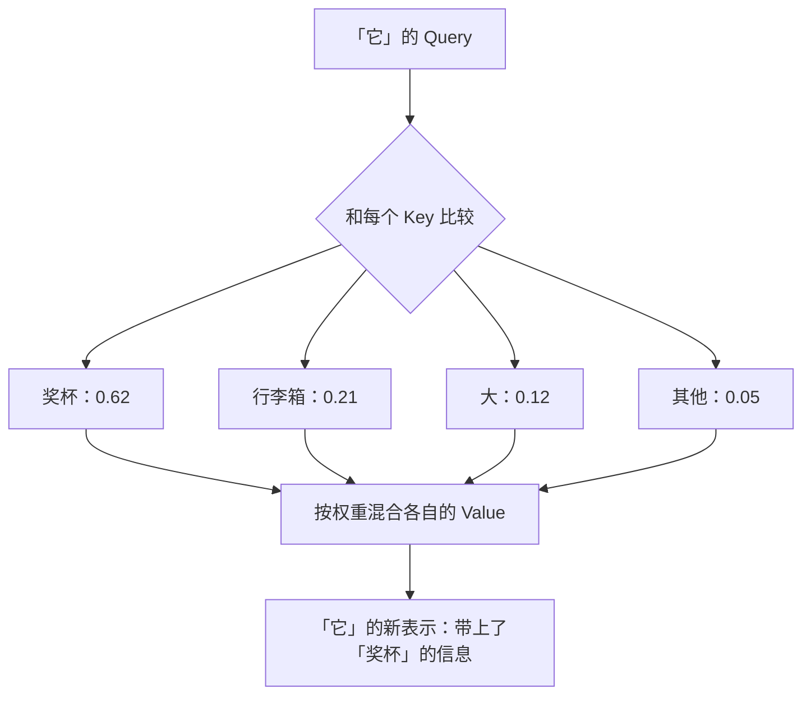
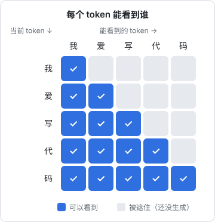

# 注意力机制

上一章把每个 token 变成了一个向量。但单独一个词的意义往往是模糊的，要看上下文才能确定。**注意力机制**（attention）就是让每个 token 去「看」上下文里的其他 token，并据此更新自己的意义。它是 Transformer 的核心，也是大模型能理解语言的关键。

## 词义取决于上下文

看这两句话：

- 我去**银行**取钱
- 我们沿着河**岸**散步

英文里这两处都可以是 `bank`，但意思完全不同。人类读到时会自然地看一眼周围的词：「取钱」说明是金融机构，「河」说明是河岸。

再看一个更难的：

> 奖杯放不进行李箱，因为**它**太大了。

这里的「它」指奖杯。如果把「太大」换成「太小」，「它」就变成了指行李箱。要正确理解「它」，必须同时看「奖杯」「行李箱」「大 / 小」这几个词，并把它们联系起来。

注意力机制要解决的，就是这种「**每个词该参考哪些别的词、参考多少**」的问题。

## 注意力的直觉：一次检索

把注意力想象成在一个小型数据库里做检索。每个 token 会生成三样东西：

| 名称 | 英文 | 比喻 | 作用 |
|---|---|---|---|
| 查询 | Query（Q） | 我想找什么 | 「我是代词『它』，我在找我指代的名词」 |
| 键 | Key（K） | 我能提供什么 | 「我是名词『奖杯』，我是一个物体」 |
| 值 | Value（V） | 我的实际内容 | 「奖杯」这个词携带的具体信息 |

一个 token 更新自己时：

1. 拿自己的 Query 去和所有 token 的 Key 逐一比较，看匹配程度
2. 把匹配程度换算成权重，所有权重加起来等于 1
3. 按权重把所有 token 的 Value 加权平均，得到的结果就是这个 token「参考了上下文之后」的新表示

Q、K、V 都由 token 原本的向量乘上三个不同的矩阵得到，这三个矩阵就是要训练的参数。训练过程会让模型自己学会「什么样的 Query 该匹配什么样的 Key」。

## 写成公式

不需要完全看懂公式，但见过一次，以后读资料时会亲切很多：

$$
\begin{aligned}
&\text{Attention}(Q, K, V) \\
&= \text{softmax}\left(\frac{QK^\top}{\sqrt{d}}\right)V
\end{aligned}
$$

拆开看：

- $QK^\top$：每个 Query 和每个 Key 做点积，得到一张「谁和谁有多匹配」的分数表
- $\sqrt{d}$：除以向量维度的平方根，防止数值过大，让训练更稳定
- $\text{softmax}$：把每一行分数变成加起来等于 1 的权重
- 乘以 $V$：按权重混合所有 token 的内容

这就是著名的**缩放点积注意力**（scaled dot-product attention）。整个大模型里最核心的计算，就是这一行公式被重复成千上万次。

## 多头注意力：同时从多个角度看

一句话里，词与词之间的关系有很多种：

- 语法关系：主语和谓语
- 指代关系：「它」和「奖杯」
- 修饰关系：「红色的」和「苹果」
- 位置关系：相邻的词

只用一组 Q、K、V，模型一次只能关注一种关系。所以 Transformer 会同时跑很多组，每组叫一个**头**（head），这就是**多头注意力**（multi-head attention）。比如有 32 个头，就相当于从 32 个角度同时看这句话，最后把结果拼起来。

研究人员拆开训练好的模型，确实能找到一些有明确分工的头：有的专门追踪括号配对，有的专门做指代消解，有的专门把注意力放在前一个词上。

## 因果掩码：不许偷看后面

大语言模型的任务是「根据前文预测下一个词」。如果训练时允许每个词看到后面的词，模型就等于直接看到了答案，什么也学不到。

所以生成式模型的注意力有一个限制：**每个 token 只能看它自己和它前面的 token**。这叫**因果掩码**（causal mask）。

这个下三角形状解释了大模型为什么是「一个字一个字往外蹦」：它在结构上就只能从左往右生成。

## 注意力的代价

注意力让每个 token 都和其他所有 token 做比较。如果上下文有 $n$ 个 token，就要做大约 $n^2$ 次比较：

| 上下文长度 | 比较次数（约） |
|---|---|
| 1,000 | 100 万 |
| 10,000 | 1 亿 |
| 100,000 | 100 亿 |

这就是为什么：

- 长上下文的模型很难做，也很贵
- API 里长输入的价格不便宜，响应也更慢
- 业界发明了大量技术来优化注意力的计算，比如 FlashAttention、KV Cache、稀疏注意力等，后面几本书会讲到

## 本章要点

- 词义取决于上下文，注意力机制让每个 token 根据上下文更新自己的表示
- 每个 token 生成 **Query、Key、Value**：用 Query 匹配 Key 得到权重，再按权重混合 Value
- **多头注意力**同时从多个角度捕捉词与词的关系
- **因果掩码**保证模型只能看前文，所以生成只能从左往右
- 注意力的计算量随上下文长度平方增长，这是长上下文贵的根本原因
