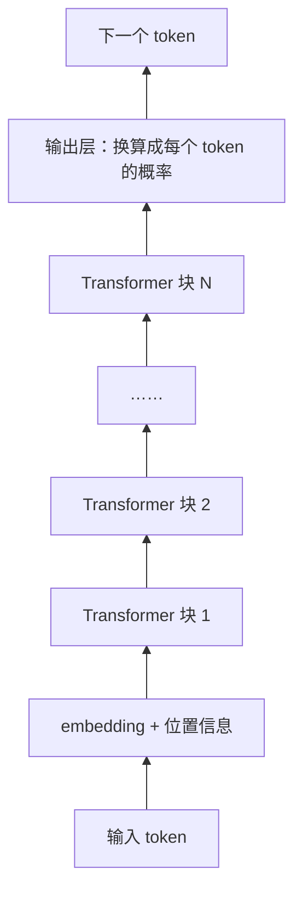
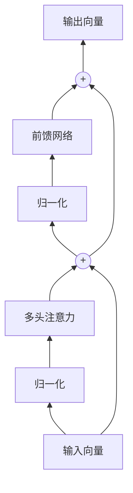
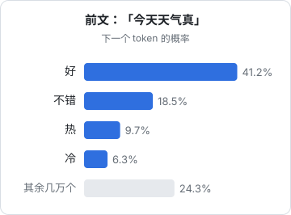

# Transformer

前三章准备好了所有零件：神经网络、token 与 embedding、注意力。这一章把它们组装起来，得到 **Transformer**。它出自 2017 年 Google 的论文《Attention Is All You Need》，此后几乎所有大语言模型都建立在这个架构之上。GPT 里的 T，就是 Transformer。

## Transformer 之前

在 Transformer 出现之前，处理语言的主流是 **RNN**（循环神经网络）和它的改进版 LSTM。它们像人读书一样，一个词一个词地顺序读，边读边更新一个「记忆」向量。

这种方式有两个致命问题：

1. **记不住远处的内容**：读到第 500 个词时，第 1 个词的信息早已在一次次更新中被冲淡
2. **没法并行**：第 n 步必须等第 n-1 步算完，GPU 成千上万个核心大多在空等

Transformer 的突破在于**彻底抛弃了顺序读取**：用注意力让每个词直接看到所有前文，距离再远也只隔一步；所有位置的计算可以同时进行，GPU 能被充分利用。这让模型规模的大幅扩张第一次成为可能。

## 整体结构

一个 GPT 式的 Transformer 从下到上是这样的：

核心就是把同一种结构的 **Transformer 块**叠很多层。小模型可能叠十几层，大模型叠到一百层左右。每一块的结构都一样，但参数各不相同。

## 一个 Transformer 块里有什么

每个块由两部分组成，再加上两个「辅助零件」：

### 第一部分：多头注意力

就是上一章讲的内容。每个 token 去看前文的其他 token，**把上下文的信息收集到自己身上**。可以理解为「token 之间交流信息」的环节。

### 第二部分：前馈网络

注意力之后，每个 token 再各自通过一个普通的神经网络（两层，中间夹一个激活函数）。这一步里 token 之间不交流，**每个 token 独自消化刚收集到的信息**。

研究发现，模型学到的大量「知识」，比如「巴黎是法国的首都」，很可能主要存储在前馈网络的参数里。前馈网络的参数量通常占整个模型的大约三分之二。

一个常见的比喻是：

- **注意力**像开会：大家互相交换信息
- **前馈网络**像会后各自回工位思考：消化信息、调取已有的知识

一层一层叠下去，就是开会、思考、再开会、再思考……每一轮，token 的表示都变得更丰富、更抽象。

### 辅助零件一：残差连接

图里的 `+` 叫**残差连接**：每个部分的输出不是直接替换输入，而是**加到输入上**。

这样做的好处是，信息总有一条「直通」的路径可以从底层一路传到顶层，训练时的梯度也能顺畅地从顶层传回底层。没有残差连接，一百层的网络几乎无法训练。

可以把它理解为：每一层都只是在原有理解上「做批注」，而不是推倒重写。

### 辅助零件二：归一化

**归一化**（normalization）把每个向量的数值调整到稳定的范围内，防止层数加深后数值越来越大或越来越小。它不改变信息内容，只是让训练更稳定。

## 最后一步：预测下一个 token

经过所有块之后，最后一个位置的向量已经融合了整段前文的信息。输出层把它换算成一个长长的分数列表，**词表里每个 token 一个分数**，再用 softmax 变成概率：

选出一个 token（怎么选见第 7 章[推理与采样](07-inference-sampling.md)），拼到前文后面，再把新的前文送进模型，预测下一个……如此循环，就生成了一整段话。这种「生成一个、拼回去、再生成下一个」的方式叫**自回归**（autoregressive）生成。

## 参数都在哪

以一个典型的大模型为例，参数大致分布在：

| 部件 | 作用 | 占比 |
|---|---|---|
| embedding 表 | token → 向量 | 很小 |
| 注意力的 Q、K、V 及输出矩阵 | 决定看谁、收集什么 | 约三分之一 |
| 前馈网络 | 消化信息、存储知识 | 约三分之二 |
| 归一化等 | 稳定数值 | 可忽略 |

所谓「把模型做大」，主要就是三件事：**加宽**（每个向量更长）、**加深**（叠更多层）、**加头**（更多注意力头）。

## 三种 Transformer

原始论文里的 Transformer 有编码器和解码器两部分，用于翻译。后来演化出三个分支：

| 类型 | 代表 | 特点 | 擅长 |
|---|---|---|---|
| 仅编码器 | BERT | 每个词可以同时看前后文 | 理解、分类、生成 embedding |
| 编码器-解码器 | T5、早期翻译模型 | 编码器读原文，解码器生成译文 | 翻译、摘要 |
| 仅解码器 | GPT、Claude、Llama 等 | 只能看前文，因果掩码 | 生成，以及几乎一切任务 |

今天的大语言模型几乎都是**仅解码器**结构。事实证明，只要规模足够大，「预测下一个词」这一个任务就能涵盖理解、翻译、摘要、推理等几乎所有能力。

## 本章要点

- Transformer 用注意力取代了顺序读取，解决了长距离依赖和并行计算两大问题
- 模型的主体是很多层结构相同的 **Transformer 块**
- 每块包含**多头注意力**（token 间交流）和**前馈网络**（各自消化、存储知识）
- **残差连接**和**归一化**让上百层的深度网络可以稳定训练
- 最后一层输出词表上每个 token 的概率，**自回归**地一个个生成
- 今天的大模型基本都是**仅解码器**的 Transformer

## 动手练习

1. **估算一个 7B 模型的参数**：设每个向量长 $d=4096$，每个块的注意力有 Q、K、V、输出四个 $d\times d$ 矩阵，前馈网络是两层、中间宽度 $4d$（即一个 $d\times 4d$ 和一个 $4d\times d$ 矩阵），一共 32 个块。忽略 embedding 和归一化，用计算器算总参数量，以及注意力和前馈网络各占多少。

   验证：每块约 2.01 亿参数，32 块约 64 亿；注意力占三分之一，前馈网络占三分之二。

   参考答案：注意力 $4d^2\approx 0.67$ 亿，前馈网络 $2\times 4d^2 = 8d^2\approx 1.34$ 亿。再加上 embedding 表等，就是常说的「7B」量级，和本章「参数都在哪」的表格一致。真实模型的前馈网络结构略有不同，比例会有出入。

2. **为什么需要残差连接和归一化**：假设没有这两样东西，信号每经过一层就被乘上一个系数。分别算出系数为 0.9 和 1.1 时，经过 100 层后信号变成原来的多少倍。

   验证：$0.9^{100}\approx 2.7\times10^{-5}$，$1.1^{100}\approx 1.4\times10^{4}$。

   参考答案：每层只偏一点点，叠 100 层后不是消失就是爆炸，梯度往回传时也一样。残差连接让信号有一条「加法直通」的路，不会被层层连乘；归一化把每层的数值拉回稳定范围。两者一起才让上百层的模型能训练。

3. **观察自回归**：在任意聊天模型里输入「请把下面这句话接着写 5 个字：今天天气真」，连续重新生成 3 次；再请它「先写出结尾的标点，再写前面的内容」。

   验证：观察流式输出时文字是从左到右逐段出现的；多次生成的接续可能不同；第二个要求下，模型通常只能在回复里「描述」结尾，实际输出顺序仍然从左到右。

   参考答案：仅解码器模型每次只预测下一个 token，拼回去再预测下一个，所以输出天然从左到右；每次结果不同，是因为它从概率分布里抽样（第 7 章细讲）。
