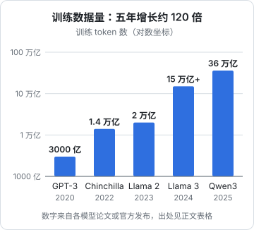

# 预训练

有了 Transformer 架构，下一步是训练它。大模型的训练分好几个阶段，第一个、也是最耗资源的阶段叫**预训练**（pretraining）。这一阶段结束时，模型已经「读过」人类大部分公开文字，掌握了语言、知识和一定的推理能力，但它还不会好好回答问题。

## 训练目标：预测下一个 token

预训练的任务简单到让人意外：**给一段文本，让模型逐个预测下一个 token**。

比如训练数据里有一句：

```text
光合作用把二氧化碳和水转化为葡萄糖和氧气。
```

这一句话就能拆出很多道「练习题」：

| 前文 | 正确答案 |
|---|---|
| 光合 | 作用 |
| 光合作用 | 把 |
| 光合作用把 | 二氧化碳 |
| …… | …… |
| 光合作用把二氧化碳和水转化为葡萄糖和 | 氧气 |

模型给出下一个 token 的概率分布，如果它给正确答案的概率很低，损失就很大，参数就会被调整。因为有因果掩码，一句话里所有位置的题目可以**一次前向传播同时做完**，这是训练效率的关键。

### 不需要人工标注

这种训练方式有一个巨大的好处：**答案就藏在文本本身里**，不需要人去标注。任何一段文字都是现成的训练数据。这叫**自监督学习**。

正因为不需要标注，训练数据的规模才能扩展到人类几乎所有的公开文字。

## 为什么「预测下一个词」能学到这么多

这是整个大模型领域最反直觉的地方。预测下一个词听起来只是个文字接龙游戏，为什么能学会知识和推理？

关键在于：**要把下一个词预测准，就必须理解前文**。看几个例子：

| 前文 | 要预测准，模型必须…… |
|---|---|
| 法国的首都是 | 知道地理知识 |
| 3 个苹果加 5 个苹果，一共有 | 会算术 |
| 他打开冰箱，发现牛奶已经 | 懂常识（过期、喝完） |
| `function add(a, b) { return` | 懂编程 |
| 侦探推理小说最后一页：「所以凶手就是 | 理解整本书的情节和推理 |

当训练数据有数万亿个 token、涵盖百科、书籍、论文、代码、论坛时，为了在所有这些文本上都把损失降低，模型被迫在内部形成对语法、事实、逻辑、甚至写作者意图的某种表示。

有一种说法是：**压缩即理解**。要用有限的参数去预测海量的文本，最高效的办法就是掌握文本背后的规律，而不是死记硬背。

## 训练数据

### 从哪来

预训练数据通常是多种来源的混合：

- **网页**：从公开互联网抓取，量最大，质量参差不齐
- **书籍**：长篇、结构完整，有助于学会长距离连贯
- **学术论文**：专业知识和严谨推理
- **代码**：来自开源代码库，研究普遍认为代码数据对推理能力有明显帮助
- **百科、问答社区**：高密度的事实和解释
- **多语言数据**：决定模型对中文等语言的掌握程度

### 清洗比数量更重要

原始网页数据里充斥着广告、导航栏、乱码、重复内容和低质量文本。数据团队会做大量处理：

1. **去重**：同样的内容出现太多次，模型会死记硬背
2. **过滤低质量内容**：常用一个小模型给每篇文档打质量分
3. **去除有害和隐私信息**
4. **调配比例**：代码、数学、各语言各占多少，对最终能力影响很大

业界的共识是：数据质量和配比，是各家模型能力差异的重要来源之一，也是各公司最核心的机密之一。

### 有多大

几个公开了训练数据量的代表模型（商业闭源模型大多不公布这个数字）：

| 年份 | 模型 | 训练 token 数（约） | 出处 |
|---|---|---|---|
| 2020 | GPT-3 | 3000 亿 | OpenAI 论文《Language Models are Few-Shot Learners》 |
| 2022 | Chinchilla | 1.4 万亿 | DeepMind 论文《Training Compute-Optimal Large Language Models》 |
| 2023 | Llama 2 | 2 万亿 | Meta 论文《Llama 2: Open Foundation and Fine-Tuned Chat Models》 |
| 2024 | Llama 3 | 超过 15 万亿 | Meta 官方发布博客 |
| 2025 | Qwen3 | 约 36 万亿 | 阿里《Qwen3 Technical Report》 |

下图把这几个数字画在对数坐标上，五年间增长了约 120 倍：



光看总数还不够直观，换两个角度看这些数字。

**每个参数配多少 token**。把训练 token 数除以参数量：

| 模型 | 参数量 | 训练 token | 每个参数约配 |
|---|---|---|---|
| GPT-3 | 1750 亿 | 3000 亿 | 1.7 个 |
| Chinchilla | 700 亿 | 1.4 万亿 | 20 个 |
| Llama 2 70B | 700 亿 | 2 万亿 | 29 个 |
| Llama 3 8B | 80 亿 | 超过 15 万亿 | 约 1900 个 |

GPT-3 是「大模型、少数据」，Chinchilla 论文指出这样不划算，给出了每个参数约 20 个 token 的经验值；而 Llama 3 的 80 亿参数小模型喂了 15 万亿 token，是这个经验值的近百倍。为什么后来的模型要远超「最省」的配比，[第 8 章的 Chinchilla 一节](08-scaling-laws.md#chinchilla数据和参数要一起涨)会讲：多花训练的钱，换来以后每次推理都更便宜。

**换算成书**。按一本书约 10 万个英文单词、约 13 万个 token 粗算，一万亿 token 相当于七八百万本书；Qwen3 的 36 万亿 token，相当于两亿多本书。这些数据覆盖的语言也在变多，Qwen3 的技术报告说它的预训练数据覆盖 119 种语言和方言。

这条曲线不可能一直这样涨下去：公开的高质量人类文本是有限的，第 8 章会讲业界怎么应对「数据快用完了」。

## 训练过程

### 硬件

预训练一个前沿模型需要成千上万块高端 GPU 连续运行数周到数月。训练成本从数百万到数亿美元不等。这也是为什么能从零训练前沿模型的公司屈指可数。

### 训练中的变化

随着训练推进，损失曲线会持续下降，模型的能力也在一点点浮现：

1. 最初输出随机字符
2. 很快学会常见的词和标点
3. 学会语法，能写出通顺但空洞的句子
4. 开始掌握事实知识
5. 逐渐出现推理、写代码、多语言翻译等能力

### 知识截止日期

训练数据收集到某个时间点为止，这个时间点就是模型的**知识截止日期**（knowledge cutoff）。在此之后发生的事情，模型一概不知，除非在对话中告诉它，或者让它调用搜索工具。

## 基座模型

预训练结束得到的模型叫**基座模型**（base model）。它非常强大，但有一个问题：**它只会续写，不会对话**。

给它一个问题：

```text
如何学习编程？
```

它可能会这样「续写」：

```text
如何学习编程？如何学习英语？如何学习数学？
```

因为在网页数据里，问题后面跟着更多问题（比如一个问题列表页面）是很常见的模式。它没有在「回答问题」，它只是在模仿训练数据里最常见的文本延续。

要让基座模型变成一个有用的助手，还需要下一章讲的**微调与对齐**。

## 本章要点

- 预训练的任务是**预测下一个 token**，答案来自文本本身，不需要人工标注
- 要把下一个词预测准就必须理解前文，所以简单的目标能学到知识和推理
- 数据来源包括网页、书籍、论文、代码等，**清洗和配比**与规模同样重要
- 训练规模达到数万亿 token、成千上万块 GPU、数月时间
- 预训练得到的**基座模型**只会续写，还不会好好对话
- 模型有**知识截止日期**，之后的事情它不知道

## 动手练习

1. **一句话能出多少道题**：把本章的例句「光合作用把二氧化碳和水转化为葡萄糖和氧气。」粘进 OpenAI 的 Tokenizer 网页，记下 token 数 $n$。这一句在预训练里能拆出多少道「预测下一个 token」的题？

   验证：题目数是 $n-1$。按[第 2 章](02-tokens-embeddings.md)的表，GPT-4o 词表是 21 个 token，即 20 道题。

   参考答案：除了第一个 token，每个 token 都是它前文的「正确答案」。因果掩码让这 $n-1$ 道题在一次前向传播里同时算完，所以一句话本身就是一批训练样本。

2. **算一算「每个参数配多少 token」**：假设一个 80 亿参数的模型用 Qwen3 公布的约 36 万亿 token 训练，算出每个参数配多少 token，是 Chinchilla 经验值（约 20）的多少倍；再按本章「一本书约 13 万 token」换算成书的数量。

   验证：每个参数约 4500 个 token，约为经验值的 225 倍；约 2.8 亿本书。

   参考答案：$36\times10^{12} / 8\times10^{9} = 4500$。远超经验值是刻意的取舍：训练多花钱，换来一个推理时更便宜的小模型，第 8 章会细讲。

3. **对话实验：探知识截止日期**：在一个**关闭联网搜索**的聊天模型里问「你的知识截止到什么时候？」，再问一件你确定发生在那之后的事（比如本月的一条新闻）。然后把那条新闻的原文粘进对话，再问一次。

   验证：观察第二问时模型是说不知道、给出过时信息，还是编出细节；第三问时它能否基于你给的原文正确回答。

   参考答案：预训练数据只到截止日期为止，之后的事不在参数里；把信息放进对话（上下文）就能弥补，这也是 RAG 和搜索工具的出发点。模型自报的截止日期也未必准确，以厂商文档为准。
