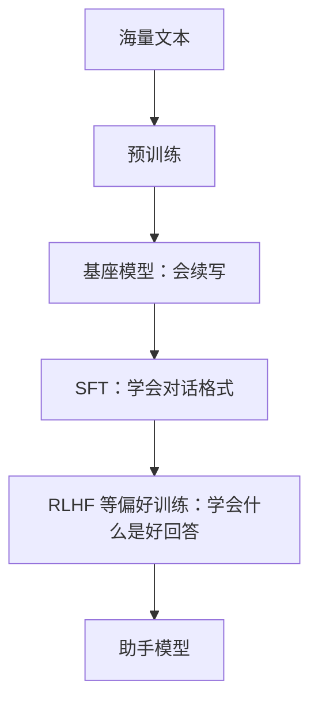
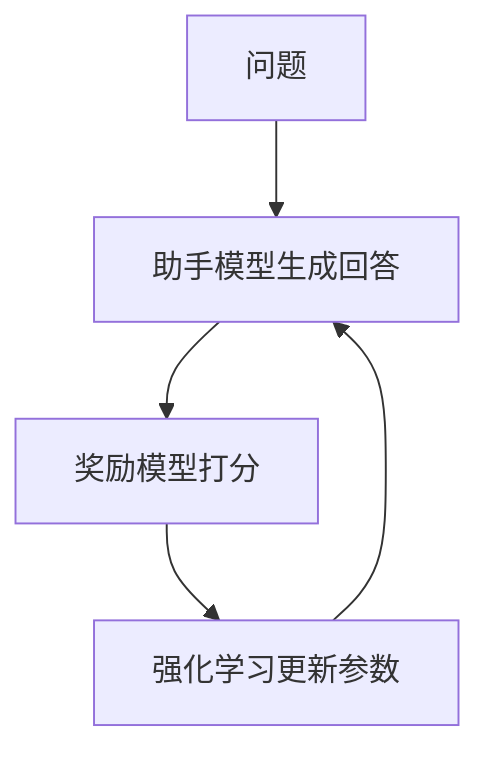

# SFT 与 RLHF

预训练出来的基座模型博学，但不懂「规矩」：它不知道自己应该回答问题，不知道该怎么拒绝有害请求，也不知道怎样的回答才算好。把它变成 ChatGPT、Claude 这样的助手，需要在预训练之后再经过**后训练**（post-training）。后训练主要包括两类方法：**监督微调**（SFT）和**基于人类反馈的强化学习**（RLHF）。



## 一个比喻

可以把三个阶段类比成培养一名新员工：

| 阶段 | 比喻 | 学到什么 |
|---|---|---|
| 预训练 | 读完图书馆里所有的书 | 知识、语言、思维方式 |
| SFT | 看大量优秀前辈的工作示范 | 怎样的格式和态度是专业的 |
| RLHF | 工作中不断收到「这个好、那个不好」的反馈 | 在各种情况下做出更好的判断 |

后两个阶段几乎不增加新知识，它们改变的是**行为方式**：怎么用已有的知识来回应人。

## 监督微调（SFT）

### 做法

准备一批高质量的「指令 + 理想回答」示范数据，用和预训练完全一样的方式（预测下一个 token）继续训练模型。

```text
用户：用一句话解释什么是递归。
助手：递归是一个函数在定义中调用自身，把大问题拆成同类的小问题，直到遇到可以直接解决的最小情况。
```

这样的示范通常有数万到数十万条，覆盖问答、写作、编程、数学、角色扮演、拒绝不当请求等各种场景。早期主要由专业标注员手写；现在也大量使用更强的模型生成、再由人筛选修改。

### 对话模板

为了让模型分清谁在说话，SFT 数据会被包装成固定的格式，用特殊 token 标记角色：

```text
<|system|>你是一个乐于助人的助手。
<|user|>用一句话解释什么是递归。
<|assistant|>递归是一个函数在定义中调用自身……<|end|>
```

（不同模型的标记各不相同，这里只是示意。）

模型由此学会：看到 `<|assistant|>` 就该以助手的身份作答，答完输出结束标记。我们平时调用 API 时传入的 `system`、`user`、`assistant` 消息，最终都会被拼成这样一段文本送进模型。

### SFT 的局限

SFT 让模型学会了**模仿**示范，但有两个问题：

1. **示范很贵**：写出高质量的长回答需要专业的人花大量时间
2. **模仿有上限**：模型只学到了「示范长什么样」，没学到「为什么这个回答比那个好」。遇到示范里没有的情况，它不知道该怎么权衡

而现实中，评价一个回答的好坏，往往比写出一个好回答容易得多。这引出了 RLHF。

## 基于人类反馈的强化学习（RLHF）

RLHF 的核心思想是：**不教模型怎么写，而是告诉它哪个写得更好**。2022 年 OpenAI 的 InstructGPT 论文让这套方法广为人知，它也是 ChatGPT 好用的关键原因之一。

### 第一步：收集偏好

让模型对同一个问题生成几个不同的回答，请人来比较排序：

```text
问题：我的代码报错 "undefined is not a function"，怎么办？

回答 A：检查一下代码。
回答 B：这个错误通常表示你调用的东西不是函数。常见原因有三个：……（附排查步骤）
回答 C：（一大段与问题无关的 JavaScript 历史介绍）

人的判断：B > A > C
```

这样的比较数据通常收集几十万条。

### 第二步：训练奖励模型

用这些比较数据训练一个**奖励模型**（reward model）：输入一个问题和一个回答，输出一个分数，表示人类大概会多喜欢这个回答。

奖励模型相当于把成千上万个标注员的判断，「压缩」成了一个可以自动打分的裁判。

### 第三步：强化学习

让助手模型不断生成回答，由奖励模型打分，然后用强化学习算法（早期常用 PPO）调整模型参数：**高分回答的写法被强化，低分回答的写法被抑制**。



这里还有一个重要约束：模型不能偏离原来太远。否则它可能找到奖励模型的漏洞，比如发现「回答越长分越高」，于是开始写又长又空的废话。这种现象叫**奖励黑客**（reward hacking）。

## RLHF 之后的发展

RLHF 效果很好，但流程复杂、训练不稳定。此后出现了很多改进方法：

| 方法 | 思路 |
|---|---|
| DPO（直接偏好优化） | 跳过奖励模型，直接用「A 比 B 好」的数据调整模型，更简单稳定 |
| RLAIF / 宪法式 AI | 用 AI 代替人来做偏好判断，依据一份明确写下的原则（Anthropic 提出的 Constitutional AI 是代表） |
| 基于可验证奖励的强化学习 | 数学题看答案对不对、代码看测试过没过，用客观结果当奖励 |

最后一种方法在近两年尤其重要：它让模型在数学和编程这类有标准答案的任务上，通过大量练习学会更长、更严谨的推理过程。所谓的「推理模型」（会先长时间思考再回答的模型），很大程度上就是这样训练出来的，下一节专门讲。

## 推理模型：先想再答

> [!WARNING]
> 本节提到的产品行为和计费方式按 2026 年 11 月各家官方文档整理（如 Anthropic 文档中的 extended thinking / adaptive thinking 页面），各家的参数名和计费细节会变，以官方最新文档为准。

2024 年 9 月，OpenAI 发布了 o1，第一次让大众见到一种新的模型：收到问题后不马上作答，而是先「想」一段时间，有时几秒，有时几分钟，然后才给出答案。2025 年 1 月，DeepSeek 开源了 R1，并在论文里公开了训练方法。到今天，主流模型基本都有这种「思考」模式，Claude 的叫 extended thinking，后来又有了由模型自己决定想多久的 adaptive thinking。

### 「思考」到底是什么

机制上没有任何新东西：思考也是**逐个生成 token**，和生成答案一模一样。区别只在于，模型先生成一大段草稿式的推理（列出思路、算中间结果、发现错误、换个方法再试），然后才写给你看的答案。这段推理有的产品会完整展示，有的只给一个摘要，有的完全隐藏。

为什么先写草稿能让答案更好？模型每生成一个 token，都是把前文从头到尾过一遍层数固定的网络（见[第 4 章](04-transformer.md)），每个 token 能做的计算量大致是固定的。一道需要五步推理的题，如果要求它直接写答案，等于让它在一个 token 的计算量里完成五步。先把中间步骤写出来，每一步都可以「站在」前面写下的结果上继续算，相当于给了它一张草稿纸。

人们很早就发现，在 prompt 里加一句「请一步一步思考」就能提升准确率，这叫**思维链**（chain of thought）。推理模型的不同在于：它不是被 prompt 提醒才这样做，而是在训练中就被大量强化了这种习惯。

### 怎么训练出来的

主要靠上一节的**可验证奖励**：给模型大量有标准答案的数学题和编程题，让它自己写推理过程和答案，答对了给奖励，答错了不给。没人告诉它该怎么想，只告诉它最后对不对。

DeepSeek 在 R1 的论文里记录了一个有意思的现象：只用这种强化学习训练时，模型的回答**自己变得越来越长**，并且开始出现回头检查、推翻前面的思路重来这类行为。没有人示范过这些，它们是因为能提高答对率而被奖励「筛选」出来的。

### 推理时计算：想得越久，答得越好

推理模型带来了一个新的扩展维度。OpenAI 在发布 o1 时公布：模型的准确率不仅随训练计算量增加而提升，也随**回答时花的计算量**（也就是想多久）增加而平滑提升。这叫**推理时计算**（test-time compute），[第 8 章](08-scaling-laws.md#新的扩展方向)会把它放进规模定律的大图景里。

这意味着同一个模型可以有不同的「档位」：简单问题少想一点，难题多想一会儿。很多 API 允许你设置思考的预算或「努力程度」，就是在调这个档位。

### 为什么更贵、更慢

推理模型的代价也直接来自它的机制：

| 原因 | 说明 |
|---|---|
| 思考 token 要一个个生成 | 生成是逐个进行的（见[第 7 章](07-inference-sampling.md)），几千个思考 token 意味着用户要多等几十秒甚至几分钟才看到第一个字的答案 |
| 思考 token 按输出计费 | 各家 API 普遍把思考 token 算作输出 token 收费，即使你只看到摘要，也按完整的思考长度计费；而输出 token 的单价通常是输入的好几倍 |
| 上下文越来越长 | 思考写下的每个 token 都进入上下文，后面每生成一个 token 都要「看」前面全部的内容，越往后越费算力 |

粗算一下：一个问题的答案只有 300 个 token，但模型先想了 5000 个 token，那么这次回答的输出 token 是不思考时的约 17 倍，花费和等待时间也大致按这个比例增长。

所以推理模型不是越多用越好：

- **值得用**：数学、写代码、调试、多步骤的规划和分析，这类任务想一想能明显提高正确率
- **不值得用**：查一个事实、改写一段话、简单分类、闲聊，想了也不会更好，只会更慢更贵

## 对齐

SFT 和 RLHF 这类工作，统称为**对齐**（alignment）：让模型的行为符合人类的意图和价值观。对齐通常追求三个目标，常被概括为 **HHH**：

- **有帮助**（Helpful）：真正解决用户的问题
- **诚实**（Honest）：不编造，不确定时说不确定
- **无害**（Harmless）：不协助造成伤害

三者之间常常需要权衡。过度强调无害，模型会变得畏首畏尾、动不动就拒绝；过度强调有帮助，又可能协助做危险的事。各家模型的「性格」差异，很大程度上来自后训练阶段的不同取舍。

## 本章要点

- 后训练改变的是模型的**行为方式**，几乎不增加新知识
- **SFT** 用「指令 + 理想回答」的示范教模型对话格式和基本态度
- **RLHF** 让人比较回答的好坏，训练奖励模型，再用强化学习优化模型
- 要防止**奖励黑客**：模型钻奖励模型的空子
- DPO、AI 反馈、可验证奖励等方法让后训练更简单、更强
- **推理模型**靠可验证奖励训练出「先想再答」的习惯；想得越久答得越好，但思考 token 按输出计费，也更慢，适合难题而不是简单问题
- 对齐追求**有帮助、诚实、无害**，三者之间需要权衡

## 动手练习

1. **当一次标注员**：问题是「Python 里怎么把列表倒过来？」。三个回答：A「用 `lst[::-1]` 或 `lst.reverse()`，前者返回新列表，后者原地修改」；B 一段 800 字、介绍列表的历史和十种写法、最后才给出 `lst[::-1]`；C「Python 不支持倒序列表」。给三者排序，并说明：如果奖励模型只从数据里学到了「越长越好」，强化学习会把助手推向哪种回答？

   验证：对照参考答案，看你的排序理由是否用到了「有帮助、诚实」这两个标准。

   参考答案：A > B > C。C 是错误信息，违背诚实；B 有用但冗长。如果奖励模型偷学了「长度≈质量」，助手会越来越像 B，这就是奖励黑客，所以训练时要约束模型不能偏离原来太远。

2. **对话实验：给模型一张草稿纸**：在一个关闭思考模式的聊天模型里，新开对话问「一个数先乘 37 再减 158，得到 1100。这个数是多少？只输出一个数字，不要任何过程。」再新开对话，把要求改成「请一步一步算，最后给出答案」。各试 2～3 次。

   验证：正确答案是 34。比较两种问法的答对次数。

   参考答案：$(1100+158)/37 = 1258/37 = 34$。只许输出数字时，模型要在很少的 token 里完成反推和除法，更容易出错；写出中间步骤相当于给了它草稿纸。很强的模型两种问法可能都对，这时换一道更多步的题再比。

3. **思考值不值**：如果你用的产品能切换思考模式，分别用「开」和「关」问一个事实问题（如「日本的首都是哪里？」）和一道逻辑题（如数独的某一格、或一道多步应用题），记录每次等到第一个答案字出现的大致秒数。

   验证：观察思考模式下首字等待明显更长；事实题的答案质量没有差别，逻辑题的正确率可能更高。

   参考答案：思考 token 也是逐个生成并计费的，只在需要多步推理的任务上值得花。具体秒数取决于产品和当时负载，不必和别人对比。
