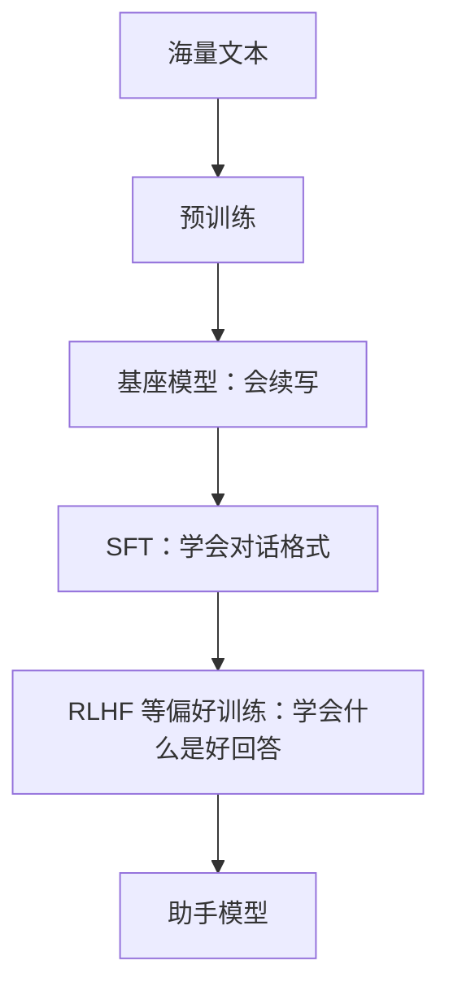
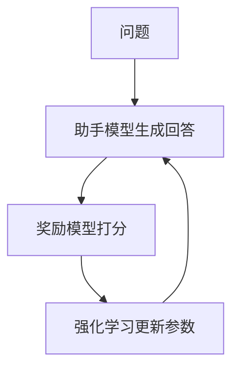

# SFT 与 RLHF

预训练出来的基座模型博学，但不懂「规矩」：它不知道自己应该回答问题，不知道该怎么拒绝有害请求，也不知道怎样的回答才算好。把它变成 ChatGPT、Claude 这样的助手，需要在预训练之后再经过**后训练**（post-training）。后训练主要包括两类方法：**监督微调**（SFT）和**基于人类反馈的强化学习**（RLHF）。



## 一个比喻

可以把三个阶段类比成培养一名新员工：

| 阶段 | 比喻 | 学到什么 |
|---|---|---|
| 预训练 | 读完图书馆里所有的书 | 知识、语言、思维方式 |
| SFT | 看大量优秀前辈的工作示范 | 怎样的格式和态度是专业的 |
| RLHF | 工作中不断收到「这个好、那个不好」的反馈 | 在各种情况下做出更好的判断 |

后两个阶段几乎不增加新知识，它们改变的是**行为方式**：怎么用已有的知识来回应人。

## 监督微调（SFT）

### 做法

准备一批高质量的「指令 + 理想回答」示范数据，用和预训练完全一样的方式（预测下一个 token）继续训练模型。

```text
用户：用一句话解释什么是递归。
助手：递归是一个函数在定义中调用自身，把大问题拆成同类的小问题，直到遇到可以直接解决的最小情况。
```

这样的示范通常有数万到数十万条，覆盖问答、写作、编程、数学、角色扮演、拒绝不当请求等各种场景。早期主要由专业标注员手写；现在也大量使用更强的模型生成、再由人筛选修改。

### 对话模板

为了让模型分清谁在说话，SFT 数据会被包装成固定的格式，用特殊 token 标记角色：

```text
<|system|>你是一个乐于助人的助手。
<|user|>用一句话解释什么是递归。
<|assistant|>递归是一个函数在定义中调用自身……<|end|>
```

（不同模型的标记各不相同，这里只是示意。）

模型由此学会：看到 `<|assistant|>` 就该以助手的身份作答，答完输出结束标记。我们平时调用 API 时传入的 `system`、`user`、`assistant` 消息，最终都会被拼成这样一段文本送进模型。

### SFT 的局限

SFT 让模型学会了**模仿**示范，但有两个问题：

1. **示范很贵**：写出高质量的长回答需要专业的人花大量时间
2. **模仿有上限**：模型只学到了「示范长什么样」，没学到「为什么这个回答比那个好」。遇到示范里没有的情况，它不知道该怎么权衡

而现实中，评价一个回答的好坏，往往比写出一个好回答容易得多。这引出了 RLHF。

## 基于人类反馈的强化学习（RLHF）

RLHF 的核心思想是：**不教模型怎么写，而是告诉它哪个写得更好**。2022 年 OpenAI 的 InstructGPT 论文让这套方法广为人知，它也是 ChatGPT 好用的关键原因之一。

### 第一步：收集偏好

让模型对同一个问题生成几个不同的回答，请人来比较排序：

```text
问题：我的代码报错 "undefined is not a function"，怎么办？

回答 A：检查一下代码。
回答 B：这个错误通常表示你调用的东西不是函数。常见原因有三个：……（附排查步骤）
回答 C：（一大段与问题无关的 JavaScript 历史介绍）

人的判断：B > A > C
```

这样的比较数据通常收集几十万条。

### 第二步：训练奖励模型

用这些比较数据训练一个**奖励模型**（reward model）：输入一个问题和一个回答，输出一个分数，表示人类大概会多喜欢这个回答。

奖励模型相当于把成千上万个标注员的判断，「压缩」成了一个可以自动打分的裁判。

### 第三步：强化学习

让助手模型不断生成回答，由奖励模型打分，然后用强化学习算法（早期常用 PPO）调整模型参数：**高分回答的写法被强化，低分回答的写法被抑制**。



这里还有一个重要约束：模型不能偏离原来太远。否则它可能找到奖励模型的漏洞，比如发现「回答越长分越高」，于是开始写又长又空的废话。这种现象叫**奖励黑客**（reward hacking）。

## RLHF 之后的发展

RLHF 效果很好，但流程复杂、训练不稳定。此后出现了很多改进方法：

| 方法 | 思路 |
|---|---|
| DPO（直接偏好优化） | 跳过奖励模型，直接用「A 比 B 好」的数据调整模型，更简单稳定 |
| RLAIF / 宪法式 AI | 用 AI 代替人来做偏好判断，依据一份明确写下的原则（Anthropic 提出的 Constitutional AI 是代表） |
| 基于可验证奖励的强化学习 | 数学题看答案对不对、代码看测试过没过，用客观结果当奖励 |

最后一种方法在近两年尤其重要：它让模型在数学和编程这类有标准答案的任务上，通过大量练习学会更长、更严谨的推理过程。所谓的「推理模型」（会先长时间思考再回答的模型），很大程度上就是这样训练出来的。

## 对齐

SFT 和 RLHF 这类工作，统称为**对齐**（alignment）：让模型的行为符合人类的意图和价值观。对齐通常追求三个目标，常被概括为 **HHH**：

- **有帮助**（Helpful）：真正解决用户的问题
- **诚实**（Honest）：不编造，不确定时说不确定
- **无害**（Harmless）：不协助造成伤害

三者之间常常需要权衡。过度强调无害，模型会变得畏首畏尾、动不动就拒绝；过度强调有帮助，又可能协助做危险的事。各家模型的「性格」差异，很大程度上来自后训练阶段的不同取舍。

## 本章要点

- 后训练改变的是模型的**行为方式**，几乎不增加新知识
- **SFT** 用「指令 + 理想回答」的示范教模型对话格式和基本态度
- **RLHF** 让人比较回答的好坏，训练奖励模型，再用强化学习优化模型
- 要防止**奖励黑客**：模型钻奖励模型的空子
- DPO、AI 反馈、可验证奖励等方法让后训练更简单、更强，推理模型由此而来
- 对齐追求**有帮助、诚实、无害**，三者之间需要权衡
