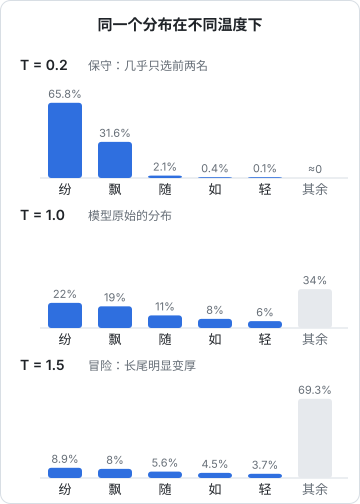

# 推理与采样

训练完成后，模型被部署出来供人使用，这个阶段叫**推理**（inference）。注意，这里的「推理」是工程术语，指「用训练好的模型计算输出」，和「逻辑推理」不是一回事。

这一章讲两件事：模型每一步是怎么**选出**下一个 token 的（采样），以及推理过程中有哪些影响速度和成本的因素。理解了这些，API 里那些 `temperature`、`top_p`、`max_tokens` 参数就不再神秘。

## 每一步都是一个概率分布

第 4 章讲过，模型每一步输出的是**词表里每个 token 的概率**：

```text
前文："写一首关于秋天的诗：\n落叶"
下一个 token：
  纷      22%
  飘      19%
  随      11%
  如      8%
  轻      6%
  ……
```

拿到这个分布之后，怎么选出一个 token？这就是**采样策略**。

## 贪心解码

最简单的办法：**每次都选概率最高的那个**。这叫贪心解码（greedy decoding）。

优点是稳定、可复现。缺点是容易单调、重复，甚至陷入循环：

```text
我很喜欢这个产品，我很喜欢这个产品，我很喜欢这个产品……
```

而且每一步选最优，整体不一定最优。人写文章也不是每个字都挑最常见的那个。

## 随机采样

另一个办法：**按概率随机抽**。「纷」有 22% 的机会被选中，「飘」有 19%，以此类推。这样输出更自然、更多样，但也带来风险：词表有几万个 token，长尾里那些概率很低的奇怪 token 加起来也有不小的机会被抽中，一旦抽中，后面就可能越写越离谱。

所以实践中会在随机采样的基础上加几个「旋钮」来控制。

### temperature：调节随机程度

**temperature**（温度）在 softmax 之前把模型输出的分数统一除以一个数 $T$：

$$
p_i = \frac{e^{z_i / T}}{\sum_j e^{z_j / T}}
$$

效果是：

| 温度 | 分布形状 | 表现 |
|---|---|---|
| 接近 0 | 极其尖锐，几乎全部概率集中在第一名 | 接近贪心，稳定、保守 |
| 1 | 模型原始的分布 | 默认状态 |
| 大于 1 | 被拉平，冷门 token 机会变大 | 更有创意，也更容易胡言乱语 |



图中「其余」是词表里其他几万个 token 的概率之和。温度升高时，前几名的概率被摊薄，长尾的总份额从 34% 涨到了 69%。

经验上：

- 代码、数据提取、分类：用低温度（0 到 0.3）
- 日常对话、通用写作：用默认值（约 0.7 到 1）
- 头脑风暴、创意写作：可以稍高一点

### top-k 与 top-p：截掉长尾

另一类办法是直接**把不靠谱的候选排除掉**，只在靠前的候选里抽：

- **top-k**：只保留概率最高的 k 个 token，比如 k=40
- **top-p**（也叫核采样）：从高到低累加概率，凑够 p（比如 0.9）就停，只在这些 token 里抽

top-p 比 top-k 更灵活：模型很确定时（第一名占 95%），候选可能只剩一两个；模型拿不准时，候选会自动变多。

通常只调 temperature 或 top-p 其中一个就够了，同时大幅调整两个容易让效果难以预测。

## 停止生成

模型会一直生成下去，直到遇到下面任一情况：

1. 生成了**结束 token**：SFT 阶段学到的「回答完了」的标记
2. 达到 **max_tokens** 上限：API 里设的最大输出长度，到了就强制截断
3. 遇到 **stop 序列**：你指定的某个字符串，比如 `\n\n` 或 `</answer>`

如果你发现 API 返回的回答莫名其妙断在半句话，多半是撞上了 max_tokens。

## 推理为什么慢、为什么贵

### 输入和输出的速度不一样

处理一次请求分两个阶段：

| 阶段 | 做什么 | 特点 |
|---|---|---|
| 预填充（prefill） | 把你的整段输入一次性送进模型 | 所有 token 可以并行计算，很快 |
| 解码（decode） | 一个一个生成输出 token | 每个 token 都要跑一遍完整模型，只能串行 |

这解释了两个常见现象：

- API 里**输出 token 的单价通常是输入的好几倍**
- 流式输出时，第一个字出来要等一会儿（预填充 + 排队），之后文字以稳定的速度往外冒

### KV Cache

自回归生成时，每生成一个新 token，都要让它和前面所有 token 做注意力计算。前面那些 token 的 Key 和 Value 其实没有变，每次重新算一遍太浪费。

所以推理时会把已经算过的 K 和 V 存起来，这叫 **KV Cache**。生成新 token 时只需要算新 token 自己的 Q、K、V，再和缓存里的 K、V 做注意力即可。

代价是 KV Cache 非常占显存，上下文越长占得越多。这是长上下文推理昂贵的另一个原因。

### Prompt 缓存

很多应用每次请求都带着同样的长开头：同一份 system prompt、同一份文档、同一套工具定义。服务商会把这部分前缀的计算结果缓存下来，下次请求遇到相同前缀就直接复用。这就是 API 里的 **prompt caching**，命中缓存的输入通常便宜很多、也更快。

设计 prompt 时把**不变的内容放在前面、变化的内容放在后面**，就能更好地利用缓存。这在《大模型应用工程》里会详细讲。

## 为什么同一个问题每次回答不一样

现在可以回答这个常见疑问了：

- 默认温度下是**随机采样**，每次抽到的 token 可能不同
- 第一个 token 不同，后续的上下文就不同，差异会滚雪球般放大
- 即使温度设为 0，由于 GPU 并行计算的浮点误差、批处理方式不同等原因，结果也不保证完全一致

所以如果你的应用需要稳定输出，要用低温度，配合结构化输出约束，并且在应用层做好校验，而不是指望模型每次都给一模一样的答案。

## 本章要点

- 模型每一步输出一个概率分布，**采样策略**决定选哪个 token
- **temperature** 调节随机程度：低温稳定保守，高温多样冒险
- **top-k / top-p** 截掉概率长尾，避免抽中离谱的 token
- 生成在遇到结束 token、max_tokens 或 stop 序列时停止
- 输入可以并行处理（快），输出只能逐个生成（慢、贵）
- **KV Cache** 和 **Prompt 缓存**是推理提速降本的关键技术
- 回答不一致是采样随机性和计算细节共同造成的，应用层要做好应对
