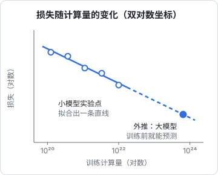

# Scaling Law

过去几年 AI 进步之快，背后有一条朴素到近乎粗暴的经验规律：**模型越大、数据越多、算力越多，效果就越好，而且好得可以预测**。这条规律叫 **Scaling Law**（规模定律）。它解释了为什么各家公司愿意砸下数十亿美元建数据中心，也是理解 AI 未来走向的一把钥匙。

## 三个变量

决定模型效果的主要有三个量：

| 变量 | 符号 | 含义 |
|---|---|---|
| 参数量 | $N$ | 模型有多少个参数 |
| 数据量 | $D$ | 训练时看了多少个 token |
| 计算量 | $C$ | 训练总共做了多少次运算，大约正比于 $N \times D$ |

计算量有一个常用的估算公式：

$$
C \approx 6ND
$$

比如一个 700 亿参数的模型训练 2 万亿个 token，总计算量约为 $6 \times 7\times10^{10} \times 2\times10^{12} \approx 8.4\times10^{23}$ 次浮点运算。

## 规律长什么样

2020 年，OpenAI 的研究人员（Kaplan 等人）系统地训练了大量不同规模的模型，发现了一个惊人的现象：

> 模型的损失随参数量、数据量、计算量的增长，呈现非常平滑的**幂律**下降。

幂律的意思是：

$$
L(N) \approx \left(\frac{N_c}{N}\right)^{\alpha}
$$

其中 $L$ 是损失，$N_c$ 和 $\alpha$ 是从实验中拟合出的常数。

把它画在横纵轴都取对数的坐标图上，就是一条**直线**。这意味着：

- 每把规模扩大 10 倍，损失就按固定比例下降
- 可以先用小模型做实验，拟合出这条直线，再**预测**大模型训练完会达到什么效果

这种可预测性极其重要：训练一个前沿模型要花几个月和巨额资金，Scaling Law 让公司在花钱之前就能大致知道会得到什么。

## Chinchilla：数据和参数要一起涨

早期大家倾向于把钱主要花在**加大模型**上。GPT-3 有 1750 亿参数，但只训练了约 3000 亿 token。

2022 年，DeepMind 的 Chinchilla 论文重新研究了这个问题：在计算预算固定的情况下，参数和数据该怎么分配？结论是：

> 参数量和数据量应该**同比例增长**。粗略的经验值是，每个参数大约对应 20 个训练 token。

按这个标准，GPT-3 严重「训练不足」。DeepMind 用同样的计算量训练了一个只有 700 亿参数、但看了 1.4 万亿 token 的 Chinchilla，效果反而超过了参数大得多的模型。

### 之后的趋势：小模型多喂数据

Chinchilla 回答的是「训练时怎么最省」。但模型训练完要**长期提供服务**，推理成本和参数量直接相关。所以后来的趋势是：**用远超 20 倍的数据去训练相对小的模型**，多花一次训练成本，换来以后每次推理都更便宜。

今天常见的中小型开源模型，训练数据量往往是参数量的几百倍以上。这也是为什么现在一个几十亿参数的小模型，能力可以超过几年前上千亿参数的大模型。

## 涌现

随着规模扩大，研究者还观察到一个现象：某些能力在小模型上几乎没有，到了某个规模之后**突然出现**。比如多步算术、理解隐喻、按示例完成新任务等。这被称为**涌现**（emergence）。

关于涌现是否真的「突然」，学界有争论。有研究指出，如果换一种更平滑的评价指标，很多能力其实是逐步提高的，只是在「全对才算对」这种严格指标下看起来像突变。但无论如何，一个共识是：**规模扩大会持续带来新的、事先难以预料的能力**。

## 新的扩展方向

单纯靠堆参数和数据，会遇到几个瓶颈：

- **数据快用完了**：高质量的公开人类文本是有限的
- **成本极高**：每一代前沿模型的训练成本都在成倍上涨
- **边际收益**：幂律意味着要获得同样的提升，投入需要成倍增加

于是业界开始寻找新的扩展维度：

| 扩展方向 | 思路 |
|---|---|
| 合成数据 | 用强模型生成高质量训练数据，尤其是数学、代码这类可验证的领域 |
| 后训练的强化学习 | 在可验证的任务上大量练习，提升推理能力（见第 6 章） |
| 推理时计算 | 让模型在回答前「多想一会儿」，用更多推理计算换更好的答案 |
| 多模态数据 | 图像、视频、音频提供了大量新的数据来源 |
| 架构效率 | MoE 等技术让模型参数多、但每次只激活一部分，降低成本 |

**推理时计算**（test-time compute）尤其值得关注：研究发现，让模型在回答前生成一长串思考过程，效果也随思考长度呈现类似的扩展规律。这意味着「训练更大的模型」不再是提升能力的唯一途径，「让模型想得更久」也可以。

这改变了算力花在哪里。过去，绝大部分算力花在训练上，训练完之后每次回答的成本基本固定；现在，一部分「变聪明」的成本挪到了每一次回答里：难题多想、简单题少想。对使用者来说，这意味着同一个模型的价格和速度不再是固定值，而取决于你让它想多久。推理模型是怎么训练出来的、为什么更贵更慢，见[第 6 章的推理模型一节](06-sft-rlhf.md#推理模型先想再答)。

## 对你意味着什么

即使不训练模型，理解 Scaling Law 也有实际用处：

- **对趋势要有预期**：同样的能力会越来越便宜，今天贵的模型，一年后可能有便宜得多的替代品
- **别过度优化当前模型的缺陷**：很多今天需要复杂工程来弥补的短板，下一代模型可能直接解决了
- **小模型值得认真考虑**：对许多具体任务，一个便宜的小模型已经足够好
- **长期押注「模型会更强」**：做产品时，设计成「模型越强、产品越好」的结构，而不是靠绕开模型的弱点来建立壁垒

## 本章要点

- 模型效果主要由**参数量、数据量、计算量**决定，训练计算量约为 $6ND$
- 损失随规模呈**幂律**下降，可以用小模型预测大模型的效果
- **Chinchilla** 指出参数和数据要同比例增长；后来的趋势是用更多数据训练更小的模型
- 规模扩大会带来**涌现**的新能力
- 数据和成本瓶颈催生了新方向：合成数据、强化学习、**推理时计算**、MoE
- 对做产品的人来说：能力会越来越便宜，产品应该随模型变强而变好
