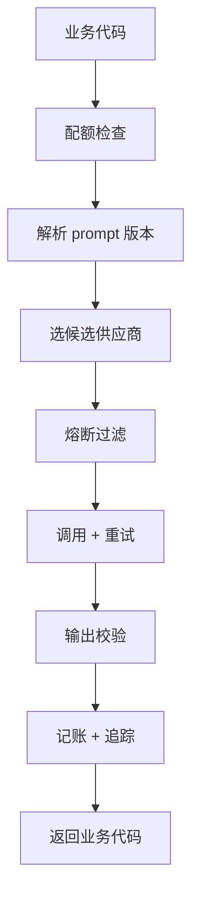

# 模型网关

一个 AI 功能刚上线时，代码里通常只有一个 `fetch` 或一个 SDK 调用：拼好 prompt，发出去，解析结果。等到第二个功能、第二家供应商、第一次月底账单超预算、第一次有用户说「它昨天还认得出来」，你会发现同样的问题在每个调用点都要解决一遍：重试、换家、记账、限额、记下用的是哪版 prompt。这一章先说明为什么要把这些事收拢到一层**模型网关**里，网关该管什么、不该管什么，再给出贯穿全书的 TypeScript 骨架。

## 这本书讲什么、适合谁、怎么读

[《大模型应用工程》](../llm-app-engineering/)讲的是「怎么把一次模型调用写对」：prompt、结构化输出、工具调用、流式、缓存、成本估算、错误重试。这本书讲的是**调用进了生产环境之后的事**：

| 章 | 解决的问题 |
|---|---|
| 1 模型网关 | 为什么要有一层，以及它的骨架 |
| 2 多供应商与降级 | 一家挂了怎么办，怎么知道它挂了 |
| 3 限流与配额 | 别被上游限流打穿，别让一个用户烧光预算 |
| 4 成本监控 | 每一分钱花在哪个租户、哪个功能上，毛利是正是负 |
| 5 Prompt 版本管理 | 改 prompt 像发版一样可灰度、可回滚、可追溯 |
| 6 观测与追踪 | 质量和故障怎么看见 |
| 7 Prompt 注入防护 | 用户的输入想篡改你的指令时怎么办 |
| 8 数据合规 | 哪些数据发给了谁，要守哪些边界 |

**适合谁**：已经在产品里接了模型 API、准备给真实用户用的独立开发者。默认你熟悉 TypeScript、NestJS、Postgres 和 Drizzle，读过《大模型应用工程》，知道 token 计费和指数退避是怎么回事；可观测性的基础（结构化日志、Prometheus、OpenTelemetry）在[《可观测性与性能》](../observability-performance/)里，本书只讲大模型特有的部分。

**怎么读**：按顺序读。第 1 章搭骨架，第 2–6 章每章往骨架上加一个环节，第 7、8 章讲安全和合规。全书的案例是同一个：给 hatch-counter（掌柜眼）的进货单识别服务加一层模型网关。

## 案例：从一条降级链出发

hatch-counter 是给中小餐饮门店用的经营管理工具，店主拍一张手写进货单，服务端调视觉大模型把它读成结构化的行项目。它现在的识别服务已经做得相当扎实（详见[《大模型应用工程》第 9 章](../llm-app-engineering/09-errors-retries.md)）：

- 候选服务商在后台配置成一张有优先级的清单，智谱的视觉模型和腾讯云 OCR 都在上面
- 失败分成 `busy`、`provider`、`unreadable`、`input` 四类，各有各的重试和降级策略
- 单次 90 秒超时，整条链 150 秒总时限，nginx 对应路径 180 秒
- 识别成功后，用 `AsyncLocalStorage` 旁路记下实际干活的是哪一家，按那一家的单价记成本

这已经是一个「小网关」的雏形了，但它只服务识别这一个场景。设想接下来要做的几件事：

1. 新加「根据进货记录给出采购建议」的文本功能，也要降级、记账
2. 免费试用的门店每天只能识别 20 张，付费门店不限但要防滥用
3. 想看每家店每月的识别成本和订阅费的比值
4. 改了识别 prompt 之后，某家供货商的单子识别率掉了，想知道是哪次改动、能不能只回滚这一家
5. 店主改了识别结果里的数字，这是一个质量信号，想把它和当时的模型、prompt 版本关联起来

每一件都可以在识别模块里继续加代码，但第 1 件一来，你就得把这些逻辑复制一份。**本书把它们提炼成一个通用的网关模块**，识别和采购建议都通过它调模型。

> 说明：下面的网关是在 hatch-counter 现有降级链基础上的**演进设计**，用来讲清原理，并不是仓库的现状。代码可以直接照着写，但字段名、表结构要按你自己的项目调整。

## 网关管什么

把「调模型」看成一次请求穿过一串关卡：



| 关卡 | 职责 | 在第几章 |
|---|---|---|
| 配额检查 | 这个租户、这个功能今天还能不能用；全局花费是否触顶 | 3 |
| 解析 prompt 版本 | 按功能和灰度规则选出这次用哪版 prompt | 5 |
| 选候选 | 按能力、优先级筛出可用的供应商 | 2 |
| 熔断过滤 | 刚刚连续失败的供应商暂时跳过 | 2 |
| 调用 + 重试 | 按错误分类决定重试、换家还是停 | 2 |
| 输出校验 | schema 校验、业务校验，软错误也算失败 | 2、7 |
| 记账 + 追踪 | token、单价、耗时、版本、哪家成功，写库并上报 span | 4、6 |

这些关卡有一个共同点：**它们和具体业务无关**。识别单据也好，生成采购建议也好，都需要它们。业务代码只该关心「我要做什么、输入是什么、要什么形状的结果」。

### 不该管什么

网关同样要有边界，否则会变成一个什么都管的大泥球：

- **不管 prompt 的业务内容**。识别 prompt 里「算式要拆开」这种规则属于识别模块，网关只负责按 ID 和版本取出它
- **不管业务结果的含义**。「数量 × 单价和金额对不上」交给识别模块和店主确认，网关只做「是不是合法 JSON、符不符合 schema」
- **不管给用户的文案**。网关抛出带分类的错误，业务层决定对店主说什么。hatch-counter 那句「换张更清楚的照片」只有识别模块知道该怎么说
- **不管工具调用循环**。agent loop 是更上一层的东西，网关只负责其中每一次模型调用

## 买还是自己写

市面上有现成的 LLM 网关，大致三类：

| 形态 | 代表 | 优点 | 代价 |
|---|---|---|---|
| 托管代理 | Cloudflare AI Gateway、OpenRouter 一类 | 零运维，自带日志、缓存、统一账单 | 多一跳网络；数据经过第三方；国内供应商覆盖不一定全 |
| 自托管代理 | LiteLLM Proxy 一类 | 统一 OpenAI 兼容接口，配置化路由和预算 | 多一个要运维的服务和它的数据库；Python 生态 |
| 进程内库 | 自己写的模块，或 Vercel AI SDK 这类多供应商 SDK | 没有额外跳数，和业务数据库、租户模型天然结合 | 要自己写配额、记账、追踪 |

各家的功能和定价变化很快，选之前以官方文档为准。对一人公司做判断，看三个问题：

1. **配额和成本要不要按你自己的租户算？** hatch-counter 的配额按门店、按套餐，成本要和订阅费对比。这些信息在业务库里，托管代理看不到，最多按 API key 分组
2. **数据能不能经过第三方？** 进货单上有供货商名字和电话。多一个中间方，就多一份要在隐私政策里说明的数据流向（第 8 章）
3. **你的供应商它支持吗？** 国内的视觉模型、腾讯云 OCR 这类非对话式接口，通用网关往往不支持或支持得不完整

hatch-counter 三条都指向「进程内自己写」。而且规模很小：一个 NestJS 模块、两三张表、几百行代码。**本书选择进程内模块**，但讲的每个环节（熔断、令牌桶、价格表、灰度）都是通用原理，换成自托管代理也一样要配置这些东西。

一个折中方案也值得考虑：进程内模块负责租户配额、记账、prompt 版本，底层的「统一多家接口」交给多供应商 SDK。本书为了讲清楚原理，适配器自己写。

## 骨架：类型先行

先定义网关对外的契约。放在 `apps/api/src/llm-gateway/types.ts`：

```typescript
// llm-gateway/types.ts

/** 一个功能要求供应商具备的能力。降级时按它筛，不能挨个往下试 */
export type Capability = "text" | "vision" | "table-vision" | "ocr-blocks";

/** 失败分类沿用识别链的四类，网关里所有供应商共用这一份 */
export type FailureKind = "busy" | "provider" | "unreadable" | "input";

export class GatewayError extends Error {
  constructor(
    readonly kind: FailureKind | "quota" | "budget" | "deadline",
    message: string,
    readonly detail?: { provider?: string; status?: number },
    options?: { cause?: unknown },
  ) {
    super(message, options);
    this.name = "GatewayError";
  }
}

/** 业务代码发给网关的请求：说做什么，不说找谁做 */
export interface GatewayRequest<TOut> {
  feature: string;                 // receipt_scan、purchase_advice……
  tenantId: string;                // 门店 ID，配额和成本按它算
  capability: Capability;
  promptId: string;                // 第 5 章：网关按它解析出具体版本
  vars: Record<string, string>;    // 填进 prompt 模板的变量
  images?: { base64: string; mime: string }[];
  parse: (text: string) => TOut;   // 结构化解析 + 校验，抛错即视为 unreadable
  deadlineMs?: number;             // 整次调用的总时限
}

/** 适配器把各家的返回统一成这个形状 */
export interface ProviderResult {
  text: string;
  model: string;                   // 实际响应的模型 ID
  finishReason: string | null;
  usage: { inputTokens: number; outputTokens: number; cacheReadTokens?: number; units?: number };
}

/** 网关返回给业务代码的结果 */
export interface GatewayResult<TOut> {
  value: TOut;
  callId: string;                  // llm_calls 表的主键，用来回填质量信号
  provider: string;                // 实际干活的供应商条目 ID
  promptVersion: string;
}
```

几个设计选择值得解释：

- **业务代码只说 `capability`，不说 `provider`**。和 hatch-counter 现有的约定一致：客户端连「用的是哪家」都不问。一旦业务代码里写死了供应商，降级就无从谈起
- **`parse` 由业务方传进来**。网关不知道识别结果长什么样，但它需要知道「这个结果能不能用」，以便把解析失败当成 `unreadable` 去降级
- **`usage.units` 给按次计费的接口用**。腾讯云 OCR 这类接口按调用次数计价，没有 token 的概念，第 4 章的价格表会同时支持两种计价方式
- **返回 `callId`**。店主后来修改识别结果时，业务层拿这个 ID 回填「被修改了几处」，第 6 章用它衡量质量

## 骨架：管线

网关主体是一个按顺序穿过各关卡的函数。先给出完整的形状，各环节的实现留给后面几章：

```typescript
// llm-gateway/gateway.service.ts
import { Injectable } from "@nestjs/common";
import { randomUUID } from "node:crypto";
import { QuotaService, type QuotaLease } from "./quota.service";
import { PromptRegistry } from "./prompt-registry";
import { Router } from "./router";
import { Ledger } from "./ledger";
import { tracer } from "./tracing";
import { GatewayError, type GatewayRequest, type GatewayResult } from "./types";

@Injectable()
export class LlmGateway {
  constructor(
    private readonly quota: QuotaService,
    private readonly prompts: PromptRegistry,
    private readonly router: Router,
    private readonly ledger: Ledger,
  ) {}

  async call<TOut>(req: GatewayRequest<TOut>): Promise<GatewayResult<TOut>> {
    const callId = randomUUID();
    return tracer.startActiveSpan(`llm ${req.feature}`, async (span) => {
      let lease: QuotaLease | undefined;
      try {
        // 第 3 章：先占额度，失败直接拒，不碰上游
        lease = await this.quota.reserve(req.tenantId, req.feature);

        // 第 5 章：同一个门店在灰度期内总是拿到同一版
        const prompt = await this.prompts.resolve(req.promptId, req.tenantId);

        // 第 2 章：按能力筛候选、跳过熔断中的、按错误分类重试和降级
        const outcome = await this.router.run(req, prompt, callId);

        // 第 4 章：记账（失败的尝试也记，它们可能同样计费）
        await this.ledger.record({ callId, req, prompt, outcome });

        return {
          value: outcome.value,
          callId,
          provider: outcome.providerId,
          promptVersion: prompt.version,
        };
      } catch (err) {
        if (err instanceof GatewayError) span.setAttribute("error.type", err.kind);
        // 整条链都没成不是店主的错，占掉的额度退回去
        await lease?.release();
        throw err;
      } finally {
        span.end();
      }
    });
  }
}
```

业务侧的调用变得很薄。识别模块的 `scan()` 改成：

```typescript
// ocr/ocr.service.ts（改造后）
async scan(storeId: string, image: OcrImage, layout?: string | null) {
  const { value, callId } = await this.gateway.call({
    feature: "receipt_scan",
    tenantId: storeId,
    capability: "vision",
    promptId: "receipt-scan",
    vars: { layout: layout?.trim() || DEFAULT_LAYOUT },
    images: [image],
    parse: parseReceiptJson,       // 宽容解析 + zod 校验，失败即抛错
    deadlineMs: 150_000,
  });
  return { ...value, callId };
}
```

注意 150 秒的总时限从识别模块传进来，而不是写死在网关里：采购建议这种文本功能，总时限可能只有 20 秒。**时限属于功能，不属于网关**。

## 一个进程内网关的代价

自己写网关不是免费的。上线前想清楚三件事：

- **它在关键路径上**。网关的 bug 会让所有 AI 功能一起挂。所以每个关卡都要有「自身出错时放行还是拒绝」的明确策略：配额服务查库失败时，hatch-counter 选择放行并告警（宁可多花点钱，也不让店主拍照认单用不了）；记账写库失败时，只打日志不影响返回
- **它有状态**。熔断状态、令牌桶在进程内存里，多实例部署时每个实例各算各的。一台 VPS 跑一个 API 进程时这不是问题；扩到多实例时，限流要搬到 Postgres 或 Redis（第 3 章讨论）
- **它要测试**。降级链的四种错各怎么退、配额边界、灰度分桶，都要有自动化测试，测试里把上游打到本地假端点。hatch-counter 用环境变量 `HATCH_TEST_OCR_BASE_URL` 把请求导向假服务，就是这个思路

## 本章要点

- 第二个 AI 功能出现时，重试、降级、配额、记账、版本、追踪就该收拢到一层网关里，而不是在每个调用点复制
- 网关是一串与业务无关的关卡：配额 → prompt 版本 → 选候选 → 熔断 → 调用重试 → 输出校验 → 记账追踪
- 网关不管 prompt 的业务内容、结果的业务含义和给用户的文案，这些留在业务模块
- 托管代理、自托管代理、进程内库各有取舍；配额和成本要按自己的租户算、数据不想多经一手、供应商不常见时，进程内模块最合适
- 业务代码只说功能、能力和 prompt ID，不说找哪家；总时限属于功能，由业务方传入
- 网关在关键路径上、有状态、要测试，每个关卡都要定好「自己出错时怎么办」
