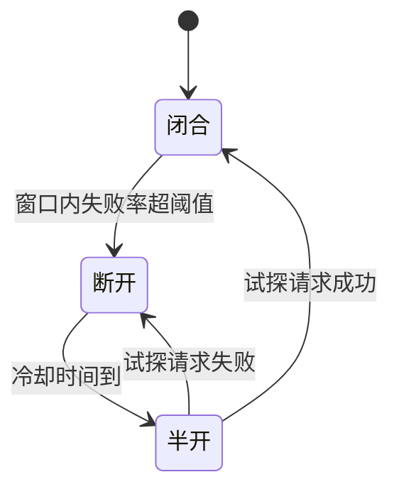

# 多供应商与降级

只接一家模型供应商，你的 AI 功能的可用性就等于那一家的可用性，外加你自己的网络。hatch-counter 最初只配了一条智谱，结果是「智谱忙的时候常回 429，只配一家的话整条识别就停在那儿」，这句话后来写进了它的服务端约束文档。这一章把第 1 章骨架里的 `Router` 填上：怎么把几家接口不同的供应商统一成一个形状，怎么按能力挑候选，怎么用熔断器避免在一家已经挂掉的服务上反复白等，以及多供应商带来的新问题：换了一家，结果还一样好吗？

《大模型应用工程》第 9 章已经讲过错误分类、指数退避和 hatch-counter 的四类失败，这里不再重复，直接在它们之上搭建。

## 多一家能换来多少

先算一笔账。假设每家供应商在任意时刻可用的概率是 $a$，且各家故障**相互独立**，那么配 $n$ 家、全部挂掉才失败时，整体可用性是：

$$
A = 1 - (1 - a)^n
$$

按一个月 30 天、43200 分钟换算成不可用时间：

| 单家可用性 $a$ | 1 家 | 2 家 | 3 家 |
|---|---|---|---|
| 95% | 约 2160 分钟 | 约 108 分钟 | 约 5.4 分钟 |
| 99% | 约 432 分钟 | 约 4.3 分钟 | 约 0.04 分钟 |

第二家带来的提升是数量级的，第三家的边际收益就小得多了。但这张表建立在「相互独立」的假设上，现实中它常常不成立：

- **同一家的两个账号不独立**。hatch-counter 链上的「智谱主号」和「智谱备用号」，在智谱整体过载时会一起 429。备用号能解决的是单个账号的额度和限速问题，不是服务商故障
- **同一个上游不独立**。一些转售或聚合服务底层调的是同一个模型，上游挂了它们一起挂
- **你自己的出口不独立**。服务器到公网的网络断了，配几家都没用

所以选第二家时，**优先选不同公司、不同基础设施的服务**。hatch-counter 把腾讯云 OCR 放在链上，除了价格，另一个理由就是它和智谱的故障基本无关。

## 适配器：把各家统一成一个形状

各家的接口差异不小：

| 维度 | Anthropic Messages | OpenAI 兼容（智谱等） | 传统 OCR（腾讯云等） |
|---|---|---|---|
| 鉴权 | `x-api-key` 头 | `Authorization: Bearer` | 请求签名 |
| 图片 | content block，`source.type: base64` | `image_url`，data URL | 单独的图片字段 |
| 用量 | `usage.input_tokens` / `output_tokens` | `usage.prompt_tokens` / `completion_tokens` | 没有 token，按次计费 |
| 结束原因 | `stop_reason` | `finish_reason` | 无 |
| 能力 | 文本、视觉 | 视个模型而定 | 只吐文字块，认不了表格 |

适配器的任务就是把这些差异吸收掉，对网关只暴露一个接口：

```typescript
// llm-gateway/providers/adapter.ts
import type { Capability, ProviderResult } from "../types";

export interface ProviderEntry {
  id: string;              // 配置表主键
  kind: "anthropic" | "openai-compat" | "tencent-ocr";
  label: string;           // 只给日志和后台看，永远不出现在给用户的文案里
  model: string;
  baseUrl: string;
  apiKey: string;
  capabilities: Capability[];
  priority: number;
  enabled: boolean;
}

export interface CallInput {
  system: string;
  user: string;
  images: { base64: string; mime: string }[];
  maxTokens: number;
  signal: AbortSignal;
}

export interface ProviderAdapter {
  call(entry: ProviderEntry, input: CallInput): Promise<ProviderResult>;
}
```

OpenAI 兼容接口的适配器大致如下。重点是**所有失败都在适配器里转换成带分类的 `GatewayError`**，网关的其余部分只认这一种错误：

```typescript
// llm-gateway/providers/openai-compat.ts
import { GatewayError, type FailureKind } from "../types";
import type { CallInput, ProviderAdapter, ProviderEntry } from "./adapter";

export function kindOfStatus(status: number): FailureKind {
  if (status === 429 || status >= 500) return "busy";
  if (status === 400 || status === 413 || status === 415) return "input";
  return "provider"; // 401、403、404 和其他 4xx：这一家这次不可能成
}

export const openaiCompat: ProviderAdapter = {
  async call(entry: ProviderEntry, input: CallInput) {
    const content = [
      ...input.images.map((img) => ({
        type: "image_url",
        image_url: { url: `data:${img.mime};base64,${img.base64}` },
      })),
      { type: "text", text: input.user },
    ];

    let res: Response;
    try {
      res = await fetch(`${entry.baseUrl.replace(/\/+$/, "")}/chat/completions`, {
        method: "POST",
        headers: { "content-type": "application/json", authorization: `Bearer ${entry.apiKey}` },
        body: JSON.stringify({
          model: entry.model,
          max_tokens: input.maxTokens,
          messages: [
            { role: "system", content: input.system },
            { role: "user", content },
          ],
        }),
        signal: input.signal,
      });
    } catch (err) {
      // 超时、DNS、连接被拒：都是等一会儿可能就好的
      throw new GatewayError("busy", "连不上供应商", { provider: entry.id }, { cause: err });
    }

    if (!res.ok) {
      const body = await res.text().catch(() => "");
      throw new GatewayError(kindOfStatus(res.status), body.slice(0, 200), {
        provider: entry.id,
        status: res.status,
      });
    }

    const json = (await res.json()) as {
      model?: string;
      choices?: { message?: { content?: string }; finish_reason?: string }[];
      usage?: { prompt_tokens?: number; completion_tokens?: number };
    };
    const choice = json.choices?.[0];
    const text = choice?.message?.content ?? "";
    if (!text.trim()) throw new GatewayError("unreadable", "模型返回为空", { provider: entry.id });

    return {
      text,
      model: json.model ?? entry.model,
      finishReason: choice?.finish_reason ?? null,
      usage: {
        inputTokens: json.usage?.prompt_tokens ?? 0,
        outputTokens: json.usage?.completion_tokens ?? 0,
      },
    };
  },
};
```

几个容易漏的细节：

- **错误体截断再记**。有的供应商出错时回一整页 HTML，原样塞进日志和 `last_error` 字段既占地方又难读
- **错误信息里不能带 key**。有的 SDK 会把请求头放进错误对象，记日志前要确认。hatch-counter 的约束是「审计和失败原因里不许出现 key」
- **`finish_reason` 为 `length` 时不要当成功**。输出被截断的 JSON 会在 `parse` 阶段失败，归为 `unreadable`，这是对的；但如果业务不做结构化解析，就要在这里显式检查

## 按能力筛候选

hatch-counter 识别的三个动作里，「按模板逐行取数」和「读表头」只有视觉大模型做得了，腾讯云 OCR 只吐文字块。它的经验是：**降级时必须按能力筛，不能挨个往下试**，否则会退到一个根本做不了这件事的服务商，把一句说得清的报错换成一堆看不懂的东西。

网关里，候选的筛选就是一行过滤：

```typescript
// llm-gateway/router.ts（片段）
const capable = (await this.config.entries())
  .filter((e) => e.enabled && e.apiKey && e.capabilities.includes(req.capability))
  .sort((a, b) => a.priority - b.priority);

// 熔断是优化：全都断开时，宁可按优先级硬试一遍，也不要直接判死刑
const healthy = capable.filter((e) => this.breakers.allow(e.id));
const candidates = healthy.length ? healthy : capable;

if (!candidates.length) {
  throw new GatewayError("provider", `没有可用的供应商能做 ${req.capability}`);
}
```

能力的声明放在配置里，由人在后台维护，而不是靠代码猜。`capabilities` 字段的值要保守：一个模型「勉强能读表格但错误率很高」，就不该标 `table-vision`。宁可让这条路没有备胎、在后台明着显示出来，也不要让降级把用户带到一个质量差得多的结果上。

配置本身放在数据库，在内存里缓存一小段时间（hatch-counter 是 10 秒），改动时顺手清掉缓存。这样调整优先级、停用某家都不用重启服务，在供应商出事的时候尤其重要。

## 熔断：别在挂掉的服务上排队

按错误分类重试已经比「一律重试三次」好得多了，但还有一个问题。假设智谱整体故障了 20 分钟，每一个识别请求都会：在智谱上试 3 次（每次可能等到超时），退避等待 0.8 秒和 2.5 秒，然后才换到腾讯云。每个店主都要多等十几秒甚至几十秒，而这 20 分钟里，第一个请求就已经知道智谱挂了。

**熔断器**（circuit breaker）把「这一家刚刚一直在失败」这个信息记下来，让后面的请求直接跳过它：



| 状态 | 请求怎么走 |
|---|---|
| 闭合（正常） | 正常调用，统计最近的成败 |
| 断开 | 直接跳过这一家，不发请求 |
| 半开 | 冷却期过后放一个试探请求过去，成功就恢复，失败就再断开一段时间 |

一个够用的实现，几十行：

```typescript
// llm-gateway/breaker.ts
type State = { mode: "closed" | "open" | "half-open"; openedAt: number; window: boolean[]; probeAt: number };

export class Breakers {
  private states = new Map<string, State>();

  constructor(
    private readonly opts = { windowSize: 10, minCalls: 5, failRate: 0.5, coolDownMs: 30_000 },
  ) {}

  private get(id: string): State {
    let s = this.states.get(id);
    if (!s) this.states.set(id, (s = { mode: "closed", openedAt: 0, window: [], probeAt: 0 }));
    return s;
  }

  /** 选候选时调用：这一家现在能不能试 */
  allow(id: string): boolean {
    const s = this.get(id);
    if (s.mode === "closed") return true;
    if (s.mode === "open" && Date.now() - s.openedAt >= this.opts.coolDownMs) {
      s.mode = "half-open";
    }
    // 半开时只放一个试探请求，其余的继续跳过。
    // 放出去的试探可能根本没被调用（排在前面的那家先成了），所以试探也有过期时间，
    // 否则这一家会永远卡在半开
    if (s.mode === "half-open" && Date.now() - s.probeAt >= this.opts.coolDownMs) {
      s.probeAt = Date.now();
      return true;
    }
    return false;
  }

  /** 只有 busy 类失败计入：provider 类有自己的处理，input 和 unreadable 不是这一家的健康问题 */
  record(id: string, ok: boolean): void {
    const s = this.get(id);
    if (s.mode === "half-open") {
      s.probeAt = 0;
      if (ok) Object.assign(s, { mode: "closed", window: [] });
      else Object.assign(s, { mode: "open", openedAt: Date.now() });
      return;
    }
    s.window.push(ok);
    if (s.window.length > this.opts.windowSize) s.window.shift();
    const fails = s.window.filter((x) => !x).length;
    if (s.window.length >= this.opts.minCalls && fails / s.window.length >= this.opts.failRate) {
      Object.assign(s, { mode: "open", openedAt: Date.now() });
    }
  }
}
```

几条要想清楚的规则：

- **哪些失败计入熔断**。只有 `busy`（429、5xx、超时）反映的是供应商的健康状况。`input` 是用户的图片有问题，`unreadable` 是这张图这个模型读不出来，都不该让这一家被熔断。`provider`（key 被拒、额度用完）可以直接把这一家标记为长时间断开并告警，因为它不会自己好
- **`minCalls` 防止误判**。凌晨一个请求超时，失败率就是 100%，不能因此断开
- **所有候选都熔断了怎么办**。不要直接报错，退回到忽略熔断、按优先级再试一遍。熔断是优化，不能让它把一次本来有机会成功的请求变成必然失败
- **状态在进程内存里**。单实例够用；多实例时每个实例各自探测，代价只是每个实例多失败几次，通常可以接受

## Router：把它们串起来

把错误分类、熔断、总时限组合成第 1 章骨架里的 `router.run()`：

```typescript
// llm-gateway/router.ts
const ATTEMPTS = 3;
const BACKOFF_MS = [800, 2_500];
const PER_CALL_TIMEOUT_MS = 90_000;

export interface Attempt { providerId: string; ok: boolean; kind?: string; ms: number }

export async function runChain<T>(
  candidates: ProviderEntry[],
  deadlineMs: number,
  tryOnce: (e: ProviderEntry, signal: AbortSignal) => Promise<T>,
  breakers: Breakers,
): Promise<{ value: T; entry: ProviderEntry; attempts: Attempt[] }> {
  const started = Date.now();
  const attempts: Attempt[] = [];
  let last: GatewayError | undefined;

  for (const entry of candidates) {
    for (let n = 1; n <= ATTEMPTS; n++) {
      const left = deadlineMs - (Date.now() - started);
      // 剩下的时间不够一次完整调用，就别开头了
      if (attempts.length && left < PER_CALL_TIMEOUT_MS) {
        throw last ?? new GatewayError("deadline", "超过总时限");
      }
      const t0 = Date.now();
      try {
        const value = await tryOnce(entry, AbortSignal.timeout(Math.min(PER_CALL_TIMEOUT_MS, left)));
        breakers.record(entry.id, true);
        attempts.push({ providerId: entry.id, ok: true, ms: Date.now() - t0 });
        return { value, entry, attempts };
      } catch (err) {
        const e = err instanceof GatewayError ? err : new GatewayError("busy", String(err), {}, { cause: err });
        attempts.push({ providerId: entry.id, ok: false, kind: e.kind, ms: Date.now() - t0 });
        last = e;
        if (e.kind === "input") throw e;                        // 换谁都一样
        if (e.kind === "busy") breakers.record(entry.id, false);
        if (e.kind !== "busy") break;                           // provider / unreadable：换下一家
        if (n < ATTEMPTS) await sleep(BACKOFF_MS[n - 1] ?? 2_500);
      }
    }
  }
  throw last ?? new GatewayError("provider", "没有候选");
}

const sleep = (ms: number) => new Promise((r) => setTimeout(r, ms));
```

`tryOnce` 里做三件事：用适配器调用，用业务方的 `parse` 解析，解析抛错就包装成 `unreadable`。这样「HTTP 成功但结果不能用」的软错误也会触发降级。返回的 `attempts` 交给第 4 章记账（失败的调用也可能计费）和第 6 章追踪。

## 换了一家，结果还一样好吗

多供应商最容易被忽视的问题是：**降级保住了可用性，却可能悄悄降低了质量**。同一个 prompt，换一个模型，输出的格式习惯、对潦草字的识别能力、对「算式要拆开」这类规则的遵循程度都可能不同。

几个应对措施：

- **prompt 可以按供应商分版本**。网关的 prompt 注册表（第 5 章）允许同一个 `promptId` 针对不同 `kind` 有不同的模板。比如某家模型不支持 system 角色，或者需要更明确的 JSON 示例
- **记下实际干活的是哪一家**。hatch-counter 的存档里记的是真正成功的那一家，而不是排第一的那家。没有这个字段，事后就无法按供应商比较质量
- **用同一份测试集评测每一个候选**。上线一家新的备用供应商之前，用历史单据跑一遍，看它和主力的差距是否在可接受范围内。测试集怎么构建、怎么打分，是《评测与质量》的主题
- **在后台把降级率当成一个指标**。主力供应商的成功占比从 98% 掉到 70%，即使用户都拿到了结果，也说明大量请求在用备胎，质量可能已经下滑（第 6 章）

### 对冲请求要慎用

还有一种更激进的做法叫**对冲请求**（hedged request）：主力供应商在一定时间内没返回，就同时向第二家发一个请求，谁先返回用谁。它能压低尾延迟，但代价是一部分请求要付两份钱，而且两份结果可能不一样。对按 token 计费、单次又不便宜的视觉识别来说，这通常不划算；对低延迟要求高、单价低的短文本任务，可以考虑。

## 健康检查与「测一下」

熔断是被动发现故障，主动探测是另一条路。hatch-counter 的后台每一条供应商配置旁边都有一个「测一下」按钮，用一张 640×480 的纯白 PNG 调一次接口，验证 key 能不能通过鉴权。这里有个细节：图的内容无所谓，但**尺寸有所谓**，太小的图会被 OCR 接口以「分辨率太低」挡回来，报的错和 key 不对长得一样。

主动探测的用法：

- **改配置时手动测**。换了 key、换了模型，保存前测一下
- **不建议高频定时探测付费接口**。每分钟一次就是每月四万多次调用，有的还按次计费。真实流量本身就是最好的探测，熔断器已经在利用它了
- **探测和真实调用必须用同一组参数**。hatch-counter 的「测一下」和真调用共用同一个参数构造函数，否则测通了不代表真能用

## 本章要点

- 多一家供应商能让不可用时间下降一个数量级，前提是故障相互独立；同一家的多个账号、同一个上游的多个转售都不独立
- 适配器把鉴权、图片格式、用量字段、结束原因的差异吸收掉，并把所有失败转换成带分类的统一错误
- 降级前先按能力筛候选，能力声明要保守，宁可没有备胎也不要退到做不了这件事的服务上
- 熔断器只统计 `busy` 类失败，用最小样本数防误判；全部熔断时退回忽略熔断再试一遍
- Router 把错误分类、熔断、总时限组合起来，解析失败也算失败并触发降级
- 降级保住可用性但可能降低质量：prompt 可按供应商分版本，记录实际干活的是哪一家，用同一份测试集评测每个候选
