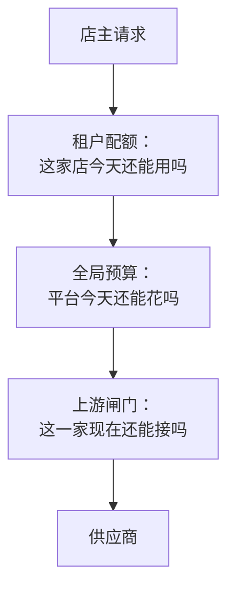
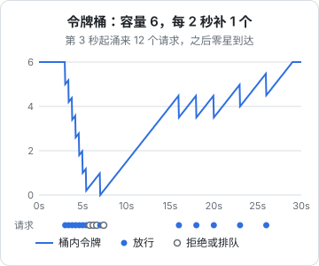

# 限流与配额

「限流」这个词在 LLM 应用里指两件方向相反的事。一件是**别人限你**：供应商按每分钟请求数、每分钟 token 数给你的账号设了上限，超了就回 429。另一件是**你限别人**：免费试用的门店每天能识别几张，付费门店怎么防滥用，全平台今天的花费到了多少就该踩刹车。前者保护你不被上游打回来，后者保护你的钱包。这一章先讲令牌桶和并发闸门这两个基本工具，用它们管住对上游的请求；再在 Postgres 里实现按租户的配额和全局预算，填上第 1 章骨架里的 `QuotaService`。

## 两个方向，三层闸门



| 闸门 | 保护什么 | 状态存在哪 | 超了怎么办 |
|---|---|---|---|
| 租户配额 | 你的毛利，防个别用户滥用 | 数据库，要跨重启、跨实例 | 拒绝，告诉用户额度用完 |
| 全局预算 | 你的现金流，防 bug 一夜烧光 | 数据库，从记账表汇总 | 非核心功能降级，核心功能告警 |
| 上游闸门 | 不被供应商 429，不打满自己的连接 | 进程内存即可 | 短暂排队，或者换下一家 |

顺序有讲究：**便宜的检查放前面，会被拒的请求尽早拒**。一个超了配额的请求，不应该先去上游闸门排队等一个名额。

## 先弄清上游的限制

主流供应商都会对账号设置几类限制，具体名称和数值因厂商和账号等级而异，以控制台和官方文档为准：

| 限制 | 含义 | 什么时候先撞上 |
|---|---|---|
| RPM，每分钟请求数 | 请求的个数 | 大量短请求 |
| TPM，每分钟 token 数 | 输入和输出 token 的总量，有的厂商分开算 | 长上下文、图片多 |
| 并发数 | 同时在途的请求数 | 单次耗时长的请求，比如视觉识别 |
| 每日或每月额度 | 用量或金额上限 | 预付费账号、免费额度 |

视觉识别有个特点：**单次耗时长**。hatch-counter 的手写单一般要 5–15 秒。按利特尔法则（[《可观测性与性能》第 9 章](../observability-performance/09-capacity-planning.md)），在途请求数等于到达率乘以平均耗时：每秒来 2 张单、每张 10 秒，同时在途的就有 20 个。所以对这类接口，并发数往往比 RPM 先成为瓶颈。

很多厂商在响应头里返回剩余额度和重置时间（例如 Anthropic 的 `anthropic-ratelimit-*` 系列头，OpenAI 兼容接口常见 `x-ratelimit-*`）。字段名各家不同，能读到时就把它们记进日志，比自己猜准确。

## 令牌桶

控制「一段时间内最多多少个」的经典算法是**令牌桶**：桶里最多放 $C$ 个令牌，每秒补充 $r$ 个；每个请求要先拿走一个令牌，桶空了就等待或拒绝。它有两个参数，分别管两件事：

- $r$ 是**长期平均速率**。设成供应商 RPM 上限除以 60，再留点余量
- $C$ 是**允许的突发量**。桶满的时候，可以一下子放过去 $C$ 个



和「固定窗口计数」（每分钟清零一次）相比，令牌桶没有窗口边界的问题：固定窗口下，第 59 秒来 60 个、第 61 秒再来 60 个，两秒内放过了 120 个，正好打在上游的滑动窗口上。

实现不需要定时器，在每次取令牌时按流逝的时间补上即可：

```typescript
// llm-gateway/limits/token-bucket.ts
export class TokenBucket {
  private tokens: number;
  private last = Date.now();

  constructor(
    private readonly capacity: number,
    private readonly perSecond: number,
  ) {
    this.tokens = capacity;
  }

  private refill(): void {
    const now = Date.now();
    this.tokens = Math.min(this.capacity, this.tokens + ((now - this.last) / 1000) * this.perSecond);
    this.last = now;
  }

  /** 拿 n 个令牌；拿不到返回还要等多少毫秒 */
  take(n = 1): { ok: true } | { ok: false; waitMs: number } {
    this.refill();
    if (this.tokens >= n) {
      this.tokens -= n;
      return { ok: true };
    }
    return { ok: false, waitMs: Math.ceil(((n - this.tokens) / this.perSecond) * 1000) };
  }
}
```

`take(n)` 的 `n` 可以不是 1。管 TPM 时，就按这次请求预估的 token 数去拿。

### 预估 token：先占后结

问题是，TPM 要的是这次请求会用掉多少 token，而输出 token 在调用结束前是不知道的。办法是**先按上限占，结束后按实际退**：

- 输入：文本部分可以用厂商的 token 计数接口，或者按字符数粗估（中文大致每个字一个 token 上下，不同分词器差别不小）；图片按厂商文档的公式或一个经验值
- 输出：按 `max_tokens` 占
- 调用结束后，用 `usage` 里的真实数字把多占的还回去

对一人公司的流量来说，TPM 闸门通常可以简化成「输入粗估 + 输出按 `max_tokens`」，偏保守但够用。真正被 TPM 限制住，多半是长上下文的对话类功能，那时再精细化。

## 并发闸门

并发闸门是一个带等待队列的信号量：最多 $N$ 个请求同时在途，多出来的排队，排太久就放弃。

```typescript
// llm-gateway/limits/semaphore.ts
export class Semaphore {
  private active = 0;
  private waiters: (() => void)[] = [];

  constructor(private readonly max: number) {}

  async acquire(timeoutMs: number): Promise<() => void> {
    if (this.active < this.max) {
      this.active++;
      return () => this.release();
    }
    return new Promise((resolve, reject) => {
      const wake = () => {
        clearTimeout(timer);
        this.active++;
        resolve(() => this.release());
      };
      const timer = setTimeout(() => {
        this.waiters = this.waiters.filter((w) => w !== wake);
        reject(new GatewayError("busy", "排队超时"));
      }, timeoutMs);
      this.waiters.push(wake);
    });
  }

  private release(): void {
    this.active--;
    this.waiters.shift()?.();
  }
}
```

每个供应商条目配一个令牌桶和一个信号量，在 Router 的 `tryOnce` 外面套上：

```typescript
// llm-gateway/router.ts（片段）
const limits = this.limits.for(entry);            // { bucket, semaphore }，按条目懒创建
const got = limits.bucket.take(1);
if (!got.ok && got.waitMs > 2_000) {
  // 等太久不如换一家：当作 busy，交给降级链
  throw new GatewayError("busy", "本地限流", { provider: entry.id });
}
if (!got.ok) await sleep(got.waitMs);
const release = await limits.semaphore.acquire(5_000);
try {
  return await adapter.call(entry, input);
} finally {
  release();
}
```

这里有个关键决定：**本地限流算作 `busy`**。这样它会自然地触发降级，第一家的本地名额满了就去第二家，而不是让请求在本地傻等。注意本地限流不应计入熔断：它说明的是你的流量大，而不是供应商不健康。

本地闸门的数值要**略低于**供应商的真实上限。多个功能共用一个账号、或者你在本地调试时也用了同一把 key，都会占掉一部分额度。

## 租户配额

接下来是「你限别人」。先在产品层面想清楚规则，用一张表写下来。下面的数值只是示例：

| 套餐 | 识别配额 | 采购建议配额 | 超了之后 |
|---|---|---|---|
| 试用 | 每天 20 张 | 每天 5 次 | 拒绝，引导升级 |
| 付费 | 每天 300 张（防滥用的软上限） | 每天 50 次 | 拒绝并告警给自己，人工看一下 |

几个规则上的取舍：

- **按什么时区算「一天」**。按业务时区，不是服务器时区，也不是 UTC。hatch-counter 所有和日子有关的口径都按一个统一的业务时区算，配额也跟着它
- **失败算不算次数**。整条链都没成，不是用户的错，应该退回。用户上传了一张非法图片（`input` 类），可以算，也可以不算；算的话能防止有人拿垃圾请求刷接口
- **付费用户要不要上限**。要。不是为了省钱，而是为了发现问题：一家店一天识别了 300 张单，要么是脚本在刷，要么是客户端有重复提交的 bug，都需要你知道

### 在 Postgres 里原子地计数

配额必须跨重启、跨实例，所以放数据库。一张计数表：

```typescript
// db/schema/llm-quota.ts
import { pgTable, uuid, text, date, integer, primaryKey } from "drizzle-orm/pg-core";

export const llmQuotaUsage = pgTable(
  "llm_quota_usage",
  {
    tenantId: uuid("tenant_id").notNull(),
    feature: text("feature").notNull(),
    day: date("day").notNull(),               // 业务时区的日期
    used: integer("used").notNull().default(0),
  },
  (t) => [primaryKey({ columns: [t.tenantId, t.feature, t.day] })],
);
```

关键是「检查还有没有额度」和「占一个」必须是**一条原子语句**，否则两个并发请求会同时看到「还剩 1 个」，然后一起通过。用 `INSERT … ON CONFLICT DO UPDATE … WHERE` 一步完成：

```sql
INSERT INTO llm_quota_usage (tenant_id, feature, day, used)
VALUES ($1, $2, $3, 1)
ON CONFLICT (tenant_id, feature, day)
DO UPDATE SET used = llm_quota_usage.used + 1
WHERE llm_quota_usage.used < $4          -- $4 是这个套餐的上限
RETURNING used;
```

返回一行，说明占到了；返回零行，说明 `WHERE` 不成立、已经用完。冲突行被行锁串行化，不会超发。在 Drizzle 里可以直接写这段 SQL：

```typescript
// llm-gateway/quota.service.ts
import { sql } from "drizzle-orm";

export interface QuotaLease { release(): Promise<void> }

async reserve(tenantId: string, feature: string): Promise<QuotaLease> {
  const limit = await this.plans.limitFor(tenantId, feature);
  if (limit === null) return { release: async () => {} }; // 这个功能不限

  const day = businessToday();
  let rows: unknown[];
  try {
    rows = (await this.db.execute(sql`
      INSERT INTO llm_quota_usage (tenant_id, feature, day, used)
      VALUES (${tenantId}, ${feature}, ${day}, 1)
      ON CONFLICT (tenant_id, feature, day)
      DO UPDATE SET used = llm_quota_usage.used + 1
      WHERE llm_quota_usage.used < ${limit}
      RETURNING used
    `)).rows;
  } catch (err) {
    // 配额库出问题时放行并告警：宁可多花一点钱，也不让拍照认单用不了
    this.logger.error("配额检查失败，本次放行", err);
    return { release: async () => {} };
  }

  if (!rows.length) {
    throw new GatewayError("quota", "今天的额度用完了");
  }
  return {
    release: async () => {
      await this.db.execute(sql`
        UPDATE llm_quota_usage SET used = used - 1
        WHERE tenant_id = ${tenantId} AND feature = ${feature} AND day = ${day} AND used > 0
      `).catch(() => undefined);
    },
  };
}
```

`release` 里固定用占额度那一刻的 `day`，避免一个跨过零点的请求把第二天的计数减掉。

「出错时放行」还是「出错时拒绝」（fail open 还是 fail closed），要按功能定。识别是核心功能，放行；如果是一个成本很高、主要被免费用户使用的功能，出错时拒绝更稳妥。

### 给用户的回应

被配额拒绝时，业务层把 `GatewayError("quota")` 翻译成用户能理解的话，并且说清楚**什么时候恢复、还有什么别的路**：

```text
今天的识别次数用完了（试用版每天 20 张），明天零点恢复。急的话可以用「表格导入」或者手工录。
```

HTTP 层面返回 429 并带上 `Retry-After` 头，客户端据此决定是否显示倒计时，而不是让用户反复点。

## 全局预算

租户配额管不住两类事故：代码 bug（重试写错、工具调用循环停不下来）和大量新用户同时涌入。它们的共同点是**平台总花费在短时间内异常升高**。全局预算就是第二道闸门：

| 今日花费 / 日预算 | 动作 |
|---|---|
| 小于 80% | 正常 |
| 80% 到 100% | 告警给自己 |
| 超过 100% | 非核心功能（采购建议）降级关闭；核心功能（识别）继续，加急告警 |
| 超过 150% | 核心功能也只对付费门店开放 |

今日花费从第 4 章的记账表汇总而来。每个请求都去 `SUM` 一次太贵，用一个后台定时任务每分钟算一次，结果放在内存里，`reserve()` 时只读这个数：

```typescript
// llm-gateway/budget.ts
@Injectable()
export class Budget {
  private spentToday = 0;

  @Interval(60_000) // @nestjs/schedule
  async refresh() {
    this.spentToday = await this.ledger.costSince(startOfBusinessDay());
  }

  check(feature: string, tier: "core" | "extra"): void {
    const ratio = this.spentToday / this.dailyBudget;
    if (tier === "extra" && ratio >= 1) {
      throw new GatewayError("budget", "这个功能今天暂停使用");
    }
  }
}
```

一分钟的延迟意味着预算可能被超过一点点，这完全可以接受：它防的是「一夜之间烧掉一个月」，不是精确到分。真正的最后一道防线是**在供应商控制台上设置花费上限**，那是不依赖你的代码正确性的保护。

## 排队还是拒绝

当上游名额不够时，请求可以等，也可以立刻失败。按功能的性质选：

| 功能 | 用户在等吗 | 策略 |
|---|---|---|
| 拍照识别 | 在等，但能接受十几秒 | 短暂排队（几秒），排不上就换家 |
| 聊天、补全 | 在等，对延迟敏感 | 不排队，直接换家或报忙 |
| 夜间批量打标签、生成报表 | 不等 | 进任务队列，按上游速率慢慢消费 |

第三类不要走同步的网关排队，而是用任务队列（基于 Postgres 的 pg-boss、基于 Redis 的 BullMQ 一类）。消费者自己按限流速率拉任务，失败了按队列的重试策略来。注意避免层层重试：队列重试了，网关里就把重试次数调低（[《大模型应用工程》第 9 章](../llm-app-engineering/09-errors-retries.md)）。

## 多实例怎么办

本章的令牌桶和信号量都在进程内存里。只跑一个 API 进程时没问题；跑两个实例时，每个实例都以为自己独占上游的全部额度，合起来就会超。几种处理：

- **按实例数均分**。两个实例，每个配一半的速率。简单，代价是某个实例空闲时它那份额度浪费了
- **集中式计数**。令牌桶搬到 Redis，用一段 Lua 脚本原子地补充和扣减；或者用 Postgres 的一行加 `SELECT … FOR UPDATE`。多一跳网络，换来精确
- **不管它**。本地闸门本来就留了余量，偶尔超一点就靠上游的 429 和降级兜底

对一台 VPS 上的单体服务，第一种或第三种就够了。租户配额本来就在数据库里，不受实例数影响。

## 本章要点

- 「别人限你」和「你限别人」是两件事：上游闸门防 429，租户配额和全局预算防烧钱
- 便宜的检查放前面：租户配额 → 全局预算 → 上游闸门
- 令牌桶用两个参数分别控制长期速率和突发量；TPM 按预估 token 先占后结
- 长耗时的视觉接口往往先撞并发上限，用带超时的信号量控制在途数
- 本地限流算作 `busy` 触发降级，但不计入熔断；本地上限略低于供应商的真实上限
- 租户配额放 Postgres，用 `INSERT … ON CONFLICT DO UPDATE … WHERE … RETURNING` 原子地检查并占用；整条链失败要退回额度
- 全局预算按分钟汇总花费，超了先关非核心功能；供应商控制台的花费上限是最后一道防线
- 不需要实时结果的任务进队列，不要在网关里排长队
