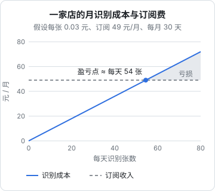

# 成本监控

《大模型应用工程》第 7 章已经给出了成本估算的公式和一张 `llm_calls` 记账表，能回答「这个功能这周花了多少 token」。上线之后，问题变得更具体，也更像生意：这家店这个月的识别成本是多少，占它订阅费的几成？降级到备用供应商，每张单贵了多少？上个月模型账单比我自己算的多了 15%，差在哪？这一章把记账从「记 token」升级为「记钱」：一张带生效日期的价格表、一条覆盖每次尝试的流水、按租户的单位经济，以及和供应商账单的月度对账。

## 从 token 到钱，缺了什么

上一本书的记账表记的是 token，查询时再乘以单价。到了多供应商、多租户的生产环境，这个做法会遇到四个问题：

| 问题 | 例子 |
|---|---|
| 计价方式不止一种 | 视觉大模型按 token，腾讯云 OCR 按次 |
| 价格会变 | 供应商调价、你换了套餐、促销结束 |
| 币种不同 | 有的按美元计价，有的按人民币 |
| 失败也可能花钱 | 超时的请求可能已经在服务端处理并计费；一次识别背后可能有三次尝试 |

解决办法是两张表：**价格表**记录「某个供应商条目、某段时间、怎么计价」；**调用流水**记录「每一次尝试用了多少量、按当时的价格折合多少钱」。

## 价格表

```typescript
// db/schema/llm-prices.ts
import { pgTable, uuid, text, integer, timestamp, index } from "drizzle-orm/pg-core";

export const llmPrices = pgTable(
  "llm_prices",
  {
    id: uuid("id").primaryKey().defaultRandom(),
    providerEntryId: uuid("provider_entry_id").notNull(),
    // 两种计价方式二选一：按 token 的填前三个，按次的只填 per_call
    // 单位都是「千分之一分」（人民币）每百万 token 或每次，整数，避免浮点误差
    inputPerMTok: integer("input_per_mtok"),
    outputPerMTok: integer("output_per_mtok"),
    cacheReadPerMTok: integer("cache_read_per_mtok"),
    perCall: integer("per_call"),
    effectiveFrom: timestamp("effective_from", { withTimezone: true }).notNull(),
    note: text("note"),                    // 「官网 10 月调价」「换成资源包后的折算价」
  },
  (t) => [index("llm_prices_entry_from_idx").on(t.providerEntryId, t.effectiveFrom)],
);
```

几条约定：

- **只追加，不修改**。调价时插一行新的，`effective_from` 设为生效时刻。查某次调用的价格，就是找同一条目下 `effective_from` 不晚于调用时间的最后一行
- **统一成一个币种、一个最小单位**。hatch-counter 用「千分之一分」的整数存识别单价（0.012 元记作 1200），这里沿用。美元计价的供应商按你实际结算的汇率折算后再录入，并在 `note` 里写明汇率
- **录入实际成本，不是标价**。买了资源包、有折扣，就按折算后的单价录。你关心的是自己的现金流出，不是官网标价
- **价格从官方定价页抄**，录入时附上日期。供应商的价格以官方页面为准，本书不给任何具体单价

## 流水：每一次尝试一行

第 2 章的 Router 返回了 `attempts`，一次网关调用可能包含好几次尝试。流水按**尝试**记，而不是按网关调用记：

```typescript
// db/schema/llm-attempts.ts
import { pgTable, uuid, text, integer, boolean, timestamp, index } from "drizzle-orm/pg-core";

export const llmAttempts = pgTable(
  "llm_attempts",
  {
    id: uuid("id").primaryKey().defaultRandom(),
    callId: uuid("call_id").notNull(),            // 同一次网关调用的几次尝试共享
    tenantId: uuid("tenant_id").notNull(),
    feature: text("feature").notNull(),
    providerEntryId: uuid("provider_entry_id").notNull(),
    model: text("model").notNull(),
    promptVersion: text("prompt_version").notNull(),
    ok: boolean("ok").notNull(),
    failureKind: text("failure_kind"),
    inputTokens: integer("input_tokens").notNull().default(0),
    outputTokens: integer("output_tokens").notNull().default(0),
    cacheReadTokens: integer("cache_read_tokens").notNull().default(0),
    calls: integer("calls").notNull().default(1),
    billable: boolean("billable").notNull(),       // 这次尝试是否计费，见下文
    costMillicents: integer("cost_millicents"),    // 按当时价格算出的快照，价格缺失时为空
    latencyMs: integer("latency_ms").notNull(),
    createdAt: timestamp("created_at", { withTimezone: true }).notNull().defaultNow(),
  },
  (t) => [
    index("llm_attempts_tenant_created_idx").on(t.tenantId, t.createdAt),
    index("llm_attempts_call_idx").on(t.callId),
  ],
);
```

### 写入时算好钱

上一本书建议「不在表里存价格，查询时再乘」。在有了带生效日期的价格表之后，两种做法在结果上等价，但**写入时算好一个快照**有几个实际好处：报表查询不用每次 join 价格表并找生效区间；价格表录错了某一段，修正后可以用一条 `UPDATE` 重算那一段，比在每个报表查询里打补丁清楚。hatch-counter 也是这样做的，识别成本按实际成功那一家的单价，写进事件表的 `cost_millicents` 字段。

```typescript
// llm-gateway/ledger.ts
export function costOf(
  price: Price | undefined,
  u: { inputTokens: number; outputTokens: number; cacheReadTokens: number; calls: number },
): number | null {
  if (!price) return null; // 没录价格：记空，不要记 0，否则报表会以为它免费
  if (price.perCall != null) return price.perCall * u.calls;
  const perM = (n: number, p: number | null) => Math.round((n * (p ?? 0)) / 1_000_000);
  return (
    perM(u.inputTokens, price.inputPerMTok) +
    perM(u.outputTokens, price.outputPerMTok) +
    perM(u.cacheReadTokens, price.cacheReadPerMTok ?? price.inputPerMTok)
  );
}
```

**价格缺失记空，不记 0**。这一点 hatch-counter 的价格字段注释里也写明了：没填单价，那一条的识别成本就记空。记成 0 的话，月底报表会显示「这家供应商免费」，你会真的以为它免费。

### 失败的尝试算不算钱

这取决于各家的计费规则，以官方说明为准。常见的情况可以这样默认，再按账单对账结果修正：

| 失败类型 | `billable` 默认 | 理由 |
|---|---|---|
| 4xx 被拒（鉴权、参数、限流） | 否 | 请求没有被处理 |
| 5xx | 否 | 通常不计费，但要对账确认 |
| 超时、连接中断 | **是**（按 `max_tokens` 估上限） | 服务端可能已经处理完并计费，只是你没收到 |
| HTTP 成功但解析失败（`unreadable`） | **是** | 模型实实在在地生成了内容 |

第四行最值得注意：**软错误是要付钱的**。如果某个供应商的 `unreadable` 率很高，它的有效单价会比标价高得多。

## 按「完成一件事」算成本

有了按尝试记的流水，就能算出《大模型应用工程》强调的那个指标：**完成一件事的成本**，即一次网关调用下所有尝试的花费之和。

```sql
-- 最近 30 天，每个功能「成功完成一次」的平均成本（含失败尝试和降级）
WITH per_call AS (
  SELECT call_id, feature,
         sum(cost_millicents) FILTER (WHERE billable) AS cost,
         bool_or(ok) AS done,
         count(*) AS attempts
  FROM llm_attempts
  WHERE created_at > now() - interval '30 days'
  GROUP BY call_id, feature
)
SELECT feature,
       count(*) FILTER (WHERE done)                          AS done_calls,
       round(avg(attempts), 2)                               AS avg_attempts,
       round(sum(cost)::numeric / nullif(count(*) FILTER (WHERE done), 0)) AS cost_per_done
FROM per_call
GROUP BY feature;
```

`cost_per_done` 的分母只算成功的调用，分子包括失败调用的花费：失败的钱最终也要摊到成功的那些上。这个数和「标价 × 平均 token」的差距，就是重试、降级、软错误带来的隐性成本。

再按供应商拆开，看降级的代价：

```sql
-- 每家供应商的有效单价：总花费 / 成功次数
SELECT provider_entry_id,
       count(*) FILTER (WHERE ok)                                   AS ok_count,
       round(100.0 * count(*) FILTER (WHERE failure_kind = 'unreadable') / count(*), 1) AS unreadable_pct,
       round(sum(cost_millicents) FILTER (WHERE billable)::numeric
             / nullif(count(*) FILTER (WHERE ok), 0))               AS effective_unit_cost
FROM llm_attempts
WHERE feature = 'receipt_scan' AND created_at > now() - interval '30 days'
GROUP BY provider_entry_id;
```

## 单位经济：每家店赚不赚钱

一人公司最该看的成本报表不是「这个月总共花了多少」，而是「**每个客户的模型成本占他付的钱的几成**」。订阅制产品里，模型成本是随用量线性增长的可变成本，而订阅费是固定的。用得越多的客户，越可能让你亏钱。



图里的数字都是假设，用来说明方法。盈亏点的计算很简单：

$$
\text{盈亏点（张 / 天）} = \frac{\text{月订阅费}}{30 \times \text{单张成本}}
$$

真实情况还要扣掉服务器、短信、存储和你自己的时间，模型成本能占的份额只会更小。用流水表按门店汇总：

```sql
-- 上个月每家店的模型成本，和订阅收入放在一起
SELECT a.tenant_id,
       s.name,
       sum(a.cost_millicents) FILTER (WHERE a.billable) / 100000.0 AS model_cost_yuan,
       p.monthly_fee_cents / 100.0                                  AS fee_yuan,
       round(100.0 * sum(a.cost_millicents) FILTER (WHERE a.billable)
             / nullif(p.monthly_fee_cents * 1000, 0), 1)            AS cost_pct
FROM llm_attempts a
JOIN stores s ON s.id = a.tenant_id
JOIN plans p  ON p.id = s.plan_id
WHERE a.created_at >= date_trunc('month', now()) - interval '1 month'
  AND a.created_at <  date_trunc('month', now())
GROUP BY a.tenant_id, s.name, p.monthly_fee_cents
ORDER BY cost_pct DESC NULLS LAST
LIMIT 20;
```

（`cost_millicents` 是千分之一分，除以 100000 得到元；`monthly_fee_cents` 是分，乘以 1000 换成千分之一分再比。单位换算是这类查询最容易出错的地方，写完用一行手算的数据验证一下。）

看这张表能做出的决策：

- **成本占比高的店集中在哪个套餐**：试用版的配额是不是给多了（第 3 章）
- **是不是少数几家店贡献了大部分成本**：如果是，考虑按用量分档定价，而不是统一订阅费
- **单张成本能不能降**：输出精简、缓存、换更便宜的主力供应商（《大模型应用工程》第 7、8 章）

## 实时指标与异常告警

数据库里的流水适合做日报和月报，但「过去 10 分钟花费暴涨」这种事故需要更实时的信号。在网关里同时把花费累加到一个 Prometheus counter：

```typescript
// llm-gateway/metrics.ts
import { Counter } from "prom-client";

export const llmCost = new Counter({
  name: "llm_cost_millicents_total",
  help: "模型调用花费，千分之一分",
  labelNames: ["feature", "provider"] as const,
});

export const llmAttemptsTotal = new Counter({
  name: "llm_attempts_total",
  help: "模型调用尝试次数",
  labelNames: ["feature", "provider", "outcome"] as const, // outcome: ok 或失败分类
});
```

标签只放**基数低**的维度：功能、供应商条目、结果分类。**不要把门店 ID 放进标签**，几百家店就是几百条时间序列，按门店的分析留给数据库（标签基数的问题见《可观测性与性能》第 2 章）。

告警规则示例，接入你已有的 Alertmanager：

```yaml
groups:
  - name: llm-cost
    rules:
      # 最近 1 小时的花费速率是过去 7 天同一时段的 3 倍以上
      - alert: LlmCostSpike
        expr: |
          sum(rate(llm_cost_millicents_total[1h]))
            > 3 * sum(rate(llm_cost_millicents_total[1h] offset 7d))
          and sum(rate(llm_cost_millicents_total[1h])) > 0
        for: 15m
        labels: { severity: warning }
        annotations:
          summary: "模型花费速率是上周同期的 3 倍以上"

      # 平均每次成功调用的尝试次数升高：重试或降级在变多
      - alert: LlmAttemptsPerSuccessHigh
        expr: |
          sum(rate(llm_attempts_total[30m]))
            / sum(rate(llm_attempts_total{outcome="ok"}[30m])) > 1.5
        for: 15m
        labels: { severity: warning }
        annotations:
          summary: "平均每次成功需要 1.5 次以上尝试"
```

和上周同期比，而不是和固定阈值比，是因为餐饮门店的流量有很强的日周期：午市前后的进货单多，凌晨几乎没有。固定阈值要么白天误报，要么夜里漏报。上周同期为 0 时比例没有意义，所以第一条规则在新功能刚上线的第一周会安静，这是可以接受的。

## 月度对账

每个月拿到供应商账单后，和自己的流水对一次账：

```sql
-- 上个月按供应商条目汇总，和账单逐行对比
SELECT provider_entry_id,
       sum(input_tokens)  AS input_tokens,
       sum(output_tokens) AS output_tokens,
       sum(calls) FILTER (WHERE billable) AS billable_calls,
       sum(cost_millicents) FILTER (WHERE billable) / 100000.0 AS my_cost_yuan
FROM llm_attempts
WHERE created_at >= date_trunc('month', now()) - interval '1 month'
  AND created_at <  date_trunc('month', now())
GROUP BY provider_entry_id;
```

差异常见的来源和处理：

| 差异 | 可能原因 | 处理 |
|---|---|---|
| 账单 token 数比流水多 | 本地调试、测试环境用了同一把 key | 生产和开发用不同的 key，账单就能分开 |
| 账单比流水多，token 数一致 | 价格表录错、汇率不对、未计税费 | 修正价格表，重算这一段 |
| 账单调用次数比流水多 | 超时请求被计费，而流水里标了不计费 | 调整 `billable` 规则 |
| 流水比账单多 | 免费额度、资源包抵扣 | 在价格表里录实际折算价 |

**差距在几个百分点以内就够了**。对账的目的不是精确到分，而是确认你的流水可信：如果流水和账单差了两成，那基于流水做的所有决策（单位经济、配额、降级成本）都不可靠。

## 本章要点

- 生产环境的记账要处理多种计价方式、调价、币种和失败计费；用「价格表 + 尝试流水」两张表
- 价格表只追加不修改，带生效时间，统一币种和最小单位，录实际成本而非标价
- 流水按每次尝试记，写入时按当时价格算好成本快照；价格缺失记空而不是 0
- 超时和解析失败的尝试往往也计费，软错误会推高供应商的有效单价
- 用「完成一件事的成本」和「每家供应商的有效单价」衡量重试和降级的隐性代价
- 单位经济比总花费更重要：按租户算模型成本占订阅费的比例，找出亏钱的套餐和用户
- 实时花费和尝试次数进 Prometheus，标签不放租户 ID，告警和上周同期比
- 每月和供应商账单对账，生产与开发用不同的 key，差距控制在几个百分点
