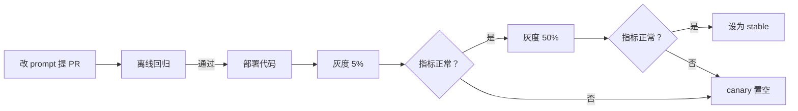

# Prompt 版本管理

hatch-counter 的识别 prompt 里有这样一条规则：「有的单子把算式写在名称格里，例如『大白菜 6.7×1.8=12』，拆成 name、quantity、unitPrice、amount」。这条规则一定是某次看到识别结果不对之后加上去的。问题是，加上它之后，其他供应商的单子识别得更好了还是更差了？如果更差了，你能不能只回滚这一条、只对一部分门店回滚？一个月后店主说「上周开始老认错」，你能不能查出上周识别他那张单的是哪一版 prompt？这一章把 prompt 当作和代码一样需要发布流程的东西：有版本号、能灰度、能回滚、每次调用都能追溯。

## prompt 和代码有什么不同

[《大模型应用工程》第 2 章](../llm-app-engineering/02-prompt-engineering.md)说过「prompt 是代码」，应该进版本控制、经过评审。这仍然成立，但 prompt 有几个代码没有的特点，决定了它需要额外的机制：

| 特点 | 后果 |
|---|---|
| 改动的效果不确定 | 改一个词可能让一类输入变好、另一类变差，单元测试测不出来 |
| 改动频率高 | 一周可能改好几次，每次都走完整发版太慢 |
| 效果依赖模型 | 同一个 prompt 换个模型效果不同，模型升级也会让旧 prompt 的表现变化 |
| 输出格式和代码耦合 | prompt 里改了 JSON 字段名，解析代码也得跟着改 |

所以需要三样东西：**稳定的版本标识**，让每次调用都能记下用了哪一版；**灰度机制**，新版本先给一小部分租户；**快速回滚**，发现问题时不用重新部署。

## 放在哪：代码库还是数据库

| 方案 | 优点 | 缺点 |
|---|---|---|
| 写在代码里，随发版上线 | 有评审、有历史、和解析代码一起改 | 每次改都要发版；回滚也要发版 |
| 存在数据库，后台编辑 | 改完立刻生效，不用发版 | 绕过了代码评审；和解析代码的版本可能对不上 |
| 托管的 prompt 平台 | 自带版本、灰度、评测 | 多一个外部依赖；数据经过第三方 |

本书采用一个折中方案：**prompt 的内容写在代码库里，「当前用哪一版、灰度多少」写在数据库里**。

- 内容在代码库：每一版都经过 PR 评审，和对应的解析代码在同一个提交里，不会出现「prompt 改了字段名、解析代码还是旧的」
- 代码里同时保留最近的几个版本：回滚就是把数据库里的「当前版本」指回旧版本，不需要发版
- 灰度比例在数据库：从 5% 调到 50% 是一次配置修改

## 版本标识：用内容的哈希

给 prompt 编号，最可靠的方式是**对内容取哈希**，而不是手写 `v1`、`v2`。手写的版本号会忘了改，也会出现两个人都改成 `v3`；哈希则由内容决定，内容变了版本号就一定变。

哈希的输入不只是模板文本，还要包括**所有影响输出的参数**：温度、`max_tokens`、是否开启思考。这些参数改了，输出同样会变。

```typescript
// llm-gateway/prompts/define.ts
import { createHash } from "node:crypto";

export interface PromptDef {
  id: string;                         // receipt-scan
  system: string;
  user: string;                       // 含 {{变量}} 占位符
  params: { temperature?: number; maxTokens: number; thinking?: boolean };
  /** 某些供应商需要不同的写法，比如不支持 system 角色的模型 */
  variants?: Partial<Record<string, { system?: string; user?: string }>>;
}

export interface PromptVersion extends PromptDef {
  version: string;                    // receipt-scan@3f9a2c1
}

export function definePrompt(def: PromptDef): PromptVersion {
  const hash = createHash("sha256")
    .update(JSON.stringify({ s: def.system, u: def.user, p: def.params, v: def.variants ?? {} }))
    .digest("hex")
    .slice(0, 7);
  return { ...def, version: `${def.id}@${hash}` };
}
```

每个版本是一个独立的导出，旧版本不删除，直到确认不再需要：

```typescript
// ocr/prompts/receipt-scan.ts
import { definePrompt } from "../../llm-gateway/prompts/define";

const RULES_BASE = `硬性要求：
- 只输出 JSON，前后不要有任何说明文字，不要用 markdown 代码块
- 每个字段都要有值：读不出来就写 null`;

/** 2026-10：初版 */
export const receiptScanA = definePrompt({
  id: "receipt-scan",
  system: "你在帮一家餐馆录入手写的进货单。",
  user: `图片是一张纸质单据，{{layout}}\n\n逐行读出内容，只输出一个 JSON 对象。\n\n${RULES_BASE}`,
  params: { temperature: 0.1, maxTokens: 4096, thinking: false },
});

/** 2026-11：加上「算式写在名称格里要拆开」 */
export const receiptScanB = definePrompt({
  ...receiptScanA,
  user: `${receiptScanA.user}
- 有的单子把算式写在名称格里，例如「大白菜 6.7×1.8=12」，拆成 name="大白菜"、quantity=6.7、unitPrice=1.8、amount=12`,
});

export const receiptScanVersions = [receiptScanA, receiptScanB];
```

这里的 prompt 是简化过的示意，hatch-counter 真实的识别 prompt 要长得多。

### 模板：只做变量替换

模板引擎越简单越好。只支持 `{{name}}` 替换，不支持条件和循环。逻辑放在 TypeScript 里，准备好变量再传进来：

```typescript
// llm-gateway/prompts/render.ts
export function render(template: string, vars: Record<string, string>): string {
  return template.replace(/\{\{(\w+)\}\}/g, (_, name: string) => {
    const v = vars[name];
    if (v === undefined) throw new Error(`prompt 缺少变量 ${name}`);
    return v;
  });
}
```

缺变量时直接抛错，而不是留一个空字符串。空字符串会让 prompt 静悄悄地少一句话，模型照样会回答，只是答得差一些，这种问题很难发现。

## 注册表与灰度

数据库里一张很小的表，描述每个 prompt 的发布状态：

```typescript
// db/schema/prompt-rollouts.ts
export const promptRollouts = pgTable("prompt_rollouts", {
  promptId: text("prompt_id").primaryKey(),
  stable: text("stable").notNull(),           // receipt-scan@3f9a2c1
  canary: text("canary"),                     // receipt-scan@8be01d4，没有灰度时为空
  canaryPercent: integer("canary_percent").notNull().default(0),
  updatedAt: timestamp("updated_at", { withTimezone: true }).notNull().defaultNow(),
});
```

`PromptRegistry.resolve()` 按租户决定用哪一版。分桶要**确定性**：同一家店在灰度期间每次都拿到同一版，否则它今天用新版、明天用旧版，店主会觉得识别质量忽好忽坏，你也没法比较两版的效果。

```typescript
// llm-gateway/prompt-registry.ts
import { createHash } from "node:crypto";

function bucket(tenantId: string, promptId: string): number {
  // 带上 promptId：不同 prompt 的灰度各自分桶，不总是同一批店当小白鼠
  const h = createHash("sha256").update(`${promptId}:${tenantId}`).digest();
  return h.readUInt32BE(0) % 100;
}

@Injectable()
export class PromptRegistry {
  private readonly byVersion = new Map<string, PromptVersion>();

  constructor(private readonly rollouts: RolloutStore) {
    for (const p of [...receiptScanVersions, ...purchaseAdviceVersions]) {
      this.byVersion.set(p.version, p);
    }
  }

  async resolve(promptId: string, tenantId: string): Promise<PromptVersion> {
    const r = await this.rollouts.get(promptId);      // 内存缓存 10 秒
    const useCanary = r.canary && bucket(tenantId, promptId) < r.canaryPercent;
    const version = useCanary ? r.canary! : r.stable;
    const found = this.byVersion.get(version);
    if (!found) {
      // 配置指向了一个代码里没有的版本：退回 stable，并告警
      this.logger.error(`prompt 版本 ${version} 不在代码里`);
      return this.byVersion.get(r.stable)!;
    }
    return found;
  }
}
```

启动时再加一道检查：数据库里每个 `stable` 和 `canary` 指向的版本都必须在代码里存在，否则拒绝启动或至少大声报警。这能防止「删了旧版本的代码，但数据库还指着它」。

### 发布流程



| 阶段 | 做什么 | 看什么 |
|---|---|---|
| 离线回归 | 用历史样本跑新旧两版 | 准确率、格式错误率、输出 token 数 |
| 灰度 5% | 少量门店用新版 | 有没有明显的报错和投诉 |
| 灰度 50% | 足够的样本做对比 | 两组的质量指标和成本指标 |
| 全量 | `stable` 指向新版 | 持续观察一周 |
| 回滚 | `canary` 置空，或 `stable` 指回旧版 | 不需要发版，10 秒内生效 |

灰度阶段的样本量要够。一家店一天识别几张单，5% 的门店一天可能只有几十个样本，不足以看出几个百分点的差异。一人公司的流量下，灰度更多是**防止大面积事故**，而精细的质量比较主要靠离线回归。

## 离线回归

改 prompt 之前，最好已经有一份「输入 + 正确答案」的样本集。对 hatch-counter 来说，最好的样本来源是**店主修正过的识别结果**：店主确认入库时改过的数字，就是模型认错的地方，改完的值就是正确答案。

```typescript
// scripts/prompt-regression.ts
// 用法：pnpm tsx scripts/prompt-regression.ts receipt-scan@3f9a2c1 receipt-scan@8be01d4
const [baseline, candidate] = process.argv.slice(2);
const samples = await loadSamples("receipt-scan", { limit: 200 }); // 图片 + 店主确认后的行项目

for (const version of [baseline, candidate]) {
  let exactLines = 0, totalLines = 0, parseFail = 0, outTokens = 0;
  for (const s of samples) {
    try {
      const r = await gatewayForEval.callWithVersion(version, s.input);
      outTokens += r.usage.outputTokens;
      const m = compareLines(r.value.lines, s.expected.lines); // 按行比对数量、单价、金额
      exactLines += m.exact;
      totalLines += m.total;
    } catch {
      parseFail++;
    }
  }
  console.log(version, {
    lineAccuracy: (exactLines / totalLines).toFixed(3),
    parseFail,
    avgOutTokens: Math.round(outTokens / samples.length),
  });
}
```

这只是一个最小的骨架。样本怎么挑才有代表性、怎么给结构化输出打分、什么时候用模型来当评委、回归测试怎么接进 CI，是[《评测与质量》](../llm-evals/)的主题。这里只强调一点：**没有离线回归的 prompt 修改，相当于直接在用户身上做实验**。

## 每次调用都记下版本

第 4 章的流水表里有 `prompt_version` 字段，第 1 章网关的返回值里也带着它。业务层把它和结果一起存下来：hatch-counter 的识别存档里已经记了实际干活的供应商，再加上 prompt 版本，一张单子就能追溯到「哪个模型、哪一版 prompt」认的。

有了这个字段，灰度期间就能按版本比较线上指标：

```sql
-- 识别功能，按 prompt 版本对比最近 7 天的表现
SELECT prompt_version,
       count(DISTINCT call_id)                                          AS calls,
       round(100.0 * count(*) FILTER (WHERE failure_kind = 'unreadable')
             / count(*), 1)                                             AS unreadable_pct,
       round(avg(output_tokens) FILTER (WHERE ok))                      AS avg_out_tokens,
       round(avg(latency_ms) FILTER (WHERE ok))                         AS avg_ms
FROM llm_attempts
WHERE feature = 'receipt_scan' AND created_at > now() - interval '7 days'
GROUP BY prompt_version
ORDER BY calls DESC;
```

再结合第 6 章的「店主修正率」，就能回答「新版是不是更好」。

## 模型版本也是版本

prompt 的效果依赖模型，所以模型 ID 同样需要管理：

- **优先使用带日期或版本号的固定模型 ID**，而不是会自动指向最新版本的别名。别名背后的模型更新时，你的 prompt 没变，输出却可能变了。各家的命名规则不同，以官方文档为准
- **记录响应里的实际模型**。有的接口会在响应里返回实际处理请求的模型版本，记进流水的 `model` 字段，而不是记你请求时填的那个
- **换模型当作一次 prompt 发布**。走同样的离线回归和灰度流程。必要时为新模型单独写一版 prompt（第 2 章的 `variants`）

## 本章要点

- prompt 改动效果不确定、频率高、依赖模型、和解析代码耦合，需要版本号、灰度和回滚
- 内容写在代码库里经过评审，「当前用哪版、灰度多少」写在数据库里，回滚不需要发版
- 版本号取内容哈希，哈希要包括温度、`max_tokens` 等所有影响输出的参数
- 模板只做变量替换，缺变量直接报错；逻辑放在代码里
- 按租户确定性分桶，同一家店在灰度期间总拿到同一版；启动时校验数据库指向的版本都在代码里
- 一人公司的流量下，灰度主要防大面积事故，质量比较主要靠离线回归；店主修正过的结果是最好的样本
- 每次调用记下 prompt 版本和实际模型；换模型也按 prompt 发布的流程走
